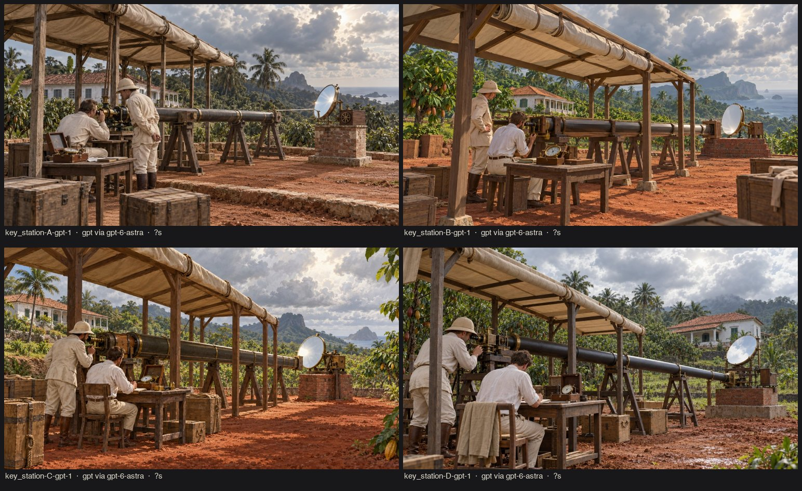
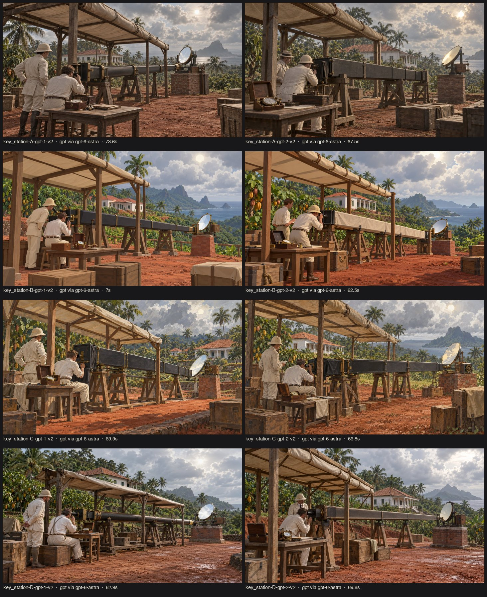

# r01 · four directions on one key shot (2026-10-19)

Subject `key_station` v1, generator GPT (Codex `gpt-6-astra` image tool). The first pass used series s1 with styles v1; the second pass (`*-v2`) used series s2 with styles v2, 2 variants each. Gemini was attempted and failed with a quota error (HTTP 429; free-tier limit is 0).

## Findings
1. **v1 (subject first, style second): all four styles came out the same photoreal render** (`contact.jpg`). Style text placed after a long literal subject is ignored.
   → `gen.py` now composes **medium first** and ends with a one-line reminder of the medium; series bumped to s2, styles to v2 (each now opens with an explicit medium sentence).
2. **v2:** styles separate, but only partly. B (stylized low-poly) changed the most. A (silver plate) and C (gouache) stayed colourful and semi-real. The image model is biased towards a "cinematic illustration" look whatever the wording.
3. Composition and history were consistent and plausible in every image: open timber shelter, canvas roof, tube on trestles, coelostat on a brick pier, plantation house. **This layout is a good reconstruction reference** for the world builder.
4. **Parallelism:** 8 concurrent Codex jobs all failed; 4 worked once; 2–3 are reliable. Each image takes 60–75 s.

## Scorecard and pick
See BIBLE §2. The pick is **B's forms with A's era idea as an in-engine grade** (style `E_diorama_plate_grade`), tested in r02. C and D were rejected (texture production; realism exposes AI-3D artifacts and costs more).
