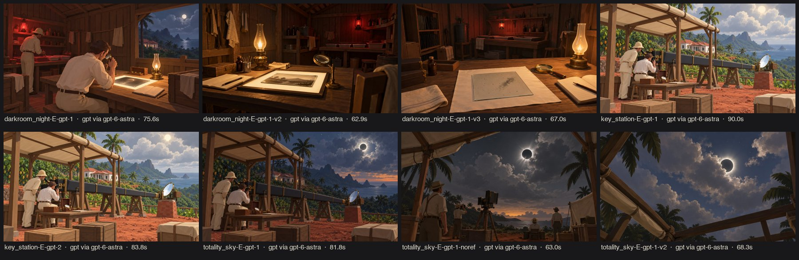

# r02 · hybrid direction E on the gameplay keyframes (2026-10-19)

Style `E_diorama_plate_grade` v1. Subjects: `key_station` v1, `totality_sky` v1, and `darkroom_night` v1 then v2. The first images used `--ref art/runs/r01-directions/key_station-B-gpt-1-v2.jpg`.

## Findings → changes
| # | Finding | Change |
|---|---|---|
| 1 | `-i <FILE>...` in `codex exec` is variadic: it swallowed the prompt, and Codex then waited on stdin until the 600 s timeout (first r02 attempt: 3 timeouts). | `gen.py` puts the prompt before `-i` and passes stdin=DEVNULL. |
| 2 | We could not tell whether Codex rewrote our prompt. | Codex now returns the exact tool prompt (`-o`), stored as `tool_prompt` in the manifest. **Verified verbatim** in all r02/r03 images. |
| 3 | **The reference image copied its composition.** `totality_sky` with `--ref` redrew the station layout instead of looking up. | Rule: use refs only for the same shot (PIPELINE rule 2). The re-run `totality_sky-…-noref` gives its own composition. |
| 4 | **Grade wording ignored.** "Sepia, glass-plate grade" produced saturated colour. | The grade moved in-engine: `scripts/look.gd` (BIBLE §5). |
| 5 | **The darkroom had a window** onto the night sky (historically impossible). | `darkroom_night` v2: "windowless … no view outside". **Fixed** in `darkroom_night-E-gpt-1-v2`. |
| 6 | Darkroom v2: the plate shows a landscape photograph, not a star-field negative. | `darkroom_night` v3: "clear grey glass sprinkled with tiny dark star dots … no picture". **Fixed** in `darkroom_night-E-gpt-1-v3`. |
| 7 | Totality: the warm 360° horizon glow is physically right and the game's sky shader already has it, but no benchmark looked at the horizon. | `totality_horizon` bookmark added to `tests/benchmark.gd`. |
| 8 | Totality (noref) is still not a look-up shot, and it added a tripod camera that does not belong. | `totality_sky` v2: "camera pointing steeply upward … no people, no cameras, no tripods". **Fixed** in `totality_sky-E-gpt-1-v2`. |

The keyframes serve as **mood and value targets** for the matching in-game bookmarks: `key_station` ↔ `arrival`/`shelter`, `totality_sky` ↔ `totality_*`, `darkroom_night` ↔ `darkroom`.

## Concept ↔ in-game parity (G4, after r03)
- **Totality:** the concept v2 sky is deep blue with a bright corona and lit cloud rims. The in-game `totality_sky` bookmark is lighter, lavender-grey, with soft clouds.
- This is a real gap, **but the sky is the gameplay evidence** (BIBLE S1/S5). Any darkening must keep the cloud-gap read, so it waits for the human playtest instead of being changed blind.
- Logged as the next sky iteration.
