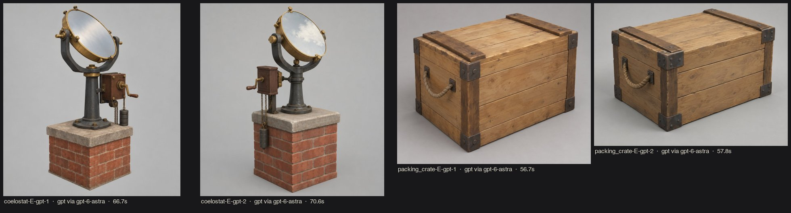

# r03 · asset concept sheets → first production assets (2026-10-19)

Style E v1. Subjects: `coelostat` v2 (part list bottom-to-top with dimensions) and `packing_crate` v1. 2 variants each, neutral grey background, 57–71 s per image.

## Pick (G1)
- **coelostat-E-gpt-1:** the clearest part breakdown (pier + stone cap, flared column, U-fork, brass cell, drive box with crank, weight chain).
  - Mirror drawn oversized (~55 cm). **The spec wins:** 40 cm (`assets.toml`).
  - History check: single-mirror coelostat on a brick pier is a RECONSTRUCTION, matching the existing game and `docs/PROVENANCE.md`. The 16 in (≈40 cm) figure comes from secondary sources only.
- **packing_crate-E-gpt-2:** simple planks, battens and iron corners. Rope handles were replaced with teak cleats to stay within 3 materials.

## Build (S3b) and gates
- **S3b build:** delegated to Codex `gpt-6.1-sol` (brief in this session; files `art/pipeline/blender/build_*.py`). No Tripo key, so the procedural route was used.
- **G2 (re-run by Opus, not just reported):**

| Asset | Triangles | Materials | Dims (m) | Result |
|---|---|---|---|---|
| coelostat | 2 032 / 6 000 | 6 / 6 | 1.447 × 1.080 × 1.530 | PASS |
| packing_crate | 592 / 600 | 3 / 3 | 0.740 × 0.500 × 0.490 | PASS |

  The coelostat's origin is the pier centre; its bounds centre is +0.18 m X because the drive overhangs, which is now declared in the spec.
- **G3** (`art/validation/g3-r03/`): Godot-measured dims equal the Blender export (import scale correct). Silhouettes read when backlit.
  - **Finding:** the mirror and chrome ball rendered black, because the flat-colour studio gave them nothing to reflect.
  - **Fix:** the lookdev now uses a neutral procedural sky. This was a lookdev flaw, not an asset flaw.
- **G4** (`art/validation/g4-r03/compare.jpg`: v0.1 baseline | r03 without grade | r03 with grade):
  - The coelostat now reads as an instrument: brass cell and sky-reflecting mirror.
  - Draw calls rose by at most 3; primitives unchanged.
  - Frame time ~8.3 ms everywhere. The display cap makes it non-discriminating; one 9.5 ms outlier sample. Use draw calls and primitives as the performance signal.
- **Gameplay:** logic tests 155/155; careful autoplay (see `art/LOG.md`).

## Next targets (from the G4 sheet)
Ordered by what most breaks the look:
1. **The two people** (capsules with sphere heads). This needs care with BIBLE S4 (respectful real people).
2. **Foliage.** The 70 shrubs are default `SphereMesh`es (64×32 segments, about 4k triangles each), which is likely most of the 300–500k primitives. This is unmeasured; confirm by toggling them off in G4.
3. **The sun-shelter and tube** (architecture plus the hero tube).
4. **Ground texture.**
