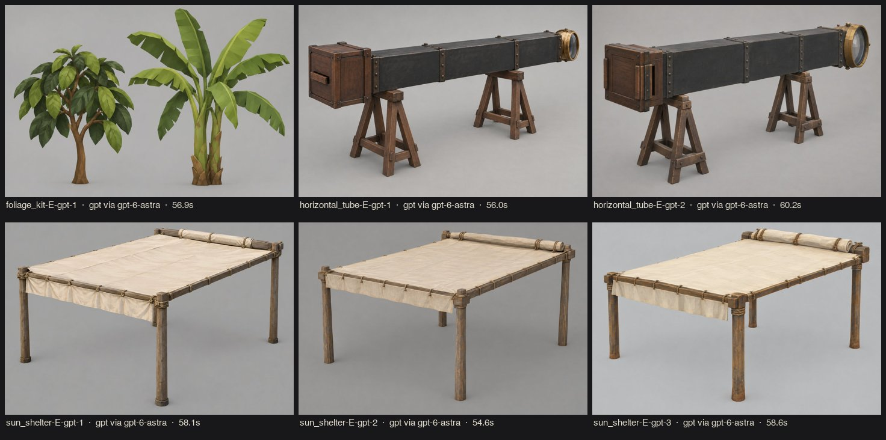

# r04 · foliage cost + sun-shelter and horizontal tube (2026-10-20)

Style E v1. New subject blocks (`subjects.toml`, all v1): `sun_shelter`, `horizontal_tube`, `foliage_kit`. Part lists and dimensions come from `scripts/world_builder.gd` (`_shelter_and_instrument`, `_vegetation`). 6 images at 55–60 s each, ≤3 parallel Codex jobs. All 6 tool prompts are verbatim (`manifest.jsonl`).

## 1. Measure first: do the shrubs dominate? (G4 attribution)

`tests/benchmark.gd` gained `--bench-hide=<group>`, which hides a scene group before measuring. `world_builder.gd` tags the vegetation `veg_shrub` and `veg_palm`. All runs use seed 7 on branch head before r04 changes (`art/validation/g4-r04-pre`, `-noshrubs`, `-nopalms`).

| bookmark | as is (prims / draw calls) | shrubs hidden | palms hidden | shrubs' share of primitives |
|---|---:|---:|---:|---:|
| arrival | 417k / 427 | 189k / 373 | 403k / 289 | 55% |
| shelter | 293k / 288 | 141k / 252 | 282k / 196 | 52% |
| coelostat | 323k / 207 | 138k / 163 | 317k / 175 | 57% |
| house | 277k / 160 | 116k / 122 | 272k / 122 | 58% |
| totality_sky | 100k / 153 | 100k / 153 | 90k / 28 | 0% |
| totality_horizon | 302k / 194 | 57k / 136 | 291k / 77 | 81% |
| darkroom | 497k / 374 | 100k / 280 | 473k / 156 | 80% |

**Confirmed:**
- The 70 default `SphereMesh` shrubs are **52–81 % of all primitives** wherever they are in view. The darkroom bookmark counts them through the shadow passes.
- **The palms, not the shrubs, dominate draw calls.** Each palm is 9 meshes (a trunk and 8 leaf boxes), × 15 palms, plus shadow passes. Hiding them removes 125 of the 153 draw calls in `totality_sky`.
- The palms are the next performance target (see the end of this file).

## 2. Pick (G1)

**sun_shelter-E-gpt-2.** All three variants have the right part list: four posts, tie beams, a taut canvas roof, a front valance, and a rolled canvas at the rear beam. #2 has the cleanest silhouette and the clearest roll. #3's lashings are nicer but busier.
- **Spec wins:** the concept posts look short and stocky. The build uses 2.75 m (front) and 2.85 m (rear) posts with a 2.5° roof slope, matching the old primitives.
- **History:** the shelter is a RECONSTRUCTION (`docs/PROVENANCE.md`: no in-situ photograph is known). There are no walls and no dome.

**horizontal_tube-E-gpt-1.** It shows a square iron tube with bands, A-frame trestles with saddle blocks and stretchers, a brass lens cell, and a teak carrier with a side slot. #2 is near-identical and slightly busier.
- **History:** the object glass is the Oxford astrographic lens (HISTORICAL_RECORD). The tube construction, trestles and carrier are RECONSTRUCTION.

**foliage_kit-E-gpt-1 (shape reference only).**
- The concept's cocoa is a small tree with a trunk. The build keeps the faceted-clump shrub the game needs at 13–40 m.
- The banana's arching paddle leaves are the target.

## 3. Build (S3b) and G2

Builds were delegated to Codex `gpt-6.1-sol` (briefs written by Opus with exact coordinates tied to the gameplay colliders). Opus rebuilt everything from the scripts (deterministic: identical GLB hashes) and re-ran G2:

| Asset | Script | Triangles | Materials | Dims (m) | G2 |
|---|---|---|---|---|---|
| sun_shelter (3 objects: frame, `_roof`, `_roll`) | build_shelter_tube.py | 1 480 / 3 000 | 4 / 4 | 5.40 × 7.00 × 3.44 | PASS |
| horizontal_tube | build_shelter_tube.py | 1 400 / 6 000 | 5 / 5 | 0.77 × 3.83 × 1.65 | PASS |
| shrub_cocoa | build_foliage.py | 120 / 300 | 3 / 3 | 2.01 × 2.04 × 1.60 | PASS |
| banana_clump (v2) | build_foliage.py | 220 / 300 | 2 / 2 | 2.76 × 2.44 × 2.48 | PASS |

## 4. Integration (`scripts/world_builder.gd`)

Every model keeps its primitive fallback for when the GLB is missing. Colliders and hotspots stay in code, at the same sizes and positions.

**Shelter:**
- The posts' box colliders are 0.14 × 2.9 × 0.14 m, in the same place as before.
- `sun_shelter_roof` is moved under the existing `roof` node, so `main.gd` and the benchmark hide it at totality unchanged.
- `sun_shelter_roll` follows `roof.visibility_changed`. The rolled canvas shows exactly while the roof is hidden.

**Tube:**
- The tube, both trestles and the carrier keep their old box colliders.
- The carrier collider is still the interactable `station` ("底片架"). `station_look` and `station_pos` are unchanged.

**Foliage:**
- **Instancing:** a new `multimesh()` helper builds one `MultiMeshInstance3D` per mesh of the model.
- **Layout:** shrub positions and sizes use the same RNG draws as v0.1, so the layout is identical. Kind (every 3rd one is a banana clump) and yaw come from the index.
- **Cost attribution:** the instances keep the `veg_shrub` group.

## 5. G3 lookdev (`art/validation/g3-r04/{shelter,tube,foliage,r03check}`)

- **Finding: the lookdev cameras were fixed for props of about 1.5 m.** The 7 m shelter filled the frame, with the camera inside the canopy.
  - **Code change:** `scripts/lookdev.gd` now pulls each camera back along its own direction when the row is bigger than about 2.7 m (`frame_scale` in `lookdev.json`). Eye level stays at 1.62 m.
  - Prop-sized rows are unchanged (`r03check`: `frame_scale` 1.0).
- Measured dimensions equal the Blender export for all four assets.
- Silhouettes read in the backlit shot: the open frame, the A-frame trestles and the faceted shrub.
- **Finding: banana_clump v1 read as bare stems with upright spikes** (`foliage/sheet-banana-v1-rejected.jpg`).
  - **Build change (v2):** leaves now reach farther than they rise (outward arch, then a droop). The blades are wider, there are 8 leaves instead of 6, and the stems are taller.
  - **Spec change:** `dims_m` height 2.8 → 2.6, tolerance 0.2 → 0.15.

## 6. G4 in-game (`art/validation/g4-r04/compare.jpg`: baseline v0.1 | r04-pre | r04)

| bookmark | draw calls base → foliage only → r04 | primitives base → foliage only → r04 | frame ms base → r04 |
|---|---|---|---|
| arrival | 424 → 398 → **395** (−7 %) | 417k → 225k → **222k** (−47 %) | 8.44 → 4.79 |
| shelter | 286 → 272 → **271** (−5 %) | 292k → 169k → **169k** (−42 %) | 8.33 → 4.88 |
| coelostat | 207 → 183 → **189** (−9 %) | 326k → 166k → **168k** (−48 %) | 8.34 → 7.21 |
| house | 160 → 142 → **142** (−11 %) | 277k → 145k → **145k** (−48 %) | 8.15 → 7.93 |
| totality_sky | 153 → 173 → **179** (+17 %) | 100k → 129k → **130k** (+30 %) | 8.62 → 6.49 |
| totality_horizon | 194 → 161 → **161** (−17 %) | 302k → 93k → **93k** (−69 %) | 8.44 → 3.85 |
| darkroom | 374 → 305 → **305** (−18 %) | 497k → 136k → **136k** (−73 %) | 8.53 → 3.64 |

"Foliage only" is `g4-r04-foliage`: the kit with the shelter and tube GLBs moved aside, so the column isolates the foliage delta.

**Finding: quadrant MultiMesh chunks broke the draw-call gate.**
- The first integration split the foliage into one MultiMesh per model *and quadrant*, so that quadrants behind the camera would cull. Looking up at totality, the quadrants' large bounds stayed in view, and the main and shadow passes drew them: `totality_sky` reached 185 draw calls (+21 %, over the +20 % gate).
- All 70 plants together are about 12k triangles, so chunking saves nothing worth having.
- **Code change:** one MultiMesh per model. Every other bookmark lost a further 7–25 draw calls with it.

**Performance:**
- Draw calls are lower in 6/7 bookmarks. `totality_sky` is +17 % (within +20 %), because the instanced foliage now draws whole in the shadow cascades even though no shrub is on screen. Its primitives are +30k, which is trivial.
- Frame time is ≤ 8.0 ms everywhere (budget 12 ms). It is noise-dominated (r03 finding), so it is not used as a signal.

**Readability:**
- The plate carrier, drive, table and Oxford case still read, and the darkroom plate is still the brightest thing in frame.
- At totality the corona and cloud gap are unobstructed. The bare side beam of the shelter frame now crosses the upper-left of the `totality_sky` view. This matches the `totality_sky` concept ("from under the bare edge of an open timber frame"), but **watch it in the human playtest**.
- Banana clumps give the horizon a tropical silhouette. The shrubs read as small faceted trees, sparser than the old continuous blob hedge.

**Concept parity:** the shelter (canvas roof, rolled canvas) and the tube (bands, trestles, lens cell) agree with the picks in form and value. The canvas is the lightest structure, as in the concepts.

## 7. Gameplay

- **Logic tests:** `godot --headless --path . --script res://tests/test_sim.gd` gives 155 checks, 0 failures.
- **Careful autoplay** (`--autoplay=careful --speed=2 --seed=7`, `art/validation/autoplay-r04/`) matches r03:
  - same ending (雲層之後的希望), evidence favours E, score 4, stuck 0
  - restart works
- The only diff from r03 is frame-timing jitter of ≤ 0.1 s in the log, which moves the combined value in the 5th decimal.
- The plates were delivered through the new carrier collider, and the roof hides at totality (`careful_05`, `careful_06b`).

## What changes next round (S5)

| Finding | Change (kind) |
|---|---|
| Lookdev cameras can't frame architecture | `lookdev.gd` auto-framing (code), done in r04 |
| Banana v1 upright spikes | `build_foliage.py` leaf profile v2 + `assets.toml` dims (build/spec), done in r04 |
| Quadrant MultiMesh chunks +21 % draw calls at totality | one MultiMesh per model (code), done in r04 |
| **Palms: 125 of 153 draw calls in `totality_sky`**, 9 meshes × 15 palms | **next:** a palm kit asset (one mesh with trunk + fronds, ≤600 tris), instanced like the foliage. The S1 subject block is still to write. |
| Shelter side beam crosses the totality sky view | human playtest check. If it distracts, thin the side beams (spec) or move the station bookmark, never the gameplay position. |
| Instanced foliage draws in every shadow cascade | try `cast_shadow` per distance (visibility range) or a shadow-only LOD if `totality_sky` creeps toward +20 % |
