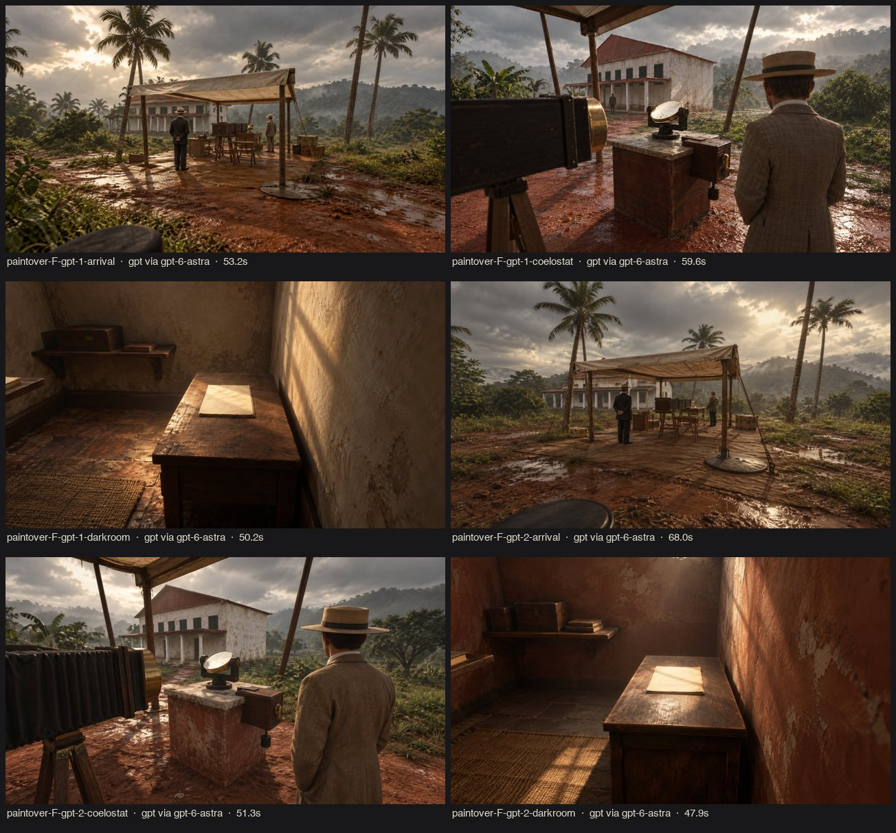
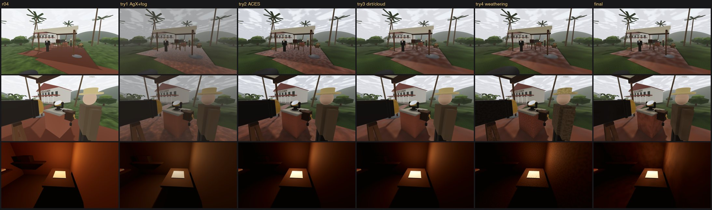

# r05 · cinematic lighting and atmosphere in real gameplay views (2026-10-20)

**Owner decision (2026-10-20):**
- Keep Diorama + Plate Grade provisionally, with room to adjust.
- Push toward historical weight, cinematic light and shadow, suspense and the characters' emotion.
- **Avoid a cartoon or toy-like read.** This round answers that brief in the playable scene, not in concept art.

## S1: paint-overs of real in-game frames (new technique)
- **Method:** `subject = paintover` (style `F_cinematic_diorama` v1), with `--ref` set to an actual r04 benchmark screenshot (`art/refs/r05/ingame-r04-*.jpg`).
- **Why it works:** r02 found that a reference image copies its composition. Here that is the point: the target keeps the **same camera and layout**, so it is a direct lighting and material goal for that bookmark.
- **Output:** 6 images, 48–68 s each.

What the targets showed, compared with r04:
- **Sky:** a heavy, structured overcast with a bright break. r04's sky was clipped to white.
- **Ground:** **wet laterite with puddles.** This matches the record: rain fell about 10:00–11:30 (PROVENANCE).
- **Contact:** contact shadows and occlusion ground every object. In r04 everything floated.
- **Depth:** misty hills give aerial depth.
- **Materials:** weathered materials. r04 had flat fills.
- **People:** dignified Edwardian figures. r04 had capsules with name tags.

What the targets got wrong, so we did **not** copy it:
- **Low golden sun.** Totality was at about 14:13, with the Sun high (~56° by our rough reconstruction), so the engine keeps the high sun and only warms its colour.
- **Daylight shafts through the darkroom's slats.** The paint-over ignored "night" and broke the windowless darkroom rule. Rule for paint-overs: state the time of day and the light sources explicitly, and judge the result against history before using it.

## S4: Godot iterations (every step captured with the G4 benchmark, seed 7)

| Try | Change | Finding → next step |
|---|---|---|
| 1 | AgX tonemap, SSAO, aerial and height fog, softer sun, wet-dirt and ground materials, sky `cloud_shade`/`day_gain`, darkroom lamp pool, fading name tags | The sky structure arrived, but the frame went milky grey and the dirt read as pink gravel → too much fog, and AgX too flat. |
| 2 | ACES 0.95, contrast 1.10, thinner fog | Contrast came back, but the dirt still read as cobbles and the clouds as camouflage. |
| 3 | Broad, low-contrast dirt blotches with wetness in roughness; `cloud_shade` 0.34 | Close to the target, but every surface was still a flat fill (the toy cue). |
| 4 | World-space weathering multiply on all non-metal, non-evidence materials, plus a warmer key colour | Too strong and too fine (speckled camouflage), and it touched the measuring sheet (evidence). |
| final | Weathering made broad and soft; value cutoff 0.8 keeps evidence whites clean; lamp PCSS removed (cost); night safelight 0.25 → 0.5 | **Accepted.** |

## Gates
- **G4 readability:**
  - The totality cloud gap, corona and stars read as before. The evidence frame is unchanged apart from r04's shelter beam.
  - Darkroom: the plate on the measuring table is the focal point, and the shelves read in red and amber.
- **G4 performance** ([perf-r05](../../validation/perf-r05/SUMMARY.md); 3 clean repetitions on the final commit `694fc38`, vs r04):
  - **Draw calls:** −4 to +26 per view (shelter +10%, house +11%; shadow distance 60 m). Under the +20% gate.
  - **Forced draw (uncapped render cost):** daytime views rose from 2.5–2.8 to 3.4–3.8 ms (+0.8–1.1 ms, about +30–40%). The darkroom rose from 3.0 to 4.9 ms (spread 4.4–5.1). `totality_sky` is unchanged.
  - The cost comes mostly from SSAO, plus the sun's PCSS (`light_angular_distance` 1.2). The individual costs were **not isolated**.
  - This exceeds the +25% relative gate. It is **justified** as the largest visual gain of the round, and every view stays under the 6 ms absolute gate.
  - The darkroom lamp's PCSS cost +0.7 ms and was removed.
  - **Wall-clock p95:** 8.9–10.0 ms in daytime views. The darkroom is at 11.85 ms, inside the 12 ms gate but **the view to watch**.
- **Gameplay:**
  - 155/155 logic tests.
  - Autoplay careful / rushed / cherry produce the same 3 distinct endings (scores 4 / 0 / 3, stuck 0).
  - One careful run on `694fc38` stalled because the bot's click on "向 Eddington 報告" did not register (viewer screen unchanged by r05). The next 2 careful runs passed. Recorded as a flaky bot click (1/3), not a game regression.
  - `--no-grade` turns off the environment look layer: grade, tonemap, SSAO and fog settings, sun and ambient gains, sky gains, and the safelight boost. The material changes (ground, weathering, lamp) are not toggled by it.
- **Not changed:** the simulation, the cloud texture the simulation samples, `fog_sky_affect` (stays 0), and the sun direction.

## Still far from the target → next rounds
1. **People** (the largest remaining toy cue). They need real human proportions and Edwardian clothing with respect for real persons (BIBLE S4).
   - Tripo has no key.
   - **Candidate replacement: MPFB 2 (MakeHuman for Blender).** It produces parametric humans whose output MakeHuman states is CC0 (to be confirmed before use), is scriptable headless, and gives deterministic, rigged bodies. It needs an Owner OK to download a Blender extension.
2. **Vegetation density and wilderness edge.** The paint-overs are lush; the scene is sparse.
3. **Daytime sky** clouds are still blotchy in prep views.
4. The "ROÇA SUNDY" building sign reads like a theme park; the paint-overs dropped it. It is a navigation affordance, so leave it until a playtest.
