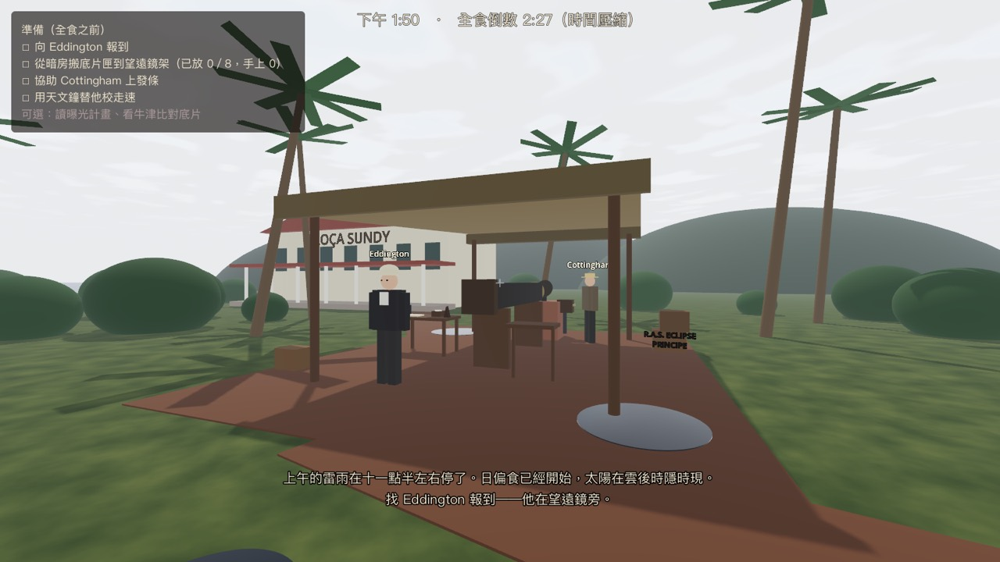
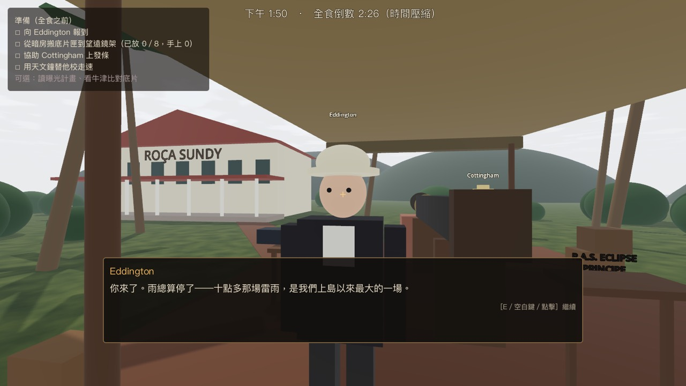
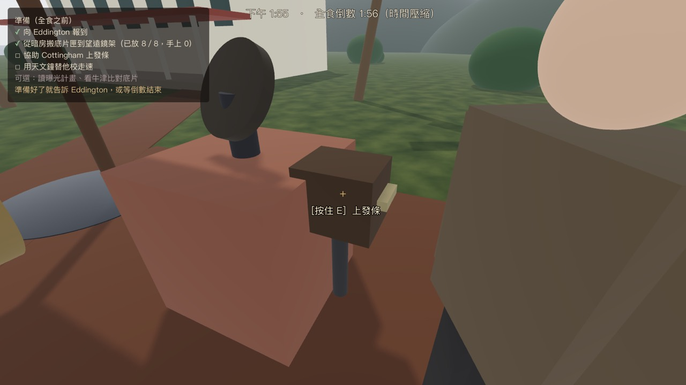
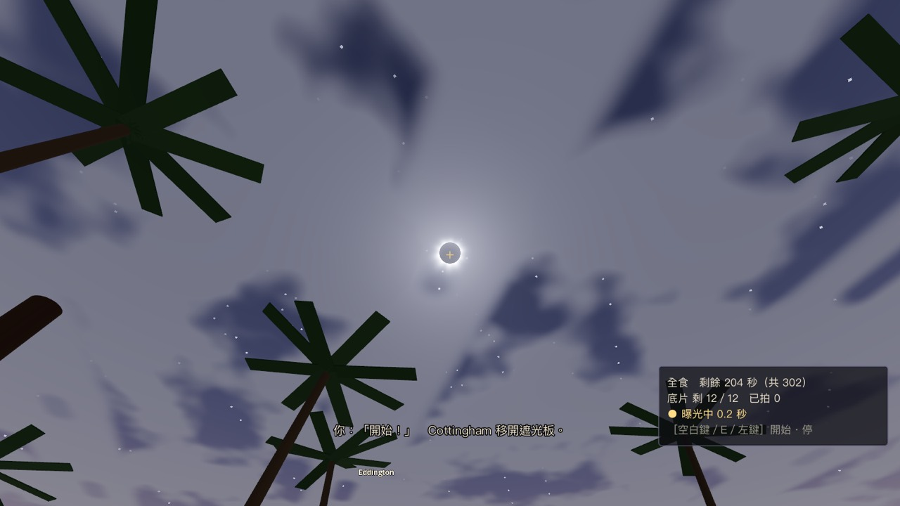
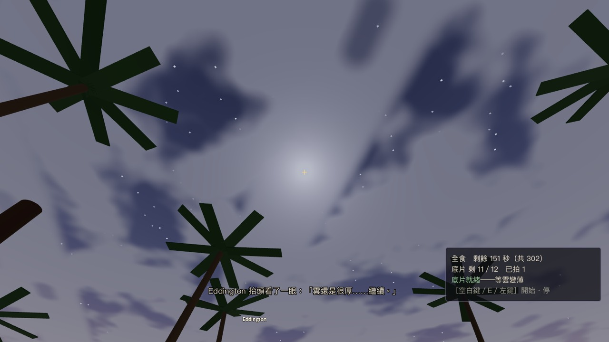
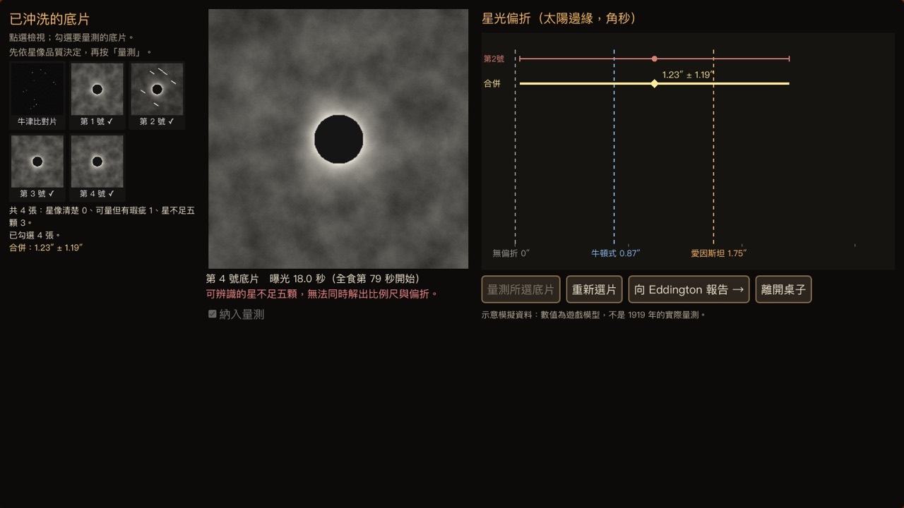
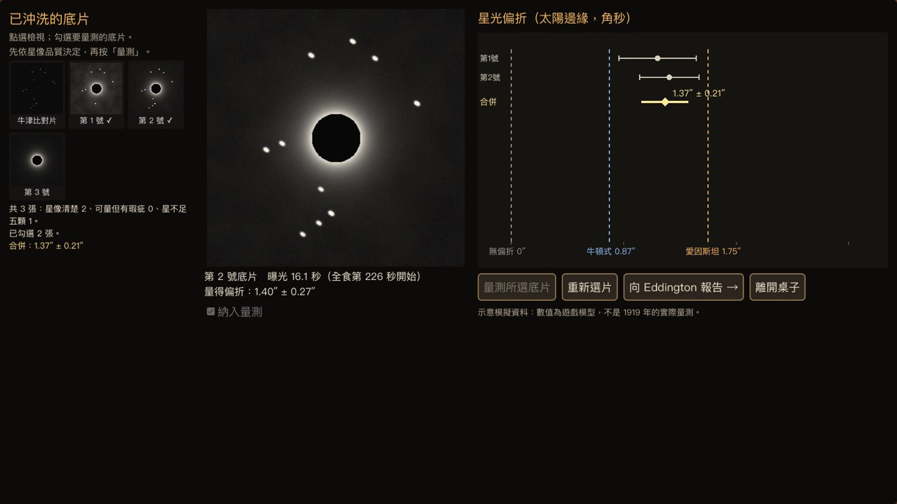
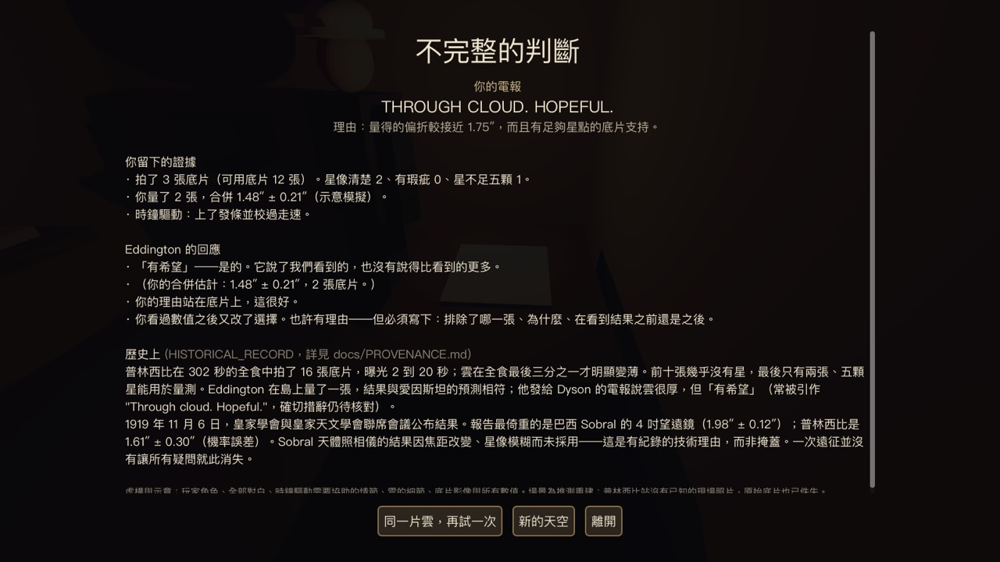

# 試玩與驗證紀錄

## v0.1 — 第一個可玩切片（2026-10-19，Opus 5.5）

**環境**：Godot 4.7.2.stable.official（Homebrew），macOS（Apple M2 Pro，Metal 4，Forward+），1600×900。

### 真人試玩：**尚未進行（ABSENT）**
目前沒有任何人親手玩過。下面的內容全部來自自動化測試，**不能取代真人試玩**。最需要真人回答的問題：
1. 全食時能否靠肉眼看出「雲正在變薄」，並在雲縫期間開始與停止曝光？（目前只用機器人調校過。）
2. 準備倒數 150 秒（對話時暫停）會不會太寬鬆或太緊？
3. 底片檢視器裡，星點數、霧和拖線能不能讓人「看圖選片」，而不是看數字？
4. 判斷與回應是否公允，有沒有說教感？Eddington 的語氣是否可信？
5. 整體時長（預估 6–10 分鐘）與重玩意願。

### 自動化驗證（實際執行過的）
| 檢查 | 指令 | 結果 |
|---|---|---|
| 邏輯測試（雲層決定性、雲縫、曝光後果、拖線偏差、證據分類、評分組合、審查回歸） | `godot --headless --path . --script res://tests/test_sim.gd` | **155 checks, 0 failures** |
| 端到端：careful（完成全部準備、只在雲縫曝光、按品質選片、電報 HOPEFUL） | `godot --path . --always-on-top -- --autoplay=careful --shots=DIR --seed=77 --speed=2` | 通關，結局「雲層之後的希望」，合併 1.37″ ± 0.21″（favors_e），卡住 0 次 |
| 暫停 | （careful 流程中） | 對話中按 Esc 會暫停；暫停時按 E 不會推進對話；再按 Esc 繼續 ✓ |
| 重玩「新的天空」 | （careful 結尾按鈕） | 重新載入，回到標題，種子 77 → 47 ✓ |
| 端到端：rushed（跳過準備、無視雲層連續長曝光、全選、電報 CONFIRMED + 日冕理由） | `--autoplay=rushed --seed=515` | 通關，只有 4 張底片，星像拖線、起霧，結局「過早的宣告」，分數 0 |
| 端到端：cherry（先漏掉一張好片，看到數值後才補回） | `--autoplay=cherry --seed=4242` | 通關，Eddington 指出「看過數值之後又改了選擇」，結局「不完整的判斷」，分數 3 |
| 即時速度（speed=1） | `--autoplay=careful --seed=77 --speed=1` | 機器人約 178 秒走完（準備 33 秒＋全食 121 秒＋夜晚約 20 秒）。真人閱讀對話與探索的時間未計入 |
| macOS 匯出 | `godot --headless --path . --export-release "macOS" build/Eddington1919-macOS.zip` | 產生 universal `.app`（ad-hoc 簽章，約 60 MB），實際啟動 600 幀無腳本錯誤。匯出版排除 `tests/`，所以**匯出版沒有跑完整的自動化流程** |

機器人用的是真實輸入事件：按鍵移動與互動、Input actions、對話數字鍵、對底片檢視器做滑鼠點擊。它不是直接呼叫遊戲函式（只有一個例外：標題按鈕點擊失敗時的備援，最終版本沒有用到）。結果 JSON 在 [docs/playtest/](playtest/)。

### 獨立審查
- **Codex（gpt-6-astra，唯讀、全新 session）**：第一輪「REQUEST CHANGES」，提出 1 個 P1、8 個 P2 問題，全部修正於 `f107a85`。修正後的複審結果見 Issue #1。

### 截圖（自動化流程擷取）
| | |
|---|---|
|  抵達 Roça Sundy 觀測站 |  Eddington 簡報 |
|  協助 Cottingham 上發條 |  全食：雲縫中露出日冕，喊「開始」 |
|  全食：厚雲中只剩一團光暈 |  草率曝光：霧、拖線、不足五顆星 |
|  細心曝光：量測圖 |  結局：Eddington 指出選片問題 |

### 已知限制
- 美術全用基本幾何體，人物是方塊人，沒有動畫。
- 沒有配樂，只有程式產生的節拍器、快門與環境聲。
- 量測模型為示意，數值不是 1919 年的資料。
- 全食的雲縫判讀與難度只經過機器人調校。
- 匯出版只在這台 Apple Silicon Mac 上啟動過，Intel Mac、Windows 與 Linux 都未測。
