# Príncipe slice: art direction and log

Owned by the art director (role `edd-art`, Fable 5.2). The Owner picked this seat on 2026-11-14 13:0x JST from a blind audition (Opus, GPT, Fable; this answer was label Z). Read this file first after every /clear.

## Owner direction (2026-11-16 03:3x JST): supersedes the look target below

- The Owner asked why this build still looks crude next to other AI-made games, then: "do what you're good at; don't be held back by what was built so far." The True Colors / Tell Me Why target is dropped. It needs performance capture, hand-sculpted faces and a large art team; our tools (code, shaders, procedural geometry, image-gen 2D with provenance) cannot carry it to a finished look. Pick a style those tools can finish. Sunk work is no reason to keep a direction.
- Next step: a **style audition**. **Owner 2026-11-16 03:4x JST: the Owner will not pick; edd-art decides the style, and edd-lead checks that it serves what the game must show** (the eclipse, the plate measurement in the darkroom, the Newton-to-Einstein turn). The Owner plays the result and reports gut reactions only. Three styles, each rendered **in engine** (no paint-overs: the point is what the build can reach) on the same four frames: arrival, coelostat, totality_sky, and one dialogue frame. One contact sheet per style plus a side-by-side of all three.
- **Pick, 2026-11-17 09:3x JST (edd-art): engraving.** Sheets in `slice_principe/audition-1117/`, reasons in the log entry of that time, acceptance rows in "Slice acceptance" below.
- Lead's candidate styles; the art director may replace any with a better one, but keep at least one far from the current look:
  1. **Silver plate**: the 1919 glass negative and toned print as the whole look. Near-monochrome warm silver, halation round highlights, plate grain, soft vignette; at most one colour accent (e.g. the corona).
  2. **Flat colour and light**: flat-shaded colour shapes with no texture noise, a strong key with cast shadows, layered haze (the Firewatch-type landscape the audition answer already called achievable), saturation toward Y.
  3. **Engraving**: period scientific-journal line engraving. Light-driven hatching, ink outlines, paper tone; an optional thin colour wash.
- Characters, in every style: no 3D faces close to camera. Dialogue uses illustrated portraits (the P1 toned-print family, image gen with provenance); 3D figures stay small, back-lit or silhouetted.
- **Owner taste signal, 2026-11-16 18:2x JST (not a direction; relayed by inbox event ev-20261116-183211-3d81):** the Owner is a veteran World of Warcraft player who loves its epic feel. When judging the audition, weigh which style can make totality feel epic: the scale of the sky against small figures, a long build-up and then a release (the light drops, the colour shifts, silence and then music), a landmark silhouette. Principles only; nothing is copied from WoW.
- Work in flight: what survives any style (geometry and staging: #344 props, #349 ridges, #341 vegetation cards, #322 dialogue camera, #329 totality staging; the #339 matrix runner, which the audition can use) may go on. Style-specific work (#318 grade defaults, #340 painted tiles) holds until the pick; after it the art director keeps, reworks or closes each. The windowed slot of 2026-11-16 09:00–15:00 JST renders the audition first.

## Owner direction (2026-11-14 JST, look target superseded 2026-11-16)

- Look target: Life is Strange: True Colors > Tell Me Why >>>> the current build.
- Pick: Z (this direction), **with saturation pushed toward Y** (the GPT proposal). The Owner said Y's saturation catches the eye at first glance, while Z has more story. Saturation is a grade and albedo knob; keep Z's composition, light and story framing.
- Scope: the Príncipe camp through totality (and the darkroom), to shippable quality before anything else.

## Reference images (this folder: `slice_principe/`)

- `current/`: the nine audition frames from the build of 2026-11-13 (1280x720). The baseline.
- `concepts/Z_*.jpg`: Codex image-gen paint-overs of this direction (arrival, coelostat, totality_sky; one generation each, no rerolls). `concepts/Y_*.jpg`: the same frames for the Y direction, kept as the **saturation reference**. Prompts and provenance: `concepts/prompts.jsonl`. Full-size PNGs: KIOXIA `eddington-1919-cache/director/audition-1113/concepts/`.
- Known generation slips, not direction: Z's daytime frames wrongly show an eclipse disc in the sky; Y keeps the façade text.
- True Colors / Tell Me Why stills are copyrighted: keep any you collect on KIOXIA only, never in this repo.

## Audition answer (verbatim, 2026-11-13)

### 1. Diagnosis

1. **No light direction.** arrival, house, shelter, coelostat: posts, trees and people cast nothing; the canvas underside is as bright as the sky; the earth is the same value under the shelter as outside. Unlit cut-outs.
2. **One noise texture plays every material.** The same mottle is canvas (shelter roof), plaster (house), brick (coelostat pier) and darkroom wall. No normals or roughness, so brass and mirror reflect nothing. The ground is one flat green; the path an airbrushed blob without an edge.
3. **Placeholder landforms and plants.** Hills are perfect hemispheres (house, cottingham_talk); bushes are faceted icospheres, palms are combs. totality_horizon is nothing but these silhouettes, so the cheapness peaks at the climax.
4. **The sky is noise.** Overcast is flat white with grey blobs at one frequency; no haze, no sun direction. In totality_sky the clouds are purple blobs and the eclipsed sun is a soft disc with a pinpoint: no corona, no twilight band. The moment the game exists for has no image.
5. **Mannequins at the worst distance.** eddington_talk: full body, dead centre, A-pose, face about 40 px tall with hollow eyes, suit one untextured white. cottingham_talk and coelostat: the same, plus a decal moustache. Hands are mitts.
6. **Text as set dressing.** "ROÇA SUNDY" in a modern sans on the façade and bold "R.A.S. ECLIPSE PRINCIPE" on crates read as labels, not objects.
7. **No camera language.** Wide lens, horizon mid-frame, no foreground element, no depth of field, no grade; the sky clips to white, totality_horizon's ground to black.
8. **The darkroom is empty.** A self-lit white card on a bare table; no safelight lamp, trays, bottles or microscope. The plate should be a glass negative, dark with star points.

### 2. The look

One sentence: a humid tropical afternoon painted in gouache; a warm key when the sun breaks, pearl-grey wrap light when it doesn't, shadows deep but never black, every surface hand-painted.

**From True Colors (the bar):** the value structure (one clear key, warm bounce, cool sky fill; shadows at 15–20%, highlights rolling off); painterly albedo with visible brushwork, no photo noise; atmospheric depth (haze, god rays, dust); a warm filmic grade; close, off-centre, shallow dialogue cameras. **From Tell Me Why:** overcast that still has form (soft light with a direction), damp saturated vegetation, period objects as heroes, over-the-shoulder framing. **Out of reach:** performance-captured faces, hair, cloth simulation; the substitute is section 5.

**Other references:** Firewatch (flat colour shapes, layered haze, silhouetted vegetation: our achievable landscape); Season: A Letter to the Future (painterly surfaces at indie scale); Winslow Homer's Bahamas watercolours (lime-washed walls, palms, hazy white sky).

**Palette:** laterite red-brown earth (keep it); foliage olive to yellow-green in light, blue-teal in shade; walls warm off-white with grey damp streaks at the base; roof terracotta gone brown with moss; brass, black lacquer, raw canvas as accents. Eclipse: indigo zenith, salmon-orange horizon band all round, pearl corona.

**Light:** sun about 50° high (totality was 14:13 local), 5200 K; DirectionalLight with soft shadows (angular size 1–2°), SSAO, SDFGI or baked GI, AgX tonemap, exposure so the sky never clips; light volumetric and height fog, far hills tinted toward the sky; canvas with backlight translucency so pole shadows show through the roof.

**Materials:** tileable painted albedos from image generation ("gouache, hand-painted, no photographic noise"), normals derived, roughness painted; brick with mortar, wood with grain, metallic brass with a reflection probe.

**Grain and camera:** 1–2% film grain, gentle vignette, no sepia in play (the toned print stays in portraits and chapter cards); 55° horizontal FOV, eye at 1.6 m, horizon on a third, a dark foreground element on one edge, depth of field only in dialogue.

### 3. Three target frames

**arrival.** Camera low (1.5 m) on the red path, running diagonally from bottom-left to the shelter on the right third. Sun upper-right behind the canvas: the roof glows warm and the poles throw long shadows toward the player across wet red earth with puddles (it stormed that morning) and leaf litter. House behind-left, half hidden by a cacao tree and a soft dark palm trunk at the left edge; two hill layers with haze between; broken cloud, one warm gap. Cottingham small, bent over a crate; Eddington walking toward us, hand shading his eyes. Removed: lawn, hemispheres, metal base disc, big text.

**coelostat.** Camera at 1.2 m, close. The brick pier fills the left third; the mirror reflects the real sky; brass crank and drive box at centre with its falling weight; the tube leaves top-right in soft focus. Cottingham waist-up in three-quarter, bent to the clock, brim shading his face, hands on the crank; the house a pale shape in haze. Sun upper-left: a hot highlight on the brass, the gimbal's shadow on the cap. Removed: façade text, second hill, flat pier paint.

**totality_sky.** Looking up about 60° from the shelter's edge; one beam crosses the lower-left corner, palm fronds silhouetted right. Sun on the upper-right third: black disc, pearl corona to two solar radii with streamers, thin cloud veils crossing it lit from behind, two cloud layers at different speeds. Zenith indigo, Venus visible, the bottom edge warming to orange. Over twenty seconds the cloud thins and the corona emerges. Removed: purple blobs, grey glow, pinpoint.

### 4. The plan

1. **Lighting and post (M):** shadows, SSAO, GI, fog, AgX, grade, FOV, vignette, grain. Biggest gain; everything else is judged after it.
2. **Sky and eclipse (M):** layered painted clouds, twilight gradient, corona shader, the cloud-thinning sequence.
3. **Terrain (M):** sculpted hills with ridgelines and tree lines; ground shader blending laterite, grass and litter; path edges, puddles.
4. **Vegetation (L):** palms with painted alpha fronds, cacao, banana, undergrowth, wind; silhouettes designed for the eclipse frames.
5. **Materials (M):** canvas translucency, plaster weathering, brick, wood, brass, lacquer; stencils at the right size.
6. **Characters (M):** section 5.
7. **Props and darkroom (S):** tarps, rope, plate boxes; safelight lamp, trays, glass negative, microscope.

**Cut or hide:** full-body character shots; the lawn; a walkable far field (fence the slice to shelter, house front and path; tree lines and fog beyond); the sea band in totality_horizon; the façade text (a small weathered sign at most); idle bare hands.

### 5. Characters

- **Framing:** never full body. Dialogue uses a locked camera at 2–2.5 m, waist-up three-quarter or over-the-shoulder, eyes on the upper third, depth of field on, face at least 120 px tall at 720p.
- **Stylise:** simplify the MPFB faces (ears, cheeks, nose), larger painted irises with a catchlight, hand-painted skin with warm and cool zones, subsurface on. Cloth with painted folds and seams: linen, not flat white.
- **Hide what cannot act:** brims and Eddington's round glasses shade the eyes; hands hold a crank, plate holder or pencil, or stay out of frame.
- **Motion:** retarget free Mixamo idle and talk cycles in Blender; weight shift, breathing, a blink every 3–5 s, head and eye look-at with a small lag, two or three gesture clips.
- **Off camera at the climax:** Eddington did not watch the eclipse; he was changing plates. Totality is first person at the plate holder, Cottingham calling time off screen.

### 6. Acceptance

- Light: every outdoor frame has a visible cast shadow; nothing self-lit except the safelight and the corona.
- Values: under 3% clipped white, under 3% pure black (darkroom exempt).
- Silhouette and depth: at 160x90 the frame still reads with foreground, subject and hazed background; no visible facets on plants or hills.
- Materials: five distinct responses in the coelostat frame (brass, lacquer, canvas, brick, cloth).
- Characters: the framing checks above; idle motion within two seconds; no A-pose anywhere.
- Eclipse: corona and cloud veil both visible, indigo zenith, orange horizon, no purple blobs.
- Fidelity: instruments match the 1919 expedition photographs (horizontal tube, coelostat on a pier, clock drive).
- Performance: 30 fps at 720p on a GTX 1650, measured under the shelter at totality.
- Blind contact sheet: six slice frames beside True Colors stills; a viewer names none of ours as placeholder.

## Slice acceptance (engraving; replaces section 6 of the audition answer, 2026-11-17 JST)

Implementation and capture commands: [engraving on main](ENGRAVING_MAIN.md). The port (#383) is on main; rows **1, 3 and 6** were judged on its frames and count from its merge.

Pass count: **7/9** on main (row 1 re-scored 2026-11-24: not met at d07f2ee for the dashed ridge line, met again from #483 merged as 97bfbc8, see the 20:40 and 20:45 JST entries; rows 1, 3, 6 first since #383 merged as 407581e on 2026-11-19 15:19 JST; row 4 since #391 merged as 34636ff on 2026-11-19 18:34 JST; row 5 since #392 merged as 198877e on 2026-11-20 12:06 JST; row 7 since the verdict of 2026-11-19 17:1x JST; row 9 since the measurement of 2026-11-19 17:2x JST, an estimate for the hardware class, to be measured again now that row 4's change is in the pass, and again after row 5's). Row 8 is judged and not met (entry of 2026-11-19 17:1x JST); row 2 waits for someone to watch the clips. Each row is judged on the running build, in the frames `arrival`, `coelostat_still`, `totality_sky`, `totality_wide`, `totality_horizon`, `dialogue`, `darkroom` at 1280×720 unless the row says otherwise.

| # | Row | How it is judged |
|---|-----|------------------|
| 1 | Line work: every surface is hatching, outline or deliberate bare paper; no moiré patch, dotted seam or noise field wider than a twentieth of the frame | art director, the seven frames at full size |
| 2 | Motion: on a 10 s walk through the camp and a full turn the lines stay on their surfaces; nothing shimmers or pops | art director on a 60 fps capture; the Owner's reaction when playing |
| 3 | Scale stability: near marks stay attached to the material and keep the same apparent pitch across native resolutions. At 1080p visible marks have at least 4 px of pitch, and distant marks resolve to flat tone. | Compare the same material patches at native 720p and 1080p, then check that contrast fades on the approach and turn from row 2. Perceptual scale approved by edd-art in the 2026-11-24 03:38 JST entry, decision 2. |
| 4 | Totality frame: blue paper, the corona heightened in white with rays, the Moon solid, the horizon glow, the camp and the peak as silhouettes; the field stars show as white points wherever the simulation's cloud lets them through, and no hatching artefact in the sky reads as a star | art director, `totality_wide`, `totality_horizon` and the shelter-edge view with the Sun in frame under clear sky (added 2026-11-25: the first two cameras are level and never show the Sun); star positions against `sim.star_offsets` |
| 5 | Totality transition: from the last crescent to second contact and back the page changes without a grey intermediate state | art director on a capture of `totality_live` from 20 s before second contact |
| 6 | Darkroom: reads as night under the safelight, unlike any day frame; the plate on the bench is readable | art director, `darkroom` |
| 7 | Evidence unchanged: plate exposure, star positions and the measurement give the same numbers as on main; the plate images, the loupe, the micrometer and the result chart stay photographic and legible, never hatched | the existing suites (`test_totality`, plate and measurement suites) pass on the branch; art director on the plate viewer and the chart |
| 8 | Reading the game: every interactable is identifiable from 3 m; dialogue and HUD text has a contrast of 4.5:1 or more on cream and on blue paper; signs, Sun crescents and fireflies are drawn; no 3D face shows features (eyes, mouth) at any distance the player can reach in play (down to the closest the player collider allows, measured); every dialogue line shows the engraved portrait | art director in a play-through of the slice; contrast computed from the frame |
| 9 | Performance: 30 fps at 720p on GTX 1650 class hardware, under the shelter at totality | forced-draw method (`eddington-perf-method`), three clean repetitions |

## Log

Newest last. Each round: date and time (JST), what changed, the frames judged (paths), the verdict.

- 2026-11-14 13:0x JST (edd-lead): seat set up. First round = plan step 1 (lighting and post), with the saturation push toward Y folded into the grade.
- 2026-11-14 13:2x JST (edd-art), round 1 dispatched, **nothing judged yet** (Saturday: no windowed run until 2026-11-16 09:00 JST).
  - Frames read: `slice_principe/current/arrival.jpg`, `coelostat.jpg`; `concepts/Z_arrival.jpg`, `Y_arrival.jpg`, `Y_coelostat.jpg`.
  - What the current build does (`scripts/look.gd`, `main._build_environment`, `_apply_light`): ACES at white 1.0, saturation 0.86 plus a sepia LUT, sky ambient at 0.72 against a sun of about 0.7 under cloud (so shadows exist but do not read), no GI (the earth under the canvas is as bright as outside), depth fog only, player FOV 72° vertical.
  - Numbers (320×180 nearest, luma Rec.709 on display values; saturation = (max − min) / max):

    | frame | luma p05 | p50 | p95 | sat | sat lower half |
    |---|---|---|---|---|---|
    | current/arrival | 0.18 | 0.33 | 0.94 | 0.24 | 0.40 |
    | current/coelostat | 0.05 | 0.27 | 0.90 | 0.33 | 0.48 |
    | current/house | 0.18 | 0.43 | 0.94 | 0.22 | 0.36 |
    | Y_arrival | 0.12 | 0.29 | 0.73 | 0.36 | 0.46 |
    | Y_coelostat | 0.12 | 0.32 | 0.69 | 0.40 | 0.49 |
    | Z_arrival | 0.17 | 0.35 | 0.67 | 0.34 | 0.43 |

    The gap to Y is less the ground than the sky: ours sits at 0.9+ and has no colour. Step 1 pulls the sky down and the key up; sky colour itself is step 2.
  - **Step 1 value targets (daytime frames):** luma p95 ≤ 0.80, p05 0.08–0.15, lower-half saturation ≥ 0.45, clipped white and black under 3%.
  - Decisions (also on GitHub via `lead-decision`): Príncipe leaves the plate grade (Cambridge and departure keep it); one parameter set `Look.PRINCIPE` with `--look-set=key=value,…` overrides; first-pass defaults ACES white 5.0, exposure 1.1, saturation 1.18, split-tone LUT (cool shadows, identity from 0.85), sun floor 0.3 and gain 1.8, ambient 0.5, sky gain 0.72, SDFGI and light volumetric fog (off at low quality, never over the sky), vignette 0.22, grain 0.03, FOV 60° vertical (the audition's 55° horizontal is about 33° vertical: kept for locked dialogue cameras, too narrow to walk in). ACES over the audition's AgX because r05 found AgX milky; AgX is a variant.
  - Dispatched (Codex Terra): `art/p1-look` (the look; draft PR until I have seen it) and `art/p1-look-matrix` (benchmark image stats, `tools/look_matrix.sh`: one benchmark run per variant, stats table, contact sheets). Briefs: `.claude/briefs/p1-look.md`, `p1-matrix.md`.
  - 2026-11-14 13:36 JST: the look is draft PR #318 (head `cdbd2d6`). Diff checked against the brief: values and scope as specified, CI green, 54 + 100 headless checks pass. Nothing judged visually yet, so it stays draft.
  - Monday 2026-11-16 09:00 JST: `tachi-run --heavy --host -- tools/look_matrix.sh /Volumes/KIOXIA/eddington-1919-cache/director/look-matrix/1116` on the two branches merged locally; judge the sheets (base, nograde, agx, white1, sat_lo, sat_hi, key_hi, no_sdfgi, no_volfog, fov72, fov55), set the defaults, then accept or send back.
- 2026-11-14 14:0x JST (edd-art), round 1 look brought forward, **nothing judged yet**. edd-lead relayed at 13:59 JST that the Owner is out for at least an hour, so the windowed matrix runs today: heavy ticket #1102, `run_windowed.sh` on KIOXIA `director/look-matrix/` (stops on any keyboard or mouse activity, deadline 15:15 JST), variants in priority order (`variants_1114.tsv`), output `director/look-matrix/1114/`. It runs on a detached merge of `art/p1-look` + `art/p1-look-matrix` in the `p1-look` worktree.
- 2026-11-14 14:1x JST (edd-art), parallel asset tracks dispatched (plan steps 3, 4, 5, 7; Codex Terra; none depends on the step 1 values). **Nothing judged yet.**
  - Read first: `art/factory/af01/contact-views.jpg` on branch `claude/af01-fix-round` (68553d3). Verdict: the 12 camp props (table, stool, cask, lantern, chest, plate rack, bucket, ladder, sawhorse, wheelbarrow, fence, barcaça) make the camp read lived-in and are worth taking as the next dressing batch; not the steps, not that palm. They are flat palette fills, so they need the painted materials below to stop reading as kit.
  - Decisions: (1) painted surfaces are **albedo tiles keyed by palette swatch**, colour-matched to the swatch hex, world-triplanar, replacing the one shared noise in `world_builder.weather()`; every kit GLB (materials `E1919_<swatch>`) then picks them up without re-export. No normal maps yet. (2) Vegetation becomes alpha cards with painted cut-outs on Blender trunks; cut-outs first, models after I have seen them. (3) Far terrain is three ridge rings with two phonolite towers behind the camp (bearing 140° and 168°, in the `totality_horizon` view); the Sun and house sector (bearing −38°) stays low; the sea is hidden. (4) The darkroom gets seven kit props; the lantern, the measuring table and the evidence sheet are untouched; rack plates are dark so they do not compete with the evidence.
  - Tracks (briefs in `.claude/briefs/`): `p5-tiles` (11 surfaces × 2 variants, sheets in `art/runs/p5-tiles/`, no PR until I pick), `p4-leaves` (6 cut-outs × 2 variants incl. `forest_edge`, sheets in `art/runs/p4-leaves/`, no PR until I pick), `p7-darkroom` (draft PR, renders in `art/validation/p7-darkroom/`), `p3-ridges` (draft PR, `art/validation/p3-ridges/panorama.jpg` and `silhouette.jpg`).
  - Next after judging: install picked tiles to `assets/textures/principe/` and wire them in `weather()`; ground shader (laterite, ground cover, litter, path edges, puddles); vegetation kit (palm, cacao, banana, undergrowth, forest-edge ring at 46–60 m) and its wiring in `palm()` / `_vegetation()`; af01 camp props; façade and crate text down to a small sign.
- 2026-11-14 14:3x JST (edd-art), p5-tiles first look at the **raw** generations only (22 swatches, before wrap and colour match; no picks yet). Image: KIOXIA `director/p5-tiles/raw-sheet-20261114-1434.jpg` (unlabelled, alphabetical).
  - **Rejected: both brick swatches.** The mortar is yellow-green and the bricks are toy red; matching the mean to `#985B45` would not fix the mortar hue. Regenerated once with thin recessed pale warm-grey lime mortar and weathered orange-red bricks; ids stay `brick-v1`, `brick-v2`, old raws go to `raw/rejected/` (decision on #317).
  - The other ten surfaces read as one painted family and go on to the processed sheets. To check there, not decided: leaf litter looks autumnal and large (scale and hue after matching); teak is very orange; the canvas seam repeats once per tile; palm bark reads as horizontal fibre bands, fine on a trunk if the bands stay level.
  - Process note: the worker reported the 22 raws copied to KIOXIA when only one was; I copied the other 21 from the paths in `REVIEW.md` before the processing job started. The run then stopped at the wrapper's wait limit and was resumed (`.claude/briefs/p5-tiles-followup-1.md`).
- 2026-11-14 14:4x JST (edd-art), p4-leaves judged on **my own re-cut of the 12 raws** (the worker's sheets did not exist yet). Images: KIOXIA `director/p4-leaves/judged-20261114/`.
  - Two defects found by looking, both missed by the numeric check: (1) the ten committed cut-outs were black (`leaves-committed-black.jpg`): the colour-spread step in `cutout.sh` wiped the RGB and `--check` never looked at colour; (2) `forest_edge` lost its alpha in the wrap, and the cross-fade wrap **my brief specified** leaves ghost palms at the seam (`forest-crossfade-ghost.jpg`).
  - Decisions (on #317): `forest_edge` wraps by mirror, 2048 px wide (`forest-mirror-rolled.jpg`: no seam, no ghost; the mirror symmetry is visible if you look for it and will sit behind 3D palms); `--check` also fails a cut-out under 8 % mean chroma. The fixed script is `.claude/briefs/p4-leaves-cutout-fixed.sh`, run over all 12 raws before it went to the worker.
  - **Picks** (`leaves-colour-fixed.jpg`, on `#CDB58F`): both variants of `coconut_frond`, `cacao_branch` (the red flush leaves are right for cocoa), `banana_leaf` (v1 first: more splits, reads as banana from further away) and `undergrowth`; `coconut_frond_dry` v1 only (v2 has keyed-out holes near the base); `forest_edge` v1 and v2. The set reads as one hand: broad gouache strokes, blue-green shade and yellow-green light, saturation on the Y side. No white fringe on the dusk blue.
  - Open, to judge in engine: the fronds are flat and symmetric, so the cards must be bent along the rib; the bottom third of `forest_edge` (cocoa pods, big leaves) reads near-scale and is to be hidden or UV-cropped on the 46–60 m ring; its five evenly spaced palms may read as a row.
  - The worker was resumed (`.claude/briefs/p4-leaves-followup-1.md`) to take the fixed script, rebuild, and write the manifest, sheets and `REVIEW.md` with these picks. No PR until the vegetation-kit brief installs them.
- 2026-11-15 14:0x JST (edd-art), **step 1 look judged** on the windowed matrix of 2026-11-14 (run stopped at 15:07 JST by the Owner's return: 8 of 11 variants done, `no_volfog`, `fov72`, `fov55` missing). Images: KIOXIA `director/look-matrix/1114/sheets/<bookmark>.jpg` (top row base / nograde / no_sdfgi, bottom row sat_hi / key_hi / agx; no labels, ImageMagick has no font), numbers in `1114/stats.tsv`.
  - **SDFGI off.** It is what crushes the shade: on `coelostat` the Príncipe assistant's face and hat go to flat black with it (clipped black 21.9 % → 0 % without), `shelter` 5.2 % → 0 %, `eddington_talk` p05 0.062 → 0.123 (in target). Without it faces in shade read and the camp keeps its contrast; forced-draw cost is unchanged.
  - **Saturation 1.30** (from 1.18), toward Y as the Owner asked. Lower-half saturation is still 0.29–0.43 in day frames against the 0.45 target: the grade alone cannot get there, the grey-green ground noise is the cause, so the rest comes from the painted tiles (p5) and the ground shader. `sat_hi` alone only moved it +0.03.
  - Kept: ACES, white 5.0, exposure 1.1, key and ambient (`key_hi` brightened without fixing anything; `agx` flattened the day and kept the black crush). Luma p95 is already ≤ 0.80 everywhere.
  - Still failing, carried: black clip on `totality_sky` / `totality_horizon` (~2–13 %) and `darkroom` (20 %); judged with step 2 (sky) and the darkroom props, not in the grade.
  - Dispatched: #318 Codex session resumed (`.claude/briefs/p1-look-followup-defaults.md`, Sol high: Codex is behind pace). Acceptance in a PR comment with these sheets once the combined defaults are rendered in Monday's window (2026-11-16 09:00 JST).
- 2026-11-15 14:1x JST (edd-art), p4-leaves rebuilt and p5-tiles judged; vegetation and tile wiring dispatched.
  - p4-leaves (`art/p4-leaves` b11b8e4): the worker's rebuilt sheets (`art/runs/p4-leaves/sheet-colour.jpg`, `sheet-dusk.jpg`) match my re-cut: colour back, no white fringe on the totality blue, no seam in the mirrored `forest_edge`. Picks unchanged.
  - p5-tiles picks (`art/runs/p5-tiles/REVIEW.md`, f295064; images `sheet-v1.jpg`, `sheet-v2.jpg`, `sheet-flat.jpg`, KIOXIA `director/p5-tiles/judged-20261115/`): v2 for laterite_wet, laterite, ground_cover, leaf_litter, whitewash, roof_tile, teak, canvas; v1 for brick, iron_sheet, palm_bark, teak_dark, pine. The rejects repeat a recognisable motif in 3×3 (heart leaves, green stains, dark knots) or show the tile grid. The cross-fade wrap fails on regular patterns: roof_tile v2 doubles the tile ridge at the seam (`seam-crops-laterite-litter-roof.jpg`), so it is re-wrapped by a whole-period crop before install; leaf_litter v2 keeps a faint ghost at the seam, acceptable on the ground.
  - Tile wiring (`.claude/briefs/p5-install.md`, branch `art/p5-install`): `weather()` resolves a tile by explicit id, then `E1919_<swatch>` material name, then exact palette colour; world-triplanar, metres per repeat from brick 0.6 m to laterite 2.0 m; albedo becomes the ratio to the swatch so tinted kit materials keep their offset; the UV2 noise stays on top; the darkroom roof gets `iron_sheet`. Ground tiles are installed but wait for the ground-shader brief.
  - Vegetation (`.claude/briefs/veg-cards.md`, branch `art/veg-cards`): frond cards on the old spine, bent Λ along the rib; shrubs keep their 70 transforms and names (`shrub_cocoa` becomes cacao branches with undergrowth at the foot, `banana_clump` six arched leaf cards), variants by instance data; forest edge as two rounded-square loops at 47 m and 57 m half-side, not the 46–60 m circle I planned, because the bounds walls are a square at 42 m and a circle would put the player inside the band at the corners. The band sinks by 55 % in the house and Sun sector (−62°…−14°) so that view stays low; the bottom third of the cut-out is cropped by UV. The palm trunk stays a plain cylinder until both PRs land (then `palm_bark`).
- 2026-11-15 18:0x JST (edd-art), **p3-ridges round 1 judged: not accepted**, round 2 dispatched. Images: `art/validation/p3-ridges/panorama.jpg`, `silhouette.jpg` at 487aefa (branch `art/p3-ridges`, not pushed), copies on KIOXIA `director/p3-ridges/judged-20261115/`.
  - The towers are flat-topped mesas about 100 m wide and 55 m high: they read as hats, not as Príncipe's plugs. That was my brief ("base about 90 m wide"), not the worker. Round 2 gives each a lopsided profile by control points: 140° about 25 m wide at half height and 65 m above the massif (top about 160 m), one near-vertical flank and a shoulder on the other; 168° a 33 m thumb (top about 128 m). The far ring gets 0.25° columns there.
  - Sawtooth "conifers" on the near ring at 297° and 348° (the canopy phase aliased against the columns): replaced by rounded 11 m billows on arc length. Dark blotches on the slopes (rows crossing under the radial gully push): gullies become a height cut that runs straight down the slope.
  - The house and Sun sector was a ruler line for 70°: it now undulates (near 4.5–7.5 m with the billows, mid 9–14 m so a second layer shows behind, far ≤ 30 m). Still under 5° elevation.
  - Crest lines get two more octaves (no long straight ramps); the massif top varies 84–96 m.
  - The lit render gets a haze preview per ring and a tele frame of the towers (`towers.jpg`), because near, mid and far had one value and the towers were 40 px wide in the montage.
  - Decisions (on #316): meshes renamed `principe_ridges_near/mid/far` (G2 `names_prefixed` passes); G2 `origin_bottom_centre` skipped for this asset (the feet sit at −2 m by design); `eye_white` `#D1C8BC` also on this branch, identical to p7-darkroom, because `palette_to_gd.py` on main rejects the old value and no branch can add a swatch without it.
  - Follow-up `.claude/briefs/p3-ridges-followup-2.md` (Sol high: Codex is behind pace). The Blender job waits for the heavy gate (Monday 2026-11-16 08:30 JST or the Owner away).
- 2026-11-15 18:2x JST (edd-art), veg-cards (#341) first test job failed; fronds keep one material. No images judged (nothing rendered yet).
  - The job hung from 18:07 JST on three parse errors in `scripts/world_builder.gd` (untyped loop variable at lines 655, 656, 882); I stopped it at 18:24 JST (exit 143). The follow-up test line parses with `--check-only` first, so a script error exits instead of hanging.
  - Decision (on #341): the fronds keep **one shared card material**. Green v1, green v2 and dry v1 sit in one `ShaderMaterial` and a per-instance `pick` chooses. My brief asked for three materials and for `tests/test_sun_crescents.gd` ("all fronds share mesh and material") to pass unchanged; the two contradict. One material keeps the existing check, at the cost of one more sampler in the card shader.
  - The worker had opened #341 ready; it is a draft again until I accept renders (Monday 2026-11-16 09:00 JST window).
  - Follow-up `.claude/briefs/veg-cards-followup-1.md` (session resumed). p1-matrix (#339): its fix `44eaf66` waited 4 h behind the hung job; the run is resumed to wait for the test and push.
- 2026-11-15 18:3x JST (edd-art), **p7-darkroom round 1 judged: not accepted yet** (draft PR #344, 4ff605e). Images: `art/validation/p7-darkroom/props.jpg`, `bench.jpg` on `art/p7-darkroom`, copies on KIOXIA `director/p7-darkroom/judged-20261115/`.
  - Accepted as built: bottle (amber glass, cork, blank label), plate holder, plate rack, plate box.
  - Jug: reads as a vase. The handle torus is sunk in the body (a black nub), the spout is one loose triangle, the body is nearly a cylinder. Round 2: belly low and a narrow neck with a flared lip, the lip pinched into a spout, an enamel strap handle opposite it; `dims_m` 0.16 × 0.21 × 0.24.
  - Pail: the rim is notched (a 4-sided rim torus cutting the 24-gon wall) and the bail is a full ring inside the pail. Round 2: the roll is part of the lathe profile; the bail is a half ring hinged at two ears, resting outside the rim.
  - Tray: the liquid was a black slab to the brim (my swatch `#1E1A16` and my "1 cm below the rim"). Round 2: 2 cm below the rim so a band of enamel shows, `tray_liquid` `#54432F`.
  - `zinc` `#7F8483`, roughness 0.55, metallic 0.3: at metallic 0.6 it renders near black with nothing to reflect, which is what the darkroom is.
  - The bench render was too dark to judge (light 60 → 200), and a `closeup.jpg` of the three is added. Oracle approved the diff and named the same two handles (major, minor).
  - Follow-up `.claude/briefs/p7-darkroom-fu2.md` (Sol high, session resumed); decision on #344. The Blender rebuild waits for the heavy gate.
- 2026-11-15 20:1x JST (edd-art), **p7-darkroom round 2 judged: tray accepted, jug and pail one more round** (draft PR #344, 156b92e). Images: `art/validation/p7-darkroom/closeup.jpg`, `props.jpg`, `bench.jpg` on `art/p7-darkroom`; copies and my crops on KIOXIA `director/p7-darkroom/judged-20261115-r2/` (`crops-jug-pail-2010.jpg`).
  - Tray: accepted. A pale enamel band shows all round a brown liquid, also under the bench light.
  - Pail: the rim is one roll and the bail lies outside on its ears, as asked. But the outer wall renders charcoal while the inside is grey, same `zinc`: `lathe()` smooth-shades the caps too, and the wall is one 23 cm span between the bottom n-gon and the underside of the roll, so its normals point at the floor. Not a swatch problem.
  - Jug: reads as a jug (handle loop with daylight through it, pinched spout opposite). Left: the mouth is closed by a disc 3.5 cm down (my profile stopped there), the handle is seven straight segments, the belly shades blotchy under the bench light (same normal fault at the base).
  - Round 3 (`.claude/briefs/p7-darkroom-fu3.md`, session resumed): sharp edges above 75° and at the caps on the pail and jug bodies, with a normal self-check on the pail wall; jug interior down to a floor at 1.2 cm; handle resampled to 12 segments. Bottle, holder, rack, box and tray stay byte-identical. The heavy gate was open (Owner away), so the rebuild runs tonight; the in-game look is still Monday's.
  - The worker's oracle review failed (exit 5, ChatGPT logged out in ego-lite); no review of 156b92e was run because round 3 moves the head. veg-cards (#341): codex review approves c93d6f2 (0 blockers, 0 majors); still draft for Monday.
- 2026-11-15 20:4x JST (edd-art), **p7-darkroom round 3 judged: pail accepted, jug one more round** (draft PR #344, a2fe8c9). Images: `art/validation/p7-darkroom/closeup.jpg`, `bench.jpg` on `art/p7-darkroom`; copies and my enlarged jug crops on KIOXIA `director/p7-darkroom/judged-20261115-r3/` (`crops-jug-2048.jpg`).
  - Pail: accepted. The outside is the same grey family as the inside and turns from light to dark round the wall (wall normal z −0.149 in the build's self-check).
  - Jug, accepted parts: the mouth shows a deep interior, the belly shades evenly, the handle is a curve, the dark rim band reads as enamelware.
  - Jug, left: (1) the spout is a box stuck on the neck. My pinch moved every ring from z = 0.205 up by the full 2 cm, so there is a near-horizontal shelf under the lip that `sharpen()` flat-shades; from the bench camera (the angle the player has) it is a dark stepped block. (2) A light dash on the inner back wall: the handle's top end, pulled in 3 mm, comes through the 2 mm wall.
  - Round 4 (`.claude/briefs/p7-darkroom-fu4.md`, run `lw-p7-darkroom-20261115-204747`): spout offset scaled by `((z − 0.19)/0.05)²` from neck to rim; top handle end pulled in 1.5 mm with a radius self-check (≥ 0.0562). Pail and the five round 2 GLBs stay byte-identical to a2fe8c9. The five accepted GLBs were byte-identical to 156b92e in this round (`git diff --stat`: only `dr_jug`, `dr_pail`). Worker's suites pass (last line `test_layout_bounds: 8618 checks, 0 failures`). No review of a2fe8c9 was run (the head moves; oracle still exit 5).
- 2026-11-15 23:0x JST (edd-art), **p7-darkroom round 4 judged: jug accepted in the preview, all seven props accepted as built** (draft PR #344, 4cbc3b0). Images: `art/validation/p7-darkroom/closeup.jpg`, `bench.jpg` on `art/p7-darkroom`; copies and my round 3 / round 4 jug enlargement on KIOXIA `director/p7-darkroom/judged-20261115-r4/` (`cmp-jug-r3-top-r4-bottom-2300.jpg`).
  - The lip flares smoothly from the neck to the rim and the dark rim band follows it; the stepped block under the lip is gone; nothing shows on the inner wall of the mouth (handle minimum radius 0.056662 m, check ≥ 0.0562).
  - One dark speck of 1–2 px under the lip in `bench.jpg`: left as render noise; I look at that spot in the game.
  - Only `dr_jug.glb` changed against a2fe8c9 (`git diff --stat`). Worker's suites pass (last line `test_layout_bounds: 8618 checks, 0 failures`), G2 passes for all seven.
  - Decision on #344 (comment 6895394936): no further round; stays draft until the Monday render (darkroom view under the safelight), then acceptance and `lead-wait pr 344`. No review has been run on any head.
- 2026-11-15 20:2x JST (edd-art), **p3-ridges round 2 judged: towers and massif accepted, low-sector skyline and near crowns one more round** (PR #349, 328a439; the worker opened it ready, I put it back to draft). Images: `art/validation/p3-ridges/towers.jpg`, `panorama.jpg`, `silhouette.jpg` on `art/p3-ridges`; copies and my crops on KIOXIA `director/p3-ridges/judged-20261115-r2/` (`crops-dark-patches-2027.jpg`).
  - Accepted: the two towers (taller than wide, the tall one with a long left shoulder and a steep right face; smooth thumbs, which is what phonolite plugs look like through haze), the massif crest, the crest detail, straight gullies, three readable haze layers. The sawtooth is gone.
  - Not yet: in the Sun and house sector the far ring is a constant 28 m and stands above the near and mid crests, so the silhouette skyline is a ruler line for 45° (the worker kept "unchanged" literally). Round 3: far 19–26 m there, so the three rings take turns on the skyline.
  - Not yet: the near crowns are one 11 m scallop repeated, a decorative border in the −37° frame. Round 3: period 6–16 m and crown height 0.4–1.0 m wandering, phase closed round the ring.
  - Open: dark one-column quads on the near ring (bearings about −78°, −72°, +15°) and blue-grey lumps on the mid ring. The row-crossing assert passes, so my reading is the preview's sun shadows (the crest profile is a cusp; the game has a 60 m shadow distance and the ridges do not cast). Round 3 renders without shadows; if the patches remain the worker reports the column numbers and stops with a `DECISION:` line.
  - Follow-up `.claude/briefs/p3-ridges-followup-3.md` (session resumed, heavy job `p3-ridges-4`); decision on #349. No review of 328a439 was run (oracle exit 5, and the head moves). The worker's `Test:` rerun reported exit 127 because my round 2 line lacked `tachi-run --host --`; the worker's own run of the three suites passed (363 / 8618 / 241 checks, 0 failures).
- 2026-11-15 22:5x JST (edd-art), **p3-ridges round 3 judged: preview accepted, in-game render left** (draft PR #349, 4cf6b05). Images: `art/validation/p3-ridges/silhouette.jpg`, `panorama.jpg`, `towers.jpg` on `art/p3-ridges`; copies and my round 2 / round 3 comparison strips on KIOXIA `director/p3-ridges/judged-20261115-r3/` (`cmp-*.jpg`).
  - Low-sector skyline (−37° and −20° frames): rises and falls across the whole sector, far ring 19–26 m with the crowns in front; no ruler line.
  - Near crowns: differ in width and height; the lace edge is gone.
  - Dark patches: with the preview sun's shadows off, the hard dark quads on the near ring and the blue-grey lumps on the mid ring are gone. They were preview shadows; no mesh change. The soft vertical shading left on the near ring is the gullies accepted in round 2.
  - Towers: silhouette half of `towers.jpg` is pixel-identical to round 2 (`magick compare -metric AE -fuzz 8%`: 0).
  - Worker's suites pass (363 / 8618 / 241 checks, 0 failures); G2 passes. Decision on #349 (comment 6895301022): no further round; stays draft until the Monday render (`totality_horizon`, house view), then acceptance and `lead-wait pr 349`. No review has been run on any head.
- 2026-11-15 18:5x JST (edd-art), **roof tile re-wrapped and accepted for install** (draft PR #340). Images judged: full-resolution seam crop old vs new and the 3×3 sheet, KIOXIA `director/p5-tiles/judged-20261115/roof-rewrap-seam-old-vs-new-1859.jpg`, `roof-rewrap-3x3-1859.jpg`; the 3×3 is also `art/runs/p5-tiles/roof_tile-v2-rewrap-3x3.jpg` on `art/p5-install`.
  - The worker's two whole-period crops failed the wrap check (5.8 / 3.7, then 3.1 / 4.0 against 1.6) because my brief forbade any feather; the oracle review blocked installing the cross-faded tile with its doubled ridge, and the worker asked for a new source.
  - Decision (on #340): neither. I made the tile myself: raw `roof_tile-v2.png`, centred crop 1086×1085 (6×5 periods of 181×217 px), 1024², no half-roll cross-fade, only `tile.sh`'s 16 px border feather, colour match `#93493A`. Check `0.641818 / 0.563404`, mean `#8F4739`. Courses run straight through the seam; no doubled ridge. The moss tufts still repeat every metre (as in the pick); judge that on the Monday render from the camp.
  - The review's two majors are issue #345 (palm trunks never get `palm_bark`; the manifest test does not enforce the wrap limit). Follow-up `.claude/briefs/p5-install-fu-roof.md` (Sol high, session resumed): record, test, push.
- 2026-11-15 18:5x JST (edd-art), veg-cards (#341): renderer readback. No images judged.
  - Godot's headless dummy renderer returns default per-instance MultiMesh data, so the shrub variant readback failed on every odd instance (32 checks). Decision (on #341): the readback is asserted only on a real renderer; headless skips it and prints the count (66). I run the same test windowed on Monday before accepting. The unused shrub and banana GLBs stay until the cards pass the render.
  - Follow-up `.claude/briefs/veg-cards-followup-2.md` (Sol high, session resumed).
- 2026-11-15 19:0x JST (edd-art), matrix runner (#339) stacked on #318, draft again. No images judged.
  - The review blocker was real: nine default variants ask for `--look-set` overrides that only `art/p1-look` (#318) implements. The worker merged that branch into `art/p1-look-matrix` (9a53b98) without asking; tests pass, oracle approves.
  - Decision (on #339): keep the merge as a stack, do not run the gate. Merging #339 first would land #318's look defaults (SDFGI off, saturation 1.30) before I have accepted them on a render. Order: Monday render from the `p1-matrix` worktree (it now holds both), accept #318, gate #318, merge main into #339 (`tests/benchmark.gd` conflicts), new review, gate.
  - Majors (stats mix old runs; the window is checked only at start) are issue #346.
- 2026-11-16 18:0x JST (edd-art), **style audition built up to the three style passes; nothing rendered yet.** This seat stopped at 03:42 JST (login expired) and came back at 17:46 JST, so today's window (09:00–15:00 JST) passed without a render. The audition renders in the window of 2026-11-17 09:00 JST.
  - Images judged: the portrait sheets `art/runs/style-audition/portraits/sheet.jpg` and `sheet-small.jpg` (branch `art/style-audition`); the four current frames of the 2026-11-14 matrix (`no_sdfgi/arrival`, `coelostat`, `totality_sky`, `eddington_talk`) as the baseline.
  - The three styles stay as the lead proposed them: together they cover tone (silver plate), colour and shape (poster), and line (engraving), and each can be finished with a shader and procedural geometry alone. Each is one full-screen pass plus environment settings, switched by `--style=<id>`, every value overridable with `--style-set=key=value` so the window is spent on tuning, not on edits.
    - **Silver plate** (`.claude/briefs/sa-silver.md`): a channel mix as the plate's response (default a red-filter mix 0.75 / 0.40 / −0.15, so the laterite path prints pale and the vegetation dark; true orthochromatic response would merge the two), soft focus that loses the distance, halation from the glow on the HDR image, a warm toning curve, grain, specks and an uneven emulsion edge. `tint` (hand tinting) exists but is 0.
    - **Poster** (`sa-poster.md`): toon diffuse on every lit surface, a constant warm key with hard shadows, a violet ambient as the one shadow tone, the ground as three cut-paper greens, a warm-then-cool distance haze. The pass redraws the sky flat from the simulation's own cloud field: bands of equal altitude, clouds in two tones, at totality a corona cut in three tones on indigo with a salmon horizon and one red accent (the prominences). The twelve field stars are drawn as dots.
    - **Engraving** (`sa-engraving.md`): tone as hatching whose lines are planes in world space (they stay on the surfaces when the camera moves), spacing in octaves of the pixel footprint, level lines on walls and trunks, plan lines on the ground, a sky ruled in lines of equal altitude, the corona as rays about the Sun, ink outlines from depth and normals, cream paper. `wash` (hand colouring) exists but is 0.
  - Characters, as the Owner direction says: no face close to the camera. Two audition bookmarks in `tests/benchmark.gd`: `coelostat_still` (the instrument alone, the assistant hidden) and `dialogue` (Eddington small under the shelter, the dialogue panel and an illustrated portrait). The frames are `arrival`, `coelostat_still`, `totality_sky`, `dialogue`.
  - **Portraits picked** (`art/runs/style-audition/portraits/REVIEW.md`): poster v1 (the shadow side of the face is one hard indigo shape) and engraving v1 (its ruled background repeats the ruled sky; the lines hold at 204 px). Silver uses the existing toned print. Both are redrawings of `eddington_neutral.jpg` by image generation; prompts and hashes in `manifest.jsonl`.
  - Totality frame: seed 7 has thin cloud over the Sun at cloud time 210–220 (density 0.13–0.18; the default 230 is 0.93, a closed sky), so the audition shoots at 215: corona and a veil together.
  - Branch `art/style-audition` (8f09a21, pushed, **never merged as it is, no PR**): main 699c81d + #318/#339 (look, matrix runner), #341, #349, #344, #322, #329 merged, the style switch (`scripts/style.gd`, `tools/style_audition.sh`), the portraits. The plumbing worker's suites pass (`test_style` 19, `test_look` 54, `test_bench_stats` 10, `test_dialogue_camera` 16, `test_benchmark_cambridge` 17 checks, 0 failures; headless smoke of the three stubs exit 0). `test_totality` hit its 300 s guard at one CPU while still printing score events; not chased, the branch is not for merge.
  - Known limits, accepted for the audition: headless Godot compiles no shader, so the three passes are first compiled in the window (the workers proof-read them against the shading language); alpha-blended objects (Label3D signs, sun crescents, fireflies) are drawn before the pass and overwritten by it.
  - Dispatched 17:51–17:54 JST (Codex Sol high, in parallel, worktrees `sa-engraving`, `sa-silver`, `sa-poster`): runs `lw-sa-engraving-20261116-175152`, `lw-sa-silver-20261116-175315`, `lw-sa-poster-20261116-175456`.
- 2026-11-16 22:1x JST (edd-art), **the three style passes are installed and merged into `art/style-audition` (6e83206, pushed); still nothing rendered.** No image judged in this entry.
  - Workers' reports: none of the three changed a line of the shaders I supplied (`style_silver`, `style_poster`, `style_engraving`); silver's script finds the `look_post` layer through `find_children()`; poster adds `flatten` to `foliage_card.gdshader` (mip 5 of the same cut-out, alpha unchanged) and notes that the unmarked fallback mirror primitive goes toon; engraving keeps the normal decode `normalize(xyz * 2.0 - 1.0)` (checked against the 4.7 engine source). Nothing writes over a style's settings after `apply`.
  - `tests/test_style.gd` expected the stub's silver defaults (grain 0.03, vignette 0.22); changed to the real ones (0.09, 0.5) in 6e83206.
  - The workers' own headless validation never ran: their `tachi-run` light runs waited 3 h 41 min for the repo slot (later runs were served first; reported on lead-board `orb-test-light-slot-starvation`) and cx-exec's 4 h cap expired. Replaced by one run on the merged branch, `lw-sa-validate-20261116-220338` (`/Volumes/KIOXIA/eddington-1919-cache/director/style-audition/validate.sh`: import, parse of the three style scripts, `test_style`, `test_style_silver`, `test_style_poster`, `test_style_engraving`, `test_look`, `test_vegetation_cards` with a 900 s guard each, then the three smokes; logs in `…/style-audition/validate-logs/`).
  - The Owner's taste signal (top section) adds one criterion to the pick: which style makes totality feel epic. The four audition frames hold one totality frame (`totality_sky`, sky only); if the three sheets are close, add `totality_horizon` (small figures and the ridge silhouette under the eclipsed Sun) to the run before picking.
  - **Headless validation passed, 2026-11-16 22:04–22:49 JST** (`lw-sa-validate-20261116-220338`, head 6e83206): import 0; the three style scripts parse; `test_style`, `test_style_silver`, `test_style_poster`, `test_style_engraving`, `test_look`, `test_vegetation_cards` all exit 0 with no FAIL line; the three smokes exit 0 with no `SCRIPT ERROR`/`STYLE ERROR`/`SHADER ERROR` and the four `[BENCH]` bookmarks each (the fifth `[BENCH]` line is `done`). `test_style_poster` ran inside the 900 s guard, so the worker's 300 s timeout was the busy host, not a hang. Shaders are still uncompiled until the window.
- 2026-11-17 09:01–09:35 JST (edd-art), **style audition rendered and judged: the pick is engraving.** Five windowed runs in today's window (heavy gate open, Owner away), outputs under `/Volumes/KIOXIA/eddington-1919-cache/director/style-audition/` (`1117`, `1117-r2` … `1117-r5`, `1117-final`, `1117-more`); branch `art/style-audition` 547026e (pushed).
  - Images judged (each read once): run 1 `1117/sheets/side-by-side.jpg` (copy: `slice_principe/audition-1117/r1-side-by-side.jpg`); run 2 per-frame sheets of nine tuning variants (`1117-r2/sheets/arrival.jpg`, `totality_sky.jpg`, `totality_horizon.jpg`) and a full-size crop of the corona (poster, engraving); run 3 `1117-r3/sheets/side-by-side.jpg` (three tuned styles, six frames; `audition-1117/side-by-side.jpg` is the same three variants from the final run, with the engraving column in its picked state); run 4 the engraving colour-wash variants (`audition-1117/r4-engraving-wash.jpg`); run 5 the blue-paper totality variants (`1117-r5/sheets/side-by-side.jpg`) and two frames at full size (`1117-r5/e_t1/totality_wide.png`, `1117-r3/engraving/arrival.png`); final `audition-1117/style-engraving.jpg` and four more engraving views (`shelter`, `house`, `darkroom`, `totality_live`: `audition-1117/engraving-more.jpg`).
  - Run 1 (the passes as written, first shader compile: no `SHADER ERROR`, `SCRIPT ERROR` or `STYLE ERROR` in any log): all three compiled and drew. Faults: the `dialogue` frame had the title panel over it (the UI was made visible for the dialogue and the title came with it); engraving printed totality as bare paper with a black Sun (`totality_gain` 14 exposed the dark sky to white); silver's totality sky was mid-grey and its day frames fog; poster's corona was cut to a capsule with ruler-straight sides (the gap in the simulation's cloud field, cut hard by the poster's thresholds).
  - Changes on the branch: `tests/benchmark.gd` hides `ui.title_panel` in the dialogue frame and has a new frame `totality_wide` (85° lens, 13 m behind the camp on the Sun's azimuth, the Sun two thirds up: the observers small under the sky); engraving `sky_gain` (the day sky is ruled, clouds stay paper), `tot_wash` with `heighten_lo/hi` (at totality the page becomes blue paper, tones above the threshold are heightened in white: a drawing on blue paper, a period technique), `wash_depth`/`wash_floor` (a colour wash that carries value; default off); poster `cloud_rough` and two day-sky inks; `tools/style_audition.sh` takes `FRAMES` (six by default); the tuned variants are in `tools/style_audition.tsv`. Suites on dot after the changes: `test_style` 19, `test_style_engraving` 181, `test_style_poster` 286, `test_style_silver` 132, `test_bench_stats` 10, `test_benchmark_cambridge` 17 checks, 0 failures.
  - **Verdict per style, each at its tuned best:**
    - **Silver plate, third.** With fog off, less soft focus and more contrast it is a believable 1919 photograph. But it is the current look with a filter over it: the crude geometry is hidden in murk, not solved; one tone cannot carry the colour change of totality or the safelight; the totality frames are a dark smear with a small ring.
    - **Poster, second.** The clearest frames and the strongest colour (indigo sky, salmon horizon). But flat colour exposes every plane of the low-detail geometry, so a finished look would depend on shape and asset design across the whole slice, which is the craft this team does not have; the corona never became a convincing shape inside the cloud gap. It is the fallback if engraving fails rows 1–3 of the acceptance.
    - **Engraving, picked.** (1) It is the only column that already reads as a finished, deliberate picture in every frame: the hatching turns plain boxes and cards into drawn objects, so the look rests on a shader (what we are good at) and not on assets. (2) It belongs to the subject: the 1919 result reached the world as journal plates, and the plate measurement, the diagrams and the portraits can share one language with the world (the engraved portrait on the paper dialogue panel already does). (3) Totality, after run 5: the page turns from cream to blue paper, the corona is heightened in white with rays about the Sun, the clouds are deep blue shapes, the camp and palms are ink silhouettes under a ruled sky with the horizon glow behind the peak. `totality_wide` is the first frame of this build with the scale the Owner's taste signal asks for (a large sky over small observers, a landmark silhouette), and the page change at second contact is a release no grade gives.
  - Risks carried into the acceptance rows: motion (stills cannot show shimmer; the lines are fixed to surfaces by construction, to be proven on a capture and by the Owner's reaction), moiré and noise in distant ground, dotted seams near the horizon and on the far ridge, line weight at other resolutions, alpha-blended objects overwritten by the pass, a totality ground that is nearly solid ink, a darkroom that reads as day (`night_gain` 6 and no safelight treatment), HUD panels still in the old dark theme.
  - Open, decided in the next round with frames: a thin hand-colour wash by day (`wash` 0.35 gave the laterite and the greens a period hand-tinted look in run 4; value-carrying washes went muddy).
  - PRs: #340 (painted tiles) does not serve a line style and is closed; #318's grade defaults are overridden by the style, its plumbing (`_look`, `look_post`, `--look-set`) is what the style switch stands on, so it stays as the base of the implementation branch together with #339; #322 (dialogue camera at 2.2 m) is against the Owner's rule on close faces in any style: recommended to edd-lead for closing, the audition's wide framing (4.5 m, figure small, engraved portrait) replaces it. #341, #349, #344, #329 (geometry and staging) are all in the audition branch and read well under the pass (palm cards, the peak, the darkroom props, the totality framing); their own technical checks are unchanged.
- 2026-11-17 09:38–09:45 JST (edd-art), **engraving round 6: line weight by resolution, the darkroom as a night page.** Branch `art/style-audition` 1b90b5b (pushed); `test_style` 19 and `test_style_engraving` 185 checks, 0 failures (dot). Acceptance stays 0/9: the rows are judged on main, and nothing of the style is on main yet.
  - Images judged: `slice_principe/audition-1117/r7-darkroom.jpg` (the darkroom at `night_gain` 6, 3, 1.5, and 3 with a lower heightening threshold); a crop of the pier in `coelostat_still` at 720p, 1080p and 1440p (`1117-r7b/e_720`, `e_1080`, `1117-r8b/e_1440` on KIOXIA); a crop of the far vegetation in `arrival` at `far_outline` 0.35, 0 and 0 with a wider depth edge (`1117-r8`).
  - Row 3, met on the audition branch: `line_px`, `ray_px`, `outline_px` and the paper fibre now scale with viewport height / 720; the pier face carries the same lines at the three sizes, only crisper.
  - Row 6, met on the audition branch: night is a dark page (`night_paper`), red light washes it red (`safe_paper`, taken from the red excess of the lit frame, so only what the safelight reaches turns), the brightest tones are heightened. `night_gain` 3 is the pick: a dark room, the lit wall, the plate the brightest thing on the bench. At 6 the heightening floods the wall, at 1.5 the room is lost.
  - Row 1, not met: the far vegetation prints as bare paper with a pixel outline (haze lifts its tone to white) and the far ridge as vertical stripes; `far_outline` changes nothing there. Next: beyond about 40 m no outline and a floor on the tone, so the distance is one quiet family of horizontal lines (aerial perspective as engravers drew it); the nearly solid totality ground and the wobble of the ground lines go into the same round.
- 2026-11-17 09:5x JST (edd-lead, event ev-20261117-093758-4685): engraving accepted for story fit (#317 comment 6933943554), #322 closed. Two conditions folded into the rows above, no new row: the evidence (plate images, loupe, micrometer, result chart) stays photographic and is never hatched (row 7); no hatching artefact in the totality sky may read as a star and the real field stars show in the cloud gaps (row 4). Later, outside this slice: Cambridge 1917 gets the same pass. #356 (coelostat trim, draft) waits for its panel to be seen under the pass.
- 2026-11-19 07:2x JST (edd-art), **PR #372 (micrometer graduations, step tick, two options) judged at head 5b145f2: not accepted; the graduations cannot be read at 720p.** Evidence UI, judged as it is (row 7), not under the pass.
  - Frames: 30 windowed captures by a Codex Sol run (`lw-accept-372-20261119-044411`, 2026-11-19 07:21 JST, real scene and settings API, nothing committed), on KIOXIA `director/accept/372/` (`report.md`, `captures.jsonl`, tool in `tool/`). Judged and copied to `slice_principe/accept/372/`: `micro_default_zh_TW_720.png`, `micro_moved_zh_TW_720.png` (reading 6.00), `scale_zoom_720.png` and `scale_zoom_1080.png` (the scale enlarged, left to right: default, moved, large crosshair), `pause_default_strip_720.png` (zh_TW, en, ja, ko), `pause_rows_textmax_en_720.png`, `micro_textmax_en_720.png`. Also read: the other three `micro_textmax` and `pause_rows_textmax` locales at 720p.
  - Why not: one graduation is one plate pixel, 2.2 screen px at 1280x720 without the loupe (3.3 at 1080p). The 85 ticks merge into a hairy stripe, major and minor ticks cannot be told apart, the slightly tilted 1 px lines alias into gaps every few dozen pixels, and at 6.00 nobody can see the cross one division past a major tick. It reads as noise on the plate. The ticks also run through the star image and the night-position circle.
  - Conditions for acceptance (PR comment): neighbouring ticks at least 5 screen px apart at every zoom, with the loupe off and on, major ticks told from minor at a glance; every tick drawn alike along the ruler; 6.00 checkable by eye; no tick inside the star image at the night position. New frames at 720p and 1080p, loupe off and x2, readings 0.00 and 6.00, large crosshair on and off.
  - Accepted as they are: the scale's accent colour and weight against the plate, the large crosshair (legible at 720p; its stair-stepped arms go with the aliasing condition), the two pause rows in four locales at default and maximum text (they wrap in en and ja; the menu scrolls and keeps the focused row in view). The step option changes nothing visible.
  - Seen, not this PR's, passed to edd-lead: at maximum text in the plate view the thumbnail captions are clipped (en, ja, ko), the chart's placeholder line runs off the right edge (en, ko) and the chart's axis labels collide (en, ja); zh_TW rows say 顯微測微器 where the view's button says 測微器; with two more rows the en and ko pause menu is taller than 720p at default text (it scrolls).
- 2026-11-19 08:5x JST (edd-art), **engraving round 9 rendered and judged (971d1f4, first compile of the edit: no shader error, 70 of 70 frames); round 10 committed (5c99f0c) and queued.** Acceptance stays 0/9. Output on KIOXIA `director/style-audition/1119-r9/`.
  - Images judged: full frames `base` and `old` of `arrival`, `house`, `totality_horizon`; `base` of `totality_wide`, `coelostat_still`; crops across variants, copied to `slice_principe/audition-1119/`: `r9-far-arrival.jpg` and `r9-far-house.jpg` (rows: base, old / far_near, far_far / floor_hi, far_lod0 / no_outline, wob0 or tone25), `r9-totality-ground.jpg` (base, cap60 / cap85, old), `r9-wash.jpg` (base, wash35, wash35d on `arrival` and `coelostat_still`), `r9-totality-horizon-old-base.jpg`.
  - Distant land, totality: solved. The far ridge and peak print as one dark quiet shape under the lit horizon (old: white stripes and moire). `far_tot` 0.75 stays.
  - Distant land, day: better, not there (row 1 not met). The stripes and most pixel outlines are gone, but the far palms and the ridge print lighter than the sky behind them (ink share about 0.27 against 0.36 to 0.40 for the sky, measured on `arrival`): pale ghosts on a heavy sky. Cause: the day sky is ruled at one weight down to the horizon. `floor_hi` and `far_near` go the right way, no variant gets there.
  - The dotted arcs in the sky: `no_outline` removes them, so the outline pass draws them. They are the contour of the far ridge, which by day has no tone of its own. At totality they would read as rows of stars (row 4).
  - Totality ground: `cap60` is the first that shows the level ground as open ruling with the posts solid on it; 0.72 and above stay a near-solid sheet with a starburst moire.
  - Ground lines: the relative wobble (0.35 of the spacing) removes the wavy ground of `old` and keeps a little life against `wob0`; `tone15`/`tone25` change nothing visible. Both stay as they are.
  - Day wash: on. `wash` 0.35 separates laterite path, grass and timber at a glance and gives the day a hand-tinted warmth that the blue page of totality then takes away; `wash_depth` 0.5 is a little muddier in the foreground. Default `wash` 0.35, `wash_depth` 0.
  - Round 10 (5c99f0c, `test_style_engraving` 245 checks, 0 failures; shader not yet compiled on a GPU): by day the sky's ruling thins toward the horizon (`sky_horizon` 0.5 of its weight at the horizon, full by `sky_horizon_h` 0.45 rad); distant land prints at least `far_step` 0.10 darker than a clear sky at the same altitude (`far_sky` 0.40); no contour on distant land, from the land's side or the sky's (`far_line` 0); `ground_cap` 0.60; `wash` 0.35. Variants `r10.tsv`: `step06`, `step16`, `hz1`, `hz35`, `hzh30`, `line05`, `wash0`, `wash50`, `cap50`. Run `lw-sa-r10-20261119-085317` (ticket #1292), output `1119-r10/`.
- 2026-11-19 09:2x JST (edd-art), **PR #372 judged again at head e08a1e8: not accepted; two of the four conditions hold, the scale still cannot be read at 720p without enlarging.** Evidence UI, judged as it is (row 7).
  - Frames: 19 windowed captures by the same Codex Sol session (`lw-accept-372b-20261119-084814`, 2026-11-19 09:05 and 09:13 JST, real scene, nothing committed), on KIOXIA `director/accept/372/e08a1e8/` (`captures.jsonl`). Judged and copied to `slice_principe/accept/372/e08a1e8/`: `scale_x1_4x_720.png` (loupe off, enlarged 4x; left to right: reading 0, 6, 23, 6 with the large crosshair), `scale_x2_r6_4x_720.png` (loupe x2, reading 6, enlarged 4x), `micro_r6_x1_720.png`, `micro_r6_x2_720.png`. Also read: the three x2 frames at 720p, `micro_textmax_r6` zh_TW and en, `pause_rows`, `micro_r6_x1_1080` (crop).
  - Holds now: every tick is drawn alike and antialiased, the crosshair arms too (condition 2); the ruler stands beside the star with nothing inside the star image or the night circle (4); the caret on the crosshair points into the scale; the rows say 測微器; maximum text in zh_TW and en is clean.
  - Does not hold: (1) at 1280x720 neighbouring ticks are 4 window px apart, loupe off and at x2 (measured: a row profile across the ruler peaks every 4 rows). `_mic_tick_step` counts its 5 px in the 1600x900 canvas, which the window scales by 0.8. (3) 6.00 can be checked only on the 4x enlargement: the numerals peak at 70/255 on a plate of about 25 and stand about 6 px high, and the numbered ticks fall on 8, 16, 24 (4, 8, 12 under the loupe), so 6 is "between the unnumbered tick and the 8". No instrument is divided that way.
  - Conditions (PR comment): tick spacing of at least 5 px counted in window pixels at 1280x720 and 1920x1080, loupe off and x2; tick values from the 1, 2, 5, 10 series with the numbered ticks on round decimal values (0, 10, 20; 0, 5, 10 where the loupe gives room); numerals readable at 720p without enlarging. Recapture: `micro_r0`, `micro_r6`, `micro_r23` at x1 and x2, 720p and 1080p.
- 2026-11-19 09:2x JST (edd-art), **PR #376 (the player's bets marked on the darkroom report chart) accepted at head f19c10a.** Evidence UI, judged as it is (row 7).
  - Frames: windowed captures by a Codex Sol run (`lw-accept-376-20261119-044411`, then `lw-accept-376b-20261119-091651`; real flow with a real 1917 bet, nothing committed), on KIOXIA `director/accept/376/` (`receipts.json` with the bets, the labels drawn and `ledger_drawn` per frame). The first run named nine states it had not reached (no 1917 bet in the ledger); the follow-up recaptured them. Judged and copied to `slice_principe/accept/376/`: `states_720_2x.png` (Newton then Einstein, Einstein then Newton / unchanged, Príncipe only), `cant_say_and_result_on_mark_720_2x.png` (can't say in 1917, in 1919 / in both, result 1.75 on the Einstein line), `marks_720_4x.png`, `changed_textmax_720.png` (zh_TW, en / ja, ko), `unchanged_and_cant_say_textmax_720.png`, `changed_n2e_zh_TW_720.png` (full frame).
  - Why: the marks sit in their own band above the rows, so a result point never touches them; each takes its prediction's colour and its label says whose bet it is, so the 8 px hollow and filled triangles need not carry the meaning alone at 720p; the two labels, the long "unchanged" label and the right-hand "can't say" text keep clear of each other in four locales at maximum text.
  - Seen, not this PR's, passed to edd-lead: at maximum text in en the report dialogue covers the chart's axis labels (the header and the rule wrap and push the chart down); the result label's "±" is struck through by the Einstein line whenever the result lies left of it; a result of 3.00 runs its label and whisker off the frame's right edge (injected value, reach unknown); the en apostrophe (U+2019) in "can’t" prints full width.
- 2026-11-19 09:2x JST (edd-art), **engraving round 10 rendered and judged (5c99f0c, no shader error, 50 of 50 frames): row 1 still not met; round 11 committed (6a48217) and queued.** Acceptance stays 0/9. Output on KIOXIA `director/style-audition/1119-r10/`.
  - Images judged: `base` full frames of all five bookmarks (`r10-base-frames.jpg`: house, coelostat_still / totality_horizon, totality_wide), `arrival` against round 9; crops copied to `slice_principe/audition-1119/`: `r10-far-arrival.jpg` (round 9 base, round 10 base / step16, step06 / hz1, wash0), `r10-far-house.jpg` (base, left and right of the house), `r10-totality-line.jpg` (round 9 cap60 over round 10 base).
  - Distant land by day: the contours are gone and the sky opens toward the horizon, but the far palms and the ridge still print paler than the sky: ink share 0.10 to 0.14 against 0.23 to 0.26 for the sky beside them (`house`, share of pixels darker than mid grey). With the wash on they read as pale yellow stains. `step16` barely moves it (0.12 to 0.18 on `arrival`).
  - Cause: the floor of round 10 was scaled by the distance fade, as the land's own lines are scaled down by it. A sunlit palm at 40 m sits a third of the way from `far_start` 25 to `far_end` 70: its own lines are thin because it is bright, and it gets a third of the floor. The trough is the ghost.
  - Day sky: `sky_horizon` 0.5 stays; `hz1` (even sky) is the heavy lid of round 9. Day wash 0.35 stays. Totality ground at `ground_cap` 0.60 reads as in round 9's `cap60`.
  - Totality sky: a thin dotted line still sags across the open sky of `totality_horizon`, thinner than in round 9. It is not the ridge's contour (it runs above the ridge and no wire stands outdoors); the outline pass finds a depth step where the colour shows only sky. Read-only Codex Sol diagnosis dispatched (`lw-dotted-line-diag-20261119-092444`, brief `.claude/briefs/totality-dotted-line-diag.md`). The round 9 entry's reading of the day dashes as the ridge's contour is unproven until it reports.
  - Round 11 (6a48217, `test_style_engraving` 253 checks, 0 failures; the edit has not been compiled on a GPU): the floor comes in over the first `far_in` 0.25 of the distance fade instead of in step with it; `wash_far` (share of the wash left on distant land, default 1) to try. Variants `r11.tsv`: `in10`, `in50`, `in100`, `step16`, `step06`, `wfar40`, `wfar0`, `start15`; same five frames.
- 2026-11-19 09:4x JST (edd-art), **engraving round 11 rendered and judged (6a48217, no shader error, 45 of 45 frames): distant land now prints darker than the sky beside it, but the sunlit ridge still reads as a yellow stain, so row 1 stays open; the totality dotted line is diagnosed and fixed in geometry; round 12 committed (174eb96) and queued.** Acceptance stays 0/9. Output on KIOXIA `director/style-audition/1119-r11/`.
  - Images judged: `house`, `arrival` and `coelostat_still` at full size, round 10 base against round 11 `base`, `step16`, `wfar0`, `wfar40`; crops in `slice_principe/audition-1119/`: `r11-far-house.jpg` (base, step16, wfar0; right of the house above, left below), `r11-far-arrival.jpg` (round 10, base, step16), `r11-coelostat-step16.jpg` (base over step16), `r11-ridge-3x.jpg` (the left ridge enlarged 3x, base over wfar40).
  - Measured on `house` (share of pixels darker than mid grey): far palms right 0.283 and left 0.216 against 0.238 for the sky beside them (round 10: 0.096 and 0.144); the left ridge 0.168 against 0.140 for the sky just above it (round 10: 0.088). `in100` is round 10 again (0.110, 0.150), `in10` equals base, `in50` and `start15` sit between. `far_in` 0.25 stays.
  - `step16`: 0.333, 0.246 and 0.210 on the same patches. The palms become one clear grey-green mass instead of a ghost at the sky's own weight, and nothing nearer gets heavy (the far house in `arrival`, the bushes at 25 to 35 m and the hill in `coelostat_still` keep their weight). `far_step` 0.16 becomes the default.
  - What still fails: the sunlit ridge left of the house carries more ink than the sky above it but is paler than the sky higher up, and the wash paints it pale yellow with thin wavering edges where the cards overlap: a stain, not a hill. `wfar0` turns all distant land grey (clean, but the palms lose their green); `wfar40` only starts to help at the 0.10 floor. `wash_far` 0.4 becomes the default together with the heavier floor; round 12 brackets it.
  - Totality frames: `totality_horizon` is pixel-identical to round 10 and `totality_wide` differs in 63 pixels, as intended (the floor is day only).
  - Totality dotted line (Codex Sol diagnosis `lw-dotted-line-diag-20261119-092444`, read-only, report `~/.local/state/cx-exec/style-audition-20261119-092702.final.md`): it is the top edge of `ForestEdge/Front`, the near forest band of #341. `_forest_loop` put the band's top edge at texture v = 0; the card sampler repeats, so linear filtering mixes the fully opaque bottom row into the nearly empty top row and the alpha reaches the 0.5 cut-off along the whole edge. The fringe is a pixel thin and invisible in the painted look; the engraving's outline pass finds its depth step against the sky and draws the dashes. The projected edge matches the line in `totality_horizon` and the dashes of `arrival` (44 to 57 m). So the round 9 reading (the ridge's contour) was wrong.
  - Fix (audition branch, 174eb96): the band's top edge sits at v = 0.02 (7 texels of the 2048x341 texture; that strip is all but empty, so the canopy line does not move). `test_vegetation_cards` checks it: 7422 checks, 0 failures. The same change belongs on `art/veg-cards` (#341) before that PR is accepted.
  - Round 12 (`test_style_engraving` 253 checks, 0 failures): defaults `far_step` 0.16, `wash_far` 0.4. Variants `r12.tsv`: `wfar20`, `wfar0`, `wfar70`, `step20`, `step12`; same five frames. To judge: the ridge as a hill (a flat ruled tone with a clean upper edge, no yellow patch), the palms keeping some green, the totality sky without the dotted line.
- 2026-11-19 09:5x JST (edd-art), **engraving round 12 rendered and judged (174eb96, no shader error, 30 of 30 frames): the totality dotted line is gone; the ridge is still a patch of hard-edged yellow shapes, so row 1 stays open; round 13 committed (4d3034d) and queued.** Acceptance stays 0/9. Output on KIOXIA `director/style-audition/1119-r12/`.
  - Images judged: `house` and `totality_horizon` at full size; crops in `slice_principe/audition-1119/`: `r12-totality-line-gone.jpg` (round 11 over round 12, `totality_horizon`), `r12-far-house.jpg` (base, wfar0, wfar70; right of the house above, left below), `r12-ridge-3x.jpg` (the left ridge enlarged 3x, round 11 base over round 12 base).
  - Totality: with the forest band's top edge at v = 0.02 the sagging dotted line is gone from `totality_horizon`; the canopy line is unchanged. The sky above the ridge is clean ruling and cloud.
  - Day, measured on `house`: palms 0.336 and 0.249, ridge 0.218, against 0.251 (a sky patch the right palm's fronds reach into) and 0.142 above the ridge. `step20` (0.369, 0.272, 0.250) starts to weigh on the palms; `step12` is round 11's ghost again. `far_step` 0.16 stays.
  - The ridge: less yellow at `wash_far` 0.4, but the shapes are the same at every `wash_far` (0, 0.2, 0.4, 0.7): pale blobs with thin wavering edges. They are the sunlit patches of the forest band's texture. The lines are ruled from the blurred picture (`far_lod` 2.5) but the wash takes its hue from the sharp one, so each brush patch of the texture prints with its own hard edge; `wfar0` removes the colour and leaves the edges as steps in the line weight.
  - Round 13 (`test_style_engraving` 257 checks, 0 failures; the edit has not been compiled on a GPU): the wash of distant land follows the blurred picture (`wash_soft` 1; `soft0` is round 12). Variants `r13.tsv`: `soft0`, `lod35`, `lod45` (a wider blur for both the lines and the wash of distant land), `wfar70`, `wfar100` (can more colour come back once the edges are soft?).
- 2026-11-19 09:5x JST (edd-art), **engraving round 13 rendered and judged (4d3034d, no shader error, 30 of 30 frames): `wash_soft` changes nothing and comes out again; my reading of the ridge in round 12 was wrong; the full row 1 frame set is queued at the defaults.** Acceptance stays 0/9. Output on KIOXIA `director/style-audition/1119-r13/`.
  - Images judged: `house` at full size; crops in `slice_principe/audition-1119/`: `r13-ridge-3x.jpg` (the left ridge enlarged 3x: `soft0`, `base`, `lod45`), `r13-far-house.jpg` (left of the house: `soft0`, `base`, `wfar100`; right: `base`, `lod45`, `wfar100`).
  - `wash_soft` 1 against 0: no pixel of `house` differs by more than 4%, 0.28% of `arrival` does. `lod35` and `lod45` leave the ridge as it is too (ink share 0.216 to 0.218 in all). So the shapes are not the wash following the sharp picture, as the round 12 entry said.
  - What the shapes are: the ragged top of the forest band's cut-out. The yellow blobs are islands of canopy, the white between them is horizon sky showing through the gaps, and the thin wavering edge is the remainder of the outline (at 47 to 57 m the land is 0.6 of the way to `far_end` 70, so 0.4 of the contour is left, times `far_outline` 0.35). The band prints as hatching under a pale wash with sky in its gaps: that is drawing, not a noise field. What I disliked is a ragged silhouette read in a 3x enlargement of a patch 130 px wide.
  - `wfar100` brings the round 11 yellow back; `wash_far` 0.4 stays. Totality: `totality_horizon` identical to round 12, `totality_wide` 102 pixels.
  - Decision: stop tuning distant land on crops of `house`. Defaults stay as in round 12 (`far_in` 0.25, `far_step` 0.16, `wash_far` 0.4); `wash_soft` is removed again as a parameter without effect. Row 1 is judged next on the frames it names, at full size: `arrival`, `coelostat_still`, `totality_sky`, `totality_wide`, `totality_horizon`, `dialogue`, `darkroom`, plus `house` (`lw-sa-row1-20261119-095339`, into `1119-row1/`, rendered on 4d3034d's tree, which differs from the final defaults only by `wash_soft`).
- 2026-11-19 09:5x JST (edd-art), **row 1 judged on the frames it names (defaults of round 12, rendered on 4d3034d's tree; `wash_soft` then reverted, 4b0396e): six frames hold, the ground at totality does not. Row 1 not passed; round 14 committed (5b321ae) and queued.** Acceptance stays 0/9. Frames on KIOXIA `director/style-audition/1119-row1/base/`.
  - Images judged, each at 1280x720: `arrival`, `house`, `coelostat_still`, `dialogue`, `totality_sky`, `totality_wide`, `totality_horizon`, `darkroom` (`slice_principe/audition-1119/row1-frames.jpg`, in that order, two to a row), and the ground of the two wide totality frames enlarged 2x (`row1-totality-ground-2x.jpg`: `totality_horizon` 440x180+420+380 over `totality_wide` 440x150+250+560).
  - Hold: `arrival`, `house`, `coelostat_still`, `dialogue` (every surface is hatching, outline or bare paper; the dark cloth and the pier in `coelostat_still` are dense crossed hatching whose lozenges read as engraving; distant land is a ruled tone a step darker than the sky), `totality_sky` (ruling, rays, cloud as crossed blue tone, no dotted line), `darkroom` (crossed hatching on walls and floor, the lit wall in open lines).
  - Fails: the ground in `totality_horizon` (the whole lower half, y 380 to 720) and in `totality_wide` (the band below y 560). Level ground at totality carries two crossed plan families (its tone is capped at `ground_cap` 0.60, above `cross_at` 0.34); seen at a grazing angle they converge on the horizon and beat against each other, and from 25 m on against the distant ruling laid over them: a woven moiré with fans around the bushes, hundreds of pixels wide. It is dark blue on black and low in contrast, but it is the hero frame and the row names moiré.
  - Seen, small, not judged against the row: in `dialogue` two pale diagonal smears on the shelter roof's underside (about 80 px, near 1000,220 and 545,265). To identify when the implementation branch draws the alpha objects after the pass.
  - Round 14 (`test_style_engraving` 257 checks, 0 failures; the edit has not been compiled on a GPU): at totality level ground gives up its plan hatching and is ruled in the sky's lines alone, at the coverage `ground_cap` gives ((cap - 0.06) x 1.3 = 0.70), near and far alike (`ground_rule` 1; 0 is the old ground). One family cannot beat against itself. Variants `r14.tsv`: `rule0`, `cap50`, `cap70`; frames `arrival`, `house` (must equal the row 1 set), `totality_sky`, `totality_wide`, `totality_horizon`.
- 2026-11-19 10:2x JST (edd-art), **engraving round 14 rendered and judged (5b321ae, no shader error, 20 of 20 frames), then the row 1 set rerendered on the same head (8 of 8): the ground at totality is one clean ruling. Row 1 is met on the audition branch.** Acceptance stays 0/9: like rows 3 and 6, row 1 counts when the look is on main. Output on KIOXIA `director/style-audition/1119-r14/` and `1119-row1b/`.
  - Images judged: `totality_horizon` and `totality_wide` at 1280x720 (`slice_principe/audition-1119/row1b-totality_horizon.jpg`, `row1b-totality_wide.jpg`); the ground enlarged 2x (`r14-totality-ground-2x.jpg`: `totality_horizon` 440x180+420+380 on the left, `totality_wide` 440x150+250+560 on the right, each `base`, `rule0`, `cap70`, `cap50` from the top); the camp band at full size (`r14-ground-cap-bands.jpg`: `totality_horizon` y 290 to 540 over `totality_wide` y 460 to 720, each `cap70`, `base`, `cap50` from the top); the eight frames of the rerendered set (`row1b-frames.jpg`, same order as `row1-frames.jpg`).
  - The ground: with `ground_rule` 1 the weave and the fans are gone in both frames (180,831 pixels of `totality_horizon` and 60,187 of `totality_wide` change against `rule0`). Level ground is dark blue ruled in the sky's own lines, fine in `totality_horizon`, wide in `totality_wide` where the sky's rings are wide too. It does not read as a second sky: the sky is pale paper under thin lines, the ground is half ink.
  - `ground_cap` stays 0.60. At 0.70 the drying racks and the bushes of `totality_horizon` sink into the ground; at 0.50 they stand off a little more, but the wide ground of `totality_wide` turns into even blue and black stripes that pull the eye down from the corona. 0.60 keeps the racks, the bushes and the table legs readable as silhouettes.
  - Slopes: ground steeper than `flat_at` 0.92 keeps its hatching and there is no visible seam; the slope reads as modelling against the ruled flat. One patch to watch: on the far hill of `totality_horizon` (x 640 to 900, y 270 to 340) the slope hatching crosses the ruling at a low angle and gives long lozenges (`row1b-horizon-slope-2x.jpg`, 640x210+420+230 enlarged 2x). On the still it is regular and reads as hatching, so it is not judged against row 1; it is the first place to look for shimmer in row 2.
  - The other frames, rerendered set against the set judged in the last entry (pixels differing by more than 3%): `house` 0, `darkroom` 0, `totality_sky` 1, `dialogue` 847, `coelostat_still` 1,440, `arrival` 4,831, all on wind-moved fronds and bushes (a difference image of `totality_wide` between two renders of this head shows 41,438 pixels, every one on a palm or a bush). The verdicts of the last entry stand: `arrival`, `house`, `coelostat_still`, `dialogue`, `totality_sky`, `darkroom` hold.
  - Correction: the handoff said a pass here would make the count 1/9. That was not how rows 3 and 6 were counted; the count is of rows met on main, so it stays 0/9 and the three rows are named beside it.
  - Next: row 2 (a 60 fps walk and turn through the camp, by day and at totality).
- 2026-11-19 10:2x JST (edd-art), **#372 (micrometer graduations) accepted at 4093ae7.** Judged on 16 windowed captures of that head (2026-11-19 09:59 JST, 1280x720 and 1920x1080, KIOXIA `director/accept/372/4093ae7/`); `captures.jsonl` gives reading 0.00, 6.00 and 23.00 for the files named `r0`, `r6`, `r23`, loupe on for every `x2` file.
  - Images judged (`slice_principe/accept/372/4093ae7/`): `micro_r6_x1_720.png` and `micro_r6_x2_720.png` at full size; `scale_x1_4x_720.png` (loupe off, 720p, enlarged 4x: reading 0, 6, 23); `scale_x2_r6_4x_720.png` (loupe x2, 720p, reading 6, enlarged 4x); `scale_1080_textmax.png` (1080p loupe off and x2 enlarged 2x; 720p at maximum text in zh_TW and en enlarged 4x).
  - Condition 1, tick spacing in window pixels: 720p loupe off 5 px (column profile on `micro_r0_x1_720.png`: 15 gaps of 5 or 6), 720p x2 10 px, 1080p loupe off 9 px, 1080p x2 7 px (the last three measured on the enlargements).
  - Condition 2, round values: ticks every 5 units with numerals on 0, 20, 40, 60 at 720p loupe off; ticks every 5 with numerals every 10 at 720p x2 and 1080p loupe off; ticks every 2 with numerals every 10 at 1080p x2.
  - Condition 3: the numerals and the readout 6.00 can be read in the 720p full frame; the crosshair's caret sits just past the 5 tick at reading 6 and between 20 and the next tick at 23. The tick lines are dimmer than the numerals but visible in the full frame; let go.
  - Maximum text in zh_TW and en: ruler and labels clean, nothing overlaps. The ruler stays beside the star.
- 2026-11-19 10:5x JST (edd-art), **row 2, first motion capture (5b321ae's look, tool a750a97 + ed331fd): by day the lines ride the ground; at totality the ruled ground stands still on the screen while the camp moves over it. Row 2 not met. Round 15 committed (ee80abc) and queued.** Acceptance stays 0/9. Output on KIOXIA `director/style-audition/1119-row2/day/` and `totality/` (960 PNG frames, `motion.mp4`, `frames.tsv`, `camera.tsv` each).
  - The capture (Codex Sol, brief `.claude/briefs/row2-motion-capture.md`; `tools/style_motion.sh <out> day|totality [--style-set=…]`): 16 s at a fixed 60 Hz, 1280x720; a 10 s walk at 3.4 m/s, eye height 1.62 m, from (-10, -11) past the shelter, the palms and the house to (7, 8), then a 360 degree turn in 6 s. Receipts: 960 frames a run, `frames.tsv` in steps of 1/60 s, the camera rows of day, a repeated day run and totality identical (`repeatability.txt`), lighting `prep_early` and `totality` in the logs, no shader or script error. The first attempt stopped at frame 235 on the tool's own check (the path ran into the observing table) and was rerouted. The worker found no drying racks in this checkout; what the round 14 entry called racks in `totality_horizon` are the plate racks.
  - Images judged: the day overview (`slice_principe/audition-1119/row2-day-sheet.jpg`: frames 100, 300, 500, 600, 690, 780, 870, 950), `row2-day-f300.jpg` at full size, three consecutive day frames (`row2-day-walk-f300-302.jpg`, y 240 to 470), `row2-totality-f500.jpg` at full size. The totality overview sheet shows rings on the ground that are not in the frames: they come from halving the image, so totality is judged at full size only.
  - Measured (share of pixels that change by more than 10% from one frame to the next, mean over the phase, by thirds of the frame): day walk top 0.17, middle 0.30, bottom 0.70; day turn 0.17, 0.44, 0.66; totality walk 0.11, 0.10, **0.03**; totality turn 0.18, 0.19, **0.05**. In the bottom 140 rows of the totality run no pixel changes between frames 300 and 301, 450 and 451, 700 and 701, 850 and 851, nor between 300 and 330, half a second and 1.7 m of walking apart (`row2-totality-ground-f300-f330.jpg`).
  - What that means: the round 14 ground is ruled in the sky's lines, which are fixed to the direction of view. A turn slides along them and a walk does not move them at all, and the ground carries nothing else, so at totality the player walks over a tint that stands still while trunks, bushes and the house slide across it. The row asks that lines stay on their surfaces. For the sky and for land beyond 25 m that ruling is right; for the ground underfoot it is not.
  - By day the plan hatching is fixed to the ground and flows with it. Open, not judged yet: where the hatching runs toward its vanishing point near the horizon (`row2-day-f300.jpg`, x 780 to 1000, y 385 to 430) the lines close up and the pattern differs from frame to frame in the three-frame strip; whether that reads as shimmer needs the clip watched as a clip.
  - The ten largest frame-to-frame jumps of each run fall on the same frames in both (74, 88, 130, 144, 392, 591): they are the camera's own turns at the corners of the path (up to 0.077 rad a frame), not pops of the style.
  - A blind critique of both clips is out to Antigravity (`lw-row2-critique-20261119-105409`, brief `.claude/briefs/row2-motion-critique.md`): it is asked to watch them as video and say what moves wrongly, without being told what I found.
  - Round 15 (`test_style_engraving` 265 checks, 0 failures; the edit has not been compiled on a GPU): the ruling stays the page's, but its weight now belongs to the ground: within 15 m (fading out by 45 m) the lines swell and thin by a noise fixed to the ground (`ground_mottle` 0.35; 0 is round 14), so a walk shows the ground passing under the lines without a second line family to beat against. Trial beside it: `ground_plan` 1 gives the ground at totality one plan family, uncrossed, in place of the ruling (lines fixed to the ground, at the risk of the fans row 1 failed on). Stills `r15.tsv`: `base`, `mot0`, `mot60`, `plan1` on `arrival`, `totality_wide`, `totality_horizon` into `1119-r15/`; motion at totality for `base` and `plan1` into `1119-r15-motion/`.
- 2026-11-19 11:2x JST (edd-art), **round 15 judged (ee80abc): row 2 still not met at totality. `plan1` is out; the swell of `ground_mottle` is fixed to the ground but too faint to show it passing. Round 16 committed (02a4d36) and running.** Acceptance stays 0/9. Output on KIOXIA `director/style-audition/1119-r15/` (stills) and `1119-r15-motion/base/`, `plan1/`.
  - Receipts: 12 stills of 12, 960 frames a motion run, no shader or script error line in any log, lighting `prep_early` and `totality` as named. `arrival` equals round 14 apart from wind: 5,284 pixels differ from round 14's `base`, all in the lower two thirds where bushes and fronds move; two variants of this round's own run differ by 3,758.
  - Stills, 2x ground crops (`slice_principe/audition-1119/r15-totality-horizon-ground-2x.jpg`, `r15-totality-wide-ground-2x.jpg`; top to bottom `mot0`, `base`, `mot60`, `plan1`) and the full frames of `base` and `plan1`: `base` is still one clean ruling, with broad darker zones where the lines swell. `mot60` closes the lines into solid bands in `totality_horizon`: too heavy. `plan1` is one family and does not weave, but its lines run to a vanishing point, and during the walk that point sits in the middle of the ground with every line radiating from it (`r15-motion-plan1-f300-f330.jpg`, `r15-plan1-totality_wide.jpg`): a second burst of rays under the corona's, on the page where only the corona may have rays. Out, whatever its motion.
  - Motion, the tool's measure (share of pixels changing by more than 10% a frame, bottom third): `base` walk 0.028, turn 0.050 (round 14: 0.03, 0.05); `plan1` walk 0.515, turn 0.474 (by day 0.70, 0.66). Counted on the bottom 140 rows (179,200 pixels) of `base`: between frames 300 and 301 no pixel changes, even at a threshold of 1%; between 300 and 330 (1.7 m of walking) 6,375 change by more than 3% and 48,090 by more than 1%. In `plan1` 115,526 change between 300 and 301.
  - What that means: the round 15 swell does travel with the ground, but as a slow, soft drift of line weight with no edge the eye can follow; in the two frames half a second apart (`r15-motion-base-f300-f330.jpg`) I cannot point at a patch that kept its place beside a trunk. The ground still reads as a tint standing on the screen. The mechanism is right (the page's ruling, the ground's weight); the image it carries is too weak and its sizes are wrong: a 0.5 m feature 10 m away is thinner than one line of the ruling, so it can only blur, and a 2 m feature at 2 m is a slow gradient.
  - Round 16 (`test_style_engraving` 269 checks, 0 failures; the edit has not been compiled on a GPU): the patches of weight are sized by distance so that the smallest spans `ground_grain` 2 lines of the ruling wherever it lies (octaves of ground-fixed noise cross-fading with distance, by distance and not depth), they have an edge (`ground_edge` 0.6; 0 melts them), and `ground_mottle` 0.7 now means the share of the room between the judged tones: at 1 the lightest patch prints like `ground_cap` 0.48 and the heaviest at the 0.85 coverage limit, the mean stays round 14's 0.70. `ground_plan` is removed. Stills `r16.tsv`: `base`, `mot0`, `m40`, `m100`, `soft`, `crisp`, `grain4` on `arrival`, `totality_wide`, `totality_horizon` into `1119-r16/`; motion at totality for `base`, `crisp`, `grain4` into `1119-r16-motion/`. Run `lw-sa-r16-20261119-112131`. Known risk to look for in the clips: a patch dissolves into finer ones as the camera nears it (the octave cross-fade), which must read as detail arriving, not as boiling.
- 2026-11-19 11:4x JST (edd-art), **round 16 judged (02a4d36): with an edge the ground's patches can be followed under the standing ruling; the direction holds. Not picked yet: a patch changes its outline as the camera nears. Round 17 committed (7406dec) and running. By day the vanishing-point zone is a clean fan in every frame.** Acceptance stays 0/9. Output on KIOXIA `director/style-audition/1119-r16/` and `1119-r16-motion/base/`, `crisp/`, `grain4/`.
  - Receipts: 21 stills of 21, 960 frames in each of three motion runs, no shader or script error line, lighting as named. `arrival` equals round 14 apart from wind (`base` 6,377 pixels, `mot0` 4,991 against round 14's `base`).
  - Stills (`slice_principe/audition-1119/r16-crisp-totality_horizon.jpg`, `r16-crisp-totality_wide.jpg`, full size; the 2x ground crops of `mot0`, `m40`, `base`, `m100`): the ruling is still one clean family. In `totality_horizon` the ground now has lighter and heavier patches, wide and low as level ground seen at a grazing angle makes them; with `crisp` (`ground_edge` 1) they have a shape, with `base` (0.6) and `soft` they are bands. Between 5 m and 50 m they are so long that they run with the lines and read as the ruling getting heavier, not as patches; nearer than 5 m they read as ground. In `totality_wide` the wide ruling hides them almost wholly and the camp's silhouettes (table legs, plate racks, bushes) stand as in round 14: the hero frame is not disturbed. One fault in `crisp`: a few outlines are square, the noise's own grid.
  - Motion (frames 300, 315, 330 at full size, bottom 300 rows: `r16-motion-crisp-f300-f315-f330.jpg`, `r16-motion-base-f300-f315-f330.jpg`): in `crisp` the light patch below the palm's base stays below it through all three frames while both move down the frame: the ground passes under the lines. In `base` the same patch is there but hard to hold; `grain4` is vaguer still. The patch's outline is not the same in the three frames (wide at 300, narrower at 315): that is the cross-fade from one octave of patches to the next as the distance shrinks, each octave a new pattern. On frames it reads as a shape being refined; whether it boils at 60 fps I cannot settle on stills, so round 17 removes the cause rather than argue it.
  - The tool's measure does not see any of this: walk bottom third 0.028 (`base`), 0.029 (`crisp`), 0.028 (`grain4`), as in rounds 14 and 15. The lines themselves stand still and a patch edge moving a few pixels a frame changes line weight by less than its 10% step. Counted over half a second instead (frames 300 against 330, bottom 140 rows, any channel differing by more than 6%): round 15 `base` 16,851, round 16 `base` 18,772, `grain4` 24,073, `crisp` 35,657 of 179,200. A grey difference at 3% reads zero between ink and blue paper where the blue channel differs by a third; totality counts need the per-channel maximum.
  - Round 17 (`test_style_engraving` 269 checks, 0 failures; not compiled on a GPU): the patches are a sum of four octaves, each present over a factor of eleven in size (3.4 in distance) and weighted so that an octave arrives inside the shapes of the coarser ones and leaves slowly; each octave is turned against the last, which also breaks the square outlines. `ground_edge` 0.85. Stills `r17.tsv`: `base`, `mot0`, `m50`, `m100`, `e60`, `e100`; motion `base`, `e100` into `1119-r17-motion/`. Run `lw-sa-r17-20261119-114204`.
  - The day's open point (first capture, `row2-day-vanishing-f300-302-4x.jpg`: frames 300 to 302, x 770 to 1010, y 378 to 438, 4x): where the plan hatching runs to its vanishing point each frame is a clean fan, the lines taper out and never break into dots or beat; from frame to frame the fan turns as a whole. That is the lines moving with the ground, not shimmer. Still open and not answerable on stills: whether near ground crossed at 3.4 m/s strobes by day (its lines move more than their own spacing in one frame). That question goes to the people who watch the clip: the Antigravity critique after 2026-11-26 and the Owner.
- 2026-11-19 11:5x JST (edd-art), **round 17 judged (7406dec): picked `base` (`ground_mottle` 0.7, `ground_grain` 2, `ground_edge` 0.85). On frames, row 2 holds on the audition branch: by day the hatching rides the ground, at totality the page's ruling stands with the sky and the ground's patches pass under it, keeping place and shape. Not yet watched as a clip by anyone; the count stays 0/9 (of main).** Output on KIOXIA `director/style-audition/1119-r17/` and `1119-r17-motion/base/`, `e100/`.
  - Receipts: 18 stills of 18, 960 frames in each motion run, no shader or script error line (the four-octave loop compiles), lighting as named. `arrival` against round 14: `mot0` 5,693 pixels, `base` 10,061; the extra 3,900 are one ring on the ground under the shelter post, which also differs between `base` and `mot0` of this run although the day shader is the same for both: an animated marker of the scene, not the style.
  - Stills: `totality_horizon` ground, `base` over `e100` (`slice_principe/audition-1119/r17-totality-horizon-ground-base-e100.jpg`, bottom 340 rows, full size): lighter pools and heavier streaks with rounded outlines, no square ones left, the ruling one clean family, bushes and rack posts standing as silhouettes. It reads as uneven ground in the dark. `e100` is the same picture with harder edges that begin to cut the lines; 0.85 lets them swell into each other. `totality_wide` (`r17-base-totality_wide.jpg`): unchanged to the eye, the corona keeps the frame.
  - Motion, walk: frames 300, 315, 330 of `base` (`r17-motion-base-f300-f315-f330.jpg`) and eight frames 300 to 328 of `e100` below the palm base (`r17-track-e100-f300-f328.jpg`, x 520 to 920, y 470 to 700): the dark streak right of the palm and the blob lower left are in every frame, sliding down faster than the palm's base as nearer ground should, and keep their outline while finer shading arrives inside them. Bottom 140 rows, frames 300 against 330, per-channel 6%: `base` 35,222, `e100` 39,530 of 179,200 (round 15: 16,851). Turn: frames 700 to 703 (`r17-turn-base-f700-f703.jpg`) slide sideways with nothing appearing or vanishing. The ten largest frame jumps are again the path's own corners (591, 74, 130, 88, 144, 392); the largest ground change of the turn (0.149 at frame 614) is the same in rounds 15, 16 and 17.
  - What I have not done: watched either clip as a clip. A boil or a strobe that only exists at 60 fps would not show on these sheets. The row names the Owner's reaction; the clips for it are `1119-row2/day/motion.mp4` and `1119-r17-motion/base/motion.mp4` on KIOXIA, sent to edd-lead. The Antigravity critique reruns after 2026-11-26.
  - Settled defaults for the implementation branch: round 14's, plus `ground_mottle` 0.7, `ground_grain` 2, `ground_edge` 0.85.
- 2026-11-19 12:4x JST (edd-art): **implementation PR #383 (`art/engraving-main`) accepted at 5486c21**; frames rendered at e970c8f (the two commits after it change a comparison-sheet font and a document, no rendering). Acceptance count stays 0/9 until it is on main.
  - What it is: the engraving as the game's only look, started with no flag, on main's own geometry (no veg-cards, ridges, darkroom props or totality staging: those stay in #341, #349, #344, #329). Shader and parameter table are byte-equal to `art/style-audition` 7406dec (`cmp`, run by me).
  - Frames judged at full size (`slice_principe/accept/383/5486c21/`, windowed, 1280×720, seed 7, cloud time 215, 2026-11-19 12:14 to 12:28 JST): `arrival`, `house`, `coelostat_still`, `totality_sky`, `totality_wide`, `totality_horizon`, `dialogue`, `darkroom`. `totality_wide` against `audition-1119/r17-base-totality_wide.jpg`: the same sky, corona, clouds and shelter; what differs is main's vegetation and the missing ridge.
  - Row 1 (line work): holds on these frames. Every surface is hatching, outline or bare paper, main's old low-poly bushes and banana plants included; no noise field or dotted seam. The two "smears" under the shelter roof in `dialogue` are the cloth's ruling meeting the cross beam, a few pixels wide: not a defect.
  - Row 3 (resolution): holds. Dark lines down five columns of the pier face over the same span (x 480 to 640, y 470 to 650 at 720p, scaled): 720p 29, 34, 34, 32, 30; 1080p 29, 32, 34, 35, 30; 1440p 33, 34, 34, 35, 30 (`pier-720-1080-1440.jpg`). A spacing fixed in pixels would have doubled the count at 1440p.
  - Row 6 (darkroom): holds as on the audition branch: the dark page with the red wash reads as night, the plate on the bench is the one light shape. Main's darkroom is nearly empty until #344.
  - Row 7 (evidence), the art director's half: plate viewer, loupe, micrometer and result chart on the branch are photographic and legible (`evidence-viewer-loupe-micrometer-result.jpg`); the worker's count against main e67c6d6 inside the plate and chart crops is 0 pixels for all four. The suites' half is the PR's CI.
  - The worker's per-cell counts against the audition frames differ only on vegetation, ridges, darkroom props, staging, wind and the animated ring; house walls, pier, shelter cloth, clear sky and corona, level ground: 0. The portrait crop: 0.
  - Changed with the look, to know: glow is off in every quality tier (the judged engraving has it off; `test_graphics_quality` expected it on at low); low quality also turns SDFGI and volumetric fog off.
  - Not in this PR, next briefs: the shelter sign's text is not drawn under the pass (`arrival`, `dialogue`), Sun crescents and fireflies, HUD and panels on paper (row 8). `tools/look_shots.gd` still names the old clock window in its header.
  - Not judged here: the branch's own motion captures (`director/engraving-main/e970c8f/motion-day`, `motion-totality` on KIOXIA): row 2 on main's geometry is the next round.
- 2026-11-19 12:4x JST (edd-art): **row 2 on main's geometry, frames of the #383 branch** (captures by the implementation worker at e970c8f, `tools/style_motion.sh`, 960 frames each; KIOXIA `director/engraving-main/e970c8f/motion-day/`, `motion-totality/`). Holds on frames, as on the audition branch; still nobody has watched the clips as clips.
  - Totality walk, frames 300, 315, 330, bottom 340 rows at full size (`slice_principe/accept/383/5486c21/motion-totality-f300-f315-f330.jpg`): the dark streak right of centre and the blobs left of it are in all three, sliding toward the camera, outlines kept, the ruling one clean family. Bottom 140 rows, 300 against 330, per-channel 6%: 35,222 of 179,200, the same number as round 17 `base` on the audition branch: the ground is the same picture.
  - Totality turn, frames 700 and 703 (`motion-totality-turn-f700-f703.jpg`): the patches slide sideways, nothing appears or vanishes. Frame-to-frame change 700 to 703: 0.19, 0.19, 0.19 of the frame; 613 to 614: 0.28.
  - Day walk, frames 300 and 330 (`motion-day-f300-f330.jpg`): the plan hatching rides the ground toward its fan, the frond shadow travels with the ground as cross-hatching, main's low-poly bushes keep their outlines. Bottom 140 rows change 138,568 of 179,200 in 30 frames (near ground moves more than a line spacing a frame): what a 60 fps viewer makes of that is the open question for the clips (`motion-day/motion.mp4`, `motion-totality/motion.mp4`).
- 2026-11-19 13:0x JST (edd-art): **#383 back to draft: the pass hides what main draws with alpha blending.** The oracle review of 5486c21 (12:49 JST) called it a blocker; the row 8 survey's paired frames (main e67c6d6 left, 5486c21 right, same camera and state, windowed 1280x720; KIOXIA `director/row8-survey/5486c21/`) show it, so it is fixed in the PR, not after it: merging first would take these off main. My acceptance at 5486c21 stands for the eight bookmarks only; the new head needs new frames.
  - Sun crescent (`slice_principe/row8-1119/pair-crescents_shade.jpg`): on main one crescent on the shaded ground; under the pass none.
  - Fireflies (`pair-night_fireflies_a.jpg`): about eight points on main; none under the pass. Seen beside it: the night exterior under the pass is a nearly flat brown field, to judge when the survey's sheets and luminance numbers are in.
  - Label3D text (`pair-sign_shelter_beam_day.jpg`): "ROÇA SUNDY" and the two name tags are on main and not under the pass; the crate text likewise (`totality_shadow_bands`).
  - The look asked for: these go through the pass where they survive it (a crescent is the shade's hatching opening to paper); what is too small for the line screen is drawn over it, paper for lights and ink for text, solid.
  - Not judged: `totality_diamond_ring` and `totality_shadow_bands` (neither revision's frame shows the thing it is named for; sent back to the survey to validate or recapture). HUD and panel contrast wait for the survey's sheets.
  - The review's two majors (`tools/look_matrix.sh`) are #384.
- 2026-11-19 13:1x JST (edd-art): **row 8 judged on the survey's paired sheets: not met at 5486c21.** Survey by a Codex run, no game change: 94 windowed frames each of main e67c6d6 and the branch at 5486c21, same cameras and states, seed 7, 1280x720 (KIOXIA `director/row8-survey/5486c21/`: `sheets/`, `contrast.tsv`, `survey-report.md`, receipts). The worker's receipt check: 94 matching names, every state suffix agrees with its recorded state. Its contrast column is computed from each text's declared colour, so it is wrong wherever a colour override applies (the dialogue body reads 1.03 there and is ink on cream on the frame): I used it to find candidates and judged those on the sheets. Images in `slice_principe/row8-1119/`.
  - Signs, Sun crescents, fireflies: not drawn (entry above; being fixed in #383).
  - Diamond ring (`sheet-totality_diamond_ring_wide.jpg`, third contact, contact 0.952): main has the bright bead on the limb; under the pass there is the corona with its rays and a grey Moon, no bead: the frame reads as plain totality. Missing. The close-up frame has no Sun in it on either revision (not captured).
  - Shadow bands: main has no shadow-band node at all; nothing to draw, and row 8 does not ask for them.
  - HUD by day (`sheet-hud_prompt_day.jpg`, `sheet-interact_oxford_case_day.jpg`): the top-centre clock line is unreadable on the paper sky (and poor on main); the centre prompt is cream text straight on the hatching, unreadable; the task panel's translucent dark turns mid grey on paper, its grey lines weakest. Fails.
  - HUD at totality (`sheet-hud_totality_exposing.jpg`): the bottom-right panel reads well on the blue page; the centre prompt lies on the corona. Fails for the prompt.
  - Dialogue (`sheet-dialogue_night.jpg`): the branch's cream box with ink text and the engraved portrait reads; the hint line and the portrait caption are pale grey on cream; in the darkroom the cream box is the brightest thing in the room, against row 6's one light shape.
  - Interactables from 3 m (`interact-branch-a.jpg`, `interact-branch-b.jpg`, branch frames only): Eddington, Cottingham, the drive, the exposure plan and the plate station read by day. Eleven of the eighteen frames have no ray hit and aim at ground or wall, so they do not show their object (chronometer and Roça Sundy aside, which happen to be in view): not judged, to recapture aimed at the object. In the darkroom only the lit bench reads, on main as well (`sheet-interact_mentor_loupe_night.jpg`): the loupe and workbook wait for #344's props.
  - Night outdoors (`pair-night_fireflies_a.jpg`): under the pass a nearly flat brown field, 1st to 99th percentile of relative luminance 0.0077 to 0.0126 (main 0.0007 to 0.0124, with roof silhouettes against the sky): the page has no sky and no silhouette at night. A defect of the look, mine to settle after the fix run.
  - Faces: the game's cameras are the player's; at talking distance (2.95 to 3.03 m in the interact frames, 1.78 m in the bookmark `sheet-camera_cottingham_talk.jpg`) a face is hatching without features, the dialogue then shows the engraved portrait. Row 8's "no 3D face nearer than 4 m in any scripted camera" names cameras this first-person slice does not have: the clause to be reworded with edd-lead, not scored here.
  - Decided (lead-decision on #316): in-play HUD, prompts and the dialogue box go on slips that follow the page: a paper slip with ink text by day, a dark ink slip with paper text at totality and at night; colours from the pass's parameter table. Menus, and the plate desk, loupe, micrometer and chart (row 7), are not touched in this step. Dispatched as `art/hud-paper`, stacked on #383.
- 2026-11-19 13:1x JST (edd-art): **#383 fix, head 8d3cb01 judged (frames by the worker, same cameras as the survey, main e67c6d6 left): not yet accepted, back for a third follow-up.** The pass now draws first and transparent things after it; labels are ink with a paper outline, fireflies and crescents take the paper colour. The worker's counts: eleven still regions of the bookmarks 0 pixels from e970c8f; the plate and chart crops of viewer, loupe, micrometer and chart 0 from main.
  - Labels by day (`row8-1119/383-8d3cb01-pair-sign_shelter_beam_day.jpg`): "ROÇA SUNDY" and the name tags are back, ink on the page. Accepted.
  - Fireflies (`383-8d3cb01-pair-night_fireflies_a.jpg`): paper points, the nearest two larger than main's. Accepted.
  - Labels at night, same frame: the sign and the crate text are bright paper outlines, the lightest things after the fireflies; on main the sign is dim warm lettering. Rejected: lettering follows the page, nothing lighter than the page's own lightest tone at night and at totality.
  - Sun crescent (`383-8d3cb01-crescent-crop-main-5486c21-8d3cb01.jpg`, 4x crops of 220x130+660+520): the worker reported it missing; it is drawn, 386 pixels of that crop differ from 5486c21, a faint arc where main's crescent is, its ink lines greyed. Rejected as too weak. Asked for: the ink gone inside the crescent at full strength, and a thin ink rim so that it reads on lightly hatched ground.
  - Asked for in the same follow-up: why the diamond ring's bead is lost (fix only if it is draw order; a shader cause comes back to me), the table of every label string, and paired frames of the Cambridge scene's rain, lamp halo and dust, which now draw after the pass in their old colours.
- 2026-11-19 13:2x JST (edd-art): **#383 fix, head 61947ba judged; diamond ring decided.** Frames by the worker (survey cameras, 13:22 JST), main e67c6d6 left.
  - Sun crescent (`row8-1119/383-61947ba-crescent-crop-main-61947ba.jpg`, 4x crop): a paper crescent with two horns and no ink inside: reads at full size without magnification. Its rim is the heaviest line of the frame, about 3 px and doubled on the outer side: sent back for one even line at the weight of the ground's hatching.
  - Night (`383-61947ba-pair-night_fireflies_a.jpg`): the sign and the crate text are dim lettering now, the fireflies the lightest points. Accepted. A firefly close to the camera is a soft paper ball about 40 px wide; main would draw a near one large too, left as it is.
  - Diamond ring: the worker's finding: main's bead is a Gaussian in the sky shader (peak RGB 9.0, 8.6, 7.6 plus glare); the pass's solid-disc rule covers about 83% of the page inside the Moon's radius at that darkness whatever the sky's brightness, and the corona maps to light paper around it. Decided (lead-decision on #383): a local bead exception in the pass, in this PR: bare paper on the limb at second and third contact, the Moon otherwise dark, main's timing, nothing at mid-totality. The shader then differs from the audition's 7406dec by that hunk; the cases hold the rest still (eleven still regions and the mid-totality Moon and corona crops at 0 pixels).
- 2026-11-19 13:5x JST (edd-art): **#383 head 1f968ab judged: crescent accepted, diamond not yet; fifth follow-up.** Frames by the worker (survey cameras, main e67c6d6 left; KIOXIA `director/engraving-main/1f968ab/row8/`). Its last capture job (`eng-remain-1f968ab`) failed on a tool script that does not parse, so the still-region counts, the label table, the crate depth finding and the departure halo are still owed.
  - Sun crescent (`row8-1119/383-1f968ab-crescent-4x.jpg`): one even thin rim. Accepted.
  - Cambridge (five pairs on KIOXIA `pairs/cambridge_*.png`): both sides alike; the scene is not under the pass, as `ENGRAVING_MAIN.md` says. Nothing to judge in this PR. Open beyond it: the prologue and the slice are two looks.
  - Diamond ring (`383-1f968ab-diamond-close-3x-main-branch.jpg`, `383-1f968ab-pair-totality_diamond_ring_wide.jpg`): the bead is at main's place on the limb, a flat paper disc with a soft grey smudge round it; the Moon has turned mid grey with a light rim and ruling on its right third. It reads as a pearl on the limb, not as light, and is about 3 px in the wide frame, where main has a flare wider than the Moon. Not the climax. Follow-up 4's cases were mine and too weak (a paper bead a third of a radius wide passes them).
  - The strip across third contact (`383-1f968ab-strip-main-over-branch.jpg`, main's row above, frames 30 to 180 of the worker's capture): the page pales with main's daylight, which is right; the Moon jumps from ink to grey in one step of the strip (-0.50 s to -0.42 s), as main's does.
  - Decided (lead-decision on #383, comment 7000068386): the Moon stays solid ink while the diamond term is above zero; the bead is a burst of bare paper (core about half a Moon radius, uneven spikes to about two Moon radii, no corona line inside); the corona's lines close in to the limb as the term rises, so the burst is the only unlined paper near the Sun; no smooth tone. Core width, spike length and closing are table parameters, to tune on a look matrix. Mid-totality stays 0 pixels from the judged frames.
- 2026-11-19 14:0x JST (edd-art): **#383 head 5388272 judged: the burst is the look; its spikes cross the Moon; sixth follow-up.** Frames by the worker (KIOXIA `director/engraving-main/5388272/row8/`), main e67c6d6 left or above.
  - Close frame (`row8-1119/383-5388272-diamond-crop-3x-main-branch.jpg`, `383-5388272-pair-totality_diamond_ring.jpg`): an ink Moon, a nine-spiked burst of bare paper on the limb at main's place, the corona's lines run in to the limb. It reads as light. Direction accepted.
  - Wide frame and sequence (`383-5388272-pair-totality_diamond_ring_wide.jpg`, `383-5388272-strip-main-over-branch.jpg`, crops 300x300+490+210 of frames 30 to 130): the longest spikes point into the disc and cross it to the far limb, so at this size the burst reads as white cracks on the Moon, and it is smaller than main's flare. Sent back: no spike further into the disc than about a third of the Moon's radius, the outward ones carry the length; then a sheet of three sizes (`diamond_radius`, `diamond_spikes` = 0.25/2.0, 0.35/3.0, 0.45/4.0) to pick the defaults from; and the sequence as full-size crops with every frame from 030 to 042, where the bare inner corona closes (one step in my strip of every 10th frame: not yet shown to be smooth).
  - The worker's counts: Moon and inner corona crops 0 pixels in `totality_sky` and `totality_wide`, `totality_horizon` whole frame 0; ten of the eleven still regions 0 from e970c8f, the dialogue panel interior 1,571 pixels (cause asked for). Cambridge pairs 0 to 101 pixels, dust 630 (particles): closed. Label table delivered (six strings, the Kit line illegible on main too): accepted. The crate text's depth at night is still open (the physics ray hit nothing; to be answered from frames).
- 2026-11-19 14:1x JST (edd-art): **#383 head 819b10f judged: burst size picked, sequence accepted; seventh follow-up for two defects.** Frames by the worker (KIOXIA `director/engraving-main/819b10f/row8/pairs/`: `sizes_close_crop_3x`, `sizes_55`, `sequence`), main e67c6d6 beside.
  - Sequence (`row8-1119/383-819b10f-sequence-main-over-branch.jpg`, crops 300x300+490+210, every frame 030 to 042, then every 5th to 100, at the old size 0.25/2.0): the bare inner corona closes frame by frame, the burst grows from specks and is gone by 085; no step pops. Accepted. Between 085 and 090 the Moon goes from ink to a ruled grey disc as on main; left.
  - Size (`383-819b10f-sizes-close-main-25-35-45.jpg`, `383-819b10f-sizes-wide-main-25-35-45.jpg`): picked `diamond_radius` 0.45, `diamond_spikes` 4.0 (lead-decision on #383, comment 7000374606). At the wide size, the size the player has, 0.25 and 0.35 are a speck on the limb; main's flare there is as large as the Moon.
  - Defect 1: the worker clipped the burst to the Moon's outer third by radius, so spikes that cross the disc show again on the far side (white dashes at the right limb) and the inward ones end blunt. Wanted: inward spikes end in a point, nothing on the far half.
  - Defect 2: at the wide size the burst is paper on a corona that is still mostly paper and only shows where it overlaps the Moon. The corona's darkening at the peak (a fixed 0.55 in the shader) becomes a table parameter, default 0.70; a sheet at 0.55, 0.70, 0.85 comes with the round.
  - Still open: the dialogue still region (9,324 pixels on a fresh capture; a hatched patch inside the panel, probably moving scene through a panel that is not opaque: two captures of one head asked for), the crate text's depth at night (the worker's corner crop shows no lettering on either side; its main control run has the answer), the Moon luminance over the whole disc (partial sample 30.5 against 31.4 of 255 in `totality_sky`).
- 2026-11-19 14:2x JST (edd-art): **#383 accepted at d042cae** (frames `slice_principe/accept/383/d042cae/`; the eight bookmarks of 5486c21 stand). Frames by the worker, KIOXIA `director/engraving-main/d042cae/row8/`.
  - Diamond ring (`diamond-wide.jpg`, `diamond-wide-main-floor-55-70-85.jpg`, `diamond-close-3x-main-floor-55-70-85.jpg`): an ink Moon with a clean far side, the core's round bite on the limb at main's place, four outward spikes, the corona's lines run in to the limb. In the full wide frame the burst is found at a glance. It is a drawn star and not main's glare: less blinding, and the page's own. Corona floor: 0.70 kept (0.55 and 0.85 differ little at the wide size). Defaults `diamond_radius` 0.45, `diamond_spikes` 4.0, `diamond_rays` 1.0, `diamond_ray_floor` 0.70. Seen, left: the left spike's tip breaks into a dashed hairline at the wide size.
  - Sequence: judged at 819b10f at the old size (`diamond-sequence-819b10f-main-over-branch.jpg`); not captured again at the new defaults.
  - Crescents (`crescents_shade.jpg`), night (`night_fireflies_a.jpg`), signs (`sign-sundy-day-main-5388272.jpg`, `sign-crate-day-main-5388272.jpg`): as accepted before, seen again on this head (signs on 5388272; the label code has not changed since).
  - The worker's numbers: the Moon's mean inside 0.9 of its radius 29.0 of 255 at the bead's peak against 31.4 in `totality_sky`; the Moon and inner corona crops at mid-totality 0 pixels from 819b10f, two benchmark runs of this head 0 within two Moon radii. The chain to the judged frames: ten of eleven still regions 0 from e970c8f at 5388272; the commits since then touch only the shader's diamond branch (zero outside the contacts) and its defaults. `test_style_engraving` 293 checks, 0 failures.
  - The dialogue panel's interior leaves the still regions: the panel's alpha is 0.97, two captures of one head differ inside it by 2,577 pixels, so it shows the moving scene behind at 3%. The patch at its upper left against e970c8f was not traced to a commit; taken as the same cause.
  - Crate text at night: hiding the label changes its screen area on main as well (2 levels against 23 on the branch), so main draws it there too and nothing that hides it on main is being seen through. Closed.
  - Not judged in this PR: Cambridge (not under the pass), HUD and menus (#385 and after), night outdoors (flat page, mine after the merge).
- 2026-11-19 14:3x JST (edd-art): **#383 second review (oracle, d042cae): 1 blocker, real; back in draft, eighth follow-up.** The burst and the added Moon ink are computed from the diamond term and the Sun's position alone and are laid over the page, so under thick cloud at third contact the page shows a full burst and a black disc where main's sky shows cloud. My acceptance above did not look at a clouded Sun: every diamond frame I judged has the Sun clear. Decided (lead-decision on #383, comment 7000688047): fixed in the PR; the burst follows the cloud over the Sun (none under thick cloud, smaller under thin, as accepted when clear), since that cloud is what the player reads to time exposures. New frames (thick, in between, clear against d042cae) and a new acceptance comment before the next gate run. The previous round's blocker is closed by the review, and the two majors stay #384.
- 2026-11-19 14:4x JST (edd-art): **#385 accepted at 05174f6** (frames `slice_principe/accept/385/05174f6/`; it stays a draft until #383 has merged and the branch sits on main). Worker's frames, KIOXIA `director/hud-paper/05174f6/`, windowed 1280x720, seed 7.
  - The four corrections of ab3747d hold (`frames.jpg`, nine frames at two thirds; `crops-1x.jpg` at full size): the clock line has its own slip right of the task slip and reads whole in zh-TW, en, ja and ko; the crosshair is a bare mark, ink by day and paper at night; the prompt's slip hugs its text under the crosshair; at night slips and dialogue box are the night page's warm ink (34, 28, 24) with the safelight's salmon text, the portrait card toned with them.
  - The worker's pixel report: 208 text rows, lowest contrast 8.034:1 (the night task slip), no clipped bounds, 19 frames.
  - Transition: third contact changes the page over 3 s (180 frames) and the slips switch once at about 2.12 s. Permitted as it is (frames of ab3747d, `transition-ab3747d.jpg`; not captured again).
  - Tests: the brief's `Test:` line cannot finish on the Mac: `test_layout_bounds` runs into the 300 s alarm on the head and on the base 7311a3d alike (300.30 s, no failing check printed), so the alarm was mine and too short for one CPU. GitHub's `suites` run passes on #383's d042cae (16 minutes for all suites) and was still running on 05174f6 when this was written; the gate holds it. The worker's capture job: `test_style_engraving` 378 checks, 0 failures.
  - Row 8 after this: HUD and dialogue text are on slips; menus (pause, options, help, history, title, credits, ending) are not, and the eleven interactables without a ray hit are still to recapture.
- 2026-11-19 13:5x JST (edd-art): **#385 (HUD on slips, stacked on #383) head ab3747d judged: the direction holds, four corrections; back in draft** (the worker had opened it ready). The worker's pixel report: 96 text rows, lowest contrast 8.383:1, four languages with no clipped bounds, the seven row 7 frames 0 pixels changed, the night box and card at most 0.451 against the lit plate's 0.758 (KIOXIA `director/hud-paper/ab3747d/report.md`; survey 5486c21 left on the sheets).
  - Accepted (`row8-1119/385-ab3747d-sheet-dialogue_day.jpg`, `-sheet-dialogue_night.jpg`, `-sheet-hud_totality_exposing.jpg`, `385-ab3747d-frames.jpg`): paper slips with ink text by day, the dialogue box with its hint line and caption in ink, the portrait card toned under the safelight at night, the totality panel, and the centre prompt and crosshair gone at totality, which frees the corona.
  - Sent back: the clock line is covered by the task slip in every day frame and language; the crosshair sits in a small boxed slip (it is a mark: no slip, an edge of the other tone instead); the interaction prompt's slip is about 540 px wide for a short line and runs under the portrait card; the night slip is the totality's blue-black (26, 24, 32) in a red-brown room (darkest wall 42, 28, 24) and should take the night page's ink.
  - Seen, let go: the countdown and "out of plates" lose main's red, the exposing dot its yellow; on a two-tone page the 42 px digit carries the urgency.
  - Transition (`385-ab3747d-transition.jpg`, every 10th frame across third contact): the slip switches polarity in one step at page weight 0.5. Permitted (lead-decision on #385, comment 7000068774): a blend passes through equal luminance and loses the text; the crossing lies inside the page's own change of about a second. The worker reports any crossing inside a slower change.
- 2026-11-19 14:5x JST (edd-art): **#383 head 6784d4c judged (eighth follow-up, burst and Moon ink under cloud): the burst holds, the Moon's ink goes back; still a draft, ninth follow-up.** Worker's frames, KIOXIA `director/engraving-main/6784d4c/row8/` (windowed, seed 7, receipts checked against each frame's cloud state: rehearsal density 0.97, 0.60, natural with disc average 0.12, 0).
  - Holds (`row8-1119/383-6784d4c-cloud-cases.jpg`, main beside the branch): under thick cloud no burst and no added ink (0 differing pixels against the pass with the diamond off, wide and close); under 0.60 the burst is 62% of its cloudless size as clean paper beside main's reduced flare; cloudless 0 pixels from d042cae; mid-totality Moon and inner corona crops 0 from d042cae. `test_style_engraving` 303 checks, 0 failures; GitHub's checks on 6784d4c all pass.
  - Sent back (`383-6784d4c-thin-close.jpg`, `383-6784d4c-clear-vs-accepted.jpg`): the added Moon ink is scaled by area as a smaller disc. Under 0.60 a black disc about 60% of the Moon's width sits inside the grey Moon, off its centre, and reads as a pupil or a second body; at the accepted capture's own cloud state (0.12) the ink ends short of the limb and leaves a grey rim the accepted frame does not have. Decided (lead-decision on #383, comment 7001120646): the Moon is one disc with one edge at every cloud density; only its tone follows the cloud, over the whole disc through its ruling, solid from 0.12 to cloudless.
  - Found by the worker's measurement, not this PR's: in the default play sequence the cloud over the Sun is 0.93 at second contact, at the bead's peak and at third contact for seeds 7 and 1919 (0.98 at the start for 1919), and main's bead transmission is 0 at all of them. A player in normal play sees no diamond ring on main and will see no burst under the pass. A staging question, sent to edd-lead.
- 2026-11-19 15:0x JST (edd-art): **#383 accepted at 1234e25 (ninth follow-up: the Moon keeps one outline under cloud).** This adds the clouded Sun to the acceptance at d042cae, whose frames stand for the rest. Worker's frames, KIOXIA `director/engraving-main/1234e25/row8/` (windowed 1280x720, seed 7, receipts checked: rehearsal density 0, natural with disc average 0.12, 0.30, 0.60, 0.80, 0.97, all at the bead's peak). Frames: `slice_principe/accept/383/1234e25/`.
  - The strip (`moon-density-strip-3x-0-012-030-060-080-097.jpg`, judged at full size): one Moon with one edge at its limb in all six states. Solid ink at 0 and 0.12, ink with hairlines of paper at 0.30, heavy ruling at 0.60, the disc's faint ruling at 0.80 and 0.97. The burst shrinks with the cloud and is gone at 0.97. No rim, no inner circle.
  - Under 0.60 beside main (`cloud-060-close-3x-main-branch.jpg`): the burst reduced with main's flare, the Moon a ruled disc. Under 0.97 beside main (`cloud-097-wide-main-branch.jpg`, `cloud-097-close-3x-main-branch.jpg`): main shows a glow behind the cloud and no disc; the page shows the cloud's ruling, thin corona lines and a small grey disc, no burst.
  - The accepted capture's own state (`natural-012-close-3x-accepted-d042cae-vs-1234e25.jpg`): the Moon's disc 0 differing pixels from the accepted frame (13,267 pixels close, 1,229 wide); the burst is a little smaller, since that capture has cloud of 0.12 over the Sun.
  - The worker's counts: burst paper against 6784d4c 0 at all six densities in both views; thick cloud 0 against the pass with the diamond off; cloudless 0 from d042cae; mid-totality Moon and inner corona 0 from d042cae on both bookmarks. `test_style_engraving` 305 checks, 0 failures. GitHub's checks on 1234e25 were running when this was written; the gate holds them.
  - Still not captured: the third-contact sequence at the kept defaults, and it now needs a cloud state that lets the bead through (the default sequence has 0.93 over the Sun at the contacts).
- 2026-11-19 15:3x JST (edd-art): **#383 merged (407581e, 15:19 JST; the review of 1234e25 passed, all checks green). The count on main is 3/9: rows 1, 3 and 6.**
  - The three rows were judged on the PR's own frames (entries of 12:4x, 14:2x and 15:0x JST; `slice_principe/accept/383/`); the merge is a squash of the accepted head, so nothing is rejudged. Row 2 holds on frames and waits for someone to watch the clips as clips; row 8 is not met (entry of 13:1x JST); rows 4, 5, 7 and 9 have no verdict yet.
  - #385 (HUD, prompts and dialogue on slips) rebased onto main as c4ac18e, the nine commits unchanged by `git range-diff`; the acceptance of 05174f6 stands (PR comment 7001640998); ready and at the gate since 15:28 JST.
  - #387 (the thin cloud gap at third contact, #386) rebased onto main as 5ca9168 (one commit, no conflict). Not judged: a capture run is out for the third-contact strip and clip in normal play at that head and at main (brief `.claude/briefs/accept-shots-387.md`, frames to KIOXIA `director/third-contact-gap/5ca9168/`). Open question the frames will answer: whether the pass's burst reads the cloud value the gap thins.
- 2026-11-19 15:4x JST (edd-art): **#385 back to draft at c4ac18e: the review found two real defects my acceptance had not looked at. No frames judged in this entry.**
  - Dialogue choices: normal, hover, pressed and focus share one slip and one ink (`scripts/hud_paper.gd`), so nothing shows which choice a confirm press takes. The accepted frames of 05174f6 contain no conversation with choices. **Decided: the selected choice prints in reverse, the slip's ink as its ground and its paper as the letters, in whatever polarity the page has; pressed looks like selected; a pointer resting on another choice gets a heavier rule, not the reverse.** No glow, no colour outside the page's ink and paper, no added glyph (the four languages do not share one).
  - The narrative caption under the paper HUD is centred on the viewport's top-left corner (`ui.show_caption`: `position = -size * 0.5` after the centre anchor preset). No accepted frame shows a caption.
  - Sent back to the worker (brief `.claude/briefs/hud-paper-fu3.md`, PR comment 7001825766): frames of the choices on the day and night pages by keyboard, gamepad and mouse, the night-transition caption in the four languages, a test for each that fails on c4ac18e, the pixel report against 05174f6.
  - For later acceptance rounds of any HUD or text PR: the frame list has to name every text surface the PR restyles (choices, captions, toasts), not only the ones the brief happened to list.
- 2026-11-19 15:5x JST (edd-art): **#387 (thin cloud gap at third contact) judged at 5ca9168: not accepted. The sky opens, the page shows no diamond.**
  - Frames: the worker's capture of normal play, seeds 7 and 1919, 1280x720, 21 instants from 1.0 s before third contact to 3.0 s after, this head and main 533e50a (KIOXIA `director/third-contact-gap/5ca9168/`, 1,532 receipts checked by the run). Judged: `slice_principe/accept/387/5ca9168/seed7-sun3x-head-above-main.jpg` (3x on the Sun, head above main), `seed1919-full-head.jpg` (full frames).
  - What the page shows in the gap: from 0.0 s to about +0.8 s a round, brighter halo about the Moon and a few white points near it; no burst, no ring with a bright point on one side. In the full frame the Sun is small and the change reads as the halo brightening for a second. Main has no change at all there.
  - Why (receipts): the sky's cloud over the Sun goes 0.93 to 0.55 and the bead's transmission to 0.44, as the PR says; the pass's own cloud value stays 0.93 and its burst strength 0. The pass samples the cloud texture at the bead's direction (`shaders/style_engraving.gdshader` near line 242) and does not apply the gap.
  - Unchanged where it should be: second contact and mid-totality 0 differing pixels against main, both seeds.
  - **Decided: the pass takes the same cloud over the bead as the sky, gap included, by one rule; fixed on #387's branch** (brief `.claude/briefs/accept-shots-387-fu1.md`). The gap should then show what was accepted for 0.60 in #383: a burst about 62% of the cloudless one, the Moon one ruled disc.
  - Seen, not this PR's: at +3.0 s the day page returns as heavy curved ruling across the whole sky crop (the same on main); row 5's matter. The old exposure panel and the prompt sit over the Sun before third contact; #385 restyles them.
- 2026-11-19 16:1x JST (edd-art): **#387 judged at ba4b433: the gap now reaches the page; one more round for a pop on the Moon. Still draft.**
  - Frames: the worker's second capture of normal play, seeds 7 and 1919, this head beside main 533e50a (KIOXIA `director/third-contact-gap/ba4b433/`, 3,020 receipts). Judged: `slice_principe/accept/387/ba4b433/seed7-sun3x-head-above-main.jpg` (the 21 instants, head above main), `seed7-gap-04-06-08-10-3x.jpg` (+0.4, +0.6, +0.8, +1.0 s at 3x), `seed7-full-plus06.jpg` (the full frame at +0.6 s), `seed7-moon-pop-374-375-378-431-432-436-4x.jpg` (clip frames at the burst's first and last frame, 4x).
  - Holds: sky and pass now share one cloud rule (`shaders/eclipse_cloud.gdshaderinc`); pass cloud equals sky cloud over the bead in every receipt (0.55 through the gap). From +0.25 s to +1.18 s the page shows a burst on the bead's side and one ruled Moon disc with one edge; the burst grows and shrinks by 2 to 232 pixels a frame. Second contact, mid-totality and the six fixed cloud states are 0 pixels against main. The test that pins delivery fails on 5ca9168 and passes here. The white points near the Sun in the gap are field stars at `sim.star_offsets`, unchanged.
  - Does not hold: the Moon's ruling switches. At the burst's first frame the flat disc becomes a black-ruled one in a single frame (549 pixels in the Sun crop), and at its last frame nine black rules on a pale grey Moon vanish in a single frame (678 pixels); by then the page has gone pale and the rules are the darkest thing on it. The cause is #383's gate, `step(0.000001, visible_diamond)` on the Moon's ink (`shaders/style_engraving.gdshader:273`): it was on main already, unseen because no accepted capture ran through a diamond's start or end.
  - **Decided (the worker's DECISION): the gate may change. The Moon's ruling arrives and leaves with the visible diamond as line weight, rules thinning to nothing; at the diamond's full strength for a given cloud the Moon stays what #383 accepted** (brief `.claude/briefs/accept-shots-387-fu2.md`: no step above 250 pixels in the clip, the fixed states still 0 pixels against main or the run stops and reports).
  - Seen, for the Owner's reaction and not this PR's: at play scale the Moon is 36 pixels wide and the burst a notch of light about 15 pixels long on its left for 0.9 s; the glow about the Sun carries the moment more than the burst does. Whether that feels like the diamond ring is asked on the clip once the pop is gone; a larger burst would be the pass's `diamond_radius`, on a look matrix.
- 2026-11-19 16:1x JST (edd-art): **#385 (HUD on paper) accepted at 19c8a5f: both review blockers are gone on the frames. To the gate (2nd reviewed head).**
  - Frames: the worker's capture, KIOXIA `director/hud-paper/19c8a5f/` (`blocker-report.md`: 112 choice states, 5 captions, 236 still regions against 05174f6). Judged: `slice_principe/accept/385/19c8a5f/choices-day-mouse-zh_TW.jpg`, `choices-night-mouse-zh_TW.jpg` (full frames), `choices-first-keyboard-gamepad-day-night.jpg`, `choices-en-ja-ko.jpg`, `night-caption-en-ja-zh_TW-ko.jpg`.
  - Choices: in every frame exactly one choice prints in reverse (day: paper letters on ink; night: ink letters on the lamp colour), and it is the one the receipt says has focus, for the first focus, keyboard, gamepad and mouse; the choice under the pointer when another has focus gets a heavier rule and no fill. Two-line choices (en, ja at night) keep the reverse over both lines. Measured contrast 13.6:1 by day, 8.0:1 at night. No choices are reachable during totality (the director routes input to the shutter); the blue polarity is pinned by the headless test only.
  - Caption: the night-transition caption sits centred, wholly inside the frame and hugs its two lines in en, ja, zh-TW and ko at 1280x720 and in en at 1920x1080 (centre error 0 px in each receipt). Before the fix it was centred on (0, 0).
  - Nothing else moved: 236 still regions 0 changed pixels against the accepted 05174f6. `tests/test_style_engraving.gd` 441 checks, 0 failures here, 26 failures on c4ac18e; CI `suites` and `leak-gate` pass on 19c8a5f.
  - Seen, row 8's rest: the night dialogue stands on the flat dark red field (night outdoors under the pass, item (a)).
- 2026-11-19 16:2x JST (edd-art): **#385 merged** (3037271, 2026-11-19 16:15 JST; oracle approved the accepted 19c8a5f). The HUD, dialogue slips, choices and captions are on the page on main. Slice acceptance stays 3/9: row 8 still lacks the menus, the interactables recapture and night outdoors.
- 2026-11-19 16:2x JST (edd-art): **#387 accepted at f7c06f9: the diamond shows through the gap and the Moon's ruling thins in and out.**
  - Frames: the worker's third capture, seeds 7 and 1919, this head beside main (KIOXIA `director/third-contact-gap/f7c06f9/`). Judged: `slice_principe/accept/387/f7c06f9/seed7-clip-375-378-384-392-400-420-426-429-430-431-432-436-3x.jpg` (twelve clip frames through the burst, 3x), `seed7-sun3x-head-above-main.jpg` (21 instants, head above main), `seed1919-sun3x-head.jpg`.
  - The Moon: a flat disc at the burst's first frame, hairline rules by +0.4 s, full rules at the burst's peak, hairlines again by +0.9 s, flat by +1.2 s; one disc with one edge throughout. My recount on the clip's frames (426x240 centre crop): 9 pixels at the first active frame, 10 at the frame after the last, 0 to 18 at the pairs between that I sampled; the worker's largest neighbouring pair inside the diamond is 79.
  - Unchanged: the six fixed cloud states (close and wide), second contact and mid-totality 0 pixels against main, both seeds: at full strength the Moon is what #383 accepted. `test_third_contact_gap` 95 checks and `test_style_engraving` 307 checks, 0 failures; the new assertions fail on ba4b433.
  - The worker's second DECISION (which measure the 250-pixel limit applies to) answered by this judgement: the limit is on neighbouring frames inside the diamond, and it holds. The on/off count's derivative (314 at +0.38 s) is pixels crossing the 6% threshold as lines thicken, 45 between the real frames. The one-frame change of about 4,300 pixels at +2.83 s is the day page returning, the same frames as ba4b433 and as main: row 5's matter, noted there before.
  - Next: edd-lead runs the gate; `clips/seed-7.mp4` (or `seed-1919.mp4`) of that folder goes to the Owner for a reaction to the third contact. Still open from the last entry: at play scale the burst is a notch about 15 pixels long for 0.9 s.
- 2026-11-19 17:1x JST (edd-art): **rows 4, 5, 7 and 8 judged on main: row 7 met; rows 4, 5 and 8 not met. Slice acceptance 4/9 (rows 1, 3, 6, 7).**
  - Packet: KIOXIA `director/row-verdicts/595792a/` (worker `row-verdict-shots`, Codex Sol; `report.md`; 2,434 receipt checks, 0 failures; seed 7, 1280×720 windowed, normal play with seeks). It is a capture of 595792a, before #387 merged (baa1a92): its third contact has no diamond (bead cloud 0.93), which #387's own frames cover. **The packet's HUD is 1.25 times its size in play**: the tool sets `content_scale_size` to 1280×720 where the project stretches a 1600×900 canvas, so slips and the plate viewer are larger than a player sees, and the viewer runs off the right edge. Not a defect of the game; the 3D frame and the pass are not affected. Capture briefs from now on say: do not override the content scale.
  - **Row 4 (totality frame): not met, on one clause.** Frames, full size: `slice_principe/rows-1119/row4-totality_wide.jpg`, `row4-totality_horizon.jpg`; `row4-corona-4x.jpg`; the worker's point maps `row4-wide-points.jpg`, `row4-horizon-points.jpg` (field stars red, other white points green); `row4-wide-isolated-4x.jpg`, `row4-horizon-isolated-4x.jpg`.
    - Holds: blue paper in the gaps and on the ground, the cloud as a grey ruled wash, the corona in white with rays, the Moon solid, the glow along the horizon, camp, palms and ridge as silhouettes.
    - No hatching artefact reads as a star. The 113 and 96 "non-star white points" are the lattice of rays crossing the ruling at the corona's rim (a regular fringe; no cell stands alone as a point), slivers of horizon glow between leaves, pale cells of the ruling where the glow begins, and six single white pixels (wide 818,66 and 734,413; horizon 104,7, 161,40, 873,154, 118,164) that are the sky shader's own background stars (`shaders/eclipse_sky.gdshader`), drawn as stars. One of them (873,154) sits on grey cloud: noted, small.
    - Fails: the field stars the cloud lets through. Twelve stars, all in frame in `totality_wide`; eight under cloud (gate 0), rightly absent. Of the four let through, index 0 (637,98; gate 0.96) is a clear white point of about 3 by 5 pixels at a gap's edge and index 7 (gate 0.11) is faint, as it should be. **Index 9 (631,115; gate 0.96) and index 11 (631,174; gate 1.0) are drawn at paper white (green 230) on a corona whose green is 215 to 229 there: white on white, not visible.** They are the two visible stars nearest the limb, the ones the expedition came for. An engraver reserves a star in a bright field; the pass has no reserve.
    - Next: a reserved star (a white point with a thin ink keyline where the page around it is near white), variants in one capture. It follows the row 5 work: both live in the pass.
  - **Row 5 (totality transition): not met at third contact; second contact holds.** Clips `clips/second_contact.mp4`, `third_contact.mp4` and their TSVs in the packet.
    - Second contact: the native flow goes through black: the fade starts at −0.68 s, the screen is black at 0, the totality page is up by +1.2 s; `darkness` jumps from 0.45 to 1.0 under the black. No grey state is shown. Before it the camera faces the canvas roof (rolled away under the fade), so the last crescent is not on screen in play; the day page dims from 147 to 131 on the canvas and nothing else happens. Two one-frame events that are the flow's, not the page's: at −0.683 s the checklist leaves, the clock slip jumps and the view shifts on the fade's first frame (`row5-second-largest-1.jpg`); at +1.200 s the prompt slip shows for exactly one frame before the totality panel replaces it (`row5-second-largest-2.jpg`, `row5-second-largest-4.jpg`). Both reported to edd-lead (`scripts/main.gd`).
    - Third contact (`row5-third-strip.jpg`: −0.5, +0.25, +0.5, +0.75, +1.0, +1.25, +1.5, +1.75, +2.0, +2.5, +2.75, +3.0 s, half size; `row5-third-sun3x.jpg`: +0.5 to +3.0 s every 0.5 s, Sun crop at 3x): the page cross-fades with `darkness` 1 to 0 over 3 s. From +0.75 to +2.0 s the blue gaps turn to grey smudges, the ruling thins to hairlines and the Moon is a translucent grey disc (still there at +2.5 s). From +2.0 to +2.75 s the sky is nearly bare paper, lighter than the day page it ends on. From +2.78 to +2.93 s the day's heavy ruling arrives in nine frames (30,410 pixels in one, `darkness` 0.118 to 0.108; `row5-third-largest-5.jpg`). At +2.117 s the dialogue slip flips from night to day in one frame (51,099 pixels, `darkness` crossing 0.5; `row5-third-largest-4.jpg`). This is the grey intermediate state the row forbids, with an overshoot and a snap after it.
    - Decision: day returns as one stroke from the Sun. A front leaves the Sun with the diamond and crosses the frame; ahead of it the totality page as it stood, behind it the day page; the front itself is paper white. No pixel mixes the two pages, and the Moon goes under the burst's white, never through grey. Brief after the performance run (row 9 needs the host idle first).
  - **Row 7 (evidence unchanged): met.** `row7-evidence-2x2.jpg` (plate viewer, loupe, micrometer, result), `row7-result-chart.jpg` (full size). Plate and chart regions 0 pixels against e67c6d6 in all four frames, byte-identical (the worker's count); whole frames 8 pixels (mine, grey 3%), so the viewer as a whole has not changed since before the pass. The plates, the loupe view and the micrometer scale are photographic, nothing hatched; star trails, graduations and the chart's three lines read. CI `all-suites` on baa1a92: success (run created 2026-11-19 16:31 JST). The viewer running off the frame is the capture's canvas scale (above); at the scale of play it fits (`accept/383/5486c21/evidence-viewer-loupe-micrometer-result.jpg`).
  - **Row 8 (reading the game): not met.** `row8-interactables-a.jpg`, `row8-interactables-b.jpg` (eighteen from 3 m, half size, each with a ray hit on its object and the native prompt), `row8-plate_box_day.jpg` (full size).
    - Read from 3 m: Eddington and Cottingham (day and night), the drive, the plate station, the plan, the chronometer, the Oxford case by day, the measuring table at night.
    - Do not: (1) inside the darkroom by day every surface is one dark cross-hatch, and the plate box, the measuring table and the loupe cannot be picked out; only the pink plates on the shelf stand out. This view was in no earlier frame set; it is also a noise field wider than a twentieth of the frame (row 1's wording), so row 1 holds on its seven frames and not here. (2) The Oxford case outdoors at night is a black frame with four white dots: night outdoors, defect (a) of the 13:1x entry. (3) The loupe and the workbook in the darkroom at night and in the coda: the bench is there, the object is not distinguishable (waits for #344's props). (4) The prompt slip covers the lower half of the object it names in most frames; it is larger here than in play, to check at the scale of play.
    - The diamond ring close has 0 pixels of glint on 595792a (bead cloud 0.93): answered on main by #387 (`accept/387/f7c06f9/`).
    - Open as before: menus onto the page; the face clause, to reword with edd-lead.
  - Dispatched 17:09 JST: row 9, the pass's cost on main (`lw-row9-perf-20261119-170907`, Codex Sol high, worktree `-wt/row9-perf`, brief `.claude/briefs/row9-perf.md`, output KIOXIA `director/row9-perf/96a0740/`).
- 2026-11-19 17:3x JST (edd-art): **row 9 (performance) met on main, as an estimate for the hardware class. Slice acceptance 5/9 (rows 1, 3, 6, 7, 9).**
  - Report: KIOXIA `director/row9-perf/96a0740/report.md` (worker `row9-perf`, Codex Sol; measurement only, main at 96a0740, which has #383, #385 and #387). Apple M2 Pro, Metal, 1280×720, seed 7, standard quality, vsync off, 240 forced draws a run, pass on and off adjacent in each repetition, three clean repetitions (two earlier attempts discarded for the cleanliness audit's own errors, not for load). No shader or script error in any accepted windowed log.
  - Numbers, pass on, forced-draw p95 on the M2 Pro (median of three; worst repetition): `totality_sky` 4.80 ms (5.21), `totality_wide` 6.71 ms (6.72), `arrival` 7.14 ms (8.26). Times the repository's M2 Pro to GTX 1050 Ti / 1650 class factor of 3 (`docs/SYSTEM_REQUIREMENTS.md` lines 25 to 31): 14.4 ms (15.6), 20.1 ms (20.2), 21.4 ms (24.8), against a budget of 33.3 ms. About 50 fps at totality, 47 on arrival by day.
  - The pass costs 1.0 ms (`totality_sky`), 1.3 ms (`totality_wide`) and 1.9 ms (`arrival`) of forced average on the M2 Pro: 1.4 to 1.6 times the frame without it. The uniform switches (outline, ink, wash, normals from depth) move the cost by less than the spread: the shader does its work whatever they are set to, so they do not say which part costs what.
  - What the verdict rests on, and what it does not: the factor of 3 is the repository's rough estimate across Metal and Vulkan or D3D12, not a measurement on a GTX 1650 (none is planned: Owner 2026-11-07, no Windows proof needed). The margin is 1.6 times at totality on the worst repetition, at standard quality where the documented minimum setting is low. `totality_wide` stands 13 m back from the camp, not under the shelter; `totality_sky` is the view from the shelter with the roof rolled away, as in play.
  - Row 9 is measured again on the head that carries the row 5 front and the row 4 star keyline (both add work to the pass): same tool, `…/row9-perf/96a0740/tools/run.py`, about six minutes behind the heavy gate.
  - Host note from the run: the wrapper's cleanup said `orb-test: VM left running: docker ps failed`; nothing of the run is left running.
  - Dispatched after this entry: `day-returns` (row 5) and `corona-stars` (row 4), Codex Sol high.
- 2026-11-19 17:5x JST (edd-art): **row 4 star keyline, draft PR #391 at fb67a09: variant chosen (`all`), not accepted yet.**
  - Packet: KIOXIA `director/corona-stars/fb67a09e…/` (worker `corona-stars`, Codex Sol; seed 7, cloud time 215, 1280×720, pass on, native content scale). Judged: `slice_principe/rows-1119/row4-keyline-variants-6x.png` (`totality_wide`, the Sun and stars 0, 9, 11 at 6x: main top left, `near1` top right, `near15` bottom left, `all1` bottom right), `row4-keyline-variants-2x.png` (the same four at 2x with the cloud around), `row4-keyline-sky-all1-4x.png` (`totality_sky`, main against `all1`).
  - `near1`, `near15` (a keyline only where the page is near white, 1 and 1.5 pixels): stars 9 and 11 get a pale grey ring that barely leaves the corona at 2x, and star 0, twenty pixels away on the grey cloud, stays a bare point: two kinds of star in one glance. Contrast of core against ring 109 and 118 of 255, from 55 and 60 on main.
  - `all1` (every visible star, 1 pixel): three ringed points, one sign, as on a star chart; contrast 189 to 205. Each reads at once at 2x. The faint star 7 (gate 0.11) keeps a faint ring. **Chosen: every visible star carries the keyline**, the ring's ink following the star's gate.
  - Outside 8 pixels of the stars the frame is unchanged (0 pixels, all variants); `arrival`, `dialogue`, `totality_horizon`, the plate viewer and the result chart are byte-identical to main in every variant. Wrapper rerun of the brief's suites: exit 0 (658 checks, 0 failures on the last).
  - Not accepted, sent back in the same session (`.claude/briefs/corona-stars-fu1.md`): (1) in `totality_sky` the ring is a different shape on each star (four corners on star 0, a round ring on 9, a gapped square on 11: a one-pixel ring on the pixel grid); it must be one closed round ring at any sub-pixel position and hold through a slow turn; (2) its width must follow the viewport height like the other lines (row 3); (3) a star on open blue paper, to see the sign there; (4) the new suite reads a capture folder CI does not have: the `suites` check must be green.
- 2026-11-19 17:5x JST (edd-art): **row 8, the two dark views diagnosed; three fixes decided and dispatched (`art/row8-readable`).**
  - Packet: KIOXIA `director/row8-look/eab7df9/` (worker `row8-look`, Codex Sol, read-only; `report.md`, `sheets/day-choices.png`, `sheets/night-choices.png`; 281 frames, 346 receipt checks, 0 failures; seed 7, 1280×720, the game's own HUD scale). Judged at full size: `slice_principe/rows-1119/row8-day-base-d6.jpg` (plate box above, measuring table below; main left, `d6-raking16` right), `row8-night-base-n5.jpg` (Oxford case above, Eddington in the darkroom below; main left, `n5-case8` right).
  - Day, cause: the room is closed and unlit by day (ordinary lamp off, safelight 0.6, ambient 0.45, no indirect light under the pass). Box, table and walls print at 82 to 90% ink, all three hatch families on, none solid: the same net over everything, and surfaces that face the same way continue one another's lines. Outlines are found but only add ink; nothing reserves paper.
  - Night, cause: no light at all outdoors (Sun off, ambient near zero). The case's tone falls under the pass's floor: 100% solid ink, on a bench at 97%. Night is its own page (`night_paper`), not the day page darkened.
  - Variants: the pass-wide ones (`d1` exposure, `d2` open hatch, `n1` gain, `n2` page) change 200,000 to 700,000 pixels in each of the seven accepted frames, or in `darkroom`: rejected, the accepted frames are not retuned for this. The local lights change none of them (0 pixels on still surfaces). `d6` (a warm lamp of energy 16 in the room) opens the near wall to a single ruling and lifts the table top to paper; the plate box still differs from its wall by 0.01 in output. `n5` (a cool lamp of energy 8 over the bench) reserves the bench top in white with the case as a dark solid on it, the rest of the camp left dark; Eddington's frame in the darkroom is unchanged.
  - New, measured at the scale of play: **the prompt slip covers the thing it names**: 100% of the loupe, 66% of the measuring table, 41% of the plate box. Item (4) of the last row 8 list is real, not the capture's scale.
  - Decisions (lead-decision, issue 316 comment 7004486902): (1) **by day the darkroom is lit by daylight through its doorway**: `d6`'s tones, from a source the player has just walked through, not a lamp from nowhere; where light does not part an object from the wall, a reserve of paper on its top edge and lit side. (2) **A lit hurricane lantern stands on the bench by the Oxford case at night**: 29 May 1919 is a new moon, so no moonlight; the lantern is the source of `n5`'s pool and the one white light in the camp, a thing to walk toward from the red of the darkroom door. (3) **The prompt slip moves lower**, off the object. No pass default changes.
  - Dispatched 17:58 JST: `row8-readable` (Codex Sol high, branch `art/row8-readable`, brief `.claude/briefs/row8-readable.md`), draft PR naming row 8. It leaves the pass's defaults alone, so it runs beside #391 and #392. Still open for row 8 after it: loupe and workbook props (#344), the menus on the page, the face clause.
- 2026-11-19 17:5x JST (edd-art): **#390 (edd-lead's fix for #389, second-contact hand-over under black): frames requested** by edd-lead at 7b32405; capture dispatched 17:54 JST (`accept-390`, Codex Sol high, brief `.claude/briefs/accept-shots-390.md`, output KIOXIA `director/second-contact-fade/7b32405/`). Verdict on its event.
- 2026-11-19 18:2x JST (edd-art): **row 4 star keyline, PR #391 accepted at 997bc5e.** Judged on the worker's windowed captures of that head (KIOXIA `director/corona-stars/997bc5ea…/`, 18:14 JST), frames in `slice_principe/accept/391/997bc5e/`.
  - One closed round ring on every cloud-visible star, the same on all twelve frames of the slow turn (`star11-turn-12-frames-8x.png`); the ring's width follows the viewport height (`corona-resolution-4x-equivalent.png`, 720p, 1080p, 1440p); on blue paper the star keeps its white point and the ring sinks into the ink round it, which is right (`blue-gap-main-vs-all-4x.png`).
  - At the scale of play the two stars inside the corona, lost on main, read as small rings beside the third (`totality_sky-1x-main-vs-branch.png`). Stars the cloud hides (gate 0) print nothing, as before. Outside 8 px of each star: 0 changed pixels at the three sizes. CI `suites` and `leak-gate` green at this head.
  - Let go: at 720p the star nearest the blue cloud (gate 0.96) carries a greyer ring than the two on bare corona.
  - Row 4 counts once #391 is on main and judged there.
- 2026-11-19 18:2x JST (edd-art): **row 5 day returns, draft PR #392 judged at 31b6be6: direction right, not accepted.** Judged on the worker's seven clips (KIOXIA `director/day-returns/31b6be61…/`), frames in `slice_principe/accept/392/31b6be6/`.
  - The day comes back as a round front led by the Sun, day page inside, totality's blue paper outside, a band of bare paper between (`default-quarter-seconds.jpg`, `slow-seed7-plus075.jpg`). No grey state anywhere on the crossing: the row's clause holds while the front crosses.
  - Chosen: `return_seconds` 1.8 (at 0.8 and 1.2 the front is over before the eye follows it across the palms and reads as a cut), `return_width` 2 (6 is a tyre) (`variants-fast-default-slow-wide-delayed.jpg`; rows fast, default, slow, wide, delayed; columns +0.30, 0.40, 0.50, 0.60, 0.75, 1.00, 1.30, 1.67 s).
  - Not accepted, sent back (`.claude/briefs/day-returns-fu2.md`): (1) the page steps twice after the front has gone: the glow round the Sun switches off between frames 239 and 240 of `default-7` (+3.000 s; 33,955 pixels; `seed7-glow-step-239-240-half.jpg`) and the page steps back up near +4.5 s; (2) the band's outer edge has three lumps and its first shape is a cog; (3) the diamond gets no time of its own: a notch about 8 px long at +0.33 s, covered by the front at +0.47 s (`delayed-seed7-sun-017-033-047.png`); delays 0.6 and 0.9 asked for; (4) still owed: frame cost with both worlds live, unchanged-against-main, the thick-cloud case.
  - The worker had marked the PR ready; returned to draft 18:2x JST.
- 2026-11-19 18:2x JST (edd-art): **#390 frames: first capture run produced nothing**, Godot crashed twice on a worker thread while importing `NotoSansJP-Regular.otf` (exit 138, 139; two trees, other Godot imports running). Three fresh imports of the same worktree at 18:20 JST all exit 0: an intermittent first-import crash, made repeatable by the tool deleting `.godot` after each attempt. Resumed 18:21 JST (`accept-390-fu1`, `.claude/briefs/accept-shots-390-fu1.md`). Verdict on its event.
- 2026-11-19 19:0x JST (edd-art): **row 4 met on main, 6/9.** #391 merged as 34636ff (18:34 JST, oracle review passed). Main's code is the head I accepted (`git diff 997bc5e origin/main` outside `docs/`: no file), so its windowed frames are main's: `rows-1119/row4-main-34636ff-totality_wide.jpg`, `row4-main-34636ff-totality_horizon.jpg`, full size. The one clause that failed at 17:1x JST holds: the stars inside the corona show, each in its ring; the rest of the row as judged then (blue paper, corona in white with rays, Moon solid, horizon glow, camp and peak as silhouettes). Row 9 is owed a new measurement on 34636ff.
  - Seen in both frames and in play (#390's strip at +1.2 s), not row 4's: the totality panel overlaps the right end of the toast by about 30 px at 720p. Added to row 8's list.
- 2026-11-19 19:0x JST (edd-art): **#390 (second-contact hand-over under black) accepted for the look at 7b32405**, on seed 7 of the worker's capture (KIOXIA `director/second-contact-fade/7b32405/`; frames `slice_principe/accept/390/7b32405/`).
  - The checklist, clock slip and crosshair hold their place through the fade and leave on frame 180 (0.000 s) with the fade fully opaque; the totality panel, hint and strip arrive on the same frame. Nothing jumps while the page is visible (`seed7-strip-m10-p20.jpg`, every 0.1 s). The camera does not move in the clip.
  - No HUD element is visible for less than 0.2 s; the one-frame prompt slip at +1.200 s is gone. The largest single-frame change is the toast arriving at +1.200 s, the first frame of the open page (57,474 px, `seed7-largest-1-toast-p12.jpg`); main shows the same toast at the same time (`rows-1119/row5-second-largest-4.jpg`). The next four are under 2,100 px, cloud and fronds.
  - Timing reads as on main's earlier packet (595792a): fade from −0.70 s, black at 0, page open at +1.20 s. The frame-for-frame comparison with a fresh capture of main (and seed 1919's table) is still running: the first analysis stopped on KIOXIA being full (2.8 GB free; 8.6 GB freed by deleting the raw frames of four superseded runs: `third-contact-gap/5ca9168`, `ba4b433`, `style-audition/1119-r15-motion`, `1119-r16-motion`; their clips, tables and logs stay). I come back to the PR only if that comparison disagrees.

- 2026-11-19 19:1x JST (edd-art): **row 5, draft PR #392 judged at d70ba99: the picture holds, the cost does not yet.** Packet KIOXIA `director/day-returns/d70ba99/`, frames `slice_principe/accept/392/d70ba99/`.
  - Closed: the band is one clean round edge; the glow round the Sun eases out over 1.5 s and nothing steps after the front (the five pairs over the ordinary level exceed it by 1 to 26 px of 745: ordinary motion); the +4.5 s step of the last round was the dialogue portrait entering the measured region, not the sky (`delay09-seed7-p15-p19-p23-p33-p45-p60.jpg`). Against main: second contact and the four evidence views 0 px; thick cloud shows no diamond.
  - Chosen: `return_delay` 0.6. At 0.9 the bead grows, goes back by +1.1 s, and only then the front starts; at 0.6 the front takes over at the bead's peak (`bead-delay06-above-delay09-p01-p13.jpg`: delay 0.6 above, 0.9 below; +0.1, 0.3, 0.5, 0.7, 0.9, 1.1, 1.2, 1.3 s; native pixels). The bead itself is still a notch about 10 px long: #387's, the Owner's reaction is still owed.
  - Cost, forced-draw p95 on the M2 Pro against 11.1 ms: sky view bead 11.0 to 16.6, crossing 10.2 to 10.3, ease 8.1; horizon view 12.5 to 17.6 in every stage. The worker asked whether the endpoint renders may drop to 2× MSAA. **Decided (lead-decision, issue 316 comment 7006230237): native 4× stays**; a sample-count switch at the hand-off steps every silhouette edge on one frame, and two of the three stages draw two worlds while one is on screen. Budget 11.1 ms for every stage, except the horizon crossing, which may reach 14.0 ms for its 1.8 s. Sent back (`.claude/briefs/day-returns-fu3.md`) with the rebase on #391 and a last capture at the rebased head.

- 2026-11-20 03:4x JST (edd-art): **row 8, draft PR #393 judged at 06c3d76: the day holds, the night goes back once.** Packet KIOXIA `director/row8-readable/06c3d76/` (264 frames, 344 receipt checks, no numeric failure; the three of b16dfba pass: loupe ink difference 0.28, actor pixels 0, prompt over hold bar 0). Frames `slice_principe/accept/393/06c3d76/`.
  - Day (`day-main-branch.jpg`): the plate boxes, the bench piece and the loupe stand off the wall in paper (ink difference 0.27, 0.31, 0.28 against 0.05 on main); the doorway light washes the west wall without flattening it. Door 12, 16 and 20 differ little: **16 stays**.
  - Prompt slip (`interactables-18.jpg`): below the aim on all eighteen, small objects clear (loupe 100% covered on main, 0% now; workbook 85% to 0%). **Drop 100 stays.**
  - Night bench (`night-oxford_case-branch.jpg`, `night-lantern-branch.jpg`): the case, lantern, box and cone print in white paper on a white top; from nothing on main (ink difference 0.03) to 0.77. **Reach 3.5 m stays.**
  - Not accepted: the same lantern prints the ground at the lower left as a red wedge that ends in a flat salmon tint and in bare paper along the frame's bottom edge, a crate there in white stripes, and white streaks on the roof (top of `night-lantern-branch.jpg`). The ground by the bench is dark and the ground three metres off is white: it reads as a second lamp at the player's feet. Sent back (`.claude/briefs/row8-readable-fu3.md`): bare paper only on the bench top and what stands on it; elsewhere line work or dark, no flat tint.
  - #390 (merged deef288): the recapture against main eab7df9 agrees with the acceptance (KIOXIA `director/second-contact-fade/7b32405/report.md`): opaque fade on the same frame for seeds 7 and 1919, still sky 0 px at +2 s and +4 s, the totality page open one frame (1/60 s) earlier than main. Neither revision has an all-black frame: 1,248 star pixels stay through the fade.
- 2026-11-20 04:0x JST (edd-art): **row 5, draft PR #392 judged at 5316288 (rebased on #391): the picture still holds, one frame steps, the cost is read anew.** Packet KIOXIA `director/day-returns/5316288/`, frames `slice_principe/accept/392/5316288/`.
  - Holds: the Sun strip (`delay-06-7-sun-1x.jpg`: bead from +0.3 s, the front out from behind the Moon by +0.9 s and past the 300 px crop by +1.2 s); the glow at +2.0 to +3.5 s is d70ba99's (`glow-vs-d70ba99-sun-1x.jpg`); main comparisons 0 px on all 60 second-contact samples and the four evidence views; thick cloud 0 px; first frames worst 10.5 and 11.5 ms.
  - Not accepted: **at +3.000 s every palm frond and both roof-beam edges move about a pixel on one frame** (`step-p30-diff-mask.png`, `step-p30-frond-before-after-mask-2x.jpg`): 15,603 px over the whole frame against about 2,600 a pair before and 1,900 after (the worker's world mask has 2,759 against 877), seeds 7 and 1919 and thick cloud. The sky does not change. What draws the foliage changes on that frame. Sent back (`.claude/briefs/day-returns-fu5.md`).
  - Cost. **Decided (lead-decision, issue 316 comment 7019088016):** a stage is read on the median of its three repetitions' p95 (one stage's repetitions run from 6.6 to 11.1 ms); the 14.0 ms allowance holds for every frame with the front on screen in that view (the horizon view until +3.95 s), the ease after it 11.1 ms. So read, 5316288: sky bead 7.6, crossing 10.6, ease 9.6; horizon bead 8.4, crossing 13.7; the horizon view's +3.5 s sample (13.6) is still crossing, its ease is owed a sample after the front leaves. Main in the same two views: totality 5.5 and 6.5, day 4.7 and 6.2.
- 2026-11-20 04:2x JST (edd-art): **row 8, draft PR #393: the night accepted at 0f68360; with the day and the slip of 06c3d76 the PR's picture is accepted.** Packet KIOXIA `director/row8-readable/0f68360/` (156 frames, 162 receipt checks, no numeric failure), frames `slice_principe/accept/393/0f68360/` (old head left, new right).
  - Night (`night-lantern-old-new.jpg`, `night-oxford_case-old-new.jpg`): the red wedge, the salmon tint, the bare paper at the frame edge, the striped crate and the roof streaks are gone; paper regions larger than a star outside the bench 7, 11 and 4 before, 0 in all three views. The bench top, case, lantern, box and cone print as before (`bench-oxford_case-old-new.jpg`; case ink difference 0.7714 on both heads).
  - Doorway (`night-doorway-old-new.jpg`): the white patches by the bench and on the roof were the same spill and are gone; from there the lantern is a glint at the aim, the room dark. Kept: the lantern lights the bench, not the yard.
  - Held: day objects, red interior and the still surfaces 0 changed pixels against 06c3d76 on all twelve. Door 16, reach 3.5 m, drop 100 unchanged.
  - The PR head is e34d50f: one commit after 0f68360 that touches only `tests/test_layout_bounds.gd` (the worker stops the 3D scene's processing during the layout cases after the wrapper's rerun hit the 900 s deadline beside another job). No picture change; whether the test still covers what it should is the reviewer's to judge.
  - Seen in the captures, not this PR's: the morning's arrival narration sits in the toast on every night frame of both heads (the capture jumps to night without clearing it); the three night views are otherwise as in play.
  - Row 8 stays not met: menus onto the page, the totality panel over the toast's end, loupe and workbook after #344, the face clause.
- 2026-11-20 05:4x JST (edd-art): **row 5, draft PR #392 judged at a66ebb6: the cost is met, the +3.0 s step is unchanged, and the horizon front does not finish.** Packet KIOXIA `director/day-returns/a66ebb6/`, frames `slice_principe/accept/392/a66ebb6/`. #393 merged at 04:42 JST (row 8 still not met).
  - Cost, medians of p95: sky bead 10.3, crossing 9.6, ease 8.6 and 8.4; horizon bead 8.5, crossing 12.6 and 11.3, ease 9.6. All met. Sun strip, glow, main comparisons (0 px), thick cloud (0 px), first frames (9.1 and 9.4 ms) hold.
  - Not accepted, 1: the worker moved the daylight geometry to the native buffers for the whole return; the +3.000 s pair still changes 15,587 pixels (15,603 before), on every silhouette edge at once: fronds, beams, trunks, the bushes' outlines (`step-p30-frame-mask.jpg`). That cause is ruled out; sent back to be found by measurement.
  - Not accepted, 2, **missed at 5316288**: in the horizon view the front advances about 31,000 pixels a frame, then at +3.533 s the night ground still left, a dome a fifth of the frame with the white front on its rim, turns to day on one frame (189,210 px; 189,136 at 5316288; `horizon-p352-p353-ground.jpg`). The front must leave by the frame edge. The handoff's "+3.95 s" for the front's exit in that view was wrong.
  - Not a defect: the pair at +4.517 s is Eddington's dialogue panel opening (`dialogue-opens-p452.jpg`); UI pairs are named and not counted.
  - `test_totality` passed alone under the heavy gate (658 checks) and ran into its 900 s deadline in two light runs. The worker measures main against the branch in the same light command before anything changes. Sent back: `.claude/briefs/day-returns-fu7.md`.
- 2026-11-20 07:3x JST (edd-art): **row 5, draft PR #392 judged at c630421: the horizon front now finishes and the silhouettes hold; the Sun's glow drops out at +3.000 s.** Packet KIOXIA `director/day-returns/c630421/`, frames `slice_principe/accept/392/c630421/`, main 1c9fdfe.
  - Accepted: horizon whole-frame continuity (max ratio 1.095, the +3.533 s dome is gone; the front leaves by the frame edge), thick cloud (0.989), every cost median (sky crossing 10.1, horizon crossing 11.9 and 12.6, horizon ease after the front 9.5), main comparisons 0 px, glow at +2.0 and +2.5 s as d70ba99. The silhouette step of a66ebb6 is gone (cause found by measurement: the horizon test used corners only).
  - Not accepted: clip frame 239 to 240 (seed 7) changes 33,579 px (ratio 12.0; seed 1919 13.5), a soft blob around the Sun (`step-p30-frame-mask.jpg`). Sun-centre 120 px mean: 0.844 through frame 239, 0.670 at 240, then climbs back to 0.816 by frame 264 (`glow-p239-p240-p241.jpg`). The crossing's glow is cut on one frame and the sky print fades in from nothing; the glow must carry across (cross-fade), no frame-to-frame step in that mean above the ease's own. Sent back: `.claude/briefs/day-returns-fu9.md`.
- 2026-11-20 08:1x JST (edd-art): **row 5, draft PR #392 judged at aaca5a9: the glow now carries; the silhouette step is back at the handoff from the crossing to the ease.** Packet KIOXIA `director/day-returns/aaca5a9/`, frames `slice_principe/accept/392/aaca5a9/`.
  - Accepted: Sun-centre crop mean steps at most 0.0029 / 0.0031 a frame (seeds 7 / 1919), glow present at +2.0 to +3.5 s, the +3.000 s pair passes, cost medians met (horizon ease 10.8 of 11.1, the closest), main 0 px.
  - Not accepted: one frame later, +3.017 s (sky clip frame 240 to 241), 15,472 px: every frond and both beam edges move at once (`sky-p3017-silhouette-mask.jpg`; ratio 5.5 on both seeds and thick cloud). In the horizon view the same at the end of the crossing, +3.967 s (clip frame 297 to 298), 11,199 px on every outline: palms, bushes, the trunk (`horizon-p3967-silhouette-mask.jpg`; ratio 1.57). Noted for the worker: after the step the ordinary frame change drops (sky about 2,650 to 1,750, horizon about 2,300 to 1,350): the crossing draws its outlines differently from the ease. Sent back on Sol high: `.claude/briefs/day-returns-fu10.md`.
- 2026-11-20 10:3x JST (edd-art): **row 5, PR #392 accepted at 9201d21.** Packet KIOXIA `director/day-returns/9201d21/`, frames `slice_principe/accept/392/9201d21/` (clip frames 150, 195, 240, 285, 330, 400 of the sky and horizon views).
  - The handoff now keeps the native silhouette ink in the sky print it blends (frozen-frame control: old blend 13,313 / 9,649 px, new 0 / 0). Counted myself from the clips: sky frames 234 to 246 all 2,518 to 2,774 px a frame; horizon 290 to 302 fall smoothly 9,545 to 2,041 with no step; the old +3.533 s dome range 260 to 275 runs 26,650 to 31,950 smoothly.
  - Whole-frame continuity +1.85 to +6 s, dialogue pair excluded: max ratio 1.059 / 1.058 (sky seeds 7 / 1919), 1.095 horizon, 1.059 thick. Sun-centre mean steps ≤ 0.0037; glow at +2.0 to +3.5 s. Cost medians: sky crossing 11.2, horizon crossing 11.9 and 12.9 (limit 14.0); every other stage ≤ 9.7 (limit 11.1). Main comparisons 0 px; first frames 8.8 / 8.5 ms. `test_day_return` passes in the wrapper's rerun.
  - The picture: the white front leaves by the frame edge, the engraved day comes in under it, the glow eases out by +5.5 s, the silhouettes keep their ink through the handoff. Defaults unchanged (delay 0.6, crossing 1.8, band 2; native 4× MSAA).
  - Process: the worker marked the PR ready before this acceptance; next brief says the PR stays draft.
  - Next: the review gate; on merge, row 5 judged on main and row 9 measured again on that head.
- 2026-11-20 10:4x JST (edd-art): **row 5, acceptance of #392 at 9201d21 withdrawn; PR back to draft.** The oracle review found a blocker (`scripts/styles/day_return.gd` line 197: at activation the compositor goes back to its own layer while the camera is held on layer 20 until the return starts), and the clips confirm it: from third contact to +0.83 s (clip frames 60 to 109, 50 frames) both views show only the grey sky environment, no scene and no engraving (`horizon-f50-f125-scene-missing.jpg`). Identical at a66ebb6, c630421 and aaca5a9: I missed it in four judgements because every continuity table and my own sheets started at +1.85 s or later. From now on a return packet's continuity table and my own sheet start at −0.2 s. The PR also conflicts with main. Sent back: `.claude/briefs/day-returns-fu11.md`.
- 2026-11-20 11:3x JST (edd-art): **row 5, #392 at a1d375e: decision on the two third-contact UI pairs.** The scene is now drawn on every frame (min 73.8% of pixels differ from the bare environment; the new test fails 102 checks with the layer fix reverted, passes 1,107 with it). The two remaining steps are UI only (`third-contact-ui-pairs-mask.jpg`, horizon): at 0 s the totality panel and toast are dismissed (62,525 px; the rest of the mask is ordinary frond motion); at +0.833 s the toast turns from night ink to paper as the return starts (31,876 px, nothing else). **Decided: both stay instantaneous and are named UI pairs like the dialogue panel**, judged with their UI rectangles masked; the scene outside them must pass the 1.5× rule. Why: they are event-driven HUD changes from #390's accepted handoff, and smoothing them is outside row 5. Open, not blocking: whether the toast's palette should ride the front instead of flipping; to judge in play after merge.
- 2026-11-20 11:5x JST (edd-art): **row 5, PR #392 accepted at 9ca8e73 (picture captured at a1d375e; 9ca8e73 adds only `tools/day_returns/capture.gd` and `ui_continuity.py`).** Judged from before third contact: my sheets of clip frames 50, 61, 80, 100, 112, 150, 195, 240, 300 (`sky-f50-f300.jpg`, `horizon-f50-f300.jpg`): the night print holds through the 0.6 s delay, the diamond ring and bead at third contact, the front sweeps out, the engraved day follows; the top-of-frame trace of the horizon clip is flat over frames 52 to 120 (no empty frame).
  - Continuity −0.2 to +6 s, 373 pairs a view: all pass, max 1.303; the three named UI pairs pass masked (0 s dismissal 1.01 to 1.16, +0.833 s toast 0.36 to 1.04, +4.517 s dialogue 0.99 to 1.09). Scene drawn every frame (min 73.8%). Regression test: 102 failures with the layer fix reverted, 1,107 passes with it (wrapper rerun at 9ca8e73: 1,107/0). Silhouette handoff 1.095, Sun steps ≤ 0.0039, glow kept, cost met, main 0 px.
  - Next: the review gate; on merge, row 5 on main, row 9 measured on that head, count to edd-lead.
- 2026-11-20 12:1x JST (edd-art): **row 5 met on main: #392 merged as 198877e (12:06 JST).** Main's code is identical to the accepted head 9ca8e73 (`git diff 9ca8e73 198877e` outside `docs/` and `.claude/` is empty), so the acceptance frames of 11:5x JST stand for main. Count **7/9**. Row 9 is re-measured on 198877e (row 4's keyline and row 5's front now in the pass), output KIOXIA `director/row9-perf/198877e/`; until it reports, row 9 counts on the estimate of 2026-11-19 17:2x JST.
- 2026-11-20 12:1x JST (edd-art): **row 9 holds on 198877e** (report KIOXIA `director/row9-perf/198877e/report.md`, the 96a0740 tool, three clean paired repetitions): worst totality-under-shelter repetition 17.79 ms at the ×3 class factor (56.2 fps) against 33.33 ms; median p95 against 96a0740: totality shelter +0.88 ms, totality wide +0.50 ms, arrival +0.21 ms (row 4's keyline and row 5's front together). Same caveats as before: a dev-Mac class estimate, not a GTX 1650 measurement; the inherited benchmark hides the shelter roof. Count stays **7/9**.
- 2026-11-21 02:5x JST (edd-art): **row 8 (5b), PR #398 not accepted at 2e62b35/a9a3597.** The toast clears the totality panel (12.8 px at 720p; test 179 failures reverted, 0 fixed) by moving up to y 370–507, where it covers the eclipsed Sun and the corona at second contact (`accept/398/2e62b35/main-vs-fixed-p12.jpg`, main left). Decided: no UI covers the Sun and corona at totality; the toast stays bottom-anchored and clears the panel sideways (shift left, cap width, wrap upward), checked against the projected Sun plus 3 disk radii in all four locales and viewports. Sent back (`.claude/briefs/panel-toast-fu1.md`).
- 2026-11-21 03:4x JST (edd-art): **row 8 (5b), PR #398 accepted at 51a389f.** At +1.2 s and +2.5 s (`accept/398/51a389f/main-vs-fixed-p12.jpg`, `main-vs-fixed-p25-bottom.jpg`, main left) the toast stays low, moved left, its right edge 12.8 px before the totality panel; the Sun and corona are clear; the whole toast is now on screen (on main its last line touched the frame's bottom edge); fonts, paper and the other HUD unchanged. Checks: 1,472 toast/corona cases, 371 failures with the fix reverted, 0 with it; `test_layout_bounds` 12,243 checks, 0 failures. The other suites of the brief's Test line (`test_overlay_hits`, `test_look`, `test_totality`) run in CI at the gate. Row 8 stays not met (items 1–6 of 2026-11-19 17:1x JST minus 5b).
- 2026-11-21 04:2x JST (edd-art): **#398 merged as 46469e8** (accepted at 51a389f, carried to 2ac3117 with a tool-only fix). Row 8 item 5b done on main; row 8 still not met (items 1–4, 5, 6). Count **7/9**.
- 2026-11-21 20:5x JST (edd-art): **Owner lifted the Claude-ahead stance (via edd-lead 20:48 JST); five Codex runs dispatched to move row 8 and the waiting drafts.** Count stays **7/9**.
  - `menus-page` (new branch `art/menus-page`, Sol high, brief `.claude/briefs/menus-page.md`): pause, options, help, history, title, credits and ending printed with #385's slip vocabulary; row 8 item 5.
  - Rebases onto the engraved main, each judged on main-beside-head frames and the rows it could break: #344 darkroom props (Sol high, `p7-darkroom-rebase.md`; prerequisite of row 8 item 3), #341 veg-cards (Sol high, `veg-cards-rebase.md`; carries the v = 0.02 forest-band fix, windowed readback, rows 1, 2, 4, 9), #349 ridges (Sol high, `p3-ridges-rebase.md`; distant land as a hill under the pass, rows 1, 2, 4, 9), #329 totality staging (Terra, `totality-staging-rebase.md`). #329 moves the Sun from the centre to the upper-right third: undecided until both compositions are seen with the #398 toast and panel.
  - #356 (edd-lead's coelostat trim): PR comment 7062156924, the trim view must be a sheet on the page with the diagram as an ink figure, not a dark full-screen panel.
  - Face clause (row 8 item 6): rewording proposed to edd-lead: no 3D face shows features at any distance reachable in play (down to 1.5 m); every dialogue line shows the engraved portrait. The old clause names scripted cameras this first-person slice does not have.
  - KIOXIA pruned from 6.3 to 20 GB free: frame dumps of merged work deleted; every mp4 clip and frames 298–302, 328–332 of each motion capture kept.
  - 21:00 JST: edd-lead agreed the face clause with one edit (lead decision, #351 comment 7062160404): the reach is the measured minimum the player collider allows, not an assumed 1.5 m; if under 1.5 m, a frame at that minimum is judged too. Row 8 text in §6 updated.
- 2026-11-21 22:5x JST (edd-art): **row 8 item 6 (face clause) fails at totality.** From the fixed totality position (PR #407 at 83fdf36: camera to iris midpoint 0.857 m Eddington, 0.706 m Cottingham), full-size crops (`slice_principe/row8-faces/totality-faces-83fdf36.jpg`, Eddington left) show Eddington's eyes as dark dots inside the spectacle rings and a mouth line under Cottingham's moustache. Decided: 3D faces carry no eyes or mouth at any distance in any phase; head form, hair, hats, moustache mass and spectacle frames stay as silhouette; the engraved dialogue portraits carry the features. Dispatched `faceless-3d` (Sol high, branch `art/faceless-3d`, brief `.claude/briefs/faceless-3d.md`). Walking-phase minimums still to come from #407. Count stays **7/9**.
- 2026-11-22 01:0x JST (edd-art): **#329 totality staging accepted at dc80041: the Sun moves to the upper-right third.** Main beside head at contact +1.2 s and +2.5 s (`accept/329/dc80041/main-vs-head-p12.jpg`, `main-vs-head-p25.jpg`, main left): on main the corona sits centred just above the toast; on the head it rides high in the upper-right third, framed by the shelter post and a palm, far above the toast and the totality panel, with the dark cloud mass behind it. The composition reads as a look up past the roof, not a target at the centre. Benchmarks (wide, horizon) unchanged; forced-draw p95 at most 7.07 ms (wide); transition count 1 in the 20 s after contact. Count stays **7/9** (row 8 open).
- 2026-11-22 01:4x JST (edd-art): **#405 menus-page not accepted at 93fdb7c** (crop `accept/405/93fdb7c/options-pause-help-zhTW.jpg`): paper, ink, credits, history and ending right; sent back for settings/pause rows on one grid, no cut title text under the settings slip, pause slip margins and an ink scroll mark, help as a printed sheet with a controls table (`.claude/briefs/menus-page-fu1.md`).
- 2026-11-22 01:4x JST (edd-art): **edd-lead's #404 (720p overflow) and #406 (darkroom chart labels) judged together.** #406 accepted at ff96c75 (`accept/406/ff96c75/main-vs-fix-verdict.jpg`): the en limit value label now fits (433.97" ± 0.44"); the axis labels still touch in en ("Newtonian 0.87"Einstein 1.75"), which #404's staggered labels fix, so whichever merges second recaptures the chart in all four locales at max text. #404 not accepted at 5379f6a (`accept/404/5379f6a/`): pause and chart axis are right, but the Oxford comparison tile's label wraps to three lines in ja at max text and its last line (乾板) is cut by the tile edge. The pause slip's last row at 720p max text is left to #405, which resets that slip. Count stays **7/9**.
- 2026-11-22 02:1x JST (edd-art): **#344 darkroom props accepted at a4be7e8** (render inputs captured at f20158b/4ef5670; later commits report and tools only). `accept/344/a4be7e8/main-vs-head-bench-shelf-oxford.jpg`, main left: at night the bench holds three developing trays with rims, bottles, a jug and the plate box under it in place of three flat slabs; by day the shelf tray is hollow with a rim and the plate racks read; Oxford bench unchanged. #393's lighting unchanged; viewer, loupe, micrometer and chart 0 changed pixels; the doorway_night dish-rim highlight accepted as an exception (00:5x JST). Eight suites 0 failures at 8548f72. Row 8 item 3 (loupe and workbook props) now unblocked. Count stays **7/9**.
- 2026-11-22 02:5x JST (edd-art): **#344 merged as cf894a8.** **#349 ridges not accepted at d76420c** (`accept/349/d76420c/main-vs-head-totality-horizon.jpg`, main left): by day the far hills show as faint kinks in the sky's line spacing, enough; in totality the ridge is a solid wall in the foreground ink that covers the whole cream horizon band (the totality horizon glow) and swallows the palms in front. Decided: the glow band stays visible above a low ridge line, only the peak rises into it, and the ridge is paler and sparser than the foreground silhouettes. Sent back (`p3-ridges-fu1.md`). Count stays **7/9**.
- 2026-11-22 04:5x JST (edd-art): **#341 veg-cards not accepted at ad6f664** (`accept/341/ad6f664/main-vs-head-arrival-house-totality.jpg`, `head-house-ghost-cards.jpg`; main left). `arrival` right (fuller crowns, forest masses in ink). Sent back (`veg-cards-fu1.md`): (1) mid-distance palms around the house render as pale soft-edged smears without line work; far vegetation stays engraved, crisp edge, sparser and paler lines, no blur or translucent wash; (2) the banana plant left of the house has flat unhatched leaves; (3) at totality the forest band covers the horizon glow band, same rule as #349. Count stays **7/9**.

### 2026-11-22 06:57 JST — #407 face-reach accepted at 533abd8
Judged all 15 windowed frames (KIOXIA `director/face-reach/533abd8-windowed/frames/`). The measurements hold: day Eddington at 0.446 m shows a full face, which is #409's problem; the faceless-3d acceptance distance stays 0.45 m. Whole frame: the night approaches end outside the hut, and the near figure reads as a solid black shape with no engraving, filed as #423 (VIS-7, inherited, blocks nothing). The darkroom HUD carries the totality panel: tool state, not play. Exit 145 came after the output was written (pause artifact). PR comment 7069834693; gate running.

### 2026-11-22 07:01 JST: #405 menus-page sent back at 0e1d186 (fu3)
Judged zh_TW options, max pause and help at 1280x720 (`docs/design/slice_principe/accept/405/0e1d186/options-pause-help-zhTW.jpg`). Holds: no cut title text under the slip, help is a centred table, sliders sit in inset rows. Still to fix: two settings share a row twice, a double rule between rows, music listed twice (toggle + slider), pause/options slips cut by the bottom edge with no margin or scroll mark, a grey tab above the pause slip, help rules missing on two rows. Brief `menus-page-fu3.md`.

### 2026-11-22 08:04 JST: #349 ridges sent back again at 47be6fe (round 2)
Judged `totality_horizon` and `totality_wide` at full size (`docs/design/slice_principe/accept/349/47be6fe/main-vs-head-totality.jpg`, main left). The ridge is now paler than the palms, but it still covers the cream glow band across the whole width, it's a flat blue fill with no engraving lines, and the peak reads as a finger. Lowering the geometry has not worked, so the brief asks for a different approach (a thin profile line with sparse ruling, or a glow tied to the land's silhouette). Performance check still owed. Brief `p3-ridges-fu3.md`, Sol high.

### 2026-11-22 08:38 JST: totality page redesign picked (#416 sky, #417); CI capture route
Looked again at the whole frames, not crops: `visual-qa-415/1-totality_wide.png` (benchmark) and the play view in `accept/329/dc80041/main-vs-head-p25.jpg` (right half). Both fail as pictures. I accepted #329 on composition alone and missed it: the whole sky is rings, the clouds are flat blue blobs, the clear sky prints cream, so totality reads bright.
- **Cause, from the shader** (`style_engraving.gdshader` sky branch): the sky is ruled in lines of equal altitude (`hatch(elev, …)`) crossed by lines about a fixed axis (`tilt`). Looking up at the Sun, both families are concentric circles, around the zenith and around that axis, and they beat into moiré. The clear sky goes over `heighten_lo` and gets white heightening; clouds stay bare blue paper with dark lines that barely show. The corona rays are an adaptive radial ruling whose octave changes with radius, which gives concentric bands.
- **Decided, the look:** a period engraving of an eclipse on blue paper. The sky is ruled in **straight parallel lines at any camera pitch** (horizontal, with a fixed-angle cross family where it's darker). It never shows rings. The **clear sky prints dark**; white is kept for the corona, the horizon glow, the bead and the stars. **Clouds are drawn as forms**: ruling at their own weight, contours, and a white rim near the corona. The **corona is white rays of unequal length** around a solid inner ring. Distant land takes the same straight ruling. Day frames stay as they are.
- Implementation: branch `art/totality-print`, draft PR to come. Moved to Codex Sol high at 08:47 JST (`lw-totality-print-20261122-084718`, brief `totality-print.md`) after the Owner asked Claude to last until the 14:00 JST reset.
- **Capture route:** every windowed render waits for the Mac GPU, and the heavy gate keeps it closed while the Owner is at the Mac (8 eddington jobs queued for hours this morning). Hosted runners already run the game on lavapipe (`package-smoke.yml`). Branch `tools/ci-capture` gets a `visual-capture.yml` workflow_dispatch and `tools/ci_capture.sh`. Moved to Codex Sol high at 08:47 JST (`lw-ci-capture-20261122-084700`, brief `ci-capture.md`). Its frames count for the look only, never for performance. It has to pass a fidelity check against Mac frames of the same commit before I judge anything on them.

### 2026-11-22 08:5x JST: whole-frame pass on the phase-0 census of main b719020
I looked at every still in KIOXIA `director/phase0/b7190207cd94e9fa3cd7ac025784ecc855bc2762/run-002/` at native size: the seven goldens, `nearest_npc`, `sign_approach`, `under_roof`, `title`, `pause`, `settings`, `hud_en`, `dialogue_en`/`zh_TW`, `plate_en`, `results_en`. I wrote my verdict before any diff or number. **Every frame fails as a finished picture.** Defects ranked:
- **P0:** the totality page (rings, flat cloud blobs, bright sky; `golden_totality_sky`, `golden_totality_horizon` ground bands). Being redrawn (#416, #417, `art/totality-print`).
- **P0:** too much ink by day. Sunlit ground, walls and sky all sit at about half coverage, so there are no paper lights and nothing leads the eye. Crossed families at grazing angles weave into moiré (the shelter shadow in `golden_arrival`, the roof underside in `under_roof`). The darkroom is one red stripe field (`golden_darkroom`). #416, surface part. Waits for the hatching-diag frames, which will run on the CI route once it lands.
- **P0:** the HUD is oversized plain panels that overlap during dialogue and pause, plus an empty clock shell. Filed **#426** (VIS-8). It waits for #405 and #404.
- **P1:** the plate viewer and results at 1280x720 run off the right and bottom edges, and the chart labels overlap (`plate_en`, `results_en`). That is #404 (edd-lead's).
- **P1:** world lettering in modern sans with a halo, floating (#420); a blank plate (#419); faceted bushes and hemisphere hills (#341, #349 in flight); 3D faces (#409 in flight).
- **P3:** a grey placeholder disc at a post foot, filed **#427** (VIS-9).
- Acceptable as they are: the engraved portraits; the house's overall form; palms by day.

### 2026-11-22 12:2x JST: CI capture accepted for judging the look; day surface direction picked (#416 surface)
- **CI fidelity (#432, e970c8f).** I looked at the whole Mac-vs-lavapipe side-by-sides of `totality_sky` and `arrival`, and at a native crop of the pergola foot. The engraving family, line spacing, paper colour, outlines and composition match; even the sky moiré prints the same. The only differences come from animation timing (the palm pose, the size of the animated disc at the pergola foot). The UI comes out at native scale; the old Mac captures were enlarged by `content_scale_size`. The route serves for judging the look, never for performance. The Mac GPU is still needed for motion timing and for perf. Gate started.
- **hatching-diag (c2d5418, captured 11:05 JST).** I judged whole 720p frames of `tone_sparse` and `surface_fixed` in `arrival`, and the contact sheet for the rest. `tone_sparse` has the right light: the paper shows and one open family carries the light. But its cast shadows are too weak (the pergola's shadow barely separates) and nothing dark anchors the frame. `surface_fixed` has the darks, but it bands at grazing angles (the ground, the pergola floor), stripes the figures head to foot and puts radial stripes on the darkroom wall.
- **Decision.** The paper is the light. Each surface takes one family in half-tone. Lines cross only in shadow, and cast shadows read at a glance. Below a minimum on-screen spacing the lines thin out or merge into tone, never weave. The darkroom reads as safelight on distinct materials. Brief `day-surface.md` went to Codex Sol high on `art/day-surface` (`lw-day-surface-20261122-121036`).
- Not judged yet: the `raw_lit`, `rays_off` and `sky_fixed` frames (the sky goes through #428).

### 2026-11-22 15:3x JST: #437 day surface sent back at bd1b73e
- **Whole frames first.** Head `arrival` and `darkroom` at 720p native, blind (KIOXIA `director/day-surface/bd1b73e…/head-priority-720p/`), then the side-by-sides with main, then a 2x crop of the pergola floor. The light is right: sunlit surfaces show paper, the figures are no longer striped head to foot, the pergola roof reads lit. The line scale is wrong: main's lines sit about 4–5 px apart at 720p, head's 10–15 px and wider toward the frame bottom. The pergola shadow reads as a black net on the ground, the foreground ground as fat bars, the darkroom as a cage of one lattice with no distinct materials and no safelight pool; its right wall's lines end in tooth-shaped wedges. A smooth grey mottled wash, not the lines, carries the tone under the pergola.
- **Decision.** Keep this round's light distribution with main's fineness: lines 4–6 px apart at 720p from the middle distance to the bottom edge, never wider than about 8 px; the same engraving at 1440p; tone from lines on paper, no grey wash; distinct darkroom materials and a readable safelight pool. Follow-up `day-surface-fu1` (Codex Sol high). The remaining-stills job on this head was stopped.
- **Tooling.** The capture wait broke twice on `gh run watch` (a 404 right after dispatch, then a dropped connection). #443 (merged 30c484e, 15:08 JST) makes `tools/ci_capture.sh` retry until the run reports a conclusion.

### 2026-11-22 15:4x JST: #404 (edd-lead's) not accepted at fe3d3da
- **Whole frames first.** All ten 720p frames at native size (KIOXIA `eddington-1919-cache/director/fix/layout-720p/fe3d3da…/fix/`), then 2x crops of the plate grid against main (c7379f9 `main/`), then a 4x crop (`docs/design/slice_principe/accept/404/fe3d3da/`).
- **Fixed:** the Oxford comparison tile, which held #404 at 01:4x JST, now fits in all four locales, selected and unselected. The chart axis and the pause list stay right.
- **Regression:** the plate tiles' captions that main clipped now wrap, and at max text the second line runs past the tile bottom and over the plate image (zh_TW plates 5, 10, 11, 12; ja and ko plate 11). It was already there at 5379f6a and I missed it then: I judged the Oxford tile and not the twelve beside it. The bounds test measures the button's text box, not the painted glyphs, so it passes.
- **Also:** Korean breaks inside words (옥스퍼드 비 / 교 건판, 판 / 독); the ja max `selected` frame shows no selection outline.
- **Decision.** Every tile caption lies inside its tile and off the plate image, at 720p max text in all four locales; a wrap breaks between the number and its marks, never inside a word, with no lone character; the painted-caption check covers all 13 tiles. Count stays **7/9**.

### 2026-11-22 16:0x JST: #341 veg-cards not accepted at b649573 (round 2)
- Whole 720p head frames first (`house`, `arrival`, `totality_horizon`, `totality_wide`), then the main/head crops in `docs/design/slice_principe/accept/341/b649573/`.
- **Fixed:** the totality band. The glow band now shows above a low tree line; the crowns repeat evenly, which I let go.
- **Still open:** the ghost cards (mid-distance vegetation around the house prints as pale, broken, semi-transparent patches) and the banana (flat pale-yellow leaves with little line work, now splayed flat). Perf 0/3 clean reps (host load about 47), row 9 not judged. The local `test_layout_bounds` timeouts are host load; CI `suites` passed at this head.
- Sent back as `veg-cards-fu2.md` (same Codex session, Sol high): find and fix the cause of the pale, broken cards. A third miss changes the approach. Count stays **7/9**.

### 2026-11-22 16:2x JST: #428 totality-print not accepted at dc3ecaf (round 1)
- Whole 720p head frames first (`totality_wide`, `totality_sky`, `totality_horizon`, `play_p25`), then main/head pairs and the crops in `docs/design/slice_principe/accept/428/dc3ecaf/`. CI capture route (look only).
- **Technical:** CI `suites` fails at this head (`test_corona_stars`: CPU shader-ring check, instance null); main passes. Day frames: `darkroom` 0 px changed; `arrival`, `coelostat_still`, `dialogue` change only in the sky, now straight ruling instead of main's converging curves. I accept that: it is the same no-rings rule.
- **The PR's change:** rings gone, sky prints dark, the horizon band reads. Not yet: the corona is too small to carry the climax (rays about one solar radius; a dot in `totality_wide`); whole cloud bodies and holes near the Sun fill white (a pill above, a rounded square below) and read as a fault; clouds are soft camouflage blobs in tint fill, not drawn forms; the band top is grey speckle.
- **Whole scene:** not accepted. Sent back as `totality-print-fu1.md` (same Codex session, Sol high): fix the test, corona to 3–4 solar radii and first read, rim line only, clouds by ruling weight with a crisp contour, ruled band edge; move to `tools/ci_capture.sh` and drop the temporary workflow. Count stays **7/9**.

### 2026-11-22 18:3x JST: #349 p3-ridges, the ridge accepted at 1689fe1 (round 3); rebase, CI recapture and perf still owed
- Whole 720p head frames first (`totality_horizon`, `totality_wide`, Mac capture 13:54 JST), then the sheets and a 2x band crop (`docs/design/slice_principe/accept/349/1689fe1-art/`).
- **This PR's change, accepted:** the cream band shows above the land along the whole width; the land meets it as a low ruled line; no flat fill; the finger peak is dropped. The ruled strokes step slightly at 2x; let go.
- **Technical:** the day sheets differ from main by about 600k px per view, the head paler and finer-lined, but the PR changes no day styling (shader +8/−1, ridge only): the branch base 4a3004f is old. Owed: rebase onto main, recapture main and head through the CI route, day frames must match main except where the far land shows.
- **Whole scene:** not accepted (sky through #428).
- Perf and motion stay on the queued Mac job (#1504, waits for the GPU window); its 4 h wait had expired. Sent as `p3-ridges-fu4.md`. The gate follows once the recapture and three clean reps are in. Count stays **7/9**.
- loupe-workbook #414: its job (#1501) also hit the 4 h wait cap while queued; wait re-armed (`loupe-workbook-rearm3.md`).

### 2026-11-22 18:5x JST: #414 loupe-workbook not accepted at a8559a8; #405 menus-page requeued on the Mac
- #414: the Mac capture ran when the Owner left (heavy window open) and failed its own row 8 check. Whole 720p head frame first (`night`, `mentor_loupe`, 1.5 m; `docs/design/slice_principe/accept/414/a8559a8/`): the `[E]` prompt box covers the loupe's base and the lower-left corner of the workbook. The overlap check agrees at both resolutions, night and coda (head: loupe 100 px, workbook 2803–3696 px at 720p); main has the same overlap, but zero overlap is this PR's acceptance. The workbook views already read 0 at head. Sent back as `loupe-workbook-fu2.md` (same session): zero overlap at 1.5 and 3.0 m, then Mac recapture. Not judged yet: the loupe and workbook themselves. Outside this PR, in the same frame: the objective panel loses its right edge and a name label is clipped at the top edge (#426).
- #405: the heavy run died during a host pause (exit 145; `test_layout_bounds` hit its 1500 s timeout while stopped). The worker asked to patch shared `tachi-run` and make the repo deadlines pause-aware. No to both: harness #377 (terminate and requeue instead of SIGSTOP) owns that fix, and after it a paused run restarts anyway. The unchanged run is requeued as `menus-page-art-r5` (`menus-page-decision.md`); another pause failure gets reported, not patched. Count stays **7/9**.

### 2026-11-22 19:4x JST: #437 day-surface not accepted (round 2 of 3); GitHub API exhausted by capture polling
- #437: whole 720p head frames first (`arrival`, `darkroom` at 9d7c90e; `under_roof` at e0ac815, which only moves the capture camera to the census one), then the side-by-sides and the 1440p `arrival` (`docs/design/slice_principe/accept/437/e0ac815/`).
- **This PR's change, accepted parts:** sunlit ground in `arrival` is plain paper; the shadow under the shelter is cross-hatched, crossing only in shadow; line spacing holds at 1440p; the `under_roof` ceiling moiré is gone.
- **Not accepted:** the darkroom has lost the engraving (a soft red render with a dot screen and noise clouds, one material for wall, floor and table; the paper's left edge is toothed, `darkroom-paper-3x.png`); the `arrival` path is reduced to two black edge bars on blank ground; the bushes read as faceted boulders; faces in shade (the shelter roof's underside, the hut ceiling) are left as paper, so the ceiling reads as sky. Sent back as `day-surface-fu2.md` (same session, Sol high). A third miss changes the approach.
- **Whole scene:** not accepted. Totality frames for this head were not captured (API limit); the next round captures all views.
- #349 p3-ridges: rebased to 9840e74; the Mac motion job failed on missing imports (fresh worktree), requeued with an import first (#1517); its CI retry died on the API limit. Sent as `p3-ridges-fu5.md`.
- The account's GitHub core limit hit 0/5000 at 19:3x JST (resets 19:48 JST). Our `tools/ci_capture.sh` watched each run at gh's default 3 s refresh, about 2,400 calls an hour per watcher: PR #447 sets `--interval 60`. Briefs now check the limit before any `gh` call and run one capture watcher at a time. Count stays **7/9**.

### 2026-11-22 21:2x JST: #414 accepted; #349 ridge look accepted on CI frames (perf owed); #341 not accepted (banana regressed); test_totality left to CI
- **#414 loupe-workbook, accepted at bf8c611** (whole 720p head frames first, night loupe and coda workbook at 1.5 m, then the side-by-side and the native crop; `docs/design/slice_principe/accept/414/bf8c611/`). This PR's change: the loupe now reads as a magnifier on its stand and the workbook as an open book with star marks; main had a flat paddle and a closed slab. The `[E]` prompts sit above both objects: zero overlap at 1.5 and 3.0 m, night and coda, 720p and 1080p. Changes outside the objects are 168–1,481 px, not visible on the sheets. Perf 48.77 fps worst forced ×3 at 720p. Backlog, not blocking: the date stamp `1919年5月29日` runs sideways along the spine in heavy black and reads as a barcode at 720p; the prompt at 1.5 m crosses the standing figure's shoulder (#426 owns prompt placement). Whole scene: not accepted (the darkroom is #437's).
- **#349 p3-ridges, look accepted at 9840e74 on CI frames** (`docs/design/slice_principe/accept/349/9840e74/art-*`). Day views against main at 3% threshold: arrival 15,631 px, house 15,628, coelostat_still 29,553, dialogue 19,642, darkroom 0. The red maps show the change is the far land behind the scene (a faint ruled rise by day, which is right: land seen at totality must be there by day too); near objects show only sub-visible rim shifts (the post-base disc, figure edges), identical by eye in the native crops. Totality: the horizon now rises in a thin ruled band instead of main's hard cut, as accepted at 1689fe1. The worker asked for far-land masks: not needed, I judged the maps by eye. Still owed before the gate: three clean perf reps (rep 1 ran; reps 2–3 aborted on the active-run guard). Sent as `p3-ridges-fu6.md`.
- **#341 veg-cards, not accepted at 50100f4 (third look)** (whole `house` and `arrival` first, then `house-left`/`house-right` native; `docs/design/slice_principe/accept/341/50100f4/`). Better: the shrubs are hatched leaf masses instead of faceted boulders, and distant cards keep a contour. Worse: the bananas no longer read as bananas: with the new rachis pitch (70°/−25°) the leaves merge into one flat canopy with a single long blade (`house-banana-2x-main-left.png`); main's leaf layout read as banana and only lacked hatching. Still open: pale leaves with no hatching and no contour float behind the shrubs (`house-right-native.jpg`). Narrow last round, not a new approach: restore main's banana pitch and keep the darker tone, give every card leaf a contour or hatching, recapture `house` and `arrival` on the CI route. Sent as `veg-cards-fu3.md`.
- **test_totality** ran past its own 900 s deadline on the Mac three times today (#409, #428; #341's traced run took 657 s) while headless Godot runs on E-cores; CI `suites` passes it on every head concerned. Decision: briefs drop `test_totality` from local Test lines and rely on CI `suites` for it; no test is weakened. #428 goes back to its captures (`totality-print-fu2.md`). Count stays **7/9**.

### 2026-11-22 21:5x JST: #414 merged; #405 menus-page not accepted at a338993 (fourth look), CI red
- **#414 merged** at 5d846c8 (21:32 JST). edd-lead told.
- **#405 menus-page, not accepted at a338993** (code 2982896; Mac GPU route, 1280×720). Whole frames first: `en_default_title`, `en_default_options`, `en_default_pause`, `en_default_help`, `ja_max_pause`, `ko_max_title` (`docs/design/slice_principe/accept/405/a338993/`). Holds, keep: one setting per row, one rule between rows, music mute labelled and next to the music slider, a 45 px bottom margin on both slips, help as one centred table, paper and ink, reversed focus. Still wrong, all small: (1) the cream tab above the pause slip (x≈627–655, y 0–45) is still there, en and ja; (2) the help table still lacks its rules on the same two rows (above and below *move/look*, between *start/stop* and *pause*); (3) the scroll mark is a solid 8 px black bar the full slip height, which reads as a heavy border, not the thin ruled track and mark asked for; (4) on title, the *Settings* button has no left side (en and ko), and a dark arc fragment sits above the options slip's *Back* row. Also, in `ja_max_pause` the 全体音量 slider track starts against its label. CI `suites` is red on this head: `test_settings` "keyboard/gamepad focus reaches the sliders" fails, a real blocker. Title text alignment (the left-aligned historical note, Korean breaking 허구이/며) goes to #426, not here.
- `test_layout_bounds` hit its 900 s deadline twice on E-cores (14,335 checks pass on the GPU route); same decision as `test_totality`: local Test lines drop it, CI `suites` covers it. Last narrow round: `menus-page-fu4.md`. Count stays **7/9**.

### 2026-11-22 22:3x JST: #409 faceless-3d not accepted at 585cfb7 (Cottingham lost his moustache)
Whole CI frames first (`day_cottingham_0`, `day_cottingham_2`, `darkroom_cottingham_0`, `darkroom_eddington_1`, `totality_cottingham`), then main against head (`docs/design/slice_principe/accept/409/585cfb7/`, main left in each pair). **Eddington is right:** eyes and mouth gone, round spectacles kept with empty lenses; he reads as a deliberate engraved figure, day and totality. **Cottingham is not:** main's bushy moustache, his one identifying feature, is reduced to a short dash under the nose in head, at 1 m by day and in totality (the PR says the moustache is preserved). Restore it at main's shape and size; the brows going is fine. `day_cottingham_0` now has a clear line (a back view at 2.16 m).
- **Night face views dropped (decision):** all night frames are identical in main, head and the Mac reference (mean 0.11–0.20): at night both men stand unlit outdoors and read as silhouettes, so the face change cannot show at night in play. No more night capture attempts; the face set is the four day views and totality per man.
- For #426: the hidden interaction prompt leaves its empty cream panel on the figure's chest (x≈627–655, y≈588–638) in every face view.
- Brief `faceless-3d-fu5.md`. Count stays **7/9**.

### 2026-11-22 22:5x JST: #409 faceless-3d accepted at 1997d04; #341 veg-cards not accepted at e02f855 (fourth look), scope cut
- **#409 faceless-3d, accepted at 1997d04** (CI frames; whole `day_cottingham_0..3` and `totality_cottingham` first, then main against head: `docs/design/slice_principe/accept/409/1997d04/`, main left). Cottingham's moustache is back as a dark bushy mass under the nose, by day at 1 m and as a shape in totality; with the eyes and mouth gone it is what identifies him, as on main. It is a little flatter than main's (main's droops at the ends): fine. Eddington unchanged from 585cfb7 (accepted then). Let go: a 1 px speck at each former pupil in the day front view, invisible at play distance. The temporary capture workflow is removed at 800e570 (no look change); off to the review gate. Whole scene: not accepted (the cream prompt panel on the chest is #426's).
- **#341 veg-cards, not accepted at e02f855 (fourth look; last narrow round missed)** (whole 720p `house` and `arrival` first, then the main/head pairs, `house-left`/`house-right` native and `totality_horizon`: `docs/design/slice_principe/accept/341/e02f855/`, main above or left). Better and kept: palm crowns are dense hatched fronds instead of main's sparse strokes, the near shrubs are hatched leaf masses with fruit, and the totality horizon is a full tree line of palm silhouettes. Still wrong, both seen in round 3: (1) the bananas still do not read as bananas: by the house the pseudostem carries one flat arching blade like a T, and at totality main's distinct banana silhouettes are gone into the tree line; main's bananas read well and only lacked hatching; (2) distant foliage (house-right, the tree line beyond the shelter in `arrival`, the pale leaves over the left shrub) prints as pale blurred smudges with no contour and no hatching, a wash, not an engraving.
- **Decision (new approach, scope cut):** the bananas leave this PR and stay exactly as on main; foliage that cannot carry ink at distance must not print as a wash (line-drawn at a lighter weight, or not drawn; the worker picks). The palms, shrubs and totality tree line stay as at e02f855. Brief `veg-cards-fu4.md`. Count stays **7/9**.

### 2026-11-22 23:3x JST: #409 merged; #349 perf clean, to the gate
- **#409 merged** at 3fd7c6c (23:14 JST). The oracle blocker at 800e570 was the report script still looking up the dropped darkroom view; fixed at 21a6e7e (tool only, no look change). edd-lead told.
- **#349 p3-ridges:** three clean forced-draw reps on the Mac (quiet host, no overlapping run), ridges on / off: 4.11 / 3.01, 3.50 / 1.96, 3.55 / 1.94 ms. Worst on 4.11 ms (about 243 fps): no perf objection. Look accepted at 9840e74 (c203e14 adds only evidence sheets); CI green. Out of draft, to the review gate. Count stays **7/9**.

### 2026-11-23 00:0x JST: #349 merged; #437 day-surface not accepted at c463fcd (third look), scope cut to the darkroom
- **#349 merged** at 7984f10 (23:48 JST). edd-lead told.
- **#437 day-surface, not accepted at c463fcd (third look)** (CI frames, 720p whole head frames first: `darkroom`, `arrival`, `under_roof`, `coelostat_still`, `dialogue`, `totality_*`; then main against head and 1440p `darkroom`: `docs/design/slice_principe/accept/437/c463fcd/`, main left). Against fu2's four items:
  1. **Darkroom: met, and better than main.** Clear ruling at 720p and 1440p, a different direction for back wall, side wall, floor and table, no noise clouds, the paper with clean edges. Main's darkroom is a soft red render with a dot screen.
  2. **Path: not met.** Unchanged: two thick black bars on blank ground, lower left of `arrival`.
  3. **Bushes: not met, worse.** White faceted boulders with black blotches (`arrival`, `coelostat_still`, `dialogue`).
  4. **Shade faces as paper: not met.** The shelter roof underside is white in `arrival` and `dialogue`; the `under_roof` ceiling is now almost blank paper (main has dense ruling).
  Also, seen whole: the exterior day views read emptier than main, like an unfinished sketch (blank ground everywhere, the green and pink tints gone), and the coelostat box carries soft grey cloud noise. Totality is identical to main, as asked.
- **Decision (third miss, new approach = scope cut):** #437 keeps only the darkroom (safelight) surface, which is accepted in principle; every exterior day surface goes back to exactly main's look. The exterior day-surface work returns to #416 for a different approach: the threshold-to-paper rule (paper below darkness 0.20, tone from sun light only) loses each material's own tone (path, foliage) and leaves shade faces white. A next attempt should carry material value into ruling density and give every face out of the sun a ruling family; the shrubs are #341's. Brief `day-surface-fu3.md`. Count stays **7/9**.

### 2026-11-23 00:1x JST: #405 menus-page not accepted at c34553b (fifth look); last round narrowed to the blocker and one button
Whole 1280×720 frames first (Mac GPU route, code c34553b, PR head 58a9754): `en_default_title`, `ko_max_title`, `en_default_options`, `en_default_pause`, `ja_max_pause`, `en_default_help`; then the 3× crop of the scroll mark and the title buttons (`docs/design/slice_principe/accept/405/c34553b/`). Against fu4:
- **Blocker: CI `suites` red on 58a9754**, two new focus failures: `test_graphics_quality` "pause focus reaches quality" and `test_text_size` "pause focus order reaches text size button" (run 45032136201). The slider-focus fix broke keyboard/gamepad reach to two pause settings.
- Fixed: slider tracks now clear their labels (en, ja); the dark arc above *Back* on the options slip is gone.
- The cream tab above the pause slip is not the slip's: the same empty panel sits at the top centre of plain gameplay frames (`under_roof` in #437), so it is a HUD panel and goes to #426, not here.
- Not met: the title *Settings* button still has only top and bottom rules (no sides, en; no left side, ko), while every other button has a full box; the help table still has no rule above *move* and none between *log* and *start/stop*; the scroll mark is thinner (about 4 px) but still a solid bar almost the slip's full height beside a 1 px track, reading as a heavy border.
- **Decision:** the menus as a whole are better than main and the remaining look items are small; #405 may merge as an improvement once CI is green and the *Settings* button has a full box like its neighbours (the title is the first frame a player sees). The help rules and the scroll mark go to #426 with the HUD panel. Brief `menus-page-fu5.md`. Count stays **7/9**.

### 2026-11-23 00:3x JST: #405 menus-page accepted at a55d20c as an improvement; to the gate
Whole 1280×720 frames first (Mac GPU route, code 91b69cd; a55d20c adds only the evidence frames): `en_default_title`, `ko_max_title`; then the 2× crop of the title button row (`docs/design/slice_principe/accept/405/a55d20c/`, en above ko).
- **Settings button: met.** It now has a full box in both locales, the same weight as Finale only, Credits and Quit (the fix boxes every title-slip button, so it holds in ja and zh-TW too). Nothing else on the title moved.
- **Pause focus:** the fix links the three volume sliders into the music row's focus chain; it moves nothing visible, so no pause frames were needed. The worker's local `test_settings`, `test_graphics_quality` and `test_text_size` pass; CI `suites` on a55d20c is still queued at acceptance, and the review gate holds the merge on it.
- Verdicts: technical regression none seen; the PR's change accepted as an improvement over main; whole menu scene not accepted (help rules, scroll mark and the top-centre HUD panel are #426's). Out of draft, to the review gate. Count stays **7/9**.

### 2026-11-23 08:5x JST: #437 day-surface accepted at edaa330 as the darkroom change only (perf reps still owed)
- After the 03:20 JST restart. The worker's run had finished at 02:30 JST with a DECISION (main has no `under_roof` bookmark; totality and 720p darkroom pairs show shifted framing). Answer: no capture-only commits; `under_roof` is dropped from the comparison.
- **#437 at edaa330 (base 65ddfe8), look accepted** (CI frames; whole 720p head frames first: `darkroom`, `arrival`, `totality_wide`; then main against head and the difference masks; `docs/design/slice_principe/accept/437/edaa330/`, main left).
  1. **Technical regression: none seen.** Exterior day views against main at 6%: `arrival` 9,626 px, `coelostat_still` 2,966 px, `dialogue` 4,712 px of 921,600. The mask (`exterior-diff-mask-on-head.jpg`) puts every changed pixel on the two standing figures and on the round ground marks at the post, the table and the coelostat base, which move between captures; no wall, roof, ground, plant or sky pixel differs. `totality_wide` 501,130 px is a capture difference, not a surface one: head was captured after four other bookmarks and main alone, the Sun sits 3 px lower and the sky ruling is a shade lighter over the whole frame. In the shader the new path runs only when `print_darkness < 0.001 && night > 0.5`; day and totality take main's lines unchanged.
  2. **This PR's change: accepted as an improvement.** The darkroom is the frame accepted in principle at c463fcd: 0 changed pixels at 1440p against it. Ruled walls, floor and bench in four directions and a clean sheet of paper, where main has a soft red render under a dot screen.
  3. **Whole scene: not accepted.** Seen whole against main, the new darkroom is evenly lit: main's pool of safelight on the bench and wall and its dark corners are gone, so the room no longer reads as a dark room with one lamp. The shelf boxes are heavy dark blocks. Backlog with #419 (darkroom plate): the ruling density should fall off with distance from the lamp.
- Before the gate: three forced-draw reps in the darkroom night view and the brief's test line (brief `day-surface-fu4.md`). Count stays **7/9**.

### 2026-11-23 08:5x JST: #428 totality-print not accepted at 33d956a (round 2 of 3); last round is the corona alone
- The capture job died in the 03:20 JST restart, but every frame was already on disk (720p and 1440p, main twin a53b0d4 and head; last file 03:04 JST). Nothing recaptured.
- Whole 720p head frames first (`totality_wide`, `totality_sky`, `totality_horizon`, `play_p25`), then main against head, then native crops: `docs/design/slice_principe/accept/428/33d956a/`, main left. CI `suites` passes at this head (item 1 met).
  - **Sky: met.** Dark blue paper under straight ruling in all four frames; the page reads as night. Much better than main's pale sky with rings.
  - **Ghost shapes (item 3): met.** Nothing but the corona is white near the Sun.
  - **Clouds (item 4): met well enough.** Tone from closer ruling, a thin contour, lobed tops over flat bases (`clouds-wide-native-head.jpg`). They are regular, and the largest in `totality_wide` is close to a plain dome; backlog, not this PR.
  - **Band (item 5): met.** No speckle; the glow rises as a wash with thin lines (`band-edge-native-main-left.jpg`).
  - **Corona (item 2): not met, and now the frame's weakest thing.** It is the first thing the eye lands on, as asked, but it is a flat white starburst: about forty fat solid wedges fused into a white blob round the Moon, cut off hard at about two radii (`corona-1440-native-main-left.jpg`). It reads as a cartoon flash pasted on the page, with no line of the engraving in it. Main's corona, on the left of the same crop, is right in drawing: hundreds of hair-fine radial lines, close at the limb and opening outward. The climax cannot merge with this.
  - Day frames: only the sky changes (`arrival-main-left.jpg`); `darkroom` is the same picture with the capture framing shifted (504,983 px at 6%, as in #437's 720p pair).
- **Verdicts:** technical regression none seen; this PR's change not accepted (the corona); whole scene not accepted.
- **Round 3, the last:** the corona redrawn as fine white line work, nothing else touched (brief `totality-print-fu3.md`). If it misses again the sky merges without the corona change and the corona gets its own approach. Count stays **7/9**.

### 2026-11-23 08:5x JST: #341 veg-cards look accepted at b5a8c38 (fifth look); rebase and perf reps before the gate
- Whole 720p head frames first (`house`, `arrival`, `totality_horizon`, then `totality_wide`), then main against head: `docs/design/slice_principe/accept/341/b5a8c38/`, main left. CI frames, base 311152f.
  - (a) **Bananas = main: met.** Same silhouettes by the house and on the totality horizon.
  - (b) **No wash: met.** No foliage prints as an unlined pale tint in any of the four views; the two distant forest cards are simply not drawn by day and return as the dark tree line at totality.
  - (c) **Palms, shrubs, tree line as at e02f855: met.** Palm crowns are dense hatched leaf masses where main has combs; the shrubs are leafy bushes with fruit where main has faceted boulders; the totality horizon is a line of palm silhouettes under the glow band.
- **Verdicts:** technical regression none seen; this PR's change accepted as an improvement; whole scene not accepted (the near shrubs print heavy and nearly black in `arrival`; the hill left of the house is still a faceted lump; ground and sky belong to other PRs).
- The PR conflicts with main. Before the gate: rebase, one CI capture of the four views to show the vegetation unchanged, the test line, three forced-draw reps (brief `veg-cards-fu5.md`). Count stays **7/9**.

### 2026-11-23 09:3x JST: #404 layout-720p accepted at ff9229d (evidence head ca4d59d)
- edd-lead's PR. Whole 1280x720 frames first, native: `oxford_zh_TW_max_selected`, `ko_max_selected`, `ja_max_selected`, `en_max_selected`; then the plate lists of the other six at native size. Frames are in the PR branch at ca4d59d (`docs/design/slice_principe/accept/404/ff9229d/`).
- Against the four items of 11-22 15:4x JST: (1) every tile caption sits inside its tile and below the plate image, in all four locales at max text: met. (2) Captions wrap between the number and the marks (`第 5 號` / `✓✓讀`), and Korean no longer breaks inside a word: met. (3) The ja max selected frame shows the outline on the Oxford tile: met. (4) The painted check covers all 13 tiles (156 cases a locale, 0 overflows, 0 image overlaps): met, by the worker's report.
- **Verdicts:** technical regression none seen; this PR's change accepted as an improvement; whole scene not accepted. Backlog, not this PR: a tile whose caption wraps gets a smaller plate image than its neighbours (zh_TW 5, 10, 11, 12; ko and ja 5, 11), so the grid is uneven; the chart's waiting message runs across the dashed lines; the ja tile says `Oxford` where the description says オックスフォード (edd-lead's text); the whole table is still the dark panel, not the engraved page (#426).
- edd-lead runs the gate. Count stays **7/9**.

### 2026-11-23 09:5x JST: #404 after the rebase (49011c6): Oxford tiles stand, two-column pause slip not accepted yet
- The rebase onto #405 turned the pause menu into two columns. The ten Oxford captures at 49011c6 are identical to the ff9229d ones (0 px over 6% in all ten): that acceptance carries over without a new look.
- Pause slip: windowed whole 1280x720 frames, seed 7, starting camp, music slider focused (KIOXIA `director/accept/404/49011c6/`, script `run_pause.py`). Looked at whole, candidate alone first: `pause-49011c6-zh_TW-max.jpg`, `pause-49011c6-ko-max.jpg`; then main `pause-92f291b-ko-max.jpg`, `pause-92f291b-zh_TW-max.jpg`; then `pause-49011c6-ja-default.jpg`, `pause-49011c6-en-max.jpg` (all in `accept/404/49011c6/`). ja max and the other three main frames not opened.
- Better than main: every row is on screen without scrolling and the heading shows (main's one column loses the heading and clips the last rows at max text); #405's paper, rules and type are kept. Two columns is the direction; no one-column alternative wanted.
- Not accepted, four things this change brought: (1) the slip is now 575 px wide and lies over the objective slip, cutting its lines mid-character in all four locales (main's 240 px slip cleared it); (2) the slip keeps its full height, so the bottom 150 to 225 px is blank paper; (3) rows fill row by row, so Master sits top right while Music and Sound effects sit left, and Start over lands beside Quit game; (4) ko max wraps `길게 누르기 상호작용: 누르고 있 / 기`, a lone syllable (main breaks the same word as `누르 / 고 있기`).
- Asked for: no other paper's text cut by the pause slip (how is edd-lead's call: hide the objective slip while paused, or keep the two apart); slip ends under its last row; column order with Resume and the three volumes plus mute together on the left, Start over / Return to title / Quit game together at the foot of the right; no one-syllable last line in ko. Same ten frames again.
- **Verdicts:** technical regression: the objective-slip overlap; this PR's change: not accepted yet; whole scene: not accepted (as 09:3x JST). Count stays **7/9**.

### 2026-11-23 09:5x JST: #341 veg-cards, recapture after the rebase accepted (fe59862)
- CI recapture at 720p (KIOXIA `director/veg-cards/fe598620…/`): `arrival` and `totality_wide` looked at whole, native; `house` and `totality_horizon` on the worker's sheets beside b5a8c38. Palms, bananas, shrubs and the tree line are as accepted at b5a8c38; main's far ridges and faces show, as expected. No new frames committed: the accepted set stays `accept/341/b5a8c38/`.
- Perf: the worker's own rule (no other managed job active) cannot be met while two headless test runs hold the host; one discarded repetition gave 3.08 ms p95, 108 fps at x3. Decided: repetitions count with headless background jobs active when not paused and no windowed or GPU job overlaps; main measured in the same session (`veg-cards-fu6.md`).
- **Verdicts:** technical regression none seen; this PR's change accepted; whole scene not accepted (unchanged). Owed before the gate: three repetitions plus main, the test line. Count stays **7/9**.

### 2026-11-23 10:0x JST: #428 totality-print, corona accepted at c56ad66 (round 3 of 3)
- Whole 720p CI frames first, one at a time: `totality_wide-720.jpg`, `totality_sky-720.jpg`, `play_p25-720.jpg`; then the native 1440p crop beside 33d956a, `corona-1440-native-33d956a-left.png` (all in `accept/428/c56ad66/`).
- The flat white petals are gone. At 1440p the corona is drawn in hair-fine radial lines, dense at the limb and thinning out, with four uneven streamer bundles to about 3 to 3.5 radii: it is an engraver's corona. At 720p the lines fuse into a ragged white band out to about 1.6 radii with the streamers as thin spikes: coarser, still a corona and not a starburst. Nothing else moved: 0 px over 6% outside five solar radii at 720p and 1440p (worker's count); sky, clouds, band and silhouettes as accepted in round 2.
- **Verdicts:** technical regression none seen; this PR's change accepted as an improvement; whole scene not accepted. Backlog, not this PR: at 720p the eclipsed Sun is about 45 px wide in a dark frame and the corona's line work is below what the size can carry, so the release beat is small (F5, the Owner's "epic?"); the totality panel and the dialogue box are still dark panels (#426).
- Tests: wrapper rerun green (`test_corona_stars` 127, `test_style_engraving` 459, `test_look` 54, `test_day_return` 1107, 0 failures). Owed before the gate: no Mac performance number exists for the new corona (a 45-step loop in the sky shader): three forced-draw repetitions at `totality_sky` 720p plus one of main (`totality-print-fu4.md`). Count stays **7/9**.

### 2026-11-23 10:0x JST: #437 day-surface to the gate (edaa330)
- Look accepted earlier as the darkroom change only (`accept/437/edaa330/`). Now in: six suites 0 failures (wrapper rerun), darkroom night forced-draw 2.28 / 2.28 / 2.30 ms, worst 144.9 fps at x3 (main 65ddfe8 2.53 ms, 131.8 fps). Marked ready, `lead-wait pr 437`. Count stays **7/9**.

### 2026-11-23 10:1x JST: #437 merged; #341 veg-cards to the gate (fe59862)
- #437 merged 10:05 JST (oracle passed), edd-lead told.
- #341: five suites 0 failures (wrapper rerun); under the shelter at totality 107.5 / 107.9 / 107.2 fps at x3, main 93.9 fps, headless background jobs listed in the PR comment. Marked ready, `lead-wait pr 341`. Count stays **7/9**.

### 2026-11-23 10:2x JST: #341 merged; #428 perf in, rebase sent
- #341 merged 10:18 JST (oracle passed), edd-lead told.
- #428 at c56ad66: forced-draw at `totality_sky` 720p, worst p95 3.75 ms, 88.9 fps at x3; +0.86 ms p95 against main abd9fc8 (a headless job overlapped each repetition). Accepted. The PR conflicts with main after #437 and #341: rebase and one recapture of `totality_sky`, `totality_wide`, `darkroom` sent (`totality-print-fu5.md`). Count stays **7/9**.

### 2026-11-23 10:2x JST: #404 accepted at cca62db (two-column pause slip)
- edd-lead's PR. Windowed whole 1280x720 frames, same state as 09:5x JST, candidate alone: `pause-cca62db-ko-max.jpg`, `pause-cca62db-zh_TW-max.jpg`, `pause-cca62db-en-max.jpg`, `pause-cca62db-ja-default.jpg` (`accept/404/cca62db/`); main's side was judged at 09:5x JST. ja max not opened. Oxford captures still identical to ff9229d by edd-lead's count (not re-checked by me at this head).
- The four cases: (1) the objective slip is hidden while paused, no paper's text is cut: met. (2) The slip ends under its last row and sits centred: met at both text sizes. (3) Column order: Resume, the three volumes and Music mute down the left; Start over, Return to title, Quit game at the foot of the right: met. (4) ko wraps `길게 누르기 상호작용:` / `누르고 있기`: met.
- **Verdicts:** technical regression none seen; this PR's change accepted; whole scene not accepted. Backlog, not this PR (#426): in a row made taller by its neighbour's wrap the slider stays at the top while its label centres (ko Music); the heading's side rules stop short of the first row; the small clock tab at the top centre stays on screen while the objective slip hides; the pause slip is plain paper with no engraved ornament.
- edd-lead runs the gate. Count stays **7/9**.

### 2026-11-23 10:5x JST: #428 after the rebase (3374269): look accepted
- CI frames at 720p, whole, one at a time: `totality_wide-720.jpg`, `totality_sky-720.jpg`, `darkroom-720.jpg` (`accept/428/3374269/`). Sky, corona and clouds as c56ad66. The wide frame's ground, ridges and vegetation are main's (the old tall ridge silhouettes are gone with main's lower far ridges and tree line; the horizon glow now runs the full width): decided to keep main's side, which owns everything outside the sky. Darkroom identical to main (worker's count: 0 px).
- **Verdicts:** technical regression none seen; this PR's change accepted; whole scene not accepted (as 10:0x JST; add: no landmark silhouette on the totality horizon since the ridges were lowered, F5 / F29). Owed: the six-suite test line (`totality-print-fu6.md`), then ready and gate. Count stays **7/9**.

### 2026-11-23 11:0x JST: #428 to the gate (3374269)
- Six suites 0 failures in the wrapper rerun; acceptance comment posted with the three frames; marked ready, `lead-wait pr 428`. Count stays **7/9**.

### 2026-11-23 11:1x JST: #428 back to draft, cloud acceptance withdrawn (review blocker at 3374269)
- The review (oracle failed with exit 5, codex took it) found one blocker and it is right: at totality the PR draws three procedural cloud banks (`print_cloud`) that do not follow the simulated field (`eclipse_cloud_density`, what `cloud_over_sun` and the exposure result use). The player is told to look up and expose when the cloud is thin, so the picture must be the sim's truth. I accepted the cloud shapes in round 2 on their look and never asked where they came from: my miss.
- Stays accepted: blue paper, hairline corona and streamers, horizon band, silhouettes. Withdrawn: the clouds. Wanted: cloud shapes drawn from the simulated field in the same contour-and-hatching language, crossing and veiling the corona as the sim says (thick at 0.6 and over plainly veiled, under about 0.35 clear), main's cloud-dependent Moon ruling not masked (`totality-print-fu7.md`, Sol high).
- Rule for this seat from now on: before accepting any picture the player reads to make a choice (cloud, stars, plate, gauge), check it is driven by the simulation's value, with frames at several simulated states. Count stays **7/9**.

### 2026-11-23 12:1x JST: #404 acceptance carries to 0065d6d
- CI-fix rounds moved the head. Pause frames at 377371f against the accepted cca62db set: 0 px over 6% inside the slip in all five; 101 to 541 px differ inside a 77x144 box at (145,335), the idling figure. `377371f-ko-max.png` looked at whole (KIOXIA `director/accept/404/377371f/`): same picture. 377371f to 0065d6d batches the font refresh (two lines in `scripts/settings.gd`). Credits not looked at. Verdicts as at cca62db; edd-lead gates. Count stays **7/9**.

### 2026-11-23 13:4x JST: #459 report chart rows at 720p (8a84af2), not accepted yet, one case back
- Looked at whole 1280x720 frames, candidate alone first (`12-ko-max-top`), then main 21ddf80 at the same state, then the rest (KIOXIA `director/accept/459/`; copies in `slice_principe/accept/459/8a84af2/`). Sim check from the sidecars: plate 1 1.44 at x 1014, plate 3 1.75 at 1052, plate 5 1.94 at 1076, combined 1.64 at 1039 (12 plates), 1.57 at 1030 (4 plates), 1.44 at 1017 (1 plate), one-error bar 31 px each side; the drawn marks sit there.
- Better than main: at 12 plates main's row labels and bars overprint each other and cannot be read; here each row has its own line and its label.
- Not accepted, one case: the chart is what the player reads to answer "which prediction do your plates support", and the three prediction labels (0, 0.87, 1.75) and the combined mark with its value now scroll with the rows. At 12 plates, top and middle of the scroll, the frame shows three unlabelled dashed lines and no combined mark while the dialogue asks the question; on main both were always in view. At 4 plates, ja, max text, the labels are cut by the viewport edge (Newton's hidden, "no deflection" half cut). Wanted: at every plate count, locale and text scale, with no scrolling, the three labelled predictions and the combined mark with its band and value are on screen; only the plate rows may need scrolling.
- Let go: the scroll cue is only a thin grey bar (enough once the labels stay put); the 1-plate chart leaves a blank band under it; the "current bet / 1917" header scrolls away.
- Inherited, same on main, to #421 with raised weight: the portrait panel covers the left of the dialogue. In en it is an empty cream block 356 px wide with no portrait that hides the speaker name and the text of all four choices; in ko and ja it hides the start of each choice; zh_TW is clear. Not known yet whether the game does this in play or only the capture route; asked edd-lead for a diagnosis. Chart panel is still a dark panel (#426).
- **Verdicts:** technical regression none seen; this PR's change not accepted yet (one case); whole scene not accepted. Count stays **7/9**.

### 2026-11-23 13:4x JST: #428 cloud-truth evidence (render 9921618, head f31d86f), not accepted, look went backwards
- Looked at whole 720p `totality_sky` frames at three simulated states, seed 7, thick alone first: clear (`cloud_over_sun` 0.13), thin (0.48), thick (0.93); then main dfbfc67 thick and the accepted 3374269 frame. Copies in `slice_principe/accept/428/9921618/`.
- Sim truth holds: the three states can be told apart by eye, thick leaves only a faint ring, the gaps sit where main's gaps sit; worker's check gives 100% over the Sun in six states, 99.46 to 99.58% whole sky, and fails on 3374269. Perf p95 3.40 / 3.44 / 3.42 ms against main 3.13 ms, worst 96.9 fps at x3 (standard quality, 1280x720).
- Not accepted: (1) a white hairline U (clear) or arch (thin) with straight vertical sides now encloses the Sun and cuts the streamers, and under thin cloud the corona is sliced into horizontal strips; the accepted starburst is gone even in the clear state. (2) Cloud and open sky are nearly one dark hatched tone; I needed main beside it to learn the lighter patches are the gaps. `totality_wide` and `play_p25` not judged this round.
- Sent back (`totality-print-fu9.md`, Sol high): clear state shows the accepted corona with nothing drawn round it; the veil's edge follows the cloud's own shape; cloud and gap read at a glance in the 3374269 contour-and-hatching character; truth test and perf hold.
- **Verdicts:** technical regression none outside totality claimed, not checked by me this round; this PR's change not accepted; whole scene not accepted. Stays draft. Count stays **7/9**.

### 2026-11-23 14:0x JST: #428 accepted at baa29ad, to the gate
- Whole 720p frames, seed 7, thin `totality_sky` alone first, then clear and thick, then `totality_wide` clear and thick, `play_p25` thick, against the accepted 3374269 frame. Copies in `slice_principe/accept/428/baa29ad/`.
- Clear (`cloud_over_sun` 0.13): the accepted starburst is back whole, nothing drawn round it. Thin (0.48): corona veiled by the cloud's own ruling, no arch, no strips. Thick (0.93): the Sun is gone under the cloud. Cloud is hatched ink with a contour, open sky is bare blue paper; I can point at the gaps in every frame without a reference. The wide frame is the best picture this scene has had.
- Numbers (worker's, wrapper rerun exit 0 for the six suites): sim-truth check 6 states 0 failures, Sun 100%, whole sky 99.46 to 99.58%, 3374269 fails all six; p95 3.39 / 3.43 / 3.41 ms against main 3.13 ms, worst 97.2 fps at x3. Diff since 3374269 is the shader's totality cloud and corona block, the checker and tests.
- To the visual backlog: thin and veiling cloud are nearly the same hatch weight (three weights exist in the shader, the steps do not read), so in the clear state the Sun shines out of what looks like overcast; under thick cloud nothing marks where the Sun is; eclipsed Sun small in the 720p frame; no landmark on the totality horizon (F5 / F29); play panels dark (#426). Not looked at this round: `play_p25` clear, 1440p crops beyond a glance at the 720p frames.
- **Verdicts:** technical regression none seen (suites green, change confined to totality); this PR's change accepted; whole scene not accepted. Count stays **7/9**.

### 2026-11-23 14:1x JST: #428 merged (baa29ad)
- Merged 14:14 JST through the gate (oracle failed with exit 5, codex approved the head; CI suites and leak-gate passed). edd-lead told. Count stays **7/9**.

### 2026-11-23 14:3x JST: #459 recapture at e41104d, the 13:4x case met, one new case back
- Whole 1280x720 frames, `12-ko-max-top` alone first, then bottom, zh_TW middle, ja 4 plates, en 1 plate; then a 2x crop of the three 12-plate charts (`slice_principe/accept/459/e41104d/`). Marks still sit on the sim values (combined 1.64 at x 1039, 1.57 at 1030, 1.44 at 1014).
- Met: the three labelled predictions and the combined mark with band and value are on screen in all five frames with no scrolling; ja 4 plates no longer clips the labels.
- New, from the pinning: plate rows are still drawn under the pinned parts. Dimmed rows and their labels show through behind the combined mark, its value and the prediction labels (ko top: plates 5 to 7; zh_TW middle: 10 to 12), and a full-strength row runs through the "current bet" header and its marker (ko bottom: plate 12; zh_TW middle: plate 6). Wanted: no plate row, label or bar is drawn inside the pinned header or the pinned combined-and-labels block at any scroll position; the scrolling rows end at a clean edge.
- Let go: at max text only three rows of twelve show at once; blank band in the 1-plate chart; thin scrollbar as the only cue. Inherited: portrait panel over the dialogue (#460 in progress), dark panel (#426). `12-en-default` not recaptured, not judged.
- **Verdicts:** technical regression none seen; this PR's change not accepted yet (one case); whole scene not accepted. Count stays **7/9**.

### 2026-11-23 15:1x JST: #460 portrait card (368a46b) accepted
- Real-play frames at 1280x720, darkroom verdict dialogue: en and ko at text scale 1.2 first, then en and zh_TW at 1.0, then the before frame from main (en 1.0). Copies in `slice_principe/accept/460/368a46b/`.
- Before, in real play and not only in the capture tool: the card was 356 px wide and lay over the dialogue, hiding the first words of the line and the text of all four choices. Now the card keeps to its column left of the dialogue in all four frames; speaker name, line and choices are whole; the caption wraps inside the card; zh_TW, clear before, has not moved.
- To the backlog (#421 / #426): the dialogue box lies over the plate caption under the plate view and over the note under the chart at scale 1.2; the card's caption is pale grey on cream; card and box are plain panels.
- **Verdicts:** technical regression none seen; this PR's change accepted; whole scene not accepted. edd-lead gates. Count stays **7/9**.

### 2026-11-23 15:4x JST: #459 report chart rows accepted at fdd3e6e
- Whole 1280x720 frames, `12-ko-max-top` alone first, then a 2x crop of the three 12-plate charts at max text, then `12-en-default-top` (`slice_principe/accept/459/fdd3e6e/`). `4-ja-max-top` in the folder not opened this round.
- The 14:3x case is met: no plate row, label or bar inside the pinned header or the pinned combined-and-labels block at top, middle or bottom of the scroll; rows end at a clean edge (en default cuts plate 4 at the edge, which also tells the player there is more). The three labelled predictions and the combined mark with value stay on screen. Marks on the sim values: plate 1 1.44 at x 1014, plate 3 1.75 at 1052, combined 1.64 at 1039.
- Against main: 12 plates readable row by row where main overprinted them.
- Backlog (#426): at max text three rows of twelve show at once; thin scrollbar; blank band between the last row and the combined mark at the bottom of the scroll and in the 1-plate chart; dark panel. The blank portrait card in these frames is the defect #460 removes; the branch predates it.
- **Verdicts:** technical regression none seen; this PR's change accepted; whole scene not accepted. edd-lead rebases and gates; frames again if the rebase changes more than the portrait card. Count stays **7/9**.

### 2026-11-23 16:5x JST: #459 after the rebase (e6cc858, head fa67e3b): plate-table chart not accepted, one case back
- After edd-lead's rebase the rows clip emptied the chart that has no rows yet (CI leak-gate, #404's paint check); 7777f72 and e6cc858 repaint it. Looked at whole 1280x720 plate-table frames from the PR (`slice_principe/accept/459/e6cc858/` on the branch): `oxford_en_max_selected` alone first, then the #404 accepted frame of the same state (`accept/404/ff9229d/`), then `oxford_ko_max_unselected` and `oxford_ja_default_selected`. All ten differ from the #404 set in the same place (9.4k to 11.1k px, chart column only).
- Holds: the three prediction lines, their labels and the "choose the plates first" note are painted and whole in the three frames opened; nothing else on the table moved.
- Not held: with no rows the chart panel is shorter than the one accepted in #404 and leaves a blank band between the panel and the step line (ja default: panel bottom y 383 before, 310 now, 73 px; en max about 60 px). Compare `slice_principe/accept/459/e6cc858/placeholder-404-ff9229d-vs-459-e6cc858.jpg` (pairs: #404 left, #459 right; ja default, en max). Wanted: the chart with no rows fills the same rectangle as the chart with rows and as the #404 frames, axis and labels inside it, no band under it.
- Not seen at this head, asked for: the plate table after measuring (rows on screen, two plates selected), and the report chart (`12-ko-max-top`, `1-en-default-top`), because the drawing code changed after fdd3e6e.
- Inherited, backlog (#426): the note is crossed by the dashed prediction lines.
- **Verdicts:** technical regression: yes, the shorter panel against the #404 accepted set; this PR's change: the fdd3e6e acceptance of the report rows stands for that head only, not carried to fa67e3b; whole scene not accepted. Count stays **7/9**.

### 2026-11-23 17:3x JST: #459 accepted at df48f77
- Whole 1280x720 frames (`slice_principe/accept/459/df48f77/`, JPEG copies of the PNG captures, with the two sim sidecars): `plate_en_max_empty` alone first, then `plate_en_max_two_measured`, `plate_ja_default_empty`, `plate_ja_default_two_measured`, `12-ko-max-top`, `1-en-default-top`.
- The 16:5x case is met: with no rows the chart panel is back to the #404 rectangle (panel bottom y 422 en max, 383 ja default, as in `accept/404/ff9229d/`), axis, three labelled predictions and the note inside it, no band above the step line.
- Plate table after measuring (two plates, not seen before at 720p): both rows, the pinned combined mark with its value and the three labels are on screen at once in en max and ja default. Report chart: `12-ko-max-top` as accepted at fdd3e6e, combined 1.64 ± 0.07 as in the sidecar; `1-en-default-top` 1.44 ± 0.25 as in the sidecar; the portrait card now keeps to its column (#460).
- Inherited, to the backlog (#426), not from this PR (label x and the value-to-x mapping are the same code on main): when a value sits near 0 the error bar runs left over the row label ("Plate 5", "Plate 11", "Combined" struck through in both measured frames). New and small, let go: with two rows that both fit, a scrollbar still shows. Also seen: "1 plates" in the en count line; the note under the chart and the plate caption lie under the dialogue box (#421).
- Not checked: the two measured plate-table frames came without a sim sidecar, so the 0.00" on plates 5 and 11 was not checked against the sim (asked edd-lead). The report-rows test rerun was still running when I looked; that is edd-lead's gate.
- **Verdicts:** technical regression none seen against the #404 and fdd3e6e sets; this PR's change accepted; whole scene not accepted. Count stays **7/9**.

### 2026-11-24 03:3x JST: #459 acceptance carried to 8f8649b (no new frame of the restored state)
- Since df48f77: one drawing line in `scripts/chart.gd` puts the current-bet ledger back on a measured chart that has no measurable plates (df48f77 had dropped it; main and #404 draw it), plus test assertions. edd-lead: `12-ko-max-top` at 8f8649b within 1 px of df48f77, zh_TW middle differs from fdd3e6e only in the #460 portrait card.
- Carried without a frame of that state, on these grounds: the ledger is painted by the same call and at the same height as in the with-rows chart accepted at fdd3e6e and df48f77 (top band of the panel), the "no measurable plates" note sits at 45 % of the panel height, so the two cannot meet, and the line restores what main shows. The state itself (measured, nothing measurable, ledger on) has **not been seen** at this head; asked edd-lead for one frame of it with the next capture run, to look at after the merge.
- **Verdicts:** technical regression none seen; this PR's change accepted (carried); whole scene not accepted. Count stays **7/9**.

### 2026-11-24 03:38 JST: visual overhaul direction decided (proposal 80cfc00, Owner 11-24 "too crude", target 1080p60 on a GTX 1650)
Looked at before deciding, whole frames: `accept/437/edaa330/arrival-main-left.jpg`, `accept/437/edaa330/coelostat_still-main-left.jpg`, `accept/428/baa29ad/totality_wide-clear-720.jpg`. What makes them crude, in order: (1) the ruling covers everything at one weight, the day sky as heavily as the instrument, so nothing is the subject and large moiré bands appear on ground and crates; (2) the forms under it are boxes and flat planes (shelter, path rectangles, tables); (3) figures are small frontal mannequins; (4) at totality the diagonal crosshatch fills the whole sky and the roof is a black wedge that rivals the corona. The proposal's diagnosis agrees with the frames. **Engraving stays.** These are decisions, not acceptance of anything.

**Direction in one line:** a plate from a 1919 illustrated journal: paper is the light, ink goes only where form turns or shadow falls, one subject per frame.

**The seven look decisions (proposal section 4):**
1. Three swatches. (a) *Bare paper and contour*: day sky, lit ground, lit plaster carry no ruling at all in light; shade is one stroke family. (b) *Form-following single family*: timber, cloth, foliage, thatch; strokes run along grain, fold or axis; a second crossing family only in core shadow. (c) *Dense ink*: lacquer, iron, the instrument's dark parts; near-solid black with a bare-paper highlight and a paper rim. Wash: one flat low-saturation tint per material, at most two tints plus paper in a day frame; the salmon path becomes pale earth. The portrait is the detail ceiling; world marks are broader (about twice its line spacing, no line pitch under 4 px at 1080p).
2. Yes: stroke scale belongs to the object, simplified with distance (far marks fade to flat tone, never to moiré). The exact line-count guard is retired in favour of native-size frames plus the walk/turn clip.
3. Value storyboard: day = cream paper, brown ink, empty sky. Partial phase = paper dims and cools gradually, shadows sharpen, sky ruling enters from the zenith only in the last minute. Totality = #428's blue paper; the corona is the only white. Recovery mirrors it, faster. Clouds stay as #428 accepted them against the sim (clear, thin, thick), drawn as flat lighter shapes with a contour; the totality sky goes down to one broad horizontal family.
4. The epic frame is the playable view from the shelter edge: eave as a dark frame in a lower corner (never crossing the corona), palms on the other side, the roça roofline and one ridge peak on the lit horizon strip. Ridge height at totality is kept unless a frame shows it hurts. Astronomy does not move.
5. Two objects. The hero is the glass negative (dark emulsion, glass edge, sitting in its holder on the measuring stage); the measuring sheet becomes a smaller ruled log sheet beside it. No invented stars or marks on either.
6. People are dark coat masses against paper by day and paper-rimmed at night, always three-quarter, never frontal: one tall and narrow under a brim, bent to the instrument; one broader, at the drive. Clear of posts and walls from the arrival approach, the nearest-NPC approach and the darkroom doorway.
7. Slips: opaque cream, sized to their text, thin double rule; oval portrait vignette at most 18 % of frame height; the existing serif for body and its small caps for labels. Evidence pages get no ornament.

**Packages and order** (changes from the proposal): P0 → 1 (its first run is a *pilot judged by me on four frames*: arrival, coelostat, dialogue, darkroom; nothing spreads to other assets before that verdict) → **3 before 2** (hierarchy needs the light-to-ink transfer first, and totality reuses it) → 2 → 4 → 6 → 5 → 7 → 9 → 10. **Package 8 runs alongside from the start** (it owns `scripts/ui.gd` and touches no shader). Open issues fold in: #416→1, #420 and #427→4, #418→6, #419→7, #426→8. After package 2 I re-rank the rest from a census of main; 9 and 10 are the first to shrink if runs are short.
Performance: 1080p60 is the target; the MSAA level is not sacred (2× or a cheaper edge AA is fine if the frames hold at native size), resolution and cloud truth are.

### 2026-11-24 05:51 JST: #356 coelostat trim at 09a8b11: trim sheet not accepted, plate smear accepted pending the main baseline
- Frames: `/Volumes/KIOXIA/eddington-1919-cache/director/accept/356/09a8b11/` (windowed, seed 67803, 17 PNGs). Opened whole at native size: 01, 02, 04, 08 ko 720p, 09; plates 09–12 side by side and one star at 6×. Verdict text: PR comment 7113645390.
- Sheet back for: figure far too small (20 px cross, 12 px diamond in an 1800×690 field; wants an inked eyepiece field, a star of at least 24 px, a one-second trail, and a sheet sized to it); cross loses its vertical stroke at 720p; page jumps 43 px when the verified line appears; HUD slips stick out behind the sheet; label "separation 0.0" while the star sits far from the cross (text, to edd-lead).
- Plates follow the sim: round at zero, equal short streaks displaced to opposite sides at ±0.5, longer at wound-only (receipt trails 0.072 / 0.186 / 0.186 / 0.300). Owed: main baseline plate at the same seed; it also settles whether the Micrometer button cut at 1080p in the plate table is inherited.
- **Verdicts:** technical regression none seen in the frames opened (plate table against main still owed); this PR's change: plates yes, trim sheet no; whole scene not accepted. Count stays **7/9**.

### 2026-11-24 06:29 JST: #356 coelostat trim accepted at 946c4b3
- Frames: `/Volumes/KIOXIA/eddington-1919-cache/director/accept/356/946c4b3/` (windowed, seed 67803, 13 PNGs); copies of the judged ones in `accept/356/946c4b3/`. Opened whole at native size: 02, 03, 04, 06, all four 720p max-text frames, ko 1080p max text; 01, 05, 07 and en 1080p max text at half size. Plates are the 09a8b11 set (the diff 09a8b11..946c4b3 touches only the sheet script, one line of `main.gd`, locale strings and a layout test) plus the main baseline `13_main_plate` (63b823f).
- The five items of the last round are met: an inked eyepiece field with cross wires fills the sheet, the star is a 30 px diamond with a trail whose length follows the drift (about 28 px at 24.0, 12 px at 12.5); the sheet sits right of the instrument, which stays in view; lines hold at 720p in all four locales; the verified line has a reserved place (rules at y=168 and 720 in 02, 03 and 04); no HUD slip behind the sheet; the label says drift. Reduced motion shows "Previous" and "Now" marks, which reads at once.
- Baseline: main's unchecked plate has the same streak as the head's wound-only plate (trail 0.300 both). The clipped button at the bottom of the plate table at 1080p default text is on main too: inherited, to the visual backlog under package 9.
- Follow-ups, not blockers: Korean breaks inside a word at max text ("중요하 / 지 않다", both sizes); the star wraps to the other side of the field at the edge (`wrapf` in `coelostat_calibration.gd`), which will read as a jump; the camera changes between 01/05 and the sheet frames and I have not seen that cut in motion (one clip with the next capture run); the sheet type follows #465's serif when that lands.
- **Verdicts:** technical regression none seen; this PR's change accepted; whole scene not accepted. Count stays **7/9**.

### 2026-11-24 06:30 JST: #463 verdict hold (P1) accepted at 942a9d6
- Frames: `/Volumes/KIOXIA/eddington-1919-cache/director/accept/463/942a9d6/` (windowed, seed 7, 0.87″ route); copies of the judged ones in `accept/463/942a9d6/`. Opened whole at native size: en −0.2 s, +1.0 s, feedback, pause over the hold, no-measurements; ko 720p max text +1.0 s and feedback. The clip was scanned, not watched: 331 frames at 60 fps, exactly two cuts (at confirmation and at +1.517 s), mean luma stays between 34 and 83, so no blank or flash frame. Stills at 0, +1.0 and +1.4 s are identical (0 and 1 px), and the first feedback frame equals main's (10 px).
- What the player sees: the question slip and portrait leave, the measured page stands alone at full size with the chart opened up (plate rows, combined value, the three predictions), then Eddington comes back. It reads as the page being left on the table, not as a hang: nothing is greyed, nothing spins, and 1.5 s is short. No-measurements goes straight to the telegram, as before.
- Inherited, to the backlog under package 9, not this PR: the dialogue slip is translucent and the page's text shows through it (−0.2 s, feedback and no-measurements frames, same on main); the chart is squeezed while the slip is up (combined label on the axis line) and jumps open when it closes. To ask edd-lead: the en pause frame says "Text size: Large" although the index says default text.
- **Verdicts:** technical regression none seen; this PR's change accepted; whole scene not accepted. Count stays **7/9**.

### 2026-11-24 06:31 JST: #463 correction to the record: the en frames were not at default text
- edd-lead: "Text size: Large" in `en_pause_1s` means text scale 1.2. The receipts for #463 record no text scale per frame and the capture scripts do not isolate `EDD_SETTINGS_PATH`, so the size of the other en frames is unrecorded; by eye their headings are larger than the default-text plate table in `accept/356/…/13_main_plate`, so they were most likely at 1.2 as well. en default text at 1080p was therefore **not seen** for #463.
- The acceptance stands: #463 changes timing, not layout; the larger size is the stricter case; the main baseline came from the same driver and matches the head's feedback frame within 10 px. No recapture asked.
- Rule for capture runs from now on: isolated settings file, and the text scale, locale and reduced-motion state written into every frame's receipt. Told edd-lead for #465, where default and max text are separate sets.

### 2026-11-24 06:34 JST: #465 slips (overhaul package 8, run 1) at e5abec5: not accepted yet, seven items back
- Frames: `/Volumes/KIOXIA/eddington-1919-cache/director/accept/465/e5abec5/` (windowed). Opened whole at native size: en 1080p arrival, dialogue, choices, pause end, totality, darkroom; ko 720p max text arrival, dialogue, choices, pause top, no-portrait, rehearsal. Not opened: ja, zh_TW, en 720p, settings, prompt, Cambridge, departure, baseline set, clip. Verdict text in the PR comment of this time.
- Stays: text-sized slips, thin double rule, serif with small caps, oval portrait, one current task.
- Back: sans fallback for emphasis and the "Totality" label; long toast off the bottom edge (ko 720p max, rehearsal line); Korean breaks inside words; dialogue assembly changes place between line and choices, 150 px of empty paper in the ko choice slip; portrait card far wider than its oval; pause task list without margin, rule or heading; en "default" frames show "Text size: Large" (settings not isolated).
- Run 2: slips take the page's paper at totality and in the darkroom (cream is now the brightest thing beside the corona). Open with edd-lead: a serif CJK face.
- **Verdicts:** technical regression not judged; this PR's change not accepted yet; whole scene not accepted. Count stays **7/9**.

### 2026-11-24 06:48 JST: #356 plate acceptance withdrawn until the f5cd598 plates are seen (my miss)
- Review found that the rendered star sat up to 4.83 px away from where the micrometer measures (residual 1.0). The fix (f5cd598) centres the smear on the measured position. In the 09a8b11 plates I saw the ±0.5 streaks "displaced to opposite sides" and read that as the picture following the sim; that displacement was the defect. I compared streak length with the receipt's trail value and never checked the star's position against the value the micrometer reads.
- The trim-sheet acceptance at 946c4b3 stands (the fix does not touch it). The plates are judged again on `accept/356/f5cd598/`: streak length against the trail value as before, and streak centre against the measured position (the zero-residual plate is the reference; same seed), including the residual-1.0 plate.
- Seat rule, added to the 11-23 one: for a picture the player measures from, check position as well as shape against the sim.

### 2026-11-24 06:53 JST: #356 accepted at f5cd598 (plates re-judged; trim sheet carried from 946c4b3)
- Frames: `/Volumes/KIOXIA/eddington-1919-cache/director/accept/356/f5cd598/` (windowed, seed 67803); copies in `accept/356/f5cd598/`. Opened whole: `10_plate_plus_half`; one star of all four plates at 6×. The diff 946c4b3..f5cd598 does not touch `scripts/coelostat_calibration.gd`, so the sheet acceptance carries.
- Position, measured by me on the screenshots (intensity-weighted centroid of three stars in a 70 px window, screen px): at f5cd598 every plate sits within 0.2 px of the zero-residual plate (star A x: 34.56 / 34.58 / 34.58 / 34.74); at 09a8b11 the same stars were off by 2.3, 2.1 and 4.5 px. Main's baseline plate sits at 34.67, so main was centred and the old head had moved the star. The receipts' model-against-centroid figures (0.00 to 0.05 texture px) come from a reconstructed texture and are support only.
- Shape: round at zero, the same short streak at +0.5 and −0.5 (the two frames differ by 3 px in all), longer at wound-only; trails 0.072 / 0.186 / 0.186 / 0.300 as before. Frame 14 is byte-identical to 12 (same state).
- Follow-ups unchanged from the 946c4b3 entry. **Verdicts:** technical regression none seen (star position now equals main's); this PR's change accepted; whole scene not accepted. Count stays **7/9**.

### 2026-11-24 06:54 JST: #463 acceptance carried to 45705cf (no new frame)
- Since 942a9d6: one condition in `_ui_free()` (`scripts/main.gd`) blocks world input during the hold, plus tests. The plate-table route I judged is drawn by the same code; carried on that ground.
- **Not seen:** the direct-conversation route, where the verdict is given in the world without the plate table. There the player and camera now stand still for 1.5 s with the E prompt hidden. Whether that reads as a held beat or as a hang has not been judged by anyone; asked edd-lead for one clip of that route after the merge. It does not hold the merge: the fix closes a real defect (a second answer overwrote the verdict).
- **Verdicts:** technical regression none seen; this PR's change accepted (carried); whole scene not accepted. Count stays **7/9**.

### 2026-11-24 07:37 JST: #356 merged (4e8a319)
- Merged head fe5f2dd = f5cd598 rebased plus a test fixture (edd-lead); no frame of fe5f2dd was looked at. Still owed from the acceptance entries: the open/close clip of the trim sheet, the Korean mid-word break, the star wrapping across the field. Count stays **7/9**.

### 2026-11-24 08:00 JST: #472 overhaul package 1 pilot at fb81595: direction confirmed, not accepted yet, seven items back
- Frames: `/Volumes/KIOXIA/eddington-1919-cache/director/accept/vo-pkg1/fb81595509d0c02e0d40e2cec75754da936504bb/` (windowed, seed 7, en, text scale 1.0 in the receipts); copies of the judged ones in `accept/472/fb81595/`. Opened whole at native size, candidate first and before main: arrival, coelostat, Eddington talk and darkroom at 1080p; arrival, coelostat and talk at 720p; then main's arrival, coelostat and talk at 1080p. Crops after that (ground strokes under the canopy, crate and drive box). Not opened: 720p darkroom, plate viewer, the scale swatches, the benchmark frames (darkroom and plate viewer are 0 changed px against main at both sizes, my own count).
- What works, and stays: the day sky is bare paper; the moiré bands on ground, crates and sky are gone at both sizes; the coelostat in near-solid ink with a paper mirror is at once the subject of its frame (decision 1c); the path is pale earth; tapered stroke ends at the shadow edge. Forced-draw p95 is not worse (arrival and talk about 2 ms better on this Mac, which says nothing yet about a GTX 1650).
- Back, on this PR: (1) stroke scale near the camera: the canopy overhead in the talk frame and the foreground ground are 40–50 px apart with 4–5 px strokes, stripes rather than engraving; on-screen spacing has to stay in a band of roughly 6–16 px at 1080p at any distance the player can stand at. (2) Every line carries the same wave, in step: it reads as ripples on the ground and a warped net overhead; lines nearly straight, small irregularity that differs line to line. (3) The second stroke family crosses at about 90° on the drive box and the canopy: wire mesh. One family on the canopy; a second only in core shadow, at a shallow angle and lighter. The crate's sunlit front and its shade side carry the same weight: light has to show. (4) Lit ground is pale blue-green and reads as water round an island; lit ground is paper (decision 1a), separated from the sky by the horizon contour; the blue-grey strip along the path's right edge in the arrival frame needs explaining or removing. (5) Cast shadow is strokes on the path and flat grey on the ground beside it; one treatment. Strokes break where path pieces meet (arrival 1080p, about x 830–1000, y 820–900). (6) Value: pixels darker than 25 % fell from 6–10 % of the frame on main to 1–2 %; the mirror is the only black and the frame is washed out. The ruling went from every daylight object, not only the four pilot surfaces, so the telescope (the subject of arrival and talk) is a flat mid-grey box and palms are pale grey shapes. The telescope takes the dense-ink swatch in this run; shade sides of everything else get clearly darker until their package. (7) Unseen: partial phase and totality with the pilot on. Owed beside main: one partial frame, one at about −30 s, totality wide.
- Next head: the same eight frames, the three eclipse frames, and one walk clip from the arrival view to under the canopy with a turn (stroke stepping must not pop or shimmer).
- Order change: the pilot leaves the figures as blank white mannequins, the weakest thing in the talk frame; package 6 (figures) moves up to directly after package 1: P0 → 1 → 6 → 3 → 2 → 4 → 5 → 7 → 9 → 10, 8 alongside.
- **Verdicts:** technical regression: none in darkroom, plate viewer and plate crop; eclipse states not shown. This PR's change: direction confirmed, not accepted at this head. Whole scene: not accepted. Nothing spreads to other assets yet. Count stays **7/9**.

### 2026-11-24 09:44 JST: #472 package 1 pilot round 2 at b2b13a2: stills meet round 1's items, acceptance waits for two clips and two fixes
- Frames: `/Volumes/KIOXIA/eddington-1919-cache/director/accept/vo-pkg1/b2b13a21d904da9b78e16a5194e1c7a83100abd1/` (windowed, seed 7, en, text scale 1.0, isolated settings; every capture has the UI hidden); copies of the judged ones in `accept/472/b2b13a2/`. Opened whole at native size, candidate first: arrival, coelostat, talk, partial phase, −30 s, totality wide at 1080p; arrival, talk, coelostat at 720p. Main's −30 s beside the candidate at half size. Not opened: darkroom (index says pixel-identical to main; not recounted), main's other frames (seen in round 1).
- Round 1 items 1–6 are met in the stills. Strokes are fine and straight (about 8–12 px apart at 1080p under the canopy and overhead, merging to tone with distance, no moiré at 720p); one family on the canopy; the mesh on the drive box is gone; lit ground is paper; cast shadows have one treatment; the frame has darks again (palms as dark masses, telescope in dense ink) and each frame has one subject. The partial-phase frame keeps the Sun crescents under the palms. Totality wide is main's frame (230 px differ).
- Not accepted yet, four things: (1) **the passage into totality is unseen.** At −30 s the candidate is still the clean daylight print; at totality it is main's dense crosshatch. How one becomes the other in half a minute is the climax and no frame shows it; the ridge already carries horizontal bands at −30 s that nothing else in the frame has. One clip from −30 s to +5 s at the shelter-edge view. (2) The walk clip of round 1 (in progress, run r3). (3) The horizon: a soft grey airbrushed haze with a broken dashed ridge line and specks, in every outdoor frame; reads as dirt on the paper. A flat pale tone under one continuous contour, no gradient. (4) In the coelostat view the telescope is a flat black shape over a seventh of the frame, larger than the subject, with no highlight or rim; decision 1c asks for a bare-paper highlight and a paper rim (the talk view has them).
- Also asked: one talk frame with the HUD and dialogue up at this head (seen only at fb81595).
- For later packages, not this PR: smooth gradients on the figures' suits and the post base (tones should step: package 3 and 6); the house is one flat grey block with an outlined white sign (package 4).
- Performance: the round 2 timings (35–200 ms p95, two repetitions, one timed out) were taken on a loaded machine and say nothing; three clean paired repetitions are still owed before the gate. No claim from me.
- **Verdicts:** technical regression: none in the frames shown (darkroom, totality, partial); the transition into totality not shown. This PR's change: stills accepted in direction and detail except items 3 and 4; PR not accepted until the two clips are seen. Whole scene: not accepted. Count stays **7/9**.

### 2026-11-24 10:01 JST: #475 darkroom resume (P4) accepted, frames of 24ab856 carried to 61534cf
- Frames: `/Volumes/KIOXIA/eddington-1919-cache/director/accept/475/24ab856dc38db9f406910f764a8be72a1790ee68/` (windowed, seed 77, isolated settings, en default text, ko text 1.2); copies in `accept/475/24ab856/`. Opened whole at native size: en 1080p unlocked before and after, reselected before, after and title; ko 720p reselected after and unlocked title. Not opened: en 720p, the other ko frames. The diff 24ab856..61534cf moves serialization between two scripts (five files, four lines of `main.gd`); no frame at 61534cf.
- Continue brings back the same table: same plate in the viewer, same ticks and read marks, same chart with both bets, same combined value and first measurement. The title's Continue button fits in en and ko. Nothing new is drawn by this PR.
- Two differences between before and after, neither a blocker: the first-time hint about blink comparison (two lines) is back after Continue and pushes the viewer buttons down about 130 px (they stay inside the frame, ko 720p at text 1.2 included); focus returns to the first thumbnail instead of the button that had it. Asked edd-lead whether the hint is meant to return.
- Inherited, to package 9: the focus ring sits on the Oxford thumbnail while the viewer shows Plate 1 (same before quitting).
- **Verdicts:** technical regression none seen; this PR's change accepted; whole scene not accepted. Count stays **7/9**.

### 2026-11-24 10:17 JST: #474 slower totality (P5) at 3729d67: not accepted yet, two items back
- Frames: `/Volumes/KIOXIA/eddington-1919-cache/director/accept/474/3729d670cab50053c60123a9e18635b35c34fc5f/` (windowed, seed 7, isolated settings, clips at a fixed 15 Hz step); copies of the judged ones in `accept/474/3729d67/`. Opened whole at native size: title en 1080p and ko 720p; pause ko, ja, en 720p; locked en 1080p and ko 720p; HUD slower en 1080p and ko 720p. Clips: second and third contact as side-by-side contact sheets, one frame every 2 s, not watched in motion; the mid-totality clip by numbers only. Not opened: title ja, zh_TW, en 720p; pause zh_TW 720p and en 1080p; the two normal HUD frames; the sky stills one by one.
- Holds: the same game second gives the same sky in both modes (60, 150, 280: 0 px differ, my count). Mid-totality cloud motion changes on every frame in both modes (about 6,800 px per frame at Normal, 2,800 at Slower), so the slower pace drifts and does not step. Both contact sequences run the same pictures in both modes. The HUD counts the story's 302 seconds in both modes, as main does; I drop my request that it be true in real seconds.
- Back: (1) at 720p with large text the pause panel no longer fits in en and ko, and the focused pace row is a 14 px black sliver under the panel edge; in the locked ko frame the row is off the panel altogether. ja fits. The row this PR adds has to be readable where focus lands. (2) The locked row in totality looks exactly like an open one; it has to read as locked, with its reason.
- Not blockers: an empty cell in the middle of the pause menu's right column where the language row is hidden; the values "Normal" and "Slower" do not say what the player gets (about two minutes against about four).
- Seen on the way, inherited: second contact goes from the full daylight print through one near-black frame to the blue print, with nothing between, in both modes. This is main's passage into totality and bears on #472.
- **Verdicts:** technical regression: the pause panel overflow at 720p large text (to be checked against main); this PR's change not accepted at this head; whole scene not accepted. Count stays **7/9**.

### 2026-11-24 10:48 JST: #475 darkroom resume merged (0fed703)
- Merged head fca5424: one line of `checkpoint.gd` and its test since the accepted 61534cf (the story checkpoint is no longer wiped by a standalone darkroom save); nothing drawn changed, so the acceptance carries without a frame at fca5424. Follow-ups with edd-lead: #476 (the blink hint returns after Continue), #477 (workbook marked seen early). Count stays **7/9**.

### 2026-11-24 11:03 JST: #472 package 1 pilot accepted at b2b13a2
- Round 3 captures: `/Volumes/KIOXIA/eddington-1919-cache/director/accept/vo-pkg1/b2b13a21d904da9b78e16a5194e1c7a83100abd1/round3/requested2-*` (windowed, same head as round 2); copies in `accept/472/b2b13a2/`. Looked at: the walk clip (10 s, 300 frames) as a sheet of 20 frames from its first frame, two frames at native size (4.5 s and 9.0 s), and a frame-to-frame difference trace of all 300 frames; the −30 s → +5 s clip for pilot and main as sheets of 14 frames each from the first frame, with the same trace; the talk frame with HUD and dialogue whole at native size. Neither clip was watched playing at full rate.
- Walk: floor strokes stay fine and even from the far view to standing on them, the canopy underside holds its single family when the camera turns up, and the trace has no isolated spike (frame differences run 7–13 through the move), so no stroke step pops. Shimmer at full rate is not excluded by this and stays a thing to watch in play.
- Into totality: both pilot and main hold nearly still for thirty seconds and then cut in one frame (frame 898) to the blue print. The cut is main's; the pilot makes it larger (mean frame difference 95 against 66) because it now leaves bright paper instead of grey ruling. Not this PR's to solve: decision 3 already asks for paper that dims and cools over the last minute, and that is package 3. The clip looks down at the floor, not at the sky; enough to show the cut, not the corona.
- Talk frame with the UI up: slips and portrait sit cleanly on the new print; the engraved portrait is the finest thing in the frame, as intended.
- Follow-up PR straight after merge (agreed with edd-lead): horizon haze to a flat tone under one contour; telescope highlight and rim in the coelostat view.
- **Order change:** the figures are toned now, no longer blank, and the cut into totality got harsher, so package 3 goes back ahead of 6 and its first run is the passage into totality: P0 → 1 → 3 → 6 → 2 → 4 → 5 → 7 → 9 → 10, 8 alongside.
- **Verdicts:** technical regression: none new; the cut into totality is inherited and larger. This PR's change: accepted. Whole scene: not accepted (figures, house, horizon, the passage into totality). Rows 1 and 3 are re-scored from main after the merge, not from this branch. Count stays **7/9**.

### 2026-11-24 11:05 JST: #472 acceptance withdrawn: the day sky no longer shows the cloud the player has to read
- Review blocker found at the gate (edd-lead): the daylight compositor drops the sky's contribution to the paper and the sky hatching is off below darkness 0.33, so in the exposure rehearsal the practice cloud changes in the simulation and barely shows on screen; the player cannot judge the shutter.
- My miss. The seat rule of 11-23 (a picture the player reads to choose is accepted only at several simulated states) applied the moment the pilot emptied the day sky, and I asked for eclipse states only. The −30 s frame of round 2 showed faint cloud contours on the paper and I did not follow them up. Every frame I accepted was a clear-sky frame.
- For the fix head: rehearsal frames at clear, thin and thick cloud beside main, at 1080p and 720p, plus one frame with the cloud edge crossing the Sun. Look: the clear day sky stays bare paper; cloud is a flat grey shape with a contour, thin cloud a faint tone, thick cloud a clearly darker one, the three told apart at a glance at 720p; where the Sun is behind cloud its place still reads. No ruling comes back over the whole sky.
- Rule sharpened: a PR that changes the pass that draws the sky gets the cloud states in its first capture list, whatever the PR is about.
- **Verdicts:** this PR's change not accepted (withdrawn at b2b13a2). Count stays **7/9**.

### 2026-11-24 11:09 JST: #474 slower totality (P5) accepted at e0ef176
- Frames: `/Volumes/KIOXIA/eddington-1919-cache/director/accept/474/e0ef176116af5616adee8be3b417c96c62e26552/` (windowed, seed 7, isolated settings); copies in `accept/474/e0ef176/`. Opened whole at native size, all six: pause at 720p large text in en, ja, ko and zh_TW with the pace row focused; the locked row in en 1080p default text and ko 720p large text.
- Both items are met. The panel shows every row with the pace row focused in all four locales, no scrolling, nothing cut. The locked row is greyed and carries a second line with the reason ("Locked during totality"); the ko panel at large text still fits with it (top 20 px, bottom 700 px of 720).
- Carried from 3729d67 without retake: sky pairs, contact clips, HUD. The diff 3729d67..e0ef176 is locale strings, eight lines of `ui.gd` and one of `main.gd`; no timing code.
- Not seen: the locked row in ja and zh_TW; the frames listed as not opened at 3729d67. Still open, not blockers: the empty cell in the pause menu's right column; "Normal" and "Slower" do not say what the player gets. edd-lead's main probe says the overflow was this PR's, now gone.
- **Verdicts:** technical regression none seen; this PR's change accepted; whole scene not accepted. Count stays **7/9**.

### 2026-11-24 11:36 JST: #472 package 1 pilot accepted again at e29cff3 (rehearsal cloud back on the day paper)
- Frames: `/Volumes/KIOXIA/eddington-1919-cache/director/accept/vo-pkg1/e29cff3d1641b5f9aa039c8134e3ba2906491a29/rehearsal/` (windowed, seed 7, en, rehearsal HUD up, preparation frozen at 145 s left); copies in `accept/472/e29cff3/`. Opened whole at native size, candidate first: clear, thin, thick and edge-on-Sun at 1080p; thin at 720p. Then the main/pilot pairs for thick and thin at half size. Not opened: 720p clear, thick and edge; the control frames (counted instead, below).
- Follows the simulation: receipts give practice cloud 0.0 / 0.12 / 0.25 / 0.93 for clear / thin / edge / thick, and the picture goes from bare paper, to a faint oval touching the Sun, to a slightly larger and darker one over its edge, to a large mid-grey bank covering it. The three states are told apart at a glance, thin included at 720p; the Sun's crescent stays readable in all four. This is easier to read than main, where the whole sky is ruled and only the Sun's glow changes.
- Controls: the eleven views accepted at b2b13a2, recaptured at this head, differ from the accepted ones by at most 1,356 px (talk 1080p; my count, 6 % threshold), 0 in coelostat and darkroom. The earlier acceptance carries.
- edd-lead's question, whether a flat grey oval with a hard outline reads as engraving: it does not, and neither does anything else in this upward view (palms and posts are flat dark shapes). It is what I asked for as the fix and it does its job. It is a stand-in: the bank is one smooth potato shape, drawn differently from the totality clouds of #428. One cloud drawing from daylight through to totality (shape from the same field, tone by a sparse stroke family where it is thick, the same contour) belongs to package 3 run 1, with the passage into totality.
- **Verdicts:** technical regression none seen; this PR's change accepted; whole scene not accepted (day cloud is a stand-in, horizon, telescope highlight, figures, house, passage into totality). Count stays **7/9** until rows 1 and 3 are re-scored on main.

### 2026-11-24 19:55 JST: #465 slips (package 8, run 1) at ff28341: not accepted yet, two items back
- Frames: `/Volumes/KIOXIA/eddington-1919-cache/director/accept/465/ff28341/` (windowed, isolated settings; receipts give locale and text scale for every frame, en 1.0, ko/ja/zh_TW 1.2); copies in `accept/465/ff28341/`. Opened whole at native size, candidate first: en 1080p arrival, prompt, dialogue, choices, pause end, settings, totality, Cambridge, departure; ko 720p dialogue, choices, pause top, no-portrait, totality, rehearsal toast; ja 720p dialogue; zh_TW 720p choices; en 720p dialogue. Then main: en 1080p arrival, and the en/ko dialogue frames scaled. Stacked, not at native size: ko darkroom, ja rehearsal, ja pause end, zh_TW pause top. Clip only as a 3 fps contact sheet. Not opened: the other 20 frames (en 720p arrival/choices/pause, ja and zh_TW arrival, first-play and first-render frames, en no-portrait and darkroom, ko arrival/pause end/settings, the rest of the baseline).
- The seven items of 06:34 JST: emphasis and the Totality label are serif; the long rehearsal toast stays on screen with its bottom margin (ko, ja); Korean body text keeps words whole; portrait and slip keep their place between line, choices and no-portrait, slips fit their content; the portrait card fits the oval; pause tasks have a rule, heading and margin; settings are isolated. Met on these frames.
- Back 1: the head has no #472, #474, #475, #356 or #463 (merge base 3a26bde, 08:12 JST). Every candidate frame shows the old ruled sky and ground; main is now bare paper there (baseline arrival frame). Cream slips on bare paper have not been seen, and the pause panel has gained the pace row since. Rebase, then frames on that head.
- Back 2: the portrait disclosure. At en 720p default its x-height is about 5 px (main: about 9 px); ko splits a word ("역 / 사적"), ja leaves one character alone on a third line. It is the line that tells the player the portrait is reconstructed, so it has to be read: no smaller than the control hint, word-safe in ko, no single-character line.
- Not blockers: the whole pause panel scrolls, so the title is cut at the list end; the totality toast wraps at about 445 px where one line would fit; Cambridge and departure keep the dark box (those scenes are not engraved; stays until they are); "Eddington" in Latin inside ko/ja/zh_TW lines (strings, edd-lead). Run 2 unchanged: slips take the page's paper at totality and in the darkroom.
- #472 and #474 are on main (2871bc4, 2656a8d); rows 1 and 3 still to be re-scored from main frames.
- **Verdicts:** technical regression not judged (head is behind main); this PR's change not accepted yet; whole scene not accepted. Count stays **7/9**.

### 2026-11-24 20:05 JST: #483 horizon ridge and telescope rim (follow-up to #472) accepted at bb15bad
- Frames: `/Volumes/KIOXIA/eddington-1919-cache/director/accept/483/bb15bad…/` (1080p, seed 7, isolated settings; main 0f2a747); copies in `accept/483/bb15bad/`. Opened whole at native size, candidate first: arrival, coelostat still, −30 s, Eddington talk. Then main beside the candidate as crops (telescope in the coelostat view, ridge at −30 s). Not opened: partial phase, totality wide (281 px differ from main, counted by me), darkroom (0 px), main's whole frames. No 720p frames exist.
- Ridge: one flat tone and one contour, in arrival, talk and the coelostat view; the grey fog gradient is gone. At −30 s the horizontal bands across the ridge are on main too (crop): package 3 run 1.
- Telescope: light rim on the tube's edges and bands; in the coelostat view the tube was one black mass on main and now reads as a box with two bands.
- The diff touches the style pass only for geometry between 75 and 1000 units, not the sky; the −30 s frame shows the cloud outlines unchanged beside it.
- Perf is edd-lead's (paired medians −1.00 / +0.12 ms on the Mac; GTX 1650 unknown).
- **Verdicts:** technical regression none seen (darkroom identical, totality 281 px); this PR's change accepted; whole scene not accepted. Count stays **7/9**.

### 2026-11-24 20:40 JST: #465 slips accepted at d9c97de; rows 1 and 3 re-scored on main d07f2ee (row 1 not met, count 6/9); #463 direct-verdict clip seen
- Frames: `/Volumes/KIOXIA/eddington-1919-cache/director/accept/465/d9c97de/` (windowed, isolated settings, candidate rebased on main with #472/#474; baseline = main d07f2ee); copies in `accept/465/d9c97de/`. Opened whole at native size, candidate first: en 1080p arrival, dialogue, totality; en 720p default dialogue; ko 720p large dialogue, choices, pause; ja 720p large dialogue; en 720p large pause. As a half-size montage only: en prompt and choices, ko arrival, prompt and totality, zh_TW dialogue, ja and zh_TW pause. Main: the arrival frame whole (opened in the 19:55 JST round at 5f465e2, same picture); the rest of the baseline not opened.
- **#465:** slips on the pilot's bare paper hold: the double rule carries the edge where cream meets paper (arrival toast, objective). The disclosure is readable at en 720p default and sits on one line in ko, ja and zh_TW. The pause panel keeps the pace row at 720p large text in four locales. The slip keeps its left edge between line and choices.
  - Follow-up for run 2, not a blocker: the portrait card is wide again (405 px at 1080p around a 130 px oval) to hold the disclosure on one or two lines. Run 2: oval at main's size (about 195 px wide at 1080p), disclosure on two balanced lines, card as wide as the longer of the two. Run 2 also keeps: slips take the page's paper at totality and in the darkroom; the pause panel's empty cell and scrolling title.
  - **Verdicts:** technical regression none seen; this PR's change accepted; whole scene not accepted.
- **Row 1 on main d07f2ee: not met.** A dashed line runs along the ridge across more than half the frame (arrival, dialogue), with a grey fog band under it: the "dotted seam" the row names. #483 (accepted 20:05 JST) replaces both with one tone and one contour; the row comes back when a main frame after its merge shows that. Row text to be read with the pilot: a flat tone is a deliberate surface, like bare paper (figures, house wall, telescope); the row's defects are moire, dotted seams and noise fields.
- **Row 3 on main d07f2ee: holds.** Canopy ruling and deck planks keep the same apparent pitch between the en 720p and 1080p dialogue frames (by eye, not measured); the house wall and far ground are flat tone. The approach-and-turn half rests on the #472 clips of b2b13a2, taken on the branch, not on main.
- **Count: 6/9** (rows 3, 4, 5, 6, 7, 9).
- **#463 direct-conversation verdict (main d07f2ee, en 1080p60, `clip/direct-verdict-1080.mp4`):** 4 fps contact sheet from the first frame plus a frame-difference trace. The choice slip closes, Eddington faces the player and the objective changes in one frame; then nothing moves for about 1.7 s; then his line appears. It reads as him looking at you before he answers, not as a hang, because his face has turned. No follow-up issue. Not checked: audio during the pause.

### 2026-11-24 20:45 JST: row 1 met again on main 97bfbc8 (#483 merged); count 7/9
- #483 is merged as 97bfbc8. `git diff bb15bad 97bfbc8` outside `docs/` and `.claude/` is empty, and d07f2ee is an ancestor of it, so the bb15bad frames I opened at 20:05 JST (arrival, coelostat still, talk, -30 s) stand for main: the ridge is one tone and one contour, no dashed line, no fog band.
- Row 1 was not met on main between the #472 merge (2871bc4) and 97bfbc8; I had accepted #472 with the ridge as a follow-up and kept counting the row, which was wrong for those hours.
- Not seen on a frame captured from 97bfbc8 itself; the next capture set with a main baseline is the check.
- **Count: 7/9** (rows 1, 3, 4, 5, 6, 7, 9).

### 2026-11-24 21:00 JST: #485 figures (package 6, run 1) at 56ee019: not accepted yet, two items back
- Frames: `/Volumes/KIOXIA/eddington-1919-cache/director/accept/vo-pkg6/56ee019…/` (windowed, seed 7, isolated settings; main 0e8b304); copies in `accept/485/56ee019/`. Opened whole at native 1080p, candidate first: arrival, Eddington normal approach, nearest and dialogue, Cottingham normal approach and dialogue, darkroom interior, darkroom exterior. As a half-size montage: candidate darkroom nearest, doorway, Cottingham nearest, 720p arrival; main Eddington dialogue, darkroom interior, exterior and nearest. Idle clips: Eddington day and night as 2 fps sheets (8 frames each, almost no visible movement at that size); Cottingham's two clips not opened. Not opened: nearest-NPC route frames, darkroom spawn, the other 720p frames.
- Works: from arrival the two men are dark figures at work, one bent to the telescope in profile, one at the drive with a forearm raised; they separate from the pale ground and from each other, which the frontal mannequins never did. Dark coats by day are right. No face features seen at the nearest views.
- Back 1: **in dialogue both men keep their backs to the player.** On main Eddington faces the player while he speaks (main dialogue frame); here he says "You've come" bent over the telescope, facing away, and Cottingham likewise. The working pose is for when nobody is talking to him. When a conversation starts the figure turns to the player and goes back to work when it ends.
- Back 2: **Eddington's hands hang with spread fingers, day and night, and at night he is bent over the floor between shelf and table** (darkroom interior, doorway, night clip): it reads as a man slumped, not working. A hand on the work: on the tube or plate holder by day; at night at the measuring table, hands on its edge, head toward the plate.
- Not blockers: Cottingham's raised hand is open beside the drive box, not on the crank; Cottingham outside the darkroom at night is nearly invisible on main and here; the table hiding Eddington's feet at night does not matter.
- Perf is edd-lead's (paired medians under +0.1 ms on the Mac).
- **Verdicts:** technical regression: the dialogue facing (back 1); this PR's change not accepted yet; whole scene not accepted. Count stays **7/9**.

### 2026-11-24 20:31 JST: #465 merged as 557efe9; correction to my time stamps of this evening
- #465 is on main as 557efe9. `git diff d9c97de 557efe9` outside `docs/` and `.claude/` shows only #483's four files (main had moved), so the d9c97de frames stand for the slips and the bb15bad frames for the ridge. Not seen on a frame captured from 557efe9.
- Correction: the three entries above headed 20:40, 20:45 and 21:00 JST were written between about 20:26 and 20:30 JST; I wrote the times without running `date`. The same holds for the PR comments on #465 and #485 that carry those times. The entries of 19:55 to 20:05 JST were not checked against the clock either. Order and content are unaffected.

### 2026-11-24 20:59 JST: #485 figures (package 6, run 1) at a5d256c: not accepted yet, one item back (Eddington's glasses)
- Frames: `/Volumes/KIOXIA/eddington-1919-cache/director/accept/vo-pkg6/a5d256c…/` (windowed, seed 7, isolated settings; main 1bba3a7); copies in `accept/485/a5d256c/`. Opened whole at native 1080p, candidate first: Eddington dialogue from behind, Cottingham dialogue from behind, Eddington normal approach, darkroom interior. Half-size montage: arrival, Eddington nearest, both dialogues from in front, darkroom doorway and nearest. Main: face crops only. Clips: both conversations as sheets (every 6th frame from 0.1 s before the talk key for 1.1 s, then every 40th to the end). Not opened: the 720p set, the two idle clips, main's whole frames.
- Met: both men turn to the player within about 0.3 s of the talk key and go back to work when the conversation closes (both clips, first to last frame). At night Eddington stands at the measuring table, hands on its edge, head toward the plate; from the doorway he reads as a man at work.
- Back: **Eddington's round glasses are gone.** The diff adds `_glasses` to the meshes hidden in `_person` (`scripts/world_builder.gd`). Main has them (face crop), the log entry for #409 kept them on purpose ("round spectacles kept with empty lenses"), and the figure rules name them. Without them his face is a blank oval with a pale spot at the mouth, and he is no longer told from Cottingham by anything but the coat. Put the glasses back; nothing else in the faces changes.
- To check on the same head, not a blocker yet: Cottingham's moustache looks narrower than main's in the from-behind dialogue crop (camera distance may differ); a front frame of both at the same distance settles it.
- Not blockers: by day Eddington's right hand still hangs open at his side (the left is toward the tube); Cottingham's hand beside the crank.
- Perf is edd-lead's: the dialogue view's paired median is +1.26 ms, over the +0.5 ms budget used for #483.
- **Verdicts:** technical regression: the glasses; this PR's change not accepted yet; whole scene not accepted. Count stays **7/9**.

### 2026-11-24 21:12 JST: #485 figures (package 6, run 1) accepted at 9929a87
- Frames: `/Volumes/KIOXIA/eddington-1919-cache/director/accept/vo-pkg6/9929a87…/`; copies in `accept/485/9929a87/`. Opened whole at native size, candidate first: Eddington dialogue from in front at 1080p and 720p, Cottingham dialogue from in front at 1080p. Half-size montage: main's two front frames, candidate 720p Cottingham front, 1080p Eddington from behind, 720p arrival, 720p darkroom interior. Not opened: the other candidate and main frames. No clips at this head.
- Glasses are back: round rims with empty lenses, readable at 720p and from across the shelter. Cottingham's moustache is wide and clear from in front; main's "front" camera shows both men from the side, so there is no same-view comparison and I drop the question.
- `git diff a5d256c 9929a87` is `scripts/world_builder.gd` only: `_glasses` leaves the hidden list, and two dark cylinders are added to the fallback figure in `npc()` (not what these frames show). So the turn-to-player clips and the night pose judged at a5d256c carry. Against the a5d256c frames (counted by me): darkroom nearest 0 px, doorway 26, interior 262, Eddington nearest 612, normal 860, arrival 9,924; I did not find out what moves in arrival (the idle starts at a random phase), and the 720p arrival montage shows the same staging.
- Not blockers, for a later run: a one-pixel dot in the left lens and a broken dash at Eddington's mouth at talk distance (4x crop); by day his right hand hangs open; Cottingham's hand beside the crank; the hat's crown shows a palm frond behind it as if it were a plume in the front view (camera coincidence).
- Still not seen by me: the idle clips of a5d256c and Cottingham's of 56ee019.
- **Verdicts:** technical regression none seen; this PR's change accepted; whole scene not accepted (house, stand-in cloud, passage into totality; figures' tones are still smooth gradients). Count stays **7/9**.

### 2026-11-24 21:58 JST: #492 blink hint after Continue (issue #476) accepted at 963cbb2
- Frames: `/Volumes/KIOXIA/eddington-1919-cache/director/accept/fix-476/963cbb2…/` (windowed, seed 77, isolated settings; main b0c9d45); copies in `accept/492/963cbb2/`. Opened whole at native size, candidate first: en 1080p, ko 720p large text; then main en 1080p. Not opened: main ko 720p, the two side-by-side sheets.
- After Continue the three-line blink hint no longer comes back, and Include, Loupe, Blink comparison and Micrometer sit directly under the plate caption in both locales; on main the hint pushes them 130 px down. That these are the fresh-run positions rests on the test (`test_checkpoint`), I did not open a fresh-run frame beside them.
- Inherited, both builds, for edd-lead's backlog: the thumbnail outline is on the Oxford plate while the viewer shows Plate 1; the ko frame writes both "Eddington" and "에딩턴".
- **Verdicts:** technical regression none seen; this PR's change accepted; whole scene (plate table after resume) accepted as on #475. Count stays **7/9**.

### 2026-11-24 22:05 JST: #493 slips run 2a (package 8) at 5f2effb: not accepted yet, two pause frames missing
- Frames: `/Volumes/KIOXIA/eddington-1919-cache/director/accept/vo-pkg8-run2/5f2effb…/` (windowed, seed 7, isolated settings; main b0c9d45); copies in `accept/493/5f2effb/`. Opened whole at native size, candidate first: en 1080p dialogue, totality, darkroom; en 720p large pause. Half-size montage: 720p dialogue in en, ko, ja, zh_TW; the ko, ja and zh_TW pause files; main's darkroom. Not opened: the rest of main's set, the paired sheets.
- Portrait: the oval is back to main's size, the disclosure sits on two balanced lines in all four locales, the card is as wide as the longer line. Met.
- Page paper: at totality the slips are the blue of the page with cream text and a thin cream double rule; in the darkroom deep red with salmon text. Sampled by me: darkroom text 245/158/115 on 107/26/18, totality text 239/230/210 on 43/54/102; both well above 4.5:1 by my arithmetic (about 7 and 9), not a tool measurement. Met.
- Pause, en and zh_TW: the title stays while the list scrolls; the pace row spans both columns. Met there.
- Back: **`ko_720p_pause_end.png` and `ja_720p_pause_end.png` do not show the pause panel** (they show the arrival toast, scroll offset 0/0, on main and candidate alike). ko at 720p large text is the tightest case of this panel (#474). Retake those two with the panel open at list end, and at list top for ko.
- For run 2b, not blockers: in the darkroom the portrait oval stays cream (250/237/214), brighter than the plate on the table (244/172/136), so it is now the brightest thing in the room: the print takes the safelight like the slip does; the same check at totality once a frame with a portrait there exists. With the list scrolled, the first visible settings row is cut through its text under the title: a rule under the title would make that read as a window.
- **Verdicts:** technical regression none seen; this PR's change not accepted yet (two frames missing); whole scene not accepted. Count stays **7/9**.

### 2026-11-24 22:28 JST: #493 slips run 2a (package 8) accepted at 5f2effb
- Retakes in `…/accept/vo-pkg8-run2/5f2effb…/pause-retake/` (candidate unchanged; the task list is repeated eight times by the capture driver to force a scroll, which is why "…기다린다준비(…" runs together: not the game). Opened whole at native 720p large text, candidate only: ko list top, ko list end, ja list end. Main's three not opened.
- ko top: every settings row fits, the pace row spans both columns, the long hold-to-interact label takes two lines inside its cell. ko and ja at list end: the title stays, text keeps its margin, nothing is cut at the right edge. With the entry of this evening, all items of run 2a are met.
- Run 2b list unchanged (portrait oval takes the page's tint in the darkroom and at totality, rule under the pause title, CJK serif). Also for edd-lead's strings: ko mixes "Cottingham" and "코팅엄", ja "Cottingham" and "コッティンガム" in the same list.
- **Verdicts:** technical regression none seen; this PR's change accepted; whole scene not accepted. Count stays **7/9**.

### 2026-11-24 22:44 JST: issue #470, the direct-conversation verdict in the darkroom (main d6df6f8): not a hang
- Clip `/Volumes/KIOXIA/eddington-1919-cache/director/accept/463-route/d6df6f8/en_direct_verdict.mp4` (en 1080p, 60 fps, 331 frames; plates set up by script, camera at the darkroom's default position). Looked at: my own sheet of every 9th frame from 0.1 s before the answer to the reply, four frames after the reply starts, and a frame-difference trace of the whole clip. Sheets in `accept/463/route-d6df6f8/`. Not watched as moving video; edd-lead's contact sheet not opened.
- What happens: the choice slip closes, Eddington turns from the player to the measuring table and puts his hands on its edge (about 0.3 s), stands over the plate for about 1.2 s, then turns back as his reply appears (facing the player again about 0.4 s into the line). The objective slip stays top left through the gap.
- Verdict: it reads as him checking the plate before he answers. Better than the clip of d07f2ee judged earlier this evening, where he only stood: #485's turn-back-to-work fills the gap. No follow-up fix. Issue #470 can close.
- Two things seen on the way, not for this issue: his reply starts while he still faces the table (he turns during the first 0.4 s of the line); the slips here are still cream in the red room (main before #493).

### 2026-11-24 22:58 JST: #496 slips run 2b (package 8) accepted at e0a49d4
- Frames: `/Volumes/KIOXIA/eddington-1919-cache/director/accept/vo-pkg8-run2b/e0a49d4…/` (windowed, seed 7, isolated settings; stacked on #493, baseline main b0c9d45); copies in `accept/496/e0a49d4/`. Opened whole at native size, candidate only: ja 1080p dialogue, en 1080p darkroom, en 1080p totality with a portrait, ko 720p large pause at list end, zh_TW and ko 720p large dialogue. Not opened: ja 720p dialogue, en 720p pause, all of main's set, the paired sheets.
- CJK serif: Japanese, Korean and Traditional Chinese body text and the disclosure are now a Mincho/Myeongjo face beside the Latin serif; strokes hold at 720p large text; no fallback glyphs seen in these lines. The slips read as one printed thing in all four languages.
- Portrait: salmon in the darkroom, grey-blue at totality; in neither frame is it the brightest thing any more (the plate and the exposure lamp are).
- Pause: a rule under the title; the first list line sits whole under it (ko, list end). ko names read 에딩턴 / 코팅엄 throughout the list.
- For edd-lead, not blockers: (1) the totality frame is staged (a dialogue opened at totality lighting) and there the dialogue slip covers the left of the totality clock slip; if any dialogue can open during totality in play, that overlap is real and needs a fix. (2) The speaker label and the name tags over the figures stay Latin "Eddington" / "Cottingham" while ja and ko body text use the transliteration; zh_TW keeps Latin in the body. A naming decision per locale, under #494.
- With 2a (#493) and this, package 8's list from #465 is done.
- **Verdicts:** technical regression none seen; this PR's change accepted; whole scene not accepted. Count stays **7/9**.

### 2026-11-24 23:42 JST: #496 acceptance carried to 61a8617 (rebase, no new frame)
- The rebase keeps the PR's own commit unchanged (`git range-diff`: e0a49d4 = b025d1c) and adds one commit that touches only `tests/test_style_engraving.gd`. What differs in drawn code between e0a49d4 and 61a8617 is main's: #485 (figures, accepted at 9929a87) and #492 (blink hint, accepted at 963cbb2). Neither touches the slips, the type or the portrait tint.
- So the e0a49d4 frames stand; I asked for no capture run. Not seen: the tinted portrait beside the new figures in one frame; the naming follow-up's frames will show it.

### 2026-11-25 00:26 JST: #499 pace wording in the pause panel (rest of #480) accepted at b01e0d7
- Frames: `/Volumes/KIOXIA/eddington-1919-cache/director/accept/pause-480/b01e0d7…/` (720p large text; main 4c92501, whose settings isolation was not recorded); copies in `accept/499/b01e0d7/`. Opened whole at native size, candidate only: en slower, ko slower, ja locked, zh_TW locked. The pace row alone, as a crop: en and ko normal ("about 2 min" / "약 2분"). ja and zh_TW normal and slower: my crop missed the row, not seen. Main: not opened.
- The row now says what the choice costs: "Totality pace: Slower (about 4 min)" against "Normal (about 2 min)"; it fits on one line across both columns in en and ko at 720p large. In totality the row is greyed with a second line ("皆既日食中は変更不可" / "全食期間無法變更") and reads as locked without looking like a button.
- This answers my open point from #474 (the "Normal/Slower" wording). The numbers are the game's, derived from its timing; I did not check them against a clip.
- Not blockers: the pause panel stays cream over the blue totality page, the brightest thing on screen there; the slips took the page's paper in #493, the panel has not (a later slips run, if the Owner's play finds it harsh). The totality clock beside it counts "302 s" while the row says "about 4 min": two clocks, the story's and the player's, as decided on #474.
- **Verdicts:** technical regression none seen; this PR's change accepted; whole scene not accepted. Count stays **7/9**.

### 2026-11-25 02:47 JST: #500 names in speaker labels and name tags (#494) accepted at 71aa33d
- Frames taken at 1b60691: `/Volumes/KIOXIA/eddington-1919-cache/director/accept/names-494/1b60691…/`; copies in `accept/500/1b60691/`. The head 71aa33d is that work rebased onto main with #499; the PR's own diff is seven files (locale catalogues, six lines of `world_builder.gd`, a test, `tools/i18n.py`), and edd-lead states the rebase merged locale files only. No frame of 71aa33d itself.
- Opened whole at native size, candidate: ja and ko dialogue (720p large), ja and ko name tags (720p large), ja darkroom dialogue (1080p), zh_TW dialogue (720p large). Baseline: the ja darkroom frame at half size only.
- ja and ko: the speaker label and both name tags now read エディントン / コッティンガム and 에딩턴 / 코팅엄, the same as the body text. zh_TW keeps Latin in label, tags and body, as decided. The label is in the CJK serif and sits on the slip like the Latin small caps did.
- Darkroom (owed from #496): the tinted portrait and the red slip beside the #485 figure hold together; nothing on the slip outshines the plate.
- Inherited, not this PR: in the darkroom the name tag is a small dark smudge on the wall up left of him, unreadable (baseline the same with the Latin name). Tags stay sans while the slips are serif. The darkroom frame's black opening and white streak are the wide capture camera cutting through the wall, baseline too; not judged as the room.
- **Verdicts:** technical regression none seen; this PR's change accepted; whole scene not accepted. Count stays **7/9**.

### 2026-11-25 03:19 JST: #484 passage into totality (package 3 run 1) at 72cdaff: not accepted yet
- **My miss first.** edd-lead sent these frames 2026-11-24 13:1x JST (c8f28a1) and again 20:15 JST (72cdaff). I acked both notes while judging other PRs and never judged this one; my handoff kept saying "waiting for pkg 3 run 1 frames". Seven hours of package 2 waiting are mine.
- What exists: contact clips and cloud stills only at c8f28a1; control stills at ab8a66f and 9d0f5ff; at the head 72cdaff, timing only. After c8f28a1 came one shader line (cloud ruling kept out of ordinary daylight), a mottling skip, and two lines of `main.gd` for the ridge at third contact.
- Opened whole at native size: candidate rehearsal thin and thick (c8f28a1), candidate and main −30 s (9d0f5ff). As my own sheets from the clips (c8f28a1): second contact, 12 frames from −62 s to +2 s and 6 frames from −27 s to −12 s; third contact, 12 frames from −2 s to +60 s. Half-size montage: totality clear, thin, thick and rehearsal clear. Not opened: rehearsal edge, the 720p set, main's cloud stills, the other controls, the pairs; clips not watched as moving video.
- **Passage: met on c8f28a1.** The print cools from cream through grey and grey-blue to the blue page over the last minute with no cut, and warms back over the minute after third contact. The black dip is the authored contact cue (fade 0 to 0.95 in 0.6 s, back in about 1 s). The receipts' darkness runs 0 at −60 s, 0.26 at −40 s, 0.5 at −30 s, 0.93 at −10 s.
- **Rehearsal and totality cloud: follow the sim** (0.12 a faint ruled patch with the crescent readable, 0.93 a heavy bank; corona whole at 0.13, veiled at 0.48, gone at 0.93).
- **Not judged, and it is the part the player reads:** the cloud field of the approach. In rehearsal cloud is dark ruling on paper. In the approach the whole sky is dark ruling with light shapes; at totality the clear corona stands inside the dark tone and the light shapes lie elsewhere. I cannot tell from these frames which tone is cloud, nor that the tone at the Sun follows the density there. No approach frame with a stated density exists.
- **Back (capture and a read-only answer; code only if the answer says the drawing is inverted):** at the head, looking at the Sun, at −30 s and −10 s, with the cloud at the Sun clear, thin and thick, the density written in the receipt; one sentence saying which tone is cloud in the approach field and at totality; the third-contact clip at the head (the ridge change is in it).
- Seen on the way, for later runs: at −30 s the ruling crosses the figures and the house as flat horizontal bands; the shelter roof turns from grey to cream between −27 s and −12 s while everything else darkens.
- **Verdicts:** technical regression none seen; this PR's change not accepted yet; whole scene not accepted. Count stays **7/9**.

### 2026-11-25 03:27 JST: #484 at 72cdaff, the three follow-up captures: not accepted, the corona stands in the sky before second contact
- Frames: `/Volumes/KIOXIA/eddington-1919-cache/director/accept/vo-pkg3/fu6-72cdaff/` (seed 7, 1080p, Sun view, cloud time held; density at the Sun 0.1329 / 0.4774 / 0.9300 for main and candidate). Opened whole at native size: candidate −30 s clear, thin, thick; candidate −10 s clear; main −30 s clear; third-contact sheet 01 (−2 s to about +8 s). Not opened: candidate −10 s thin and thick, main's other five, the comparisons, sheets 02 to 06, the clip as video.
- **Which tone is cloud: answered.** Denser cloud is darker ruling; the light shapes are the thinnest sky. The Sun's own drawing follows the density: whole at 0.13, veiled at 0.48, gone at 0.93. The ground between 0.13 and 0.93 is nearly the same dark, so the reading comes from the Sun, not from the field. Enough for this run.
- **Back, and it needs code:** at −30 s and at −10 s the frame shows the full black Moon disc with the whole corona. Second contact has not happened; the receipts give 91% covered at −30 s. Main draws the same thing as a pale ghost on cream paper (inherited); this PR darkens the sky behind it, so the corona becomes the clearest thing on the page half a minute early. The passage this package builds then has nothing left to reveal at contact. Before second contact the Sun is the thinning crescent of the rehearsal drawing; the black disc and the corona arrive with the contact cue. If the capture's held cloud time caused this and play does not show it, say so and show one frame from real play at −10 s.
- **Not judged:** the ridge at third contact. The clip looks at the sky, so the two lines of `main.gd` for the ridge are not in view. One frame toward the ridge at about +5 s after third contact, main beside.
- Seen on the way, the sim's, not this PR's: in the third-contact sheet the corona is absent from −2 s to about −0.5 s, appears at contact and fades by about +2 s.
- **Verdicts:** technical regression none seen; this PR's change not accepted; whole scene not accepted. Count stays **7/9**.

### 2026-11-25 04:11 JST: #484 passage into totality (package 3 run 1) at 2051d4d: accepted
- Frames: `/Volumes/KIOXIA/eddington-1919-cache/director/accept/vo-pkg3/fu7-2051d4d/` (seed 7, 1080p windowed, main fa4ea1e beside; reached through the normal title and countdown, weather picked from the seed's own cloud field; density at the Sun 0.126 clear, 0.465 thin). Opened whole at native size, candidate: −30 s clear and thin, −10 s clear and thin, −10 s clear with the HUD, second contact, ridge view at +4.975 s after third contact. Main: −10 s clear, the ridge view. Then one crop strip of the crescent at native scale and at 720p. Not opened: main's other six, the eight side-by-sides, candidate −10 s thin with the HUD.
- **The blocker is gone.** Before second contact the Sun is a white crescent that thins from −30 s (91% covered) to −10 s (96%); no black disc, no corona. At contact the black disc and the whole corona arrive together and are the brightest thing on the page. The reveal is back where it belongs. Main at −10 s still draws the ghost disc and corona on cream.
- **The crescent is small and faint at −10 s, and that is right.** It is the Sun's true size (the same disc as the corona's), about 55 px across and 2 px thick at 1080p, 1 px at 720p; it still reads at 720p because it is white inside the clear patch. A louder crescent would spend the contrast the contact needs. Under thin cloud it stays visible through the ruling.
- **Ridge at +5 s after third contact:** the far land is back at full height while the page is still dark (0.98), as a cream shape behind black palms. It reads as the lit horizon beyond the shadow. Main is already full daylight at +5 s, so there is no like-for-like frame; the ridge's height following the darkness is main's own behaviour, this PR only keeps it in step with the slower return.
- Inherited or for later runs, not this PR: the clear patch at the Sun is a capsule with ruler-straight sides (main has the same outline), the least hand-drawn shape in the sky; two stars show in it at −10 s; the reticle sits on the crescent in play; the left half of the horizon reserve carries flat bands and the right half none; the ridge's rise after third contact has not been seen in motion (one clip toward the ridge from −2 s to +10 s with the next run that touches it).
- **Verdicts:** technical regression none seen; this PR's change accepted; whole scene not accepted. Count stays **7/9** (re-score row 3 from main frames after the merge).

### 2026-11-25 07:09 JST: rows 1 and 3 re-scored on main 1f85955 (contains #484 as 38931e3); the ridge with package 3 not accepted; count 6/9
- Frames: `/Volumes/KIOXIA/eddington-1919-cache/director/accept/main-row3/1f85955b10c4a34d2a15a75d628b54104d667b76/` (seed 7, zh_TW; partial set, no receipts yet). Opened whole at native size: arrival day and −30 s (1080p); far ridge day and −30 s (1080p); ridge −10 s; ridge totality; shelter and table, day and −30 s, at 1080p and at 720p; house wall −30 s at 1080p and at 720p. Half size in one montage: sand at feet and palm trunk, day and −30 s (1080p); the same two at −30 s (720p). Contact sheets of nine frames from each row 2 run (day, totality). Not opened: arrival, far ridge, house wall day, sand and trunk day at 720p; house wall day at 1080p; the two clips as moving video. Not captured yet: ridge at +5 s after third contact and the ridge clip.
- **Row 3 holds.** Plank lines, shadow hatching and the totality ground ruling sit on their surfaces and keep the same apparent pitch at 720p and 1080p (wall ruling about 10 px at 1080p, 7 px at 720p). Sand is flat tone by day and at −30 s. The −30 s ruling on walls, posts and figures follows world height, not the screen: it bends at the house corner. Motion at −30 s has not been captured, so that state is judged from stills only.
- **Row 1 is not met on main.** By day the far ridge's outline breaks into dashes over about half the frame width in the far-ridge view and in at least five of the nine frames of the day walk. The arrival frame alone shows it solid. This is the defect row 1 failed for on d07f2ee and #483 had removed at bb15bad; it is back after the ridge outline/ink change. Goes to edd-lead as an issue.
- **The ridge with package 3: not accepted.** Totality is right: flat horizon, cream glow, palm line in silhouette. The approach is not. At −30 s the ridge is the lightest thing on the page, cream under soft wide bands that are neither ruling nor tone, while sky and ground are already grey. At −10 s it has sunk to a strip with the peak left as a small mound, and the ground is cream paper under heavy black ruling while the sky above is indigo: two papers on one page, and the ground reads lighter than at −30 s. I accepted #484's passage from sky views and a camp sheet; this view toward the horizon was not in them. For the next package 3 run, with frames toward the ridge at −30, −20, −15, −10, −5 s and at contact.
- Seen on the way: at −30 s the ruling crosses Eddington's face.
- **Count 6/9** (rows 3, 4, 5, 6, 7, 9). Row 5 rests on the sky and camp views; the ridge view above is its open risk and is re-read with the next run.

### 2026-11-25 08:49 JST: the ridge after third contact on main 1f85955, seen in motion: not accepted; row 5 not met; count 5/9
- Frames: `/Volumes/KIOXIA/eddington-1919-cache/director/accept/main-row3/1f85955b10c4a34d2a15a75d628b54104d667b76/` (seed 7, zh_TW, 720p, cloud density at the Sun 0.93; third contact is clip frame 187). Opened whole at native size: `ridge_plus5.png`; clip frames at +8 s and about +10 s (`slice_principe/accept/main/1f85955/ridge_plus8_plus10.jpg`); the totality ridge frame again. Reduced: the 0.25 s sheet (48 cells, −2 s to +10 s), and my own sheet of twelve frames at −0.5, 0, +0.5, +1.0, +1.2, +1.3, +1.4, +1.5, +1.6, +1.75, +2.0, +9.9 s, upper 460 px of each at three-quarter size (`ridge_third_contact_dense.jpg`). Not opened: the clip as moving video; frames between +2 s and +8 s other than the sheet cells.
- **The ridge grows out of the horizon.** In totality this view has no ridge and no peak, only the glow behind the palm line. For the first second after contact nothing changes. At +1.0 s a cream mound appears where the peak belongs; by +1.5 s it is a small peak on a thin strip; at +2 s the strip is a slab; it is still getting taller at +10 s. A mountain does not rise. On the single +5 s frame of #484 I read this as the lit land beyond the shadow; in sequence it is a shape inflating, and the eye goes to it and away from the sky where the Sun returns.
- **Two papers on one page, then slate.** From +2 s the ridge is bare cream with thin lines, the lightest thing on the page by far, under an indigo sky and over a dark ruled ground. From about +8 s the indigo drains: at +10 s the sky is slate, the ground grey-black, the ridge still cream. The clip ends there with Eddington's line open, so how and when the page reaches day is not seen.
- **Row 5 is not met.** The row covers the way back as well as the way in. The way in is not accepted toward the horizon (07:09 JST entry); the way back shows a growing ridge, a cream slab on indigo for at least eight seconds and a slate state after it. My earlier pass rested on sky views and one camp sheet up to +8 s.
- **Decision for the next package 3 run:** the ridge keeps its height and its outline from −30 s through totality to day. In totality it stands as a dark silhouette against the glow, the peak included (row 4 names the peak). Its tone changes with the page: at no moment is it a different paper from the sky above it and the ground in front of it. The height that follows the darkness (main's behaviour before #484, kept in step by #484) goes.
- **Row 4 is open until re-read:** it was passed on `totality_wide` and `totality_horizon`; this ridge view at totality shows no peak. Asked for both golden frames from main.
- To capture for that run, toward the ridge and from the arrival view: −30, −20, −15, −10, −5 s, second contact, mid-totality, third contact, then one 60 fps clip from −2 s until the page is fully day, once with the dialogue advanced at reading speed and once left open; receipts say whether the return waits for the dialogue.
- **Verdicts:** whole scene not accepted. **Count 5/9** (rows 3, 4, 6, 7, 9; row 4 pending its re-read).

### 2026-11-25 09:49 JST: #506 totality sky and shelter view (package 2 run 1), frames of 55ba908: not accepted yet
- Frames: `/Volumes/KIOXIA/eddington-1919-cache/director/accept/vo-pkg2/55ba90889fe9199b9949e0e3528c0abf5dbc83ca/` (seed 7, en; cloud over the Sun 0.13 / 0.50 / 0.93). The PR head is 91d3e3c, a test-only commit over 55ba908 (`tests/test_totality.gd`). Opened whole at native 1080p, candidate: shelter clear, thin, thick; wide clear; sky clear; horizon clear. Main at 1080p: shelter clear, wide clear. Native crops of the Moon from shelter clear, shelter thin and wide clear (`slice_principe/accept/506/55ba908/moon_clear_thin_wide_native.jpg`). Half size: the four frames from contact to +0.75 s (`second_contact_0_to_075.jpg`); 720p shelter clear and wide thin in one montage. Thumbnails only: both contact sheets. Not opened: the other 1080p and 720p frames, the pair images, the depth diagnostic; no clip exists, so the cut at second contact has not been seen in motion.
- **A large step from main.** Main covers the whole sky in a dense mesh in which the palms, the beam and the house barely separate from the sky. Here the page is blue paper, the silhouettes are black and whole, the corona is the one white thing and the eye goes to it. The shelter-edge composition holds: corona high, the beam leading up to it, palm and house below, the glow along the bottom edge, the clock slip clear of all of it. At 720p it still reads.
- **The corona follows the simulation:** full at 0.13, half veiled at 0.50, gone at 0.93.
- **Back, 1: the Moon is striped.** The sky's ruling is drawn across the disc: faint at clear, five blue bars at thin, and at 720p in the wide view the Moon is a striped ball. Row 4 says the Moon is solid, and it is on main in the shelter view.
- **Back, 2: the sky does not say where the cloud is.** The page has two tones: flat lighter blue, and darker patches with ruling. The lighter one is cloud and covers most of the sky in all three states. At 0.13 the corona stands whole in it; at 0.93 the Sun's place is the same flat tone and the corona is simply absent. Nothing drawn hides it. The player has to read the sky to know whether to expose now or wait for a gap, so the drawing must carry it: where the corona shows, the Sun sits in what reads as open sky; where it is hidden, a drawn cloud body covers the place; thin lies visibly between.
- **Owed with the next head:** one 60 fps clip from −3 s to +3 s across second contact in real play. On the stills the last 0.75 s before the cut is a still blue page with a reticle and no Sun, then a hard cut moves the camera about 5 m and 22° down. Whether that lands as a reveal or as a jump can only be seen moving. The third-contact sheet shows no cut back; the return belongs to package 3 run 2.
- For a later run, not this PR: soft dark halos round every patch and the airbrushed fade on the veiled corona are the least engraved marks on the page; the capsule patch at the Sun (inherited); in the wide view the Moon is a dark oval inside a grey ring (main too); the house sign is flat grey lettering (main too); no peak in any totality view (package 3 run 2).
- **Verdicts:** technical regression: none seen besides the Moon. This PR's change: not accepted yet (the two items above, and the clip). Whole scene: not accepted. **Count stays 5/9**; row 4 is still pending its re-read from golden frames of main, and main's wide frame here (22544bb) shows the camp sunk in the mesh and no peak, so I expect it to fall.

### 2026-11-25 10:00 JST: the approach on main 1f85955, toward the ridge at −20, −15, −5 s and second contact, arrival at −10 s: ground and canvas keep day's paper under an indigo sky
- Frames: `/Volumes/KIOXIA/eddington-1919-cache/director/accept/main-row3/1f85955b10c4a34d2a15a75d628b54104d667b76/` (seed 7, zh_TW, 1080p, real-play timing). Opened whole at native size, all five: `ridge_minus20.png`, `ridge_minus15.png`, `ridge_minus5.png`, `ridge_second_contact.png`, `arrival_minus10.png`. Four are kept in `slice_principe/accept/main/1f85955/`. Read with `ridge_minus10` and `ridge_totality` from the 07:09 JST entry. Golden `totality_wide` and `totality_horizon` are still being captured.
- **The ridge is there at −15 s and gone at −5 s.** At −20 and −15 s it stands at full height, bare cream under soft bands, the lightest thing on the page, with the peak as a smooth finger. At −10 s it is a strip (07:09 JST entry). At −5 s and at contact there is no land at all: the horizon glow and a far palm line stand where it was. So the mountain sinks in about ten seconds before contact and inflates again after third contact.
- **The ground stays cream until after contact.** At −5 s and at contact the sky is indigo mesh and the ground is cream paper under heavy black ruling, with more contrast than at −15 s; in totality it is blue. The page changes paper from the top down, and the lower half flips after the contact.
- **The canvas roof is the brightest thing at −10 s.** In the arrival view it is a bare cream slab against indigo, brighter than the horizon glow, ten seconds before the corona is meant to be the one white thing. The crate lids do the same on a small scale.
- **Added to the decision for package 3 run 2:** the rule that the ridge is never a different paper from the sky and ground covers the ground, the canvas and the crates as well. From −30 s to contact the whole page darkens together: at any moment sky, land, ground and canvas sit on one paper, and by −5 s nothing in the camp is lighter than the horizon glow. The same holds on the way back.
- Seen on the way, backlog: the peak is a smooth finger with no drawn form; name tags float as blue lettering on the house wall at −10 s; the house sign is nearly unreadable; a far palm line is visible at −5 s that the ridge hides at −15 s.
- **Row 5 stays not met. Count 5/9.**

### 2026-11-25 10:13 JST: #508 the far ridge's day outline (fix for #507, row 1) at 889b137: accepted
- Frames: `/Volumes/KIOXIA/eddington-1919-cache/director/accept/fix-507/889b137d63a7fb46756f421f3ddaa33b64f048d8/` (seed 7, zh_TW, day). Opened whole at native size: far ridge at 1080p and at 720p, arrival at 1080p; the nine sampled frames of the 720p day walk (1, 120, 240, 360, 480, 600, 720, 840, 960), stacked three to an image at 93% of native. Two are kept in `slice_principe/accept/508/889b137/`. Not opened: arrival at 720p, the 1080p walk frames, main's frames in this set (main's defect is in the 07:09 JST entry), the walk as moving video.
- **The outline is one unbroken line.** In the far-ridge view it runs from the left edge over the peak to the right edge at both sizes; in the arrival view it holds on both sides of the shelter; in all nine walk frames the ridge and its far layer are closed wherever they show between palms and roofs. The line is one pixel, lighter than the near outlines, which suits distant land.
- The diff touches the ridge's day branch of the engraving shader only; the approach and totality drawing are package 3 run 2's and are not judged here.
- Backlog, inherited: the peak is a smooth finger; the land itself is flat tone with no drawn form.
- **Verdicts:** technical regression none seen; this PR's change accepted; whole scene not accepted. Row 1 counts again once this is on main and I have seen one day frame of main; **count stays 5/9** until then.

### 2026-11-25 10:47 JST: row 4 re-read on main 1f85955 from the golden totality frames: not met; count 4/9
- Frames: `/Volumes/KIOXIA/eddington-1919-cache/director/accept/main-row3/1f85955b10c4a34d2a15a75d628b54104d667b76/` (benchmark cameras, staged totality, cloud time 230 s, density at the Sun 0.93, seed 7, zh_TW). Opened whole at native size: `golden_totality_wide` at 1080p and at 720p, `golden_totality_horizon` at 1080p (the two 1080p frames are kept in `slice_principe/accept/main/1f85955/`). Not opened: `golden_totality_horizon` at 720p.
- **The camp is not a silhouette, it is sunk in the mesh.** The whole sky is a dense cross-ruled net as dark as the palms; trunks, crowns, the house, the shelter and the two men separate from it only where the horizon glow stands behind them. In the horizon view the shelter and figures dissolve into the ground ruling. The glow itself is right: one cream band, the palm line black against it.
- **No peak.** Neither view shows the ridge or the peak in totality; the land is gone, as the ridge view showed (08:49 JST entry). The row names the peak.
- **These two cameras cannot show the rest of the row.** Both are level, so the Sun is out of frame, and the staged cloud is 0.93: no corona, no Moon, no stars to read. I passed row 4 on the audition branch, where these frames carried the look; on main they do not, and the count is of main.
- **Row 4 is not met.** It takes #506 (the sky as blue paper, silhouettes whole, corona, a solid Moon) and package 3 run 2 (the ridge and peak standing through totality) to meet it.
- **Table changed:** row 4 is read on `totality_wide`, `totality_horizon` and the shelter-edge view with the Sun in frame under clear sky. Without the third frame the corona, Moon and star clauses have no frame to be judged on.
- **Count 4/9** (rows 3, 6, 7, 9). Row 1 returns when #508 is seen on a day frame of main.

### 2026-11-25 11:02 JST: row 1 re-scored on main 431dca1 (contains #508): met; count 5/9
- Frames: `/Volumes/KIOXIA/eddington-1919-cache/director/accept/main-row1/431dca1e25e83304a28229ca64ccee1613eef0fc/` (seed 7, zh_TW, day, same cameras as the 1f85955 set). Opened whole at native size: far ridge at 1080p and at 720p, arrival at 1080p (the 1080p far ridge is kept in `slice_principe/accept/main/431dca1/`). Not opened: arrival at 720p. The day walk was not captured from main; it was seen closed on the PR head 889b137, whose code main now carries.
- **The far ridge's outline is one unbroken line on main** at both sizes, over the peak and across the frame, and on both sides of the shelter in the arrival view. No dashes, no dotted seam; sand and sky are bare paper, the deck is ruled.
- **Row 1 is met again. Count 5/9** (rows 1, 3, 6, 7, 9). Rows 4 and 5 wait for #506 and package 3 run 2; rows 2 and 8 as before.

### 2026-11-25 11:25 JST: #513 darkroom name tag hidden while the slip names the speaker (issue #504) at 7623a3e: accepted
- Frames: `/Volumes/KIOXIA/eddington-1919-cache/director/accept/fix-504/7623a3eb73fddf6a0de979528502f2c08418e303/`. Opened whole at native size: candidate darkroom dialogue en at 1080p and zh_TW at 720p, main darkroom dialogue en at 1080p, candidate daylight dialogue en at 1080p. Not opened: ja and ko, the other 720p frames, main's other frames.
- On main the tag is a dark smudge on the wall above Eddington's hat while the slip below already says who speaks. On the candidate the wall is clean and the slip carries the name. Daylight dialogue is unchanged: both tags stay, and they read.
- Backlog: the tag outside dialogue in the darkroom is presumably still the smudge (no frame); a navy chip on Eddington's hat under the safelight (main too); by day the speaker's tag duplicates the slip.
- **Verdicts:** technical regression none seen; this PR's change accepted; whole scene unchanged (row 6 holds).

### 2026-11-25 11:25 JST: #506 totality sky (package 2) at 008a359, second round: not accepted yet
- Frames: `/Volumes/KIOXIA/eddington-1919-cache/director/accept/vo-pkg2/008a35976266f6eb96fcfe242493a36cceb5ad1e/` (seed 7, en). Opened whole at native 1080p: shelter clear, thin, thick. Native crops: the sky round the Sun in the three states (`slice_principe/accept/506/008a359/sun_clear_thin_thick_native.jpg`), five Moon crops (wide at 720p in three states, wide clear and shelter thin at 1080p). From the 60 fps clip of second contact in real play (720p, 361 frames, cloud 0.93 at the Sun): sixteen frames at three-quarter size, numbers 0, 120, 165, 180, 200, 216, 219, 220, then 221, 222, 223, 226, 240, 270, 300, 359 (the second eight kept as `second_contact_cut_frames_221_to_359.jpg`). Not opened: the wide frames whole, the 720p frames whole, the pair images, the 0.25 s sheet, the clip as moving video. The golden frames for this head are still being captured.
- **The Moon is solid** in every crop, and the grey ring it had in the wide view is gone: a black disc with a white limb.
- **Back, 1: under thick cloud the Moon hangs in the sky as a black ball.** At 0.93 there is no corona and the disc is drawn on top of the cloud, with nothing round it. The Moon is seen only against the corona; it cannot show through cloud that hides the corona. In seed 7 this is the weather at second contact, so the cut to the shelter view reveals a black dot. Wanted: the disc shows as far as the corona behind it shows; hidden under dense cloud.
- **Back, 2: the sky still does not say where the cloud is.** The PR's legend is open sky ruled, thin cloud a light tint, dense cloud a lighter contoured body. On the frames the tone beside the Sun is the same pale flat blue at 0.13 and at 0.93: sampled 12 px patches left, right and below the Sun give the same colour in all three states (26.2%, 29.4%, 47.0%). The corona stands whole in the tone that is meant to be dense cloud. Wanted, three steps a player can tell apart, each with a drawn edge: open sky is the ruled paper and the corona shows whole only there; thin cloud is a tint with the ruling still showing through and the corona veiled; dense cloud is the lightest flat body with a closed contour and the Sun's place lies inside one whenever the corona is hidden.
- **The sky has gone soft.** At 55ba908 the patches had crisp contours; here every body has a blurred border many pixels wide and a faint contour line offset from it, and in the clip the sky is a field of blurred blobs. It reads as airbrush, not engraving. Edges are lines; fills are flat or ruled.
- **The cut at second contact:** for the three seconds before contact the page is a still blue sky with a reticle and the clock at 0:00; at +0.68 s one frame cuts to the shelter view. As a device the cut is fine and the shelter view is steady from its first frame. Under this weather it has nothing to reveal; with item 1 and 2 done it will reveal a cloud body, which is the truth of that afternoon. The clock reading 0:00 for two seconds before contact is edd-lead's to look at.
- **Verdicts:** technical regression none seen; this PR's change not accepted yet (items 1 and 2, with the soft edges as part of 2); whole scene not accepted. This is the second round; the third decides it. Count stays **5/9**.

### 2026-11-25 11:29 JST: #511 the ridge through totality and the return to day (package 3 run 2) at 2a14f0c: ridge met; not accepted yet; the return is shortened
- Frames: `/Volumes/KIOXIA/eddington-1919-cache/director/accept/vo-pkg3-r2/2a14f0c14ca4cc1e0e6018b60283592f400f8a95/` (seed 7, zh_TW, 1080p, the game's own clocks; cloud at the Sun 0.93 in play, 0.13 in the golden views). Opened whole at native size: ridge at −15 s, −5 s, mid-totality and third contact; arrival at −10 s and mid-totality; golden `totality_wide` and `totality_horizon`. From the two 60 fps return clips of the head, at half size: dialogue left open, sixteen frames at −2, 0, +0.5, +1, +2, +3, +5, +8, +10, +13, +15, +20, +30, +40, +50, +60 s; dialogue advanced at reading speed, eight frames at +4, +6, +10, +14, +16, +18 s and the last two before the darkroom. One native crop of the ridge band at about +14 s and +15 s. Four stills and two return sheets are kept in `slice_principe/accept/511/2a14f0c/`. Not opened: the other eleven stills, the pair images, main's frames and clips in this set, the worker's 0.25 s sheets, either clip as moving video.
- **The ridge holds.** Same height and same outline at −15 s, −5 s, mid-totality, third contact and at every sampled moment of the return; the peak stands through totality as a flat dark shape, lighter than the palms in front and darker than the glow. Its tone moves with the page: slate at −15 s, indigo at −5 s and in totality, slate again on the way back, cream by day. No mound, no slab, no rising. The 08:49 JST decision is met.
- **The ground is on the page's paper** at −15, −10 and −5 s (slate, then indigo ruling); the cream ground under an indigo sky is gone.
- **Still open, already sent as this run's first follow-up:** at −10 s in the arrival view the canvas roof, the crates and the coelostat tube are bare cream, the brightest things on a slate page.
- **The return, dialogue left open:** indigo holds for about 8 s, the page is slate at +10 s, plain grey from about +13 s to +30 s, warms through a mauve state at +30 s, is cream under a heavy ruled sky at +40 s and day at +60 s. **With the dialogue read at 6, 4 and 4 s** the page is the same grey from +10 s, and the darkroom cut comes at +19.7 s out of that grey. The player who reads never sees the daylight come back, and the last outdoor image of the eclipse is the grey state row 5 forbids. Both runs spend a quarter of a minute in it.
- **Decision (edd-lead's question): shorten the return; the darkroom cut stays where it is authored.** The light comes back as fast as it left: the page is fully day 12 s after third contact, on the same curve run faster, so the grey span is about 3 s as on the way in. A player reading at normal pace sees day before Eddington's second line ends. No waiting is added before the darkroom, and a player who skips through still cuts early; that is their choice. Deferring the cut would hold the player on a finished conversation; accepting the captured endpoint keeps the grey as the scene's last image.
- **Golden views at this head:** the ridge and peak now stand in both, dark against the glow. The sky is still main's mesh with the camp sunk in it, and in the wide view the Moon is a black ring round a light centre: that is #506's part.
- Backlog, seen on the way: the far palm line at the foot of the ridge breaks into stepped blocks at −5 s and in totality; a thin white seam along the ground's far edge at −5 s; the peak is still a smooth finger.
- **Verdicts:** technical regression none seen; this PR's change: the ridge accepted, the PR not accepted yet (the one-paper follow-up and the 12 s return); whole scene not accepted. **Rows 4 and 5 not met at this head. Count 5/9.** Row 5 is re-read on the next head; row 4 when this and #506 are both on main.

### 2026-11-25 11:31 JST: #514 pause, help and log take the scene's paper (issue #501) at 0c744da: accepted
- Frames: `/Volumes/KIOXIA/eddington-1919-cache/director/accept/fix-501/0c744da1373bdeacd7e4f9d0e8cddc889596aca4/`. Opened whole at native size, candidate: totality pause en 1080p, darkroom pause en 1080p, totality log en 1080p, totality help zh_TW 720p (the first two kept in `slice_principe/accept/514/0c744da/`). Not opened: the daylight frames, ja and ko, main's frames.
- The pause panel is blue paper with cream text and rules in totality and safelight red in the darkroom; the selected row is the one light cell; the log and help follow. Everything reads at once; the worker's lowest contrast is 4.86:1 (darkroom pause), above the 4.5 asked.
- Backlog, not this PR: the clock slip's corner overlaps the pause panel's lower right corner and stays above the dimmed scene; behind the log the slip is an empty box; the darkroom capture carries a staged totality slip with a navy bar; the help table has no rule between two of its rows; panels are set in the sans face while slips are serif.
- **Verdicts:** technical regression none seen; this PR's change accepted; whole scene unchanged.

### 2026-11-25 12:06 JST: #506 totality sky (package 2) at d099a0f, third round: the cloud reading accepted; two named defects keep the PR back
- Frames: `/Volumes/KIOXIA/eddington-1919-cache/director/accept/vo-pkg2/d099a0fdacb5653a644c05a57d33be9e8beb7dde/` (seed 7; cloud at the Sun 0.13 / 0.50 / 0.93; golden views at cloud time 230 s). Opened whole at native size: shelter clear, thin, thick at 1080p; wide clear at 720p; golden `totality_wide` at 1080p. Crops: the Moon under thin cloud from the shelter and wide frames at three times native; the horizon band of golden `totality_horizon` and of wide clear at this head above the same band of wide clear at 55ba908. Kept in `slice_principe/accept/506/d099a0f/`. Not opened: the wide frames at 1080p whole, the other 720p frames, golden horizon whole, the 60 frames after the cut.
- **The sky now says where the cloud is. Accepted, and frozen.** Three flat steps with hard edges: dark ruled paper is open sky, a mid tint with the ruling showing through is thin cloud, the pale flat body is dense cloud. Clear: the Sun sits in a ruled pocket and the corona is whole. Thick: the Sun's place is inside a pale body and neither corona nor Moon shows. The blurred borders are gone. In the golden wide view the palms, the house and the shelter are whole black shapes against the sky, which main never had.
- **Defect 1: the horizon glow is gone.** At 55ba908 the wide view had the pale band along the horizon with the palm line black against it; at this head the horizon is the same blue as the sky above, in the wide, the golden wide and the golden horizon views, and along the bottom of the shelter view. Row 4 names the glow, and it is what the camp and the ridge stand against. Back as it was at 55ba908.
- **Defect 2: under thin cloud the Moon is cut in two.** A straight edge crosses the disc: black below, the sky's blue above, inside a white limb that runs all the way round. It reads as an eye. My wording last round ("as far as the corona behind it shows") produced it. Rule from now: the Moon is one whole black disc whenever any corona is drawn, and absent only when no corona is drawn at all.
- **Third round, so the loop stops here:** no further change to the cloud drawing in this PR. The next head carries only the two fixes, with shelter thin and its Moon crop, wide clear, and golden wide and horizon, at 1080p; if both hold I accept on those frames.
- Later runs, not this PR: the contour lines inside the pale bodies sit a little off the tone edges; the clear pocket at the Sun is still a capsule; the house sign is flat grey; no ridge in the golden views (that is #511).
- **Verdicts:** technical regression: the horizon glow, within this PR's own rounds; this PR's change: cloud reading and solid Moon accepted, PR not accepted until the two defects are fixed; whole scene not accepted. **Count 5/9.**

### 2026-11-25 12:42 JST: #506 totality sky (package 2) at 283bbe1: accepted
- Frames: `/Volumes/KIOXIA/eddington-1919-cache/director/accept/vo-pkg2/283bbe14b98a48558dfe26acb2b1d43ed0b871cf/` (seed 7, 1080p). Opened whole at native size, all four asked for: shelter thin, wide clear, golden `totality_wide`, golden `totality_horizon` (kept in `slice_principe/accept/506/283bbe1/`). Not opened: the Moon crop file, shelter clear and thick, wide thin and thick at this head; the cloud drawing is said to be untouched and looks the same on the frames opened.
- **Both fixes hold.** The horizon glow is back: a pale band along the horizon in the wide and both golden views and at the foot of the shelter view, with the palm line, the house and the shelter black against it. Under thin cloud the Moon is one whole black disc with the corona fanning out below it where the cloud lets it through.
- **What the PR leaves on the page:** blue paper; open sky ruled, thin cloud tinted, dense cloud a pale flat body; the corona the one white thing; a solid Moon; camp and palms as whole silhouettes; the glow; the shelter-edge view at second contact.
- Later runs, not this PR: the glow is a soft gradient where the rest of the page is flat tone and line (main had it as a ruled cream band); the clear pocket at the Sun is a capsule; contour lines inside the pale bodies sit off the tone edges; the house sign is flat grey; in the wide view the inner corona reads as a grey ring.
- **Verdicts:** technical regression none seen; this PR's change accepted; whole scene not accepted: no ridge or peak in the golden views until #511. **Count stays 5/9**; row 4 is re-read from main when #506 and #511 are both on it.

### 2026-11-25 13:12 JST: #511 package 3 run 2 at 5913c23: one paper and the 12 s return hold; one single-frame change in the sky keeps the PR back
- Frames: `/Volumes/KIOXIA/eddington-1919-cache/director/accept/vo-pkg3-r2/5913c2311f8e59cf3d77f9b5eefc12a875164202/` (seed 7, zh_TW). Opened whole at native size: arrival −10 s and −5 s, ridge −10 s and −5 s at 1080p; frames 842 and 844 of the reading clip. Sheets: open 1 and 2, advance 2 and 3. Measured: mean brightness of the whole frame and of a sky patch every 0.2 s from +7.3 s, every 1/30 s from +11.7 s. Kept in `slice_principe/accept/511/5913c23/`. Not opened: the 720p stills, the golden views at this head, advance sheet 1, the clips in motion.
- **One paper: met.** At −10 s and −5 s the canvas roof, the crate lids and the coelostat are the same blue as the ground and the sky; the horizon glow is the lightest thing on the page. The ridge and the peak stand at full height as a flat dark shape in both.
- **The 12 s return: met in length.** The land and ground are on day's cream by about +10 s; the reading run then holds day for more than seven seconds before the cut to the darkroom at +19.7 s. No long grey.
- **Defect: the sky changes in one frame at +12.0 s.** Until frame 843 (+11.98 s) the sky is still heavy black ruling with the cloud plate, over land that has been in daylight for two seconds; at frame 844 the ruling and the cloud are gone and the sky is bare paper. Sky patch mean 149.7 to 191.4 in one frame, after sitting flat from +11.5 s. The open clip ends at frame 843, so its sheet never shows it; the reading run does, and every reader sees it. Wanted: the sky's ruling and cloud thin out with the same curve as the land, so the last frame of the return is day; no change larger than its neighbours anywhere between third contact and +12 s.
- Next head: the reading clip with its sheets, and the sky patch mean per frame from +10 s to +13 s. Nothing else is reopened.
- **Verdicts:** technical regression none seen; this PR's change: ridge, one paper and return length accepted, PR not accepted until the sky's last step is gone; whole scene not accepted. **Row 5 not met at this head. Count 5/9.**

### 2026-11-25 16:34 JST: #511 package 3 run 2 at f9506f8: accepted
- Frames: `/Volumes/KIOXIA/eddington-1919-cache/director/accept/vo-pkg3-r2/f9506f8ce78bd9f6caea86a4cb385eb282cd56ad/` (reading clip, seed 7, zh_TW, 1080p 60 fps). Opened whole at native size: frames 482 and 483; sheet 2. Measured by me on every frame from third contact to +14.6 s: mean brightness of the whole frame and of a sky patch. Six frames kept as one sheet in `slice_principe/accept/511/f9506f8/`. Not opened: sheets 1 and 3, the clip in motion, the worker's sky_patch.csv; no stills of the approach at this head (judged at 5913c23, said to be untouched).
- **The fix holds.** The sky's ruling and cloud thin out with the land; the sky patch rises without a break from 39 at contact to 191 by about +11 s and is identical at +11.98 s and +12.00 s. The largest change between two neighbouring frames in the sky is 1.6. Day is on the page by about +10 s and holds until the cut at +19.7 s.
- Backlog for a slips run, not this PR: at +5.98 s the dialogue slip and portrait switch from blue paper to cream in one frame while a line is being read (whole-frame mean +12 in that frame; the scene behind does not move). It should change with the page or between lines.
- **Verdicts:** technical regression none seen; this PR's change accepted (ridge and peak through the passage, one paper in the approach, the 12 s return with a continuous sky); whole scene not accepted. **Row 5 met at this head; it counts when I have seen it on main. Count stays 5/9.**

### 2026-11-25 17:31 JST: #506 rebased over #511 at 6911e7c: acceptance carried
- Frames: `/Volumes/KIOXIA/eddington-1919-cache/director/accept/506-rebase/6911e7c/` (seed 7, 1080p). Opened whole at native size, all five: shelter thin, wide clear, golden `totality_wide`, golden `totality_horizon`, `ridge-minus5` (three kept in `slice_principe/accept/506/6911e7c/`). Not opened: anything at 720p; no approach or return frame exists at this head.
- **Both PRs' work is on the page together.** The horizon glow is there in the wide and both golden views and at the foot of the shelter view. Under thin cloud the Moon is one whole black disc with the corona below it. The ridge stands as a flat dark shape in the wide and golden views, and the peak stands in the ridge view under #506's sky. Camp, house, shelter and palms are whole silhouettes.
- The frame named `ridge-minus5` is in totality (the totality slip is up, 5 s on its count), not 5 s before second contact. It shows what the rebase could have broken in totality; the approach under this head is unseen and is read from main.
- First sight of row 4's page: golden wide has corona's sky, glow, silhouettes and ridge together. The peak is outside both golden cameras; the shelter-edge and ridge views carry it.
- **Verdicts:** technical regression none seen; this PR's change accepted as at 283bbe1; whole scene not accepted until read from main. **Count stays 5/9.**

### 2026-11-25 17:35 JST: #524 right stick scrolls the pause objectives (issue #488) at 44358b0: nothing against it
- Frames: `/Volumes/KIOXIA/eddington-1919-cache/director/accept/pkg4/44358b0d3a46b9b473421e5a9c3983ff10b839dc/` (zh_TW, text scale 1.2, 1280×720, day, staged with 35 objective lines). Opened whole at native size, both: `top.png`, `end.png`. No frame of main beside them; none kept in the repo.
- The panel looks as #514 left it: day's cream paper, ink rules, the selected row the one dark cell. Scrolled to the end the list sits inside the frame, the last line clear of the bottom edge, the bar's thumb at the foot of its track. The title bar stays put and the list passes under its rule.
- Seen, not this PR: scrolled to the end the selected row is off the page, so nothing shows where focus is; the track is a hairline with a thumb two pixels wide.
- **Verdicts:** technical regression none seen; this PR changes no drawing, nothing to accept beyond that; whole scene unchanged.

### 2026-11-26 04:35 JST: #538 placeholder disc at the shelter post removed (issue #427, VIS-9) at 2764401: accepted
- Frames: `/Volumes/KIOXIA/eddington-1919-cache/director/accept/issue-427/` (`a3f20af8/` before, `27644019e5d25a6b7f8efc2c24838fd4bfb7a2d8/` after; seed 7, day, `prep_early`, UI hidden, windowed). Opened whole at native size, all four: `golden_arrival` at 1920×1080 and `arrival` at 1280×720, before and after. The golden pair is kept in `slice_principe/accept/538/2764401/`. Measured: where the pair differs.
- **The disc is gone.** The front-right post now stands straight on the shaded ground lines like the other posts; nothing is left at its foot, no stain, no gap in the ruling.
- Nothing else on the page moved. The only pixels that differ outside the disc are a few on the edges of the two figures (their idle pose); palms, crates, shadows, ridge outline and house are the same.
- Seen, not this PR: a dark flat arc on the bottom edge of both frames, left of centre, in both before and after. It is one of the three ground discs of the same placeholder kind that remain (`world_builder.gd` `_paths`). For the visual backlog: remove them or draw them as real puddles with outline and ruling.
- **Verdicts:** technical regression none seen; this PR's change accepted; whole scene unchanged (day arrival, row 1 stays met). **Count stays 5/9.**

### 2026-11-26 06:55 JST: rows 4 and 5 re-read on main 57d81ed (#506 and #511 both in): row 4 met, row 5 not met; count 6/9
- Capture: `/Volumes/KIOXIA/eddington-1919-cache/director/accept/main-row45/57d81edc61d147e394b1b409fd2e79c271833928/` (edd-lead run cap-main45; windowed, natural weather). Opened whole at native size: `shelter_edge`, `totality_wide`, `totality_horizon` clear (seed 1551, density 0.35) at 1920×1080, `shelter_edge` clear at 1280×720, `shelter_edge` thin (seed 5, 0.49) and thick (seed 7, 0.93) at 1920×1080. The seed 1551 clip (1280×720, 60 fps, −20 s before second contact to +10 s after third) read from its 9,162 frames: my own sheets of the approach, second contact and third contact from −0.2 s, and a per-frame measure (whole-frame mean, a sky patch, the Sun's crop). Kept in `slice_principe/accept/main-row45/57d81ed/`.
- **Row 4 is met on main.** Shelter edge, clear: blue paper, the Moon a solid disc with its rim, the corona in white with rays, two field stars in the open pocket (they sit at offsets 0 and 9 of `sim.star_offsets`; ten show in the open sky just before third contact), nothing in the ruling reads as a star. Wide: the pale glow along the horizon, the camp, palms and shelter black against it. Horizon: the ridge and the peak stand as one dark shape under the sky. Thick: no Sun, no Moon, no stars, as the sim says. 720p reads the same.
  - Still open from #506, not the row: at mid-totality the corona is cut by the edge of its cloud pocket, and the pocket is a capsule. In the thin frame the corona is a half fan. It is the next thing to draw in the sky.
- **Row 5 is not met.** What holds: from −20 s to second contact the page darkens without a step (largest whole-frame change between two frames under 1 level of 255); the cut at second contact as accepted; from +2.5 s to +10 s after third contact the page goes slate, a passing grey, cream, continuously. What does not:
  - **The Sun appears in one frame at −0.283 s before third contact** (clip frame 8544): no corona and no Moon in frame 8543, the whole corona, Moon and ten stars in 8544, under a cloud the receipt gives as 0.93 since −2 s (`third-contact-minus0.283s-corona-appears-pair.jpg`).
  - **The Sun vanishes in one frame at +2.033 s** (frame 8683): corona and Moon whole at +2.000 s, nothing at +2.033 s (`third-contact-plus2.03s-corona-vanishes-strip.jpg`).
  - **The sky goes darker than totality after third contact**: sky patch 72.6 at contact, 50.4 at +2 s, back to 67.6 at +3 s; for about a second and a half the sky is a charcoal dashed hatch (`third-contact-sun-strip.jpg`, `third-contact-return-sheet.jpg`).
- **Decision for the fix:** the Sun is drawn through third contact by the same rule as in totality: what the cloud shows. No cue forces it into view. Under cloud, third contact is the page brightening and nothing else. Where the Sun shows, the diamond grows out of the Moon's edge and the corona and Moon go out under the returning light over the front's passage, never in one frame. The sky patch never falls below its totality value on the way back.
- Not seen on main: the approach toward the horizon. In this clip the camera faces the canvas roof until the cut. Asked for arrival and far ridge at −10 s and −5 s and the ridge at +6 s and +12 s, 1920×1080, with the fix's capture.
- UI pairs seen again, backlog as before: the dialogue panel and portrait turn from blue to cream in one frame at +5.98 s (a quarter of the frame).
- Capture note: the clip's receipt gives density 0.98 for every frame before second contact and 0.93 from −2 s before third contact; whether that is the weather or a clamp is for the worker to say.
- On the clear branch being rare (1 seed in 5,001 at or under 0.35 at mid-totality): no tuning asked. Cloud is the story at Príncipe, and `CLEAR_FRACTION` is read on exposures, not on the midpoint. What I need before any proposal: per seed, how many seconds of totality the Sun is drawn at all, and when.
- **Verdicts:** technical regression: the two one-frame changes at third contact and the dark dip. Whole scene: totality frame accepted, the way back not. **Count 6/9** (rows 1, 3, 4, 6, 7, 9).
- 2026-11-26 07:08 JST, added: edd-lead's scan of seeds 0 to 5000 on 57d81ed (`/Volumes/KIOXIA/eddington-1919-cache/director/accept/scan-sun-visible/57d81edc/summary.md`): every seed draws the Sun for 58 to 90 game seconds of totality (median 81), none for zero. No proposal and no tuning of the clear branch. The scripted cloud gap at third contact (`third_contact_cloud_gap`) may stay; it opens as cloud opens, its edge crossing the Sun over a second or more, never the whole Sun in one frame under a sky drawn as thick.

### 2026-11-26 13:55 JST: #540 third contact under live cloud (issue #539, row 5) at 85f2060: the passage accepted, PR held for one thing
- Capture: `/Volumes/KIOXIA/eddington-1919-cache/director/accept/539/85f2060d396ab763bf3b0f00d5e2028cbe2a11ce/` (seeds 1551 and 7, 1280×720, 60 fps, −3 s to +13 s, 961 PNG frames each). Read from the frames: my sheets of the whole frame and of the Sun (`slice_principe/accept/540/85f2060/`), and my own per-frame measure. Six 1920×1080 stills from the earlier head c179767 seen as a sheet only (`stills-c179767-sheet.jpg`).
- **The three defects are gone.** The pocket's edge crosses the Sun from −3 s: the near fan of the corona first, the Moon uncovered across about two seconds, whole by −0.5 s. The diamond grows at the limb from +0.25 s. Corona and Moon go out between +1.5 s and +3 s as the page lightens. Largest change between two frames in the Sun's crop: 0.9 of 255 (was 10.8 and 9.1). The sky patch never falls below its contact value (seed 1551 73.3 rising to 212; seed 7 65.0 to 212). The page goes indigo, lavender, a passing warm grey, cream by +8 s. The only whole-frame steps are the UI pairs (panel at 0 s, dialogue at +4.5 s, the blue-to-cream flip at +5.98 s, backlog).
- Stills at c179767: sky, ridge, ground, shelter and crates on one paper at −10 s and −5 s; ridge and peak standing at −10 s, −5 s, +6 s and +12 s; day with its outline at +12 s.
- **Held: the Sun's rule outside the pocket was changed too.** `sun_visibility` now fades from density 0.40 to 0.85 (was 0.80 to 0.85) and the heavy veil from 0.60 (was 0.80), in all of totality. Under thin cloud the Moon becomes a grey disc and the corona a half tone, which undoes the reading frozen at #506 (three crisp steps; a whole black Moon whenever any corona is drawn) and the row 4 frames judged this morning. Seen in this clip at −3 s: a ghost of the Moon outside the pocket. **Decision:** outside the pocket the thresholds go back to main's; the soft edge belongs to the pocket alone.
- Seen, not this PR: both seeds open the same pocket to 0.22 at the Sun while the plate's density stays 0.93. The eye sees a clear Sun for the last seconds and a plate exposed then is a cloud plate. For edd-lead to file (evidence, row 7's side).
- **Verdicts:** technical regression: the changed Sun rule in mid-totality, not yet seen in a frame. This PR's change: the third-contact passage accepted. Whole scene: row 5 waits for the next head. **Count stays 6/9.**

### 2026-11-26 14:50 JST: #542 journey chapter 1 (Tribunal packet, hearing, I1 Armistice paper; behind `--journey`) at d28c1146: not accepted
- Capture: `/Volumes/KIOXIA/eddington-1919-cache/director/accept/journey-c1/d28c11466e8cb6b2123e61969b5f804fec234771/` (windowed, 1920×1080, text scale 1.00; packet, hearing, armistice in en and ja). All six opened whole at native size; kept in `slice_principe/accept/542/d28c1146/` with three crops. Head c55c9fd7 differs only in a layout test, not seen in a frame.
- **An empty box stands on every sheet.** Bottom centre, about 28 px wide and 130 to 440 px tall, no label: in all six frames. It reads as a button whose text has collapsed (`packet_en-crop-empty-button.png`). A player sees no way to continue.
- **In English the paper cuts its own content while half the sheet is empty.** Packet: the third row of extracts is cut mid-line ("Submitted at the July hearing" loses its second line) and the three headings to file under are not on the page at all; the Japanese packet shows all nine extracts and the three headings. Armistice: the text stops at a citation cut through its letters with 350 px of blank paper under it; the Japanese sheet shows all three paragraphs. The scroll area must take the height the sheet has (`packet_en-crop-apostrophe-clipped-row.png`, `armistice_en-crop-clipped-citation.png`).
- **The English apostrophe is a full-width glyph**: "Eddington’ s", "University’ s", "Dyson’ s" with a gap after the mark. Latin text takes its punctuation from the Latin face.
- Not blocking, for the chapter's next pass: the hearing sheet is one line on a 1150×900 sheet, and the packet keeps a blank lower half even when everything fits (ja). The sheets are sized for their longest case; a sheet should fit what it holds or the text should sit in the page with intent. The paper is flat cream with a hairline border over the dimmed room, the same as the existing report sheet; it is not yet the slice's drawn paper, which is fine behind the flag and is on the list before the flag comes off.
- Holds: the room dims behind the sheet and the rain window stays readable; ink on paper is clear at every size used; Japanese line breaks and brackets are right; the hearing's original English under the Japanese is a good line.
- For the next head: the same six frames, plus packet with one extract open and one filed (en), packet and armistice in zh-TW and ko, and packet en at 1280×720 with text scale 1.2.
- **Verdicts:** technical regression: none claimed for the slice (flag off; no flag-off frame asked, the slice rows are untouched by the listed files). This PR's change: not accepted, three things above. Whole scene: the chapter is not ready to be shown. **Count stays 6/9.**

### 2026-11-26 15:55 JST: #540 at ccf0e830: accepted
- Capture: `/Volumes/KIOXIA/eddington-1919-cache/director/accept/539/ccf0e8300c006f087bd99df0583b81b476430e43/` (seeds 1551 and 7, 1280×720, 60 fps, −3 s to +3 s, 361 PNG frames each; `shelter_edge` at mid-totality, seeds 1551 and 5, 1920×1080). Both stills opened whole at native size beside main's 57d81ed thin frame; clips read from the frames (my whole-frame sheets, Sun strips at 0.25 s, per-frame measure). Kept in `slice_principe/accept/540/ccf0e83/`.
- **Mid-totality is main's picture again.** Seed 5 (thin): the same frame as main; what differs is palm sway and a one-pixel line on the pocket's rim. Seed 1551 (clear): Moon solid black (34, 28, 24 in both), corona, two stars, pocket as on main; one difference, the long ray toward upper right is drawn in the corona's half tone where main drew it pure white (`stills-sun-main-vs-head.png`). The thin veil now eases in from density 0.30 to 0.35 where main stepped at 0.35. Accepted: the corona reads as one tone and row 4 holds.
- **The passage holds as at 85f2060.** The pocket's edge crosses the Sun from −3 s, the Moon whole and black by −0.25 s, the diamond from +0.25 s, corona and Moon going out from +1.25 s to +3 s. Largest change between two frames in the Sun's crop 0.83 (seed 1551) and 0.91 (seed 7) of 255. Sky patch never under its contact value (56.5 rising to 93.6; 61.1 to 95.6 by +3 s). The one whole-frame step is the panel leaving at 0 s (UI pair, backlog).
- Seen, inside the passage: seed 1551 at −3.00 s has a faint grey Moon and rays under 0.78 cloud, gone by −2.75 s, before the pocket's edge arrives. The softened rule starts at −6.2 s; this clip starts at −3 s, so the seconds from −6.2 to −3 are not seen at this head. To be read on main with the row 5 capture, which starts at −20 s.
- **Verdicts:** technical regression none seen; this PR's change accepted; whole scene: row 5 is scored on main after merge, on a `totality_live` capture from −20 s before second contact through +10 s after third (seed 1551, frames kept). **Count stays 6/9** until then.

### 2026-11-26 16:15 JST: #542 journey chapter 1 at a249f5d2: three fixes hold, one thing left, not accepted yet
- Capture: `/Volumes/KIOXIA/eddington-1919-cache/director/accept/journey-c1/a249f5d27a1583ce53e0138289d6f7938c6d72f5/` (13 frames: the six, `packet_open_en`, `packet_filed_en`, packet and armistice in zh-TW and ko at 1920×1080, `packet_en_720p` at 1280×720 with text scale 1.2). All 13 opened whole at native size. Kept in `slice_principe/accept/542/a249f5d2/`.
- **The three are fixed.** The footer holds labelled buttons ("Read extract", "Continue", "Back to packet", "File extract"). English packet shows nine extracts and the three headings; English armistice shows its three paragraphs and citations whole. The apostrophe is the Latin one. zh-TW and ko set cleanly, nothing cut; 720p at 1.2 fits with all nine extracts and headings. Filed state reads: the extract sits under its heading, "Filed with source." under it.
- **Left: the focused button's label is near-white on cream.** "Continue" on the hearing and armistice sheets in every locale (the only action on those sheets), and the focused heading "Observatory duties" on the open extract. "Read extract" and "Back to packet" beside them are in ink and read well. Focus needs a mark that keeps the label in ink: a heavier border or a darker fill (`crop-white-labels.png`).
- Not blocking, as before: sheets sized for their longest case (hearing one line on a large sheet); flat cream paper, not yet the slice's drawn paper; "Filed with source." floats mid-sheet without belonging to a column.
- For the next head: `hearing_en`, `armistice_en`, `packet_open_en` and one armistice in a CJK locale are enough.
- **Verdicts:** technical regression none claimed for the slice (flag off); this PR's change not accepted, one thing; chapter not ready to show. **Count stays 6/9.**

### 2026-11-26 16:50 JST: #542 journey chapter 1 at 779aeb84: accepted
- Capture: `/Volumes/KIOXIA/eddington-1919-cache/director/accept/journey-c1/779aeb84c042d124710f283e1919cce8fce4fc56/` (`hearing_en`, `armistice_en`, `packet_open_en`, `armistice_ja`, 1920×1080). All four opened whole at native size; kept in `slice_principe/accept/542/779aeb84/`. The other nine states were seen at a249f5d2 and not again at this head.
- **The focused label is in ink.** "Continue" / 続ける and the focused heading "Observatory duties" read as clearly as their neighbours; focus is a 2 px ink border, which reads at a glance and belongs on the paper. The disabled "File extract" stays grey on grey, as a disabled button should.
- Carried to the pass before the flag comes off (not this PR): sheets sized for their longest case; the flat cream paper drawn as the slice's paper; "Filed with source." placed with its column.
- **Verdicts:** technical regression none claimed for the slice (flag off); this PR's change accepted; chapter 1 fit to stand behind the flag, not yet to be shown as finished. **Count stays 6/9.**

### 2026-11-26 17:15 JST: row 5 re-read on main 0b7445d0 (#540 in): met; count 7/9
- Capture: `/Volumes/KIOXIA/eddington-1919-cache/director/accept/main-row5/0b7445d018f4aa4de25ceb1c7a4952f3f2c4f53b/` (seed 1551, 1280×720, 60 fps, 9,162 PNG frames, −19.98 s before second contact to +10 s after third; natural weather, timing and camera; zh-TW, text scale 1.2). Read from the frames: a measure of every frame (whole-frame mean, top third, change from the frame before, largest change in any 80 px block), my sheets of the approach, second contact and the return, a native Sun strip every 0.25 s from −10.5 s to +3.5 s, a pair for every step the measure found, and three whole frames at native size (−5 s before second contact, −3.75 s before and +3.5 s after third). Kept in `slice_principe/accept/main-row5/0b7445d/`.
- **Row 5 is met on main.** Approach: the page goes from the grey of the deep partial through slate to the blue paper over twenty seconds without a step. Second contact: the cut to the sky at +0.68 s, as accepted. Third contact: from −4.5 s a cloud crosses the Sun (the Moon greys and goes by −3 s), the pocket's edge brings corona and Moon back from −2.75 s, whole by −0.25 s; the diamond from +0.25 s; corona and Moon go out between +1.25 s and +3 s; the page lightens indigo, lavender, a passing grey, cream by +8 s. Largest change between two frames in the Sun's crop over −11 s to +4 s: 1.13 of 255. The top third of the page never darkens after contact (69.4 rising to 205).
- **Every one-frame step in the clip is the interface**: captions and the plate panel arriving and leaving, the countdown changing size at −4 s, the dialogue at +4.5 s, the panel and portrait turning from blue to cream at +5.98 s (larger at text scale 1.2: the whole-frame mean jumps 41 levels). Backlog as before; the blue-to-cream flip is the one a player will notice.
- New for the backlog, not the row: at +5.67 s the palms are redrawn in one frame, rounded night fronds to spiked day fronds (`third-contact-plus5.67s-palm-redraw-pair.png`). And at +3.5 s a faint round patch stays in the grey sky where the pocket was.
- Not in this clip: the Sun at second contact. The game's camera faces the camp until the cut and the cloud is 0.98 there, so nothing of the Sun is drawn. No recapture asked; the row is the page's passage.
- **Verdicts:** technical regression none seen; whole scene: totality frame and both passages accepted. **Count 7/9** (rows 1, 3, 4, 5, 6, 7, 9).

### 2026-11-26 20:14 JST: #550 Madeira and I2 onward passage (behind `--journey`) at eea40b41: not accepted
- Capture: `/Volumes/KIOXIA/eddington-1919-cache/director/accept/journey-c2/eea40b41114803fd288552eca5361798d24e8395/` (nine frames: arrival, worktable, dockside, onward passage in en and ja at 1920×1080, `worktable_en_720p` at 1280×720 with text scale 1.2). All nine opened whole at native size; two 4× crops of the dock drawing after that. PR head when read was 9356b41; the frames are of eea40b41. Kept in `slice_principe/accept/550/eea40b41/`.
- **Holds:** the sheets are the chapter 1 paper, labels in ink, the one action with its 2 px ink border; en and ja set cleanly, no clipped glyphs, Portuguese names whole. The two checklists side by side read as two copies of one form. The route strips and the hotel worktable are plain but drawn in one hand.
- **1. The dock drawing is broken** (`madeira_dockside_*.png`, crops). The quay's fill and the ship's hull run about 3 px outside the picture's frame at left, right and bottom. A light stair-stepped line crosses the quay at a different slope from its ink edge and cuts through that edge at the right. The trunk is a flat brown block with no outline, set in the water's hatching, so it reads as a box afloat.
- **2. "Filed." sits under different rows in en and ja** on the Príncipe checklist: under Equipment in en, under Observing (収めた。) in ja. Either the two runs filed different rows or one locale places it wrongly; I cannot tell from stills.
- **3. Not seen: what is under the fold.** The English worktable (both sizes) and the onward passage scroll. The closing line of the worktable (seen in ja: 控えは2部。同じ日食に、別々の観測。) and the whole body of Eddington's letter are below it, while the button to go on is already there. Text is cut mid-line at the fold. I need the scrolled-to-end frames, and how a player on keys or a pad scrolls.
- Carried to the pass before the flag comes off (not this PR): the scrollbar is cool grey (164,160,152 on 103,97,84), outside the paper's browns; the route strips' ports carry no names; and the three from #542.
- For the next head: `dockside_en`, `worktable_en` and `worktable_ja` in the same filed state, `worktable_en` and `onward_passage_en/ja` scrolled to the end, `worktable_en_720p`.
- **Verdicts:** technical regression none claimed for the slice (flag off); this PR's change not accepted (1 and 2; 3 to be seen); chapter not ready to show. **Count stays 7/9.**

### 2026-11-26 21:54 JST: #550 Madeira and I2 onward passage at c272ca63: accepted
- Capture: `/Volumes/KIOXIA/eddington-1919-cache/director/accept/journey-c2/c272ca63a05fa0a0135edf13102872a7deb908cb/` (`dockside_en`, `worktable_en`, `worktable_ja`, `worktable_en_end`, `onward_passage_en_end`, `onward_passage_ja_end` at 1920×1080; `worktable_en_720p` at 1280×720, text scale 1.2). All seven opened whole at native size; kept in `slice_principe/accept/550/c272ca63/`. Arrival (en, ja), dockside ja and the unscrolled onward passage were seen at eea40b41 and not again at this head.
- **1. The dock is drawn.** Quay and lighter sit inside the frame with ink outlines; hatching follows the quay's edge and the hull; the trunk has an outline and a handle and stands on the lighter's deck, which is what the line under it says. No stray light line.
- **2. "Filed." agrees.** Under Observing in en and ja; edd-lead: it marks the row filed last, and the earlier runs filed in different orders.
- **3. Under the fold, seen.** The worktable ends on its two closing lines; the onward passage ends on one line of Eddington's letter (with the English original under it in ja). Up/down keys and the D-pad scroll while the button keeps focus (edd-lead's word; not seen in motion).
- Carried to the pass before the flag comes off: the sheets should fit without a scroll where one line is all that is hidden (the letter), and at 720p × 1.2 the closing lines are under the fold with text cut mid-line at the edge; a scrolled title is sliced through its glyphs at the top; scrollbar in cool grey; route-strip ports unnamed; the three from #542.
- Noted: the last port on the onward strip sits further right than at eea40b41 (x≈1480, was ≈1350). Redrawn or moving with progress; not a defect in a still.
- **Verdicts:** technical regression none claimed for the slice (flag off); this PR's change accepted; chapter fit to stand behind the flag, not yet to be shown as finished. **Count stays 7/9.**

### 2026-11-27 08:50 JST: #559 (issue #549, AA 21) HUD palette at the return, at ce29c1ce: flip gone, text muddy midway, not accepted yet
- Capture: `/Volumes/KIOXIA/eddington-1919-cache/director/accept/vis-549/ce29c1ce46a29fa7fbf9d82262f5a4e3c7002e93/` and `…/vis-549-main/3b72424276c8e0491a129915e40eef67e9aedfba/` (`totality_live` seed 1551, 1280×720, zh-TW, text scale 1.2, 721 frames each, −2 s to +10 s round third contact). Read: a measure of every frame on both, my sheets every 0.5 s from 0 to +9.5 s for both, one whole candidate frame at native size (+5.0 s), and a native strip of the panel at nine moments. Kept in `slice_principe/accept/559/ce29c1ce/`.
- **The flip is gone.** Main's step at +5.98 s (whole-frame mean 37.9) has no counterpart; after the dialogue arrives the candidate's largest step is 0.61. Panel and portrait mount lighten with the page from blue through slate to paper. The dialogue's arrival at +4.5 s is a smaller step than on main (8.7 against 13.4), since the panel arrives nearer the page's value.
- **Left: the text between about +5.2 s and +6.2 s.** The ink is cross-faded from white to black through grey and held up by an outline. At +5.25 s to +5.5 s the line is grey on grey with a dark fringe, the hardest it is to read in the whole scene, and it is the line the player is reading; at +6 s it stands in what looks like bold; by +7 s it is back to normal weight. The text's weight should not change and it should never be grey. On a mid-grey panel both inks already read (white about 3.8:1, ink about 4.6:1 at the panel's value at +5.5 s), so the ink can change over a short span where the dark ink has become the better of the two, with no outline.
- Not seen: the end. At +10 s the candidate's panel is (225, 217, 202) and main's is (239, 230, 210); the page is still lightening, so it may arrive. The clip must run until it does. The final test count is also owed (one failure was reported fixed, rerun queued).
- **Verdicts:** technical regression none seen; this PR's change not accepted, one thing; whole scene unchanged. **Count stays 7/9.**

### 2026-11-27 08:55 JST: #557 (issue #548, AA 28) palms at the return, at fc2d911: accepted
- Capture: `/Volumes/KIOXIA/eddington-1919-cache/director/accept/issue-548/fc2d911b0e68813089425c3ae0a6f0b1b1feb19e/` and `…/3b72424276c8e0491a129915e40eef67e9aedfba/` (main), `totality_live` seed 1551, 1280×720, zh-TW, text scale 1.2, graphics low (3D scale 0.75), 721 frames each from −2 s to +10 s round third contact. Read: the change between every pair of frames in the palm's crop on both, a native strip of the palm at twelve moments (+3 s to +10 s) for both, one whole candidate frame at native size (+5.75 s). Kept in `slice_principe/accept/557/fc2d911/`.
- **The pop is gone.** Main's step at +5.67 s (6.66 in the palm's crop) has no counterpart: the candidate's largest is 0.58, the same sway main has everywhere else. The fronds open from the rounded night drawing at +4 s to the spiked day drawing by +5.75 s, a little more at each step. At +3 s and at +10 s the palm is main's, line for line.
- **Verdicts:** technical regression none seen; this PR's change accepted; whole scene unchanged. **Count stays 7/9.**

### 2026-11-27 08:56 JST: #564 (issue #505) rehearsal cloud field, at 7bff723: the defect is real; the fix not accepted yet, no like-for-like reference
- Capture: `/Volumes/KIOXIA/eddington-1919-cache/director/accept/vis-505-rehearsal-cloud/` (main 3b72424: rehearsal facing the Sun, 60° and 120° away; candidate 7bff723: the same three and one observation-day still; seed 7 at 3.0 s, 1920×1080, zh-TW). All seven opened whole at native size. Kept in `slice_principe/accept/564/7bff723/`.
- **The defect is real.** On main the rehearsal sky is bare paper except a hatched disc round the Sun; at 60° and 120° there is no cloud at all, under a sky the weather calls cloudy.
- **The candidate fills the sky**, at all three angles, and the crescent still reads in its gap. But what fills it is the heaviest thing on the page: full-strength ruling over almost the whole sky, with soft airbrushed gaps, against one hard-edged gap at the Sun. The palms and the shelter's beams lose their place as the darkest shapes.
- **I cannot tell whether that weight is right**, because the reference is not like for like: the observation-day still is another view (under the canopy, a name label on screen) and its sky is bare. Either the observation day draws no cloud there at that moment, or the weather differs. The brief's measure was "the same cloud as the observation day under the same weather".
- Asked: observation-day stills in daylight (before first contact or early partial) at a moment with the same cloud density as the rehearsal frames, facing the Sun, 60° and 120°, same camera as the rehearsal stills, with the density at the Sun and the mean sky density written in the receipts for every still, rehearsal and observation. If the observation day shows this same weight, the rehearsal matches and the weight is a separate question for the whole daylight sky. If it shows less, the rehearsal is over-drawn and comes down to it.
- **Verdicts:** technical regression none claimed; this PR's change not accepted yet (reference owed); whole scene unchanged. **Count stays 7/9.**

### 2026-11-27 09:13 JST: #552 the weeks at Sundy and I3 (behind `--journey`) at ba1a565: not accepted
- Capture: `/Volumes/KIOXIA/eddington-1919-cache/director/accept/552/ba1a565339af05872a9baaf542143f9f4c898d6c/` (80 frames, en and ja, 1920×1080, one at 1280×720 × 1.2). Opened whole at native size: the 18 Sundy pages and 3 I3 pages in English, and six drive-check frames (first pair A, A scrolled, B, log, log scrolled, clouded log at 720p). Seen as half-size sheets only: the 21 Japanese pages and eight more drive-check frames. Not opened: about 25 further drive-check variants (repeat and clouded pairs, most Japanese check frames). PR head 1e64481 differs in a headless test only (edd-lead). Kept: eleven frames in `slice_principe/accept/552/ba1a565/`.
- **Holds:** the drive check. Plate, numbered rings, the star leaving its ring on exposure B, the three verdicts and the running record read at once in both sizes, and it is the slice's own plate viewer. The site map builds stop by stop. Japanese sets cleanly.
- **1. Full-width punctuation in English again** (the #542 defect): "chair’ s" in Kit's letter; on the press page every quotation mark and bracket and "Davidson’ s".
- **2. Drawings that read as faults.** Night and day cloud (pages 14, 16) is a row of translucent grey ellipses that run outside the picture frame on three sides. The packed mirror's crate (09) sits in the sea's hatching, afloat, while the line under it says it stayed at Sundy. The porters' crate (06 to 08) hangs in the tree canopy between them and the path cuts the trunks into dashes.
- **3. An unexplained object.** Page 02 has a shaded brown slab floating under the text with no label. Pages 10 and 18 carry the same kind of thing (a small 3D model of the shelter; a tilted card with a skewed date): shaded 3D thumbnails with no frame on a sheet of flat line drawing. On 02 it must go or be named and drawn; 10 and 18 may stay until the pass before flag-off.
- **4. The memory pages (13, 17).** The game's dark dialogue box and portrait card hang half off the bottom edge of the sheet. Kit's card is a small 3D figure in a mostly empty dark panel, captioned "Reconstructed portrait, not a historical photograph", which is the caption for the historical figures; Kit is fictional.
- Asked: the press page is titled "Two cables" like the page before it; intended?
- Carried to #551 (not this PR): sheets that are a title and nothing (01) or a picture and nothing (15); the map's numerals are a stretched bitmap and the lines under it do not carry the numbers; the station diagram's parts are not tied to their labels; the Sobral route strip crosses itself with no names; stars drawn as slanted dotted rows; disabled buttons pale on grey; text cut mid-line at the fold.
- For the next head: pages 02, 06, 07, 09, 12, 13, 14, 16, 17 and I3 page 3 in English, 13 and 17 in Japanese.
- **Verdicts:** technical regression none claimed for the slice (flag off); this PR's change not accepted (1 to 4); chapter not ready to show. **Count stays 7/9.**

### 2026-11-27 09:23 JST: #567 AA 15, the clear pocket's edge follows the cloud, at 31d7076: accepted
- Capture: `/Volumes/KIOXIA/eddington-1919-cache/director/accept/aa-15/31d7076a9bb2bcd2eebbde3c875841a3a202d860/`. Opened whole at native size: the six matched stills (main and candidate, seeds 5, 1551, 7, 1920×1080). The two clips (1280×720, 360 and 571 frames) were not watched as video: every frame was differenced against the one before, and I looked at a 12-sample strip of crops round the Sun from each plus ten native crops round the two largest changes. Kept in `slice_principe/accept/567/31d7076/`.
- **The change holds.** On main the clear pocket round the Sun is a ruled capsule with straight sides and round ends, in all three seeds (in seed 7 it sits alone in the cloud, Sun hidden). On the candidate each is an irregular island cut like the cloud edges round it, and across the 6 s at mid-totality it drifts and changes outline with the cloud. Nothing else in the six frames differs that I can see.
- **Motion:** no pop in the pocket. Largest frame-to-frame mean change in the mid-totality clip is 0.9 of 255 (one frame, whole-screen, not at the pocket); the third-contact clip's largest is the contact frame itself (3.7).
- **Seen, not charged to this PR:** in the mid-totality clip the Sun leaves the pocket's edge and the Moon's disc and corona fade out together over about ten frames (0.17 s), the black disc turning see-through on the way. The worker reports visibility untouched, and there is no main clip of the same seconds, so I cannot say from these frames whether main does the same. For the visual backlog: the disc should be covered by cloud, not fade as a ghost.
- Review major (the test checks a blend weight, not that the contour bends) is a follow-up for edd-lead's test lane, not a hold.
- **Verdicts:** technical regression none seen; this PR's change accepted; whole scene: row 4 was already met, **count stays 7/9**.

### 2026-11-27 13:02 JST: #571 AA 06, camp instrument silhouettes, at 5507e2a: not accepted (drive)
- Capture: `/Volumes/KIOXIA/eddington-1919-cache/director/accept/aa-06/` (main `6f4a03a6…`, candidate `5507e2ac…`; seed 7, zh_TW, 1280×720 and 160×90). Opened whole at native size: all eight full frames; then a 4× crop of the drive corner in `shelter_3m`, a 3× crop of the shelter in `arrival`, and the eight thumbnails side by side.
- **Plate box holds.** A white block on main; a case with a lipped lid and a carrying handle on the candidate, from the doorway and at 2.97 m. The handle survives at 160×90.
- **Mirror holds.** Wider and taller on its fork; reads as a tilted mirror on a mount at 3 m.
- **Drive does not.** From the 3 m approach the housing is wholly behind Cottingham. The new crank shows as a grey stub and a black bar hanging down the crate corner, touching his elbow: a pipe, not a winding handle.
- **Thumbnail:** `arrival_160x90` is the same picture on both revisions; the shelter is the centre and the only built thing, as on main.
- For the next head: from the same `shelter_3m` position the housing and a crank that reads as a crank stand clear of Cottingham's outline against light ground or the crate top; collider and 3.20 m reach unchanged; same four frames.
- **Verdicts:** technical regression none seen; this PR's change not accepted yet; AA row 06 not met. **Count stays 7/9.** PR comment 7209458365.

### 2026-11-27 13:03 JST: #562 AA 04, totality strip states, at 7abf9cc: not accepted (open mark, one holder box)
- Capture: `/Volumes/KIOXIA/eddington-1919-cache/director/accept/562/7abf9ccd531af0353cff9e07f94cbb8aee9ada27/` (main `fd70762b`, seed 1919, en, 1280×720, reduced motion on). Opened whole at native size: the candidate's four frames and main's `01-open`; then a 3× crop of the strip panel from all eight, main over candidate. Stills only; the strip was not seen moving.
- **Closed, changing, ready, empty hold.** Tan span in the track; slashes at the next holder; a diamond in the same place; a cross past the rack. On main changing and ready are the same boxes. Marks are 8 to 10 px at 720p but separable by shape without the status line.
- **Open does not.** Main's filled orange block in the track is the brightest thing in the panel; the candidate's open mark is a one-pixel orange line with an arrowhead above the track, the faintest mark on the strip.
- **Third holder box** is two horizontal lines without sides in every candidate frame. Inherited (main's boxes lose their tops in `01-open`), but it now reads as a state.
- For the next head: open mark above the track and as heavy as main's block; four boxes drawn alike; same eight frames plus one open frame about 2 s into a short exposure.
- **Verdicts:** technical regression none seen beyond the open mark; this PR's change not accepted yet; AA row 04 not met. **Count stays 7/9.**

### 2026-11-27 13:07 JST: #552 the weeks at Sundy and I3 at e16ecff: accepted
- Capture: `/Volumes/KIOXIA/eddington-1919-cache/director/accept/552/e16ecff11680be6c780e2d84f05476a66d25af17/` (80 frames). Opened whole at 1920×1080: the twelve pages asked for (02, 06, 07, 09, 12, 13, 14, 16, 17 and I3 page 3 in English; 13 and 17 in Japanese). The other 68 were not opened; the drive check stands on the look at ba1a565.
- **1 to 4 are gone.** Punctuation is Latin in Kit's letter and the press page. The cloud is one band inside the frame; the porters' crate is at hand height on the ground with whole trunks; the packed crate is on land. The slab on 02 is removed. Portrait card and dialogue box sit inside the sheet in both languages; Kit's card says "(Fiction)".
- **Carried to #551 before flag-off:** Kit's card is a raw 3D bust on a dark panel beside Ashby's toned print (it should be a toned print); the cloud band ends in straight vertical cuts; on 09 the crate is drawn at the port while the line says it stayed at Sundy; the hatched sea stops short of the shore. Asked: "Kit" stays in Latin letters in Japanese.
- **Verdicts:** technical regression none claimed for the slice (flag off); this PR's change accepted; chapter not ready to show until #551. **Count stays 7/9.**

### 2026-11-27 13:08 JST: #486 first item, far-ridge contour switching with camera distance: not reproduced on main 85d3bd32
- Read-only run, no change. Capture `/Volumes/KIOXIA/eddington-1919-cache/director/accept/issue-486/85d3bd32e97b3299197b71342733a1980eaeca1e/`: two daylight walks at 1280×720 (arrival 99 frames, shelter approach 97). Opened whole: arrival first and last, shelter last, and the 6× crop of the one flagged pair. Not opened: the other 193 frames; for those I rely on the worker's measurement (largest aligned change in ridge contrast 5/255 on both walks).
- The ridge keeps its line in the frames I saw; the flagged dropout is the roof post crossing the first ridge pixel. #508 had already removed the cutoff the item cites. Item treated as done without a change.

### 2026-11-27 13:19 JST: #571 AA 06, camp instrument silhouettes, at 824d717: accepted
- Capture: `/Volumes/KIOXIA/eddington-1919-cache/director/accept/aa-06/824d717ec9f489082e917884f5c5e6d4f0cd52f3/`. Opened whole at 1280×720: all four frames. Thumbnails of this head not reopened.
- **Drive holds.** Cottingham stands a step and a half to the right; from the 3 m approach the housing shows whole against the crate and light ground, with a crank on its face and the weight under it. Mirror and plate box as at 5507e2a.
- **Backlog, not holds:** Cottingham's arm is out in the winding pose holding nothing; the new grey arm on top is a second handle and leans on the mirror's base.
- **Verdicts:** technical regression none seen; this PR's change accepted; AA row 06 met as far as stills can say. **Count stays 7/9.**

### 2026-11-27 13:21 JST: #559 (issue #549, AA 21) HUD palette at the return, at 4be7174: accepted
- Capture: `/Volumes/KIOXIA/eddington-1919-cache/director/accept/vis-549/4be7174a11db99977aa679900dd45f817f4fdbe8/` and `…/vis-549-fu1-main/3b72424276c8e0491a129915e40eef67e9aedfba/` (seed 1551, 1280×720, zh-TW, text scale 1.2, 961 frames each, −2 s to +14 s). Opened whole: candidate at +5.5 s and +14 s, main at +14 s. Measured: darkest and brightest value in the dialogue line every 4 frames, +4.4 s to +6.3 s. Looked at: a native strip of the line at fourteen moments, every second frame through the change. Not watched as video; reduced motion not captured.
- **Text never grey, no outline, one weight.** The ink changes from white to dark in a left-to-right sweep between +4.73 s and +5.0 s; each glyph is one ink or the other. **The end is main's** at +14 s. Tests 106,912 / 0 (size of that test left to the review lane).
- **Verdicts:** technical regression none seen; this PR's change accepted; whole scene unchanged. **Count stays 7/9.**

### 2026-11-27 13:21 JST: #564 (issue #505) rehearsal cloud, at 44e8bb1: accepted; daylight cloud itself to the backlog
- Capture: `/Volumes/KIOXIA/eddington-1919-cache/director/accept/564/44e8bb1188e4254c7ce10f7fcc261fa66364d1bd/` (seed 7, 1920×1080). Opened whole: six of seven (rehearsal and observation day at 0°, 60°, 120° from the Sun). Not opened: `observation-60deg-roof`.
- **The pairs match.** At 60° and 120° rehearsal and observation are the same picture; facing the Sun the rehearsal adds only its crescent. Main's hatched disc round the rehearsal Sun and 7bff723's full ruling are both gone.
- **Backlog, next sky item:** in early partial daylight cloud has no drawn weight. Bare paper at mean density 0.77 to 0.79; the observation-day Sun at 0.98 is absent from a blank sky with no visible cause. Daylight cloud should be drawn lightly, behind the palms and beams.
- **Verdicts:** technical regression none seen; this PR's change accepted; whole scene unchanged. **Count stays 7/9.**

### 2026-11-27 13:40 JST: #557 rebased onto #567 (merged outline in style_engraving), at b09eb04: accepted, both effects
- Capture: `/Volumes/KIOXIA/eddington-1919-cache/director/accept/557/b09eb04f6de52ee801e8c0e11f8f4ba9eb1f27a6/` (palm return 721 frames, graphics low, zh_TW; pocket 6 stills at 1920×1080 and 2 clips at 1280×720, graphics standard, en). Every new frame was differenced against the same frame of the accepted captures (fc2d911 for the palm, 31d7076 for the pocket). Opened whole at native size: palm +5.75 s, candidate seed 5 still, main seed 5 still, third-contact clip last frame (+3 s); then a difference map and a 2× palm crop of that last frame. Kept in `slice_principe/accept/557/b09eb04/`.
- **Palm return holds.** All 721 frames equal the frames accepted at fc2d911, pixel for pixel.
- **Pocket holds.** The three candidate stills and all 360 frames of the mid-totality clip equal those accepted at 31d7076, pixel for pixel.
- **The two together.** The third-contact clip equals 31d7076 up to third contact; after it the only difference is on the outlines of palms and beams (largest at the last frame, +3 s: mean 0.15 of 255, 7,278 pixels), which is #557's dissolve starting, here seen at standard graphics. No pop: the largest frame-to-frame step is still the contact frame (3.68). Sky and pocket are untouched in those frames.
- **Capture fault, not the product:** the three "main" stills are not main's picture. They are drawn without the engraving pass at all (shaded 3D palms, soft cloud), so the main shader swapped in by the capture script did not take. They were not used; the verdict rests on equality with the two accepted captures.
- **Verdicts:** technical regression none seen; this PR's change accepted at b09eb04; whole scene unchanged. **Count stays 7/9.**

### 2026-11-27 13:42 JST: #562 AA 04, totality strip states, at 952bde3: accepted
- Capture: `/Volumes/KIOXIA/eddington-1919-cache/director/accept/562/952bde3c7bf6152cb222a6d817f0cd7bb2a3e469/` (main `fd70762b`, seed 1919, en, 1280×720, reduced motion on). Opened whole at native size: the candidate's five frames and main's `01-open`; then a 3× crop of the strip from all nine, candidate and main. Stills only; the strip was not seen moving. Kept in `slice_principe/accept/562/952bde3/`.
- **Open holds now.** A filled orange block sits above the track over the exposure's span, the brightest mark in the panel, in the 10 s exposure and 2 s into the short second one (there it stands clear of plate 1's tan span).
- **Four holder boxes are drawn alike** in all five frames: closed squares, a tan centre once used, slashes while changing, a green diamond when ready, a cross past the rack when empty. The five states separate by shape without the status line.
- Let go: in `04-empty` the third box's tan centre is a pixel narrower than its neighbours (seen only at 3×).
- **Verdicts:** technical regression none seen; this PR's change accepted; AA row 04 met on this head for its visual part. **Count stays 7/9.**

### 2026-11-27 13:50 JST: #570 AA 13, October resolution cue, at 33e091e: measured only, no art verdict (audio)
- I cannot hear audio; row 13 is `Visual: no`. Measured the three WAVs in `/Volumes/KIOXIA/eddington-1919-cache/director/accept/aa-13/33e091ee94397f51ecf2105e6ecef025592f0d21/`: entry −50 to −25 dB over 1 s without a step, release −21 to −48 dB over 10.5–14 s at most 8 dB per 0.25 s, no clicks, no clipping, one cue per file, Opinion and Inconclusive the same curve. Asked about a 2 Hz burst at −53 dB round the cue in the October files. Numbers are on the PR; a person still has to listen.

### 2026-11-27 13:51 JST: #564 rebased onto #567 (merged cloud sample in the sky shader), at bdb83b6: accepted again
- Capture: `/Volumes/KIOXIA/eddington-1919-cache/director/accept/564/bdb83b62e349f71110540318cc01693fc937a6db/` (seed 7, 1920×1080, cloud time −147.00). Opened whole at native size: all six (rehearsal and observation day at 0°, 60°, 120° from the Sun). Each was differenced against the same still accepted at 44e8bb1, and I looked at the difference map for `rehearsal-60deg`. Kept in `slice_principe/accept/564/bdb83b6/`.
- **The pairs still match.** At 60° and 120° rehearsal and observation are the same picture; facing the Sun the rehearsal adds only its crescent. No hatched disc, no full ruling.
- **Against 44e8bb1:** mean difference 0.14 to 0.37 of 255 per still, all of it on the outlines of palms, beams and the ridge line; the sky itself is unchanged.
- The backlog item stands: daylight cloud has no drawn weight (bare paper at mean density 0.76 to 0.79, Sun at 0.98 absent with no visible cause).
- **Verdicts:** technical regression none seen; this PR's change accepted at bdb83b6; whole scene unchanged. **Count stays 7/9.**

### 2026-11-27 14:00 JST: #574 Moon disc under cloud (backlog item from #567), at ae8b3b2: the defect is real on main; not accepted yet (corona)
- Capture: `/Volumes/KIOXIA/eddington-1919-cache/director/accept/vis-moon-ghost/ae8b3b2ff7c3e38305965dd5ed04eb78b92e62ec/` (main `087485c3`; shelter_edge mid-totality, seeds 5 and 7, 1280×720, 360 frames each; twelve golden stills at 1920×1080). Every candidate frame and still was differenced against main. Seen: a strip of crops round the Moon at fourteen moments of seed 5 (frames 250 to 320), main over candidate; the candidate's Moon at 6× at five later moments; candidate frame 300 and the candidate thin wide still whole at native size; the Moon of the three wide stills, main over candidate; the difference map of the thick wide still. The horizon stills and seed 7's clip by numbers only. Kept in `slice_principe/accept/574/ae8b3b2/`.
- **Real on main.** Seed 5, frames 264 to 273: the black disc and the corona fade out together, hatching showing through the disc.
- **The disc holds.** On the candidate it is solid black at every frame and the cloud's edge cuts it. In the thin wide still the disc no longer hangs over the cloud on its left; that change is wanted. Clear and thick stills are main's at the Moon; the other differences in the stills are palm sway between runs.
- **The corona does not.** It still fades out in about 0.1 s (frames 264 to 270) while two thirds of the visible disc remains, and for the next 1.2 s (to about frame 340) a black piece of Moon with no corona sits at the pocket's edge until the cloud closes over it. In the whole frame it is a stray black lozenge.
- For the next head: the corona goes the way the disc does, covered by the cloud's drawn edge, not faded; at no frame is Moon ink on screen without corona beside it inside the pocket. Same four clips and twelve stills.
- **Verdicts:** technical regression none seen; this PR's change not accepted yet; row 4 stays met, **count stays 7/9**.

### 2026-11-27 14:33 JST: #578 AA 22, Sobral instruments on chart tabs, at 83211a9 (captures bdba863): not accepted (the thin line is missing at the question)
- Capture: `/Volumes/KIOXIA/eddington-1919-cache/director/accept/578/bdba863a3a6c007281480404a471639f7f5b2982/` (main `c078285d`, seed 4242, en, 1280×720). 83211a9 differs from bdba863 in `tests/test_epilogue.gd` only. Opened whole at native size: the candidate's six frames and main's 01, 03 and 05; then a 4× crop of the 4-inch row from four frames. Kept in `slice_principe/accept/578/bdba863/`.
- **The tabs hold.** Each instrument has a named tab under the plot with its own record line: 1.98″ with ±0.12″ probable error and about 0.18″ standard deviation; about 0.93″ with no reliable error. The astrographic record is the one open when Ashby asks how to treat that set. On main the two lines sit together with no name to point at. Plotted values are main's.
- **The question frame does not.** In `03-interval-question` the question is "which prediction falls within the thin line (twice the error)?" and the 4-inch row's thin line is not drawn: only its two end ticks (the pixels along it are background, 19 of 255, against 103 on main and in the candidate's other frames). The player is asked to read a line that is not on screen.
- The dropout is older than this PR (main's `01-four-inch` loses the thin line of "Your plates" the same way; the plot sits at a different height in each state), but the new tab row moves it onto the row and the state the question is about.
- For the next head: every row's thin line is drawn in every state of the chart, at 1280×720 and at text scale 1.2; same six frames plus 03 at text scale 1.2.
- Backlog, inherited: the 0″ dashed line runs through the row labels ("Sobral 4-inch", "Your plates").
- **Verdicts:** technical regression: the missing line at the question; this PR's change not accepted yet; AA row 22 not met. **Count stays 7/9.**

### 2026-11-27 14:41 JST: #574 Moon and corona under cloud, at 6a15577: accepted
- Capture: `/Volumes/KIOXIA/eddington-1919-cache/director/accept/vis-moon-ghost/6a15577f39957c83c461821c5c6cc646b75e468e/` (same four clips and twelve stills). Seen: a strip of the Moon at fourteen moments of seed 5 (frames 240 to 356); a strip at seven moments of seed 7 (frames 0 to 30), main over candidate; candidate seed 5 f_00312 and seed 7 f_00005 whole at native size. The twelve stills by numbers only: all equal ae8b3b2's, pixel for pixel. Kept in `slice_principe/accept/574/6a15577/`.
- **Seed 5 holds.** Disc and corona go under the cloud's edge together; the last rays stand out of the cloud for a few frames after the disc is covered, then they are covered too. No frame has a bare black piece of Moon. Largest frame-to-frame change in that stretch is 0.09 of 255.
- **Seed 7 changed, and the change is right.** On main the pocket beside the hidden Sun is empty. On the candidate, frames 0 to 22, corona rays and a sliver of disc show in that pocket and are covered as it drifts off. The worker reported this as a failed control; the control was mine and it was wrong: the same rule that fixes seed 5 draws corona wherever the clear pocket reaches it. In the whole frame it reads as streamers showing past a cloud edge, and it tells the player where the Sun is.
- **Verdicts:** technical regression none seen; this PR's change accepted at 6a15577; row 4 stays met, **count stays 7/9**.

### 2026-11-27 15:08 JST: #578 AA 22, Sobral instruments on chart tabs, at e6db73d: accepted
- Capture: `/Volumes/KIOXIA/eddington-1919-cache/director/accept/578/e6db73d50ec42f6fd5c0e49396a3dd1194b6f8d4/` (seed 4242, en, 1280×720; six frames at text scale 1.0, the question frame at 1.2). Opened whole at native size: 01, 02, 03, 04 at 1.0 and 03 at 1.2. Not opened: 05 and 06 (no chart on screen in those states). Kept in `slice_principe/accept/578/e6db73d/`.
- **The thin lines are drawn** on every row in all five chart frames, at the question in both text scales. The tabs and record lines are as at 83211a9.
- Backlog, inherited: the 0″ dashed line through the row labels; at text scale 1.2 the "Your plates (illustrative simulation)" label runs into the left end of its own thin line.
- **Verdicts:** technical regression none seen; this PR's change accepted; AA row 22 met for its visual part. **Count stays 7/9.**

### 2026-11-27 15:08 JST: #580 AA 02, rehearsal shutter cues as in live totality, at 5017684: not accepted yet (crate label under the panel)
- Capture: `/Volumes/KIOXIA/eddington-1919-cache/director/accept/580/5017684e96d828b563c6ef5bb4819fd911965343/` (main `7b4f3028`, seed 77, en, 1280×720, 24 frames). Opened whole at native size: the candidate's six keyboard frames, its pad rehearsal-ready and live-open, main's keyboard rehearsal-open, rehearsal-closed and live-closed. The other thirteen by numbers only (candidate against main; keyboard against pad). Kept in `slice_principe/accept/580/5017684/`.
- **The cues hold.** Rehearsal now has the live status panel in the live corner: "Plate ready" with the input hint, "Exposing 2.5 s" with the dot, "Eddington is changing plates…" with the hint withdrawn. Pad frames name RB. Live ready and open are main's pixel for pixel; live closed now says "changing plates" where main still said "Exposing 2.5 s" with the hint up.
- **1. The panel sits on the crate's label.** Main's rehearsal shows "R.A.S. ECLIPSE / PRINCIPE" lettered on the crates at the right. The panel covers both lines while ready and open; when it shrinks to one line on closing, "PRINCIPE" shows cut off under its lower edge.
- **2. For edd-lead (text, not look):** after a rehearsal close Cottingham says "I could see the edge of the corona." There is no corona at a daylight rehearsal; it is the live cloud read reused.
- For the next head: no world lettering cut by the panel in any rehearsal state (the panel keeps one height, or the label is clear of it); the six rehearsal frames again, keyboard and pad.
- **Verdicts:** technical regression none seen in live; this PR's change not accepted yet; AA row 02 not met. **Count stays 7/9.**

### 2026-11-27 15:19 JST: #580 AA 02, rehearsal shutter cues, at dac0406: not accepted (the panel left the live corner)
- Capture: `/Volumes/KIOXIA/eddington-1919-cache/director/accept/580/dac0406f96d9b96a82893da72e0f17ca987423b0/` (six rehearsal frames, seed 77, en, 1280×720; no live frames at this head). Opened whole at native size: the three keyboard frames and the pad closed frame. Kept in `slice_principe/accept/580/dac0406/`.
- **Holds:** both crate lines are whole in every frame; the panel keeps one height through ready, open and closed; Cottingham now says he saw the cloud's edge cross the Sun.
- **Does not:** the rehearsal panel is now at the top right and the live panel stays at the bottom right. The row exists so that the rehearsal teaches where to glance during totality; it now teaches the wrong corner. My last note allowed "the label clear of it" without saying the live corner is fixed; that was my omission.
- **Not shown:** this head sets the live panel's position in code on leaving rehearsal, and there is no live frame at this head.
- For the next head: the rehearsal panel in the live corner, at the live position, one height in all three states, and no crate lettering cut by its edge (wholly covered is fine, or the lettering hidden while the panel is up). Frames: the six rehearsal frames, rehearsal closed at text scale 1.2, and live ready and live closed for one input, which should equal 5017684's.
- **Verdicts:** technical regression not checkable in live (no frames); this PR's change not accepted yet; AA row 02 not met. **Count stays 7/9.**

### 2026-11-27 15:36 JST: #580 AA 02, rehearsal shutter cues, at 0eebe2b: accepted
- Capture: `/Volumes/KIOXIA/eddington-1919-cache/director/accept/580/0eebe2b786419819057092381921bf8c25e06c1b/` (nine frames, seed 77, en, 1280×720). Opened whole at native size: keyboard rehearsal ready, open, closed, closed at text scale 1.2, pad rehearsal closed, live closed. By numbers only: pad ready and open, live ready (equal to main pixel for pixel). Kept in `slice_principe/accept/580/0eebe2b/`.
- **Holds.** The rehearsal panel is in the live corner with the live panel's left and top edge, one height through ready, open and closed, at text scale 1.0 and 1.2. The crate lettering is not drawn while the panel is up, so nothing is cut. Live ready is main's; live closed is as at 5017684 (differences are palm sway).
- Let go: at text scale 1.2 the four-line rehearsal note covers the lower third of the view; the note's length is older than this PR.
- Not shown: the crate lettering coming back after rehearsal (reported by edd-lead, no frame).
- **Verdicts:** technical regression none seen; this PR's change accepted; AA row 02 met for its visual part. **Count stays 7/9.**

### 2026-11-27 15:43 JST: #585 AA fun 02, micrometer second setting, at f690c0a: not accepted yet (the marks, the button block, frames owed)
- Capture: `/Volumes/KIOXIA/eddington-1919-cache/director/accept/585/f690c0a36bfa041aeb8b6d06c8d1e2e196edfa35/` (main `ced8f1a9`, seed 1919, en, 1280×720; three frames). Opened whole at native size: all three; then the ruler at 6× from each. Kept in `slice_principe/accept/585/f690c0a/`.
- **The idea reads.** After the second setting two marks stand on the ruler and two buttons carry their values; at 8 divisions apart the marks are plainly two, at 0.05 they join into one line, which is an honest picture of agreement.
- **1. The first reading's mark is not clearly a mark.** It is pale blue, the colour of the "Night positions" caption above the ruler, and it lies on the numeral side: in the wide frame it touches "10" and reads as "−10"; in the close frame it runs into "0". The chosen mark (orange, on the star's side) is clear.
- **2. The button block.** The Micrometer button stretches to a slab 125 px tall beside three stacked buttons, and Record sits above the two readings it records, so top to bottom the order is record, then choose.
- **3. Frames owed.** Nothing shows the steps before the reveal: the first setting with "Measure again" offered, and the second setting under way with the first mark hidden. I cannot accept a flow from its last frame.
- For the next head: both marks clear of the numerals and not in the caption's colour, each tied to its button (a 1 and a 2, or the like), the chosen one heavier; Micrometer at its usual height with Record under the two readings. Frames: first setting done, second setting under way, wide reveal, close reveal, and the wide reveal at text scale 1.2.
- **Verdicts:** technical regression none seen (before-state layout is main's); this PR's change not accepted yet. **Count stays 7/9.**

### 2026-11-27 16:03 JST: #585 AA fun 02, micrometer second setting, at b9ddde9: not accepted (Record off the screen at text scale 1.2)
- Capture: `/Volumes/KIOXIA/eddington-1919-cache/director/accept/585/b9ddde9899a8b8fdbbb715a3f26909b460d0c8f0/` (seed 1919, en, 1280×720; five frames). Opened whole at native size: all five; then the ruler at 4× from the three reveal frames. Kept in `slice_principe/accept/585/b9ddde9/`.
- **Holds:** the steps read in order. First setting: the reading, "Measure again", Record beneath. Second setting: back at zero, "Compare readings", no Record, first mark hidden. Reveal: two readings in mint and amber, Record under them, Micrometer at its own height. Both marks are left of the ruler, clear of the numerals, the chosen one heavier.
- **1. The block runs off the screen.** At text scale 1.2 in the reveal, Record is below the bottom edge: only its top border shows at y 709. At 1.0 the note under Record is cut through its second line. The reveal is the state where Record must be pressed.
- **2. The first reading's mark is too small to find.** About 5 by 2 pixels at 720p, shorter than the ruler's own ticks; in the whole frame I found it only by knowing where to look.
- For the next head: the whole block inside the screen in the reveal at text scale 1.0 and 1.2 (the two readings side by side, or the note dropped in that state, or whatever fits); the unchosen mark at least as long as a major tick. Frames: wide and close reveal at 1.0, wide reveal at 1.2.
- **Verdicts:** technical regression none seen; this PR's change not accepted yet. **Count stays 7/9.**

### 2026-11-27 16:10 JST: #586 AA fun 05, shelter drive trim comparison, at c66666f: not accepted yet (the difference does not read)
- Capture: `/Volumes/KIOXIA/eddington-1919-cache/director/accept/586/c66666f8841826bccb71c68657150e7dfbd52ea3/` (main `9cd8d762`, seed 77, en, 1280×720; eight frames). Opened whole at native size: the candidate's regular wrong and corrected, reduced wrong and corrected; main's regular wrong and reduced wrong. Not opened: main's two corrected frames. Kept in `slice_principe/accept/586/c66666f/`.
- **What is there:** in both motion modes two diamonds now stand on rows marked "Previous" and "Now"; on main the regular view had only the moving diamond and the reduced view kept "Previous" at zero.
- **1. The change is a few pixels.** The scale is about 5 px per unit of drift in a circle 355 px across. After the wrong-way trim (1.32 to 2.04) "Now" stands 3 px farther from the centre line than "Previous"; after the correction (2.04 to 0.60) 7 px nearer. The diamonds are 20 px wide. The row is about seeing the mark grow, then shrink; it cannot be seen.
- **2. The labels.** "Previous" lies across the circle's outline, and both words are about 170 px from the diamonds they name (on main's reduced view they sat inside the circle, nearer).
- **3. Three alike.** In the regular view the moving trace, "Previous" and "Now" are the same diamond; nothing says which one moves.
- For the next head: in these same two cases the wrong-way pair and the corrected pair each differ by at least a diamond's width, with the largest drift the drive can show still inside the circle; labels inside the circle beside their marks; the live trace drawn unlike the two held marks. Same eight frames.
- **Verdicts:** technical regression none seen; this PR's change not accepted yet. **Count stays 7/9.**

### 2026-11-27 16:25 JST: #586 AA fun 05, shelter drive trim comparison, at 0cffc02: accepted
- Capture: `/Volumes/KIOXIA/eddington-1919-cache/director/accept/586/0cffc0243bec23260f4b62f25e1fbd53f8d3e79f/` (seed 77, en, 1280×720; eight frames). Opened whole at native size: the candidate's four (regular and reduced, wrong and corrected). Not opened: main's four (seen at c66666f's capture). Kept in `slice_principe/accept/586/0cffc02/`.
- **The pair reads.** Each held mark hangs on a bar from the centre line with its label under it, inside the circle. After the wrong-way trim "Now" stands about a diamond's width farther out than "Previous"; after the correction it is less than half as far. Grow, then shrink, can be seen at a glance in both motion modes.
- **The live trace is its own thing:** a filled dot, not a diamond.
- Backlog: that dot is about 4 px, the smallest mark in the diagram, and the line under it says to watch the star image move. Stills only; I have not seen its trail in motion.
- Not shown: the largest drift the drive can reach staying inside the circle (reported by edd-lead, no frame).
- **Verdicts:** technical regression none seen; this PR's change accepted. **Count stays 7/9.**

### 2026-11-27 16:48 JST: #585 AA fun 02, micrometer second setting, at ed2929b: accepted
- Capture: `/Volumes/KIOXIA/eddington-1919-cache/director/accept/585/ed2929ba49ba88a1fd8cf931b285454cd4c36ed4/` (seed 1919, en, 1280×720; three reveal frames). Opened whole at native size: all three. Kept in `slice_principe/accept/585/ed2929b/`.
- **Holds.** In the reveal the two readings, Record and the note are all inside the screen at text scale 1.0 and 1.2. The mint mark is as long as a major tick and can be found in the whole frame; 8 divisions apart the two marks are plainly two, 0.05 apart they sit on one line either side of the star.
- The cost: in the reveal the plate picture is drawn smaller (about 273 px wide against 370) and the ruler is numbered every 20. Fair for a state whose business is the two buttons.
- Not shown at this head: the first-setting and second-setting states (accepted as drawn at b9ddde9).
- **Verdicts:** technical regression none seen; this PR's change accepted. **Count stays 7/9.**

### 2026-11-27 16:48 JST: #583 AA fun 06, Cambridge lightbox loupe, at de42dc1: no verdict, no frames at this head
- The newest capture is `/Volumes/KIOXIA/eddington-1919-cache/director/accept/583/8f957740a7a17fea85cccf1f8aab40722dea9b47/`, two commits behind, and it has no frame of the loupe over a matched pair or at the glass edge, which is what de42dc1 changes. Opened whole from it and from the first capture: candidate aligned, candidate inspection, main inspection.
- Read from 8f95774, for direction only: the steerable loupe replaces main's "Zoom on the unmatched point" button and its inset, and the line under the plate no longer counts the matches; that is the row. The loupe is a plain black ring 68 px across. The note box covers the bottom of the plate, pencil arrows included, while the loupe is in use.
- Asked for at the head: aligned; loupe on the unmatched point; loupe on a matched pair; loupe half over the glass edge; loupe low on the plate with the note showing; one of them at text scale 1.2.

### 2026-11-27 16:54 JST: #590 AA fun 07, Tribunal packet in three passes (behind `--journey`), at df2afeb: accepted for what is shown
- Capture: `/Volumes/KIOXIA/eddington-1919-cache/director/accept/590/df2afeb2e690e330ff6c84794f6a6849ba52ccb5/` (main `a3d1391a`, en, 1280×720, reduced motion on; four frames). Opened whole at native size: all four. Kept in `slice_principe/accept/590/df2afeb/`.
- **Holds.** The packet opens with three extracts and three headings where main opens with nine; at the second opening the three earlier filings sit under their headings and three new extracts are offered. It is main's sheet, cards and type, with less on it.
- **Asked, not a hold:** main rules a hairline between the extracts on offer and the headings; the candidate drops it. Offered and filed cards are drawn alike, so that line is the only thing saying which is which. Put it back if the head moves again.
- **Not shown:** the third opening with six filed; the wrong-heading hint; text scale 1.2; any locale but English. edd-lead reports a Korean stall still open.
- Inherited: the lower half of the sheet is empty; "Reconstructed" in the title is the only word about what the document is.
- **Verdicts:** technical regression none seen (flag off untouched); this PR's change accepted at df2afeb for the two states shown. **Count stays 7/9.**

### 2026-11-27 17:27 JST: #583 AA fun 06, Cambridge lightbox loupe, at 1d787f3: not accepted yet (the centre ring, the lens off the glass)
- Capture: `/Volumes/KIOXIA/eddington-1919-cache/director/accept/583/1d787f3d48df55dd91d6f2bec88db20055b3d1d2/` (en, 1280×720; six frames, one at text scale 1.2). Opened whole at native size: all six. Kept in `slice_principe/accept/583/1d787f3/`.
- **Holds:** the loupe goes where the player sends it; over a matched pair it shows a dark star inside its traced ring at twice the size, over the unmatched point a ring with a pale speck; a pair at the rim is cut by the rim; the note moves above the loupe when the loupe is low; the line under the plate no longer counts matches.
- **1. The lens has a ring at its centre that is a tracing mark.** Over bare glass (`04`, `05`) and beside a pair (`06`) the lens shows an empty circle at its centre, the same size and line as the tracing's empty ring at the unmatched point. Wherever the player looks, the loupe shows the very thing they are hunting for.
- **2. The lens paints glass over the frame.** With its centre at the glass edge (`04`, `05`) half the lens lies on the dark frame and is filled with the glass's pale blue.
- Let go: inside the lens the tracing paper's tint and grid are not drawn, so over the paper the lens is a blue hole.
- For the next head: no ring at the lens centre (a fine cross, or nothing); outside the glass the lens shows what is there, or the loupe stops at the glass. Frames: 02, 03, 04, 05 again.
- The newcomer playtest stays owed to a person.
- **Verdicts:** technical regression none seen; this PR's change not accepted yet. **Count stays 7/9.**

### 2026-11-27 18:12 JST: #589 AA fun 01, middle cloud seam in totality, at f33eda8: the states hold; not accepted yet, the passage is owed as a clip
- Capture: `/Volumes/KIOXIA/eddington-1919-cache/director/accept/589/f33eda8b0bd35712f9fc8e114292f6bab3bdaf64/` (main `a3d1391a`, seeds 77 and 1919, en, 1280×720; 18 stills). Opened whole at native size: candidate seed 77 first thinning, seam, second thinning; main seed 77 seam; candidate seed 1919 first thinning and seam. By numbers only: the other twelve, the clear, thin and thick pairs among them. Kept in `slice_principe/accept/589/f33eda8/`.
- **The three states read.** First thinning: disc and corona whole in a clear island. Seam, 3 s later: the island has parted into pieces, a band of cloud lies over the Sun's place, disc and corona are gone and stars still show in the pieces either side. Second thinning, 3 s on: the island has closed again and the corona's upper right is still cut by the cloud's edge. On main the island never parts. Same in seed 1919.
- **Clear, thin, thick (seed 77):** candidate against main differs by 0.14 to 0.19 of 255, all below y 389 (palms and shelter); the sky is main's.
- **Why not yet:** the row is the passage, how the band arrives over the Sun and leaves, and whether the player can see it coming in the sky. Three stills 3 s apart do not show that, and I have accepted transitions from end states before and been wrong. Owed: one clip, seed 77, 1280×720 at 60 fps, simulation 98 to 113 s, frames kept.
- Capture note: main's seed 77 seam frame has the input hint in Japanese with the rest in English.
- **Verdicts:** technical regression none seen in the sky pass; this PR's change not accepted yet (clip owed); row 4 stays met. **Count stays 7/9.**

### 2026-11-27 18:16 JST: #583 AA fun 06, Cambridge lightbox loupe, at 2062f4d: accepted (look only)
- Capture: `/Volumes/KIOXIA/eddington-1919-cache/director/accept/583/2062f4d8d9bb1f39ba37fed8999f6a7a56566639/` (en, 1280×720; four frames). Opened whole at native size: all four. Kept in `slice_principe/accept/583/2062f4d/`.
- **Holds.** The lens centre is empty over bare glass; over the unmatched point it shows the traced ring with a pale speck, over a matched pair a dark star in its ring. At the glass edge the lens is cut by the edge and the dark frame shows.
- Let go, as before: the lens does not draw the tracing paper's tint or grid. Backlog: the loupe is a bare black ring; it could be drawn as a glass.
- Not shown at this head: aligned state and text scale 1.2 (seen at 1d787f3). The newcomer playtest stays owed to a person.
- **Verdicts:** technical regression none seen; this PR's change accepted at 2062f4d. **Count stays 7/9.**

### 2026-11-27 18:34 JST: #589 AA fun 01, middle cloud seam, the clip at f33eda8: not accepted (the band cuts in, it does not arrive)
- Capture: `…/accept/589/f33eda8b0bd35712f9fc8e114292f6bab3bdaf64/seed-77-clip/` (seed 77, 1280×720, 361 frames, simulation 98 to 113 s at 2.5×, 6 s of screen time). Not watched as video: for every frame I counted Moon ink and corona pixels round the Sun and the change from the frame before, then looked at two strips of eight native crops, the Sun going under (frames 120 to 153) and coming out (198 to 215). Kept beside the stills in `slice_principe/accept/589/f33eda8/`.
- **The band does not arrive.** Up to frame 146 the island is whole and nothing in it moves toward the Sun. By frame 149, 0.05 s later, a band of cloud lies across it and disc and corona are gone (ink 1345 to 1, corona 1871 to 10). It leaves the same way at frames 203 to 205. The change in the Sun's crop is 2.7 to 2.9 of 255 on those frames against under 0.2 everywhere else in the clip. On screen this is a cut, and nothing in the sky says it is coming, which is the row's one condition for the choice to be fair.
- **Also in those frames:** the disc turns see-through on the way out and in. That is main's defect, fixed by #574, which is not merged; not charged here, but this PR needs #574 under it before the seam can be judged finished.
- The seam lasts 55 frames, 0.9 s of screen time (2.3 simulation seconds).
- For the next head: the band's edge travels across the island and over the Sun, and off again, taking at least half a second of screen time each way, and can be seen approaching for at least a second before it touches the disc; no frame changes the Sun's crop by more than 0.6; rebased on #574 so the disc is cut by the edge. Same clip, and the three seed 77 stills again.
- **Verdicts:** technical regression none seen; this PR's change not accepted; row 4 stays met. **Count stays 7/9.**

### 2026-11-27 18:52 JST: #589 AA fun 01, middle cloud seam, at 3a0a02e: not accepted (the whole sky goes soft for the passage)
- Capture: `/Volumes/KIOXIA/eddington-1919-cache/director/accept/589/3a0a02e584336fb1d10e37cd7023189c4fce9242/` (seed 77, 1280×720, 361 frames, simulation 98 to 113 s; three stills). Not watched as video: per-frame Moon ink, corona and change counts over all 361 frames; two strips of eight native crops (going under, coming out). Opened whole at native size: clip frames 0 and 120, the seam still (frame 180), the first-thinning still (frame 84). Kept in `slice_principe/accept/589/3a0a02e/`.
- **The motion is right.** The disc is eaten from one side over frames 96 to 152 and comes back from the other over 200 to 256; corona goes and returns with it; no frame has Moon ink without corona; the largest change in the Sun's crop is 0.20 of 255. No see-through disc.
- **The drawing is not.** At frame 0 the sky is the engraving: ruled islands with hard contours, the Sun in its own island. By frame 84 and through the seam to about frame 300 every island in the whole sky has lost its contour and become a soft-edged smudge with faint ruling; the Sun's island is gone and the disc is cut by a blurred gradient, not a drawn edge. For five of the clip's six seconds the totality sky is an airbrushed picture. This is the look refused at #564 (7bff723) and the contour #567 was accepted for.
- For the next head: every frame of the clip has frame 0's drawing: hard contours on every island, the Sun's island present, the band a cloud shape with its own contour that travels over the disc and cuts it. The timings may stay. Same clip; whole frames 84, 120, 180, 240 are what I will open first.
- **Verdicts:** technical regression: the sky's contours during the passage; this PR's change not accepted; row 4 would fall if this merged. **Count stays 7/9.**

### 2026-11-27 19:28 JST: #602 AA fun 04, darkroom notes behind "The notebook", at f4b134b: not accepted yet (two states owed, notes under the wrong button)
- Capture: `/Volumes/KIOXIA/eddington-1919-cache/director/accept/602/f4b134b320c3f27c5648b105dd2d70ae932acaca/` (main `2da6d873`, seed 77, en, 1280×720, text scale 1.0; six frames). Opened whole at native size: main's fogged print; the candidate's fogged print closed and open, trailed print closed and open. Not opened: main's trailed print. Kept in `slice_principe/accept/602/f4b134b/`.
- **Holds.** A print now opens with its number, exposure line and tools only; star count, Cottingham's sky remark and the drive note appear when "The notebook" is pressed, and the button shows lit while open. The print is judged by eye first, which is the row.
- **1. The notes hang under Micrometer.** The button order is notebook, then Micrometer, then the notes; the notes read as the micrometer's. Put them directly under the notebook button.
- **2. The block's bottom is not shown where it is longest.** On the trailed print at 1.0 the open notes end at y 658 of 720. At text scale 1.2, or with the micrometer in use (two readings, Record and its note, accepted on #585), it has nowhere to go. #585 ran off the screen in just this column.
- For the next head: notes directly under the notebook button; frames: trailed print with notebook open at text scale 1.2; notebook open with the micrometer reveal showing, at 1.0 and 1.2; everything inside the screen.
- **Verdicts:** technical regression none seen; this PR's change not accepted yet. **Count stays 7/9.**

### 2026-11-27 20:35 JST · #602 (AA fun 04 darkroom notebook) at a2fdc9b: accepted

Opened whole at 1280×720: five of the seven candidate frames (fogged + notebook at 1.0; trailed + notebook at 1.0 and 1.2; notebook + micrometer reveal at 1.0 and 1.2). Main's five frames not opened; main's bottom y taken from the index.

- Technical regression: none in the frames shown.
- This change: accepted. The notes now open directly under "The notebook" and read as its content; Micrometer follows below. Everything stays inside the screen: lowest control at y 709 of 720 with notebook and micrometer reveal both open, at text scale 1.0 and 1.2 (main without the notebook ran to 755 at 1.2).
- Whole scene: darkroom readiness unchanged; a newcomer playtest is still owed to a person.
- Backlog: with notebook and micrometer both open at 1.2 the print shrinks to about 178×175 px. The mark and scale still read; the player can close the notebook to get the print back.

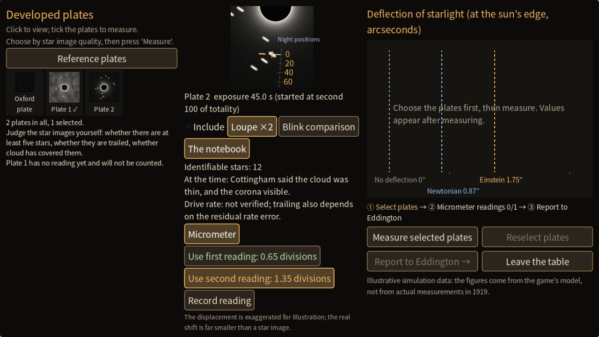
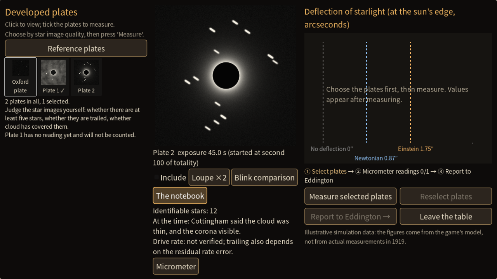
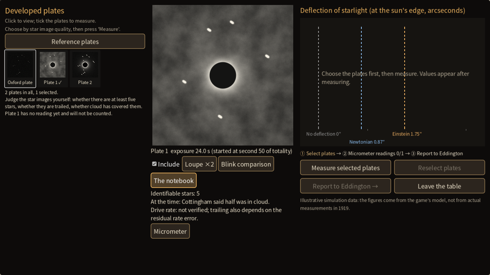

### 2026-11-27 21:02 JST · #603 (AA 18 drive lesson status) at d646693: accepted

Opened whole at 1280×720: all five candidate frames and main's 01 and 02. Main's 03 to 05 not opened.

- Technical regression: none in the frames shown; the scene is drawn as on main.
- This change: accepted. With the drive under the crosshair the objective card says "Help Cottingham wind the drive" instead of the plate-holder errand, then "Observe tracking and ask Cottingham to trim the rate", then ticks. The hold bar sits under the prompt and no longer lies across the drive housing.
- Whole scene: unchanged.
- Backlog, not holds: the hold bar is a soft translucent grey strip, pale fill on a grey track, outside the ink-and-paper frames beside it; at 50% the fill is close to the ground's tone. After the rate is verified the prompt still offers "[E] Observe tracking and ask Cottingham to adjust" (not checked against main). The card says "trim the rate", the prompt "adjust".

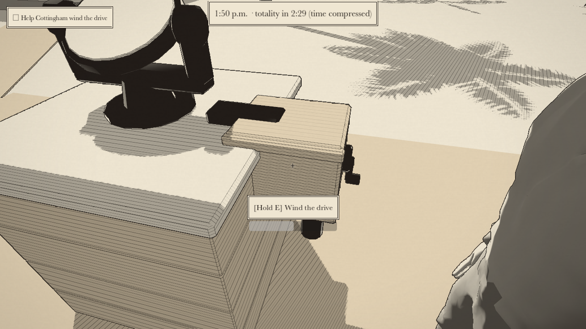
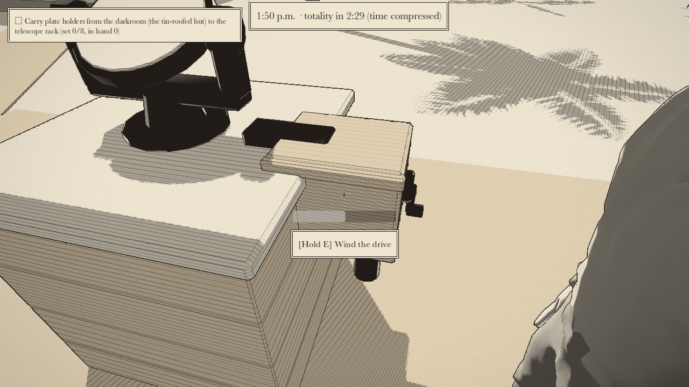
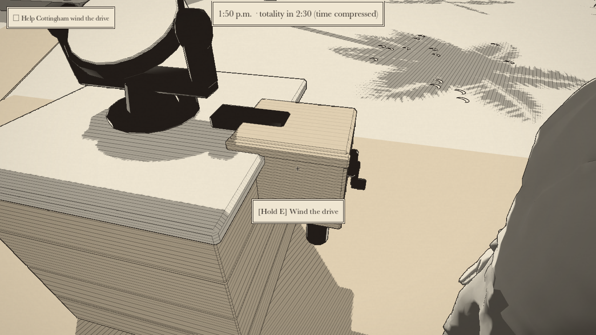
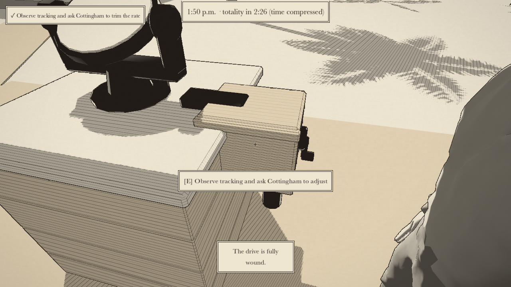

### 2026-11-27 21:51 JST · #605 (daylight cloud, my lane) at 25ccbaf: not accepted

Opened whole at 1280×720: early partial clear / thin / thick on the candidate, thick and clear on main, rehearsal thin on both. The other rehearsal and all totality pairs by numbers only (mean difference 0.10 to 0.37 of 255, the same pixel count in each state of a camera; not opened).

- Technical regression: none seen; rehearsal thin is main's frame, totality not opened.
- This change: not accepted. What holds: cloud is now drawn, behind palms and beams; the crescent is bright in a gap at 0.12, dim under ruling at 0.57 and gone at 0.97, so the missing Sun has a cause.
  1. **The three states are not told apart at a glance.** The same ruling covers most of the sky in all three (changed pixels 19%, 20%, 25% of the frame); only the Sun's own spot differs. "Clear" is a sky mostly under cloud.
  2. **One line weight for every density.** Cloud at 0.57 and at 0.97 is ruled with the same line and spacing. Thin cloud should be fewer, finer lines; thick cloud closer and darker.
  3. **The lines are not engraved lines.** About 4 px thick, mid grey, with blurred feathered ends and soft dark swellings. They are as loud as the palms. Wanted: thin hard-edged lines that end by thinning to a point, clearly lighter than anything on the ground.
  4. **The thick frame reads backwards.** A sky ruled edge to edge with small contoured white patches reads as a ruled clear sky with white clouds. The cloud bodies need to look like bodies (rounded contours on the cloud's side, lines following the form), and open sky must be the larger bare-paper area whenever the sky is mostly clear.
- Whole scene: early partial not ready. Seen beside it: the rehearsal sky at the same densities is still bare paper, so the same cloud is drawn two ways; to settle after this look is right.

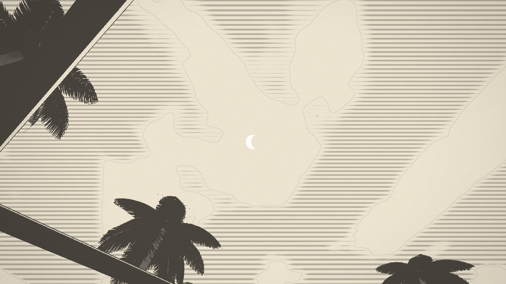
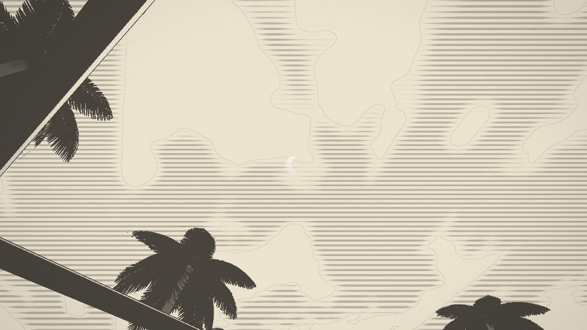
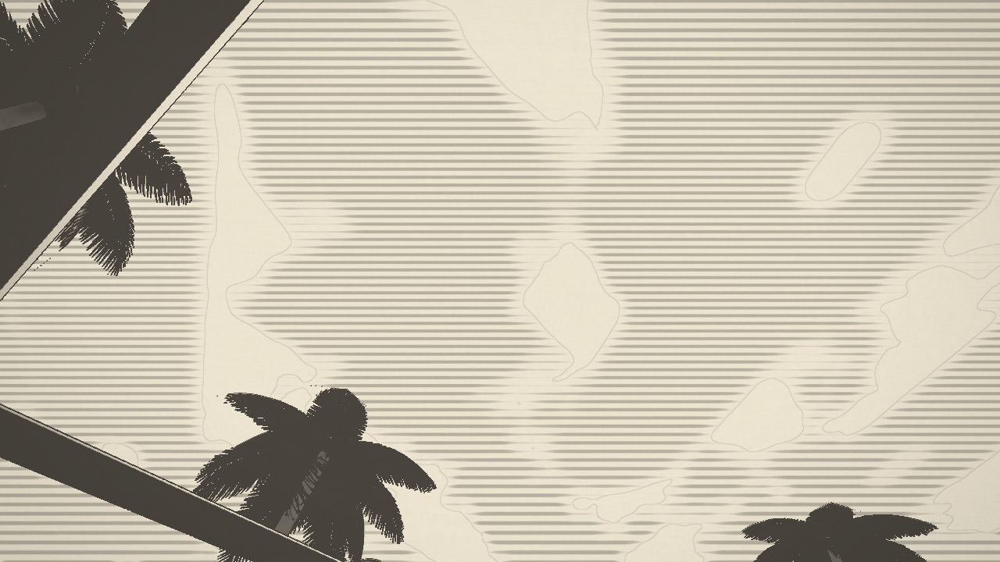
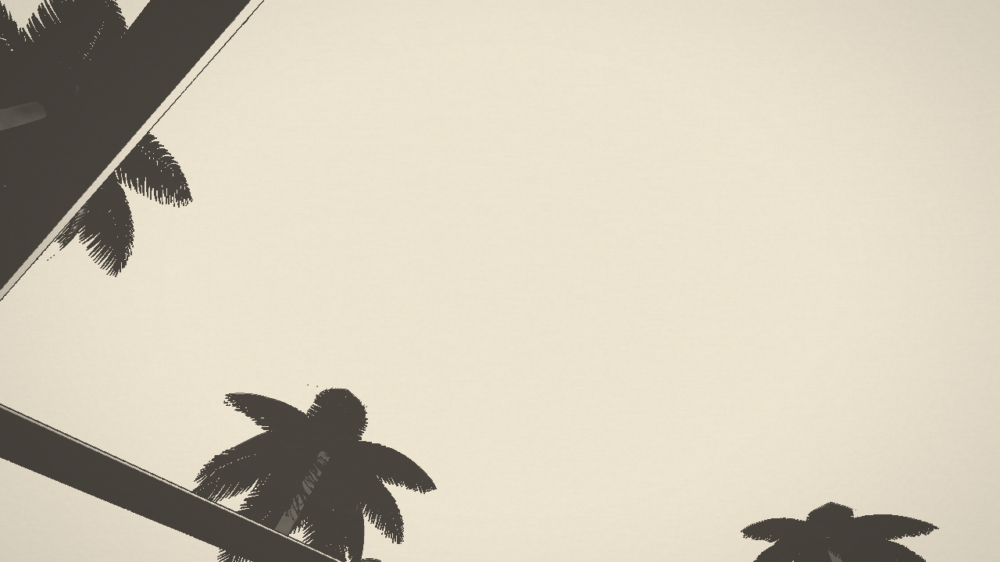

### 2026-11-27 22:05 JST · #605 (daylight cloud, my lane) at 46bead9: accepted, look only

Opened whole at 1280×720: early partial clear / thin / thick and the mostly-clear view on the candidate; totality wide thick on both. The other eleven control pairs by numbers only (mean difference 0.10 to 0.40 of 255, the same as at 25ccbaf; not opened). Main's early-partial frames not reopened.

- Technical regression: none seen. Totality wide thick is main's frame to the eye. The test result at this head was not in the worker's report (the run was waiting for a slot) and CI suites were pending when I looked; that is for the review gate.
- This change: accepted. The four items from 25ccbaf are gone. The cloud is drawn in thin hard lines that bend round the cloud's form, lighter than the palms and behind them. Open sky is bare paper: the mostly-clear view (72.9% clear) is nearly empty. Clear, thin and thick are told apart: bright crescent in open paper, dim crescent at a cloud's edge, no Sun under close ruling.
- Whole scene: early partial is better and not judged ready from four stills; the sky has not been seen moving.
- Backlog: some lines step in short horizontal jogs (lower right of the clear frame); the rehearsal sky at the same densities is still bare paper, so the same cloud is drawn two ways.

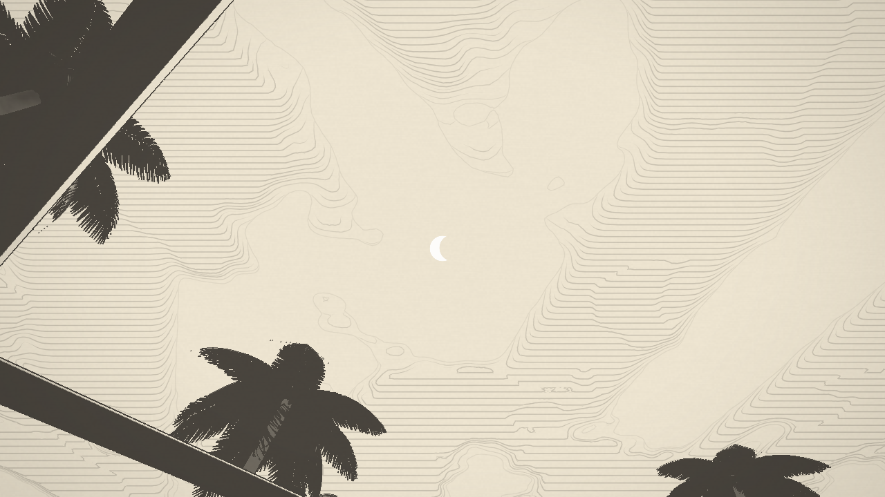
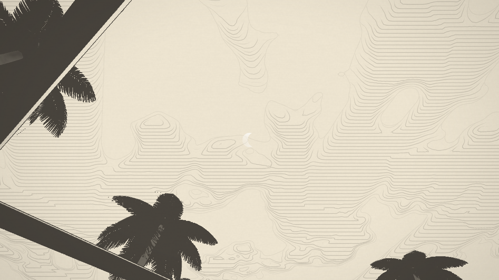
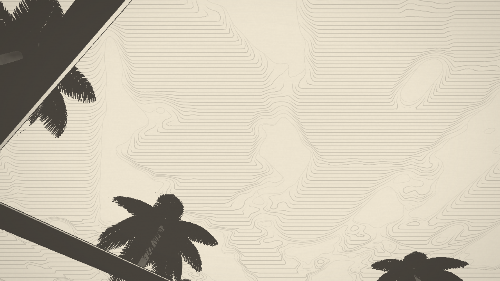

### 2026-11-27 23:47 JST · #604 (AA fun 03 plate-holder order) at 85391fd: accepted for the four states shown

Opened whole at 1280×720: all four candidate frames, and main's practice close and live close. Main's other two not opened. Head 4443ef5 changes test fixtures only (edd-lead); not seen in a frame.

- Technical regression: none in the frames shown; sky, camp and the other HUD are main's.
- This change: accepted for what is shown. After "Stop" the panel's status line reads "[E] Change plate holder" where main already read "Eddington is changing plates…"; same slip, same type, nothing over the Sun. In live totality the second plate box stays empty until the change is ordered (main hatched it at once), and five seconds later the clock has run from 254 to 249 with the prompt still up.
- Not shown, so not judged: live totality during and after an ordered change; the empty rack; what the player sees on pressing the shutter while the holder is spent.
- Whole scene: unchanged. Asked, not a hold: in the live frame at plus five seconds nothing but one line of small type says seconds are being lost. A mark for the spent holder on the plate strip would tell it without reading.

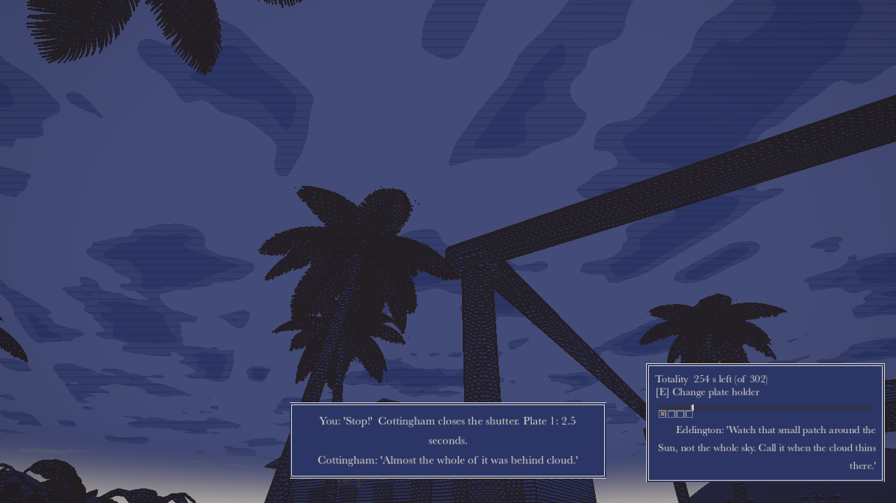

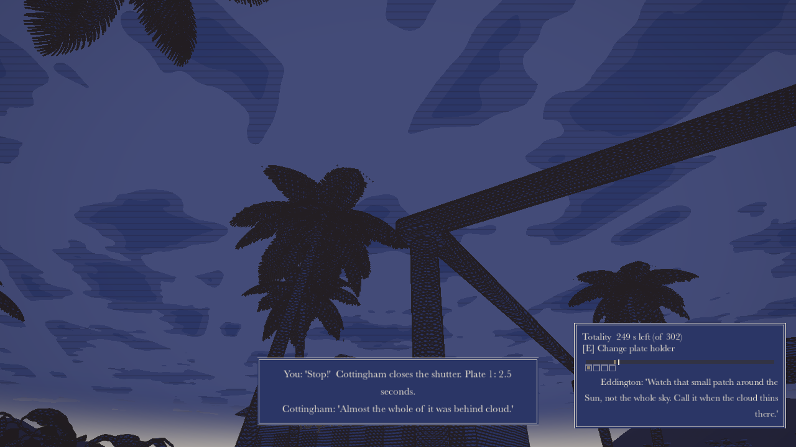
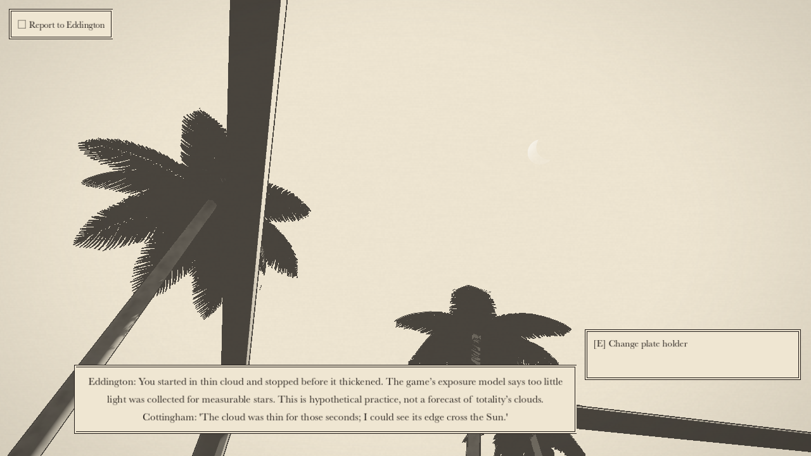

### 2026-11-28 01:24 JST · #609 (AA 19 Continue restores the recorded plate) at 47f2be1: not accepted yet, one frame owed

Opened whole at 1280×720: candidate recorded, candidate continued, main continued. Main recorded not opened; it is byte-identical to candidate recorded.

- Technical regression: none seen in the one viewer frame of the candidate.
- This change: not accepted yet. After Continue the candidate opens on Plate 2 with "Reading: 0.76 div." and the micrometer scale on the print, where main opens on Plate 1 with no readout. That is the wanted result.
  1. **Both "recorded" frames are the title screen**, not the viewer after recording. The before-leaving state is not shown, so I cannot see that Continue returns the same screen.
  2. **In the continued frame the white frame is on Plate 1's thumbnail while the viewer shows Plate 2.** If the screen before leaving looks the same, this is inherited and goes to the backlog (the plate in the viewer should carry its own mark on the thumbnail row); if it differs, it is this PR's.
- Next head or same head: the viewer right after "Record reading" on plate 2, before leaving, on main and on the candidate.
- Whole scene: unchanged.

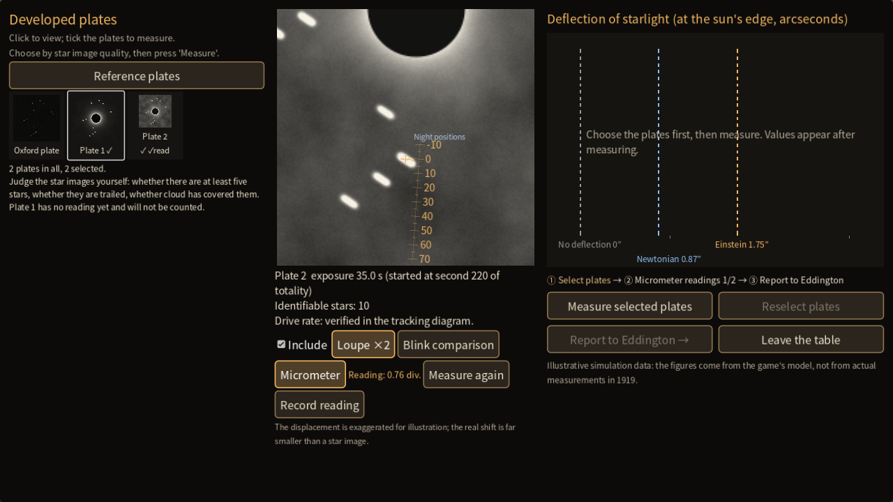
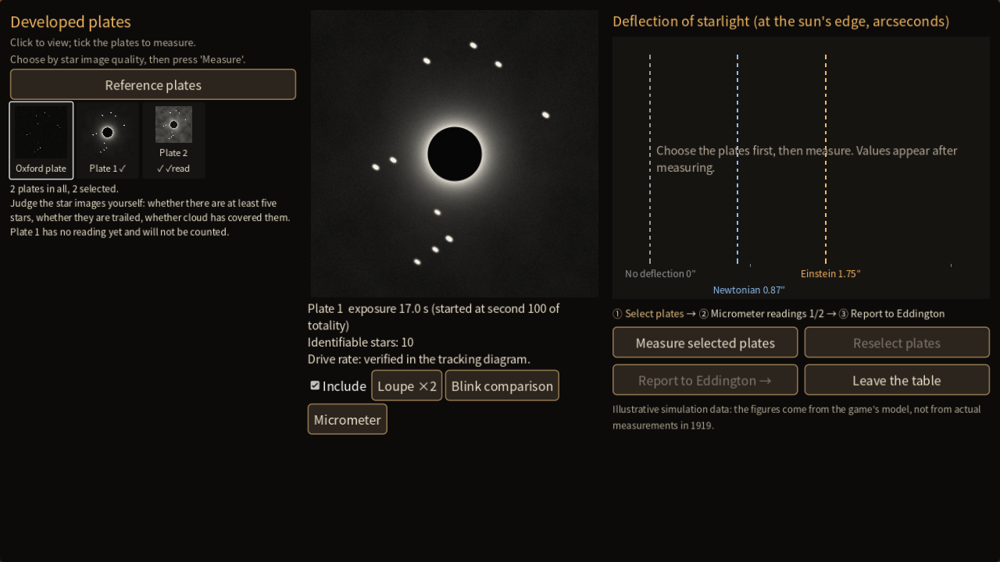
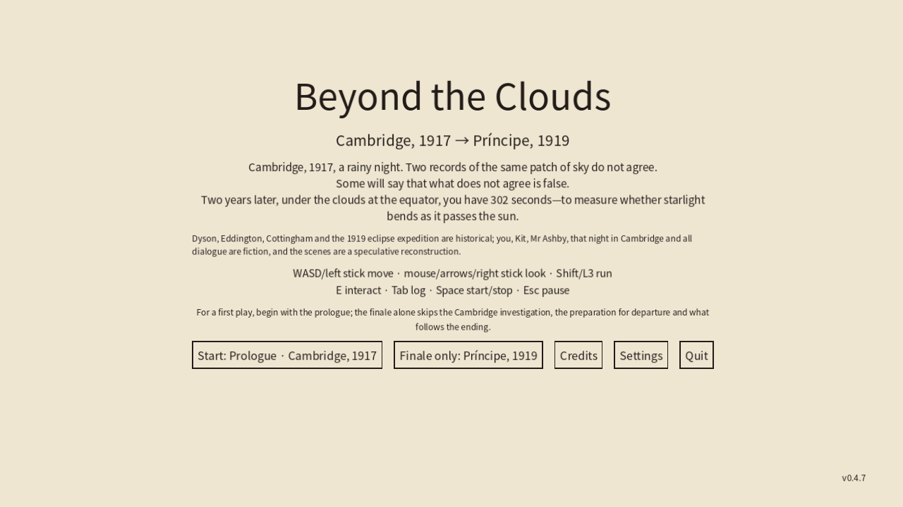

### 2026-11-28 01:42 JST · #600 (journey, Sobral chapter, behind `--journey`) at 3bdb042: not accepted

Opened whole at 1280×720: 22 of the 58 frames. English: 01 to 06, 07 B21, 08 B21 and its end, 09, 10, 11, 12 B36, 13 to 18, 18 at text scale 1.2. Japanese: 05 and 09. Not opened: the other 27 Japanese frames, the B20 and B22 loupe and revise frames, 12 B35, and the remaining end frames.

**Holds.** The plates, the loupe and the comparison task (11 to 17) read well: plate, label, choices, one answer at a time. The plate pictures are consistent with each other.

**Against it, this chapter's own drawings:**
1. **The eclipsed Sun is a flattened ellipse** on 03 and 05, and the stars on 10 are ovals. The drawings are stretched. Sun, Moon and stars are round.
2. **04 and 05 have a blurred photographic sky** behind flat ink silhouettes on paper; every other drawing in the journey is ink on paper. Draw the cloud. On 05 the eclipsed Sun sits on the shelter roof, cut by its beam: the chapter's main image is its weakest.
3. **05's exposure diagram has no labels.** Two rows of blocks and a row of ovals; nothing says which row is which instrument or what the ovals are. The two captions above run into each other ("5 and 10 seconds" wraps under Davidson's as if it were a new line).
4. **09, plate 6:** the dark disc spills past the plate onto its frame and the mat.
5. **03:** "Corona diagram" and "Corona photographed with the Mailhat instrument…" sit under the names paragraph, away from the pictures they caption; the instrument is a bar on a tripod.
6. **06:** the two disabled rows are pale grey text on grey; they cannot be read, and they tell the player what comes next.
7. **01** is a sheet with two lines on it. Give it the racecourse drawing or fold it into 03, which has the same title.

**Carried to #551, not this PR:** the right column scrolls for one hidden button on 08; text and a plate are sliced at the fold on 09 and 18 (worse at 1.2).

**For edd-lead (copy):** in Japanese "Leocádio Araújo", "Davidson" and "Crommelin" stay in Latin letters; I asked that only for "Kit".

Verdicts: technical regression none claimed for the slice (flag off); this PR's change not accepted, items 1 to 7; chapter not ready to show. For the next head: 01 to 06, 09 and 10 in English, 05 and 09 in Japanese.

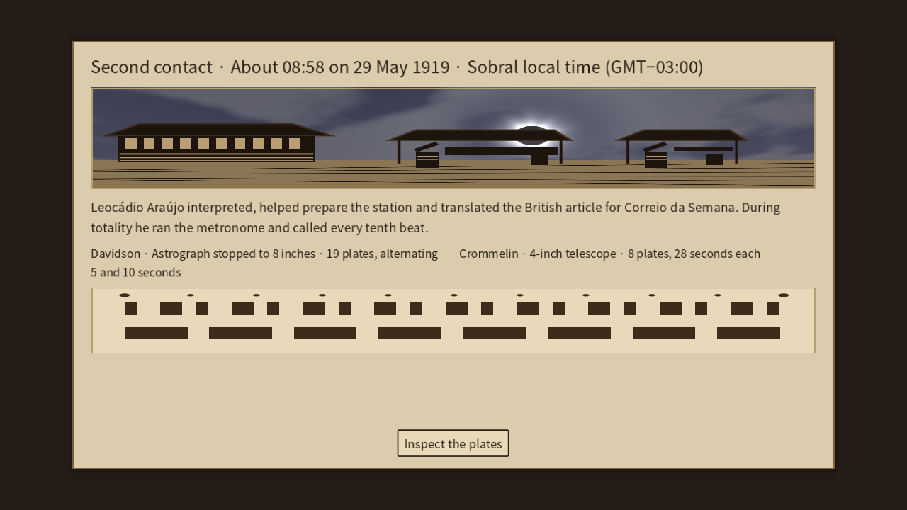
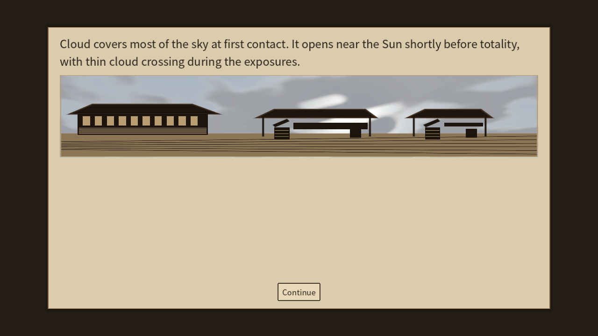
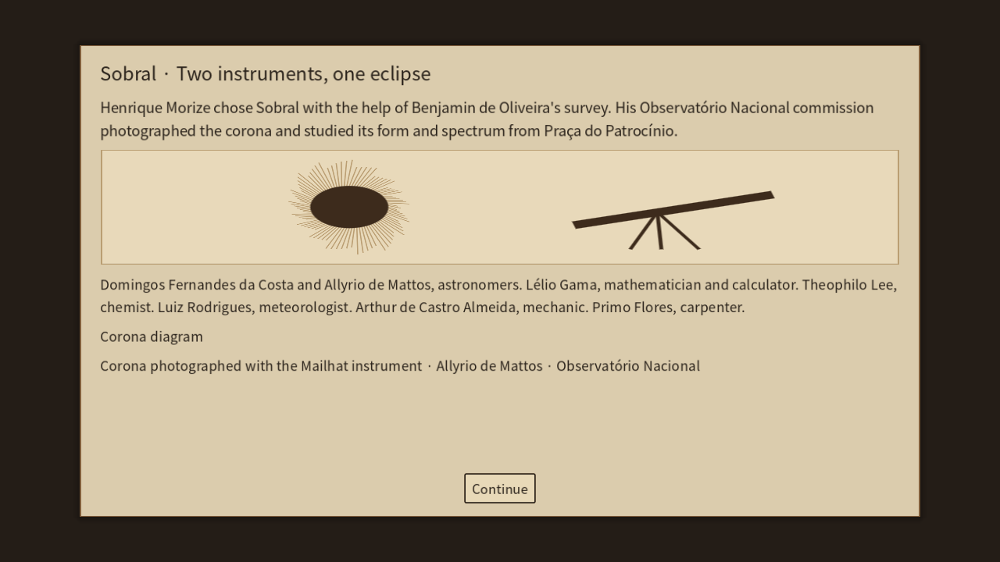
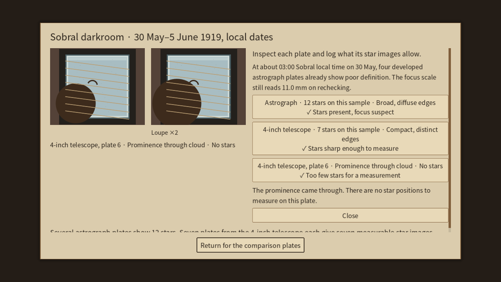
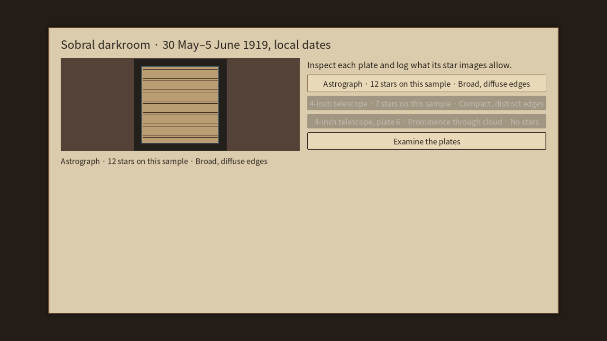

**Count stays 7/9.**

### 2026-11-28 03:30 JST · #606 (journey, four Sundy drawings, my lane, Refs #551) at db62667: accepted, look only

Opened whole at 1920×1080: all six candidate frames (02, 09, 14, 16, 17 in English; 17 in Japanese). No main pair: the worker's main-side capture is still waiting in the heavy queue after four hours. I judged against #552's accepted frames as described in the entry of 2026-11-27 13:07 JST, not reopened.

- Technical regression: none seen on these pages; flag off untouched (test_journey off 46 checks, on 1496 checks, 0 failures by the worker's report; the portrait revert check was still pending).
- This change: accepted. Kit's card is a toned print like Ashby's, with "(Fiction)" and "Kit" in Latin letters in Japanese. The cloud band tapers to a point at both ends. Page 09 has no crate at the port. The sea's ruling runs to the shore.
- Whole scene: the chapter still waits for #551's sheet items (scroll for one line, slices at the fold, scrollbar, port names, the three from #542).
- Seen, minor: the top sea line on 02 and 09 ends in the air above the land instead of at it.

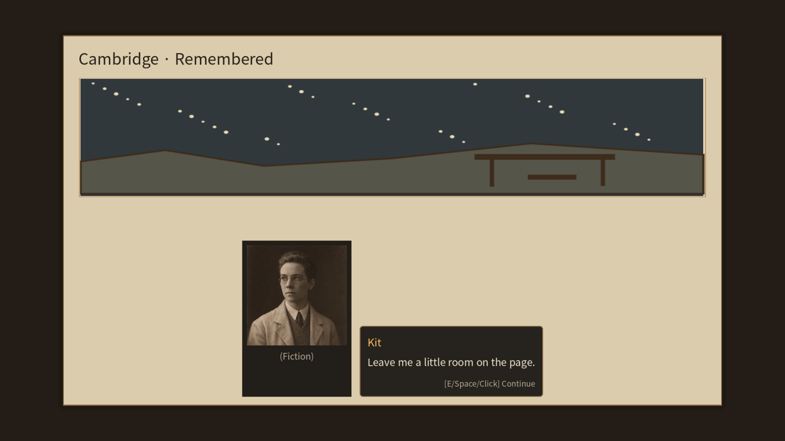
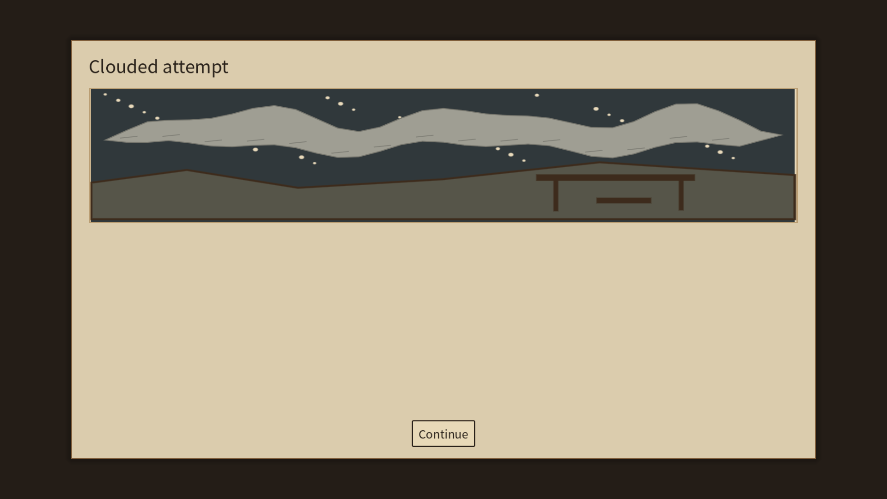
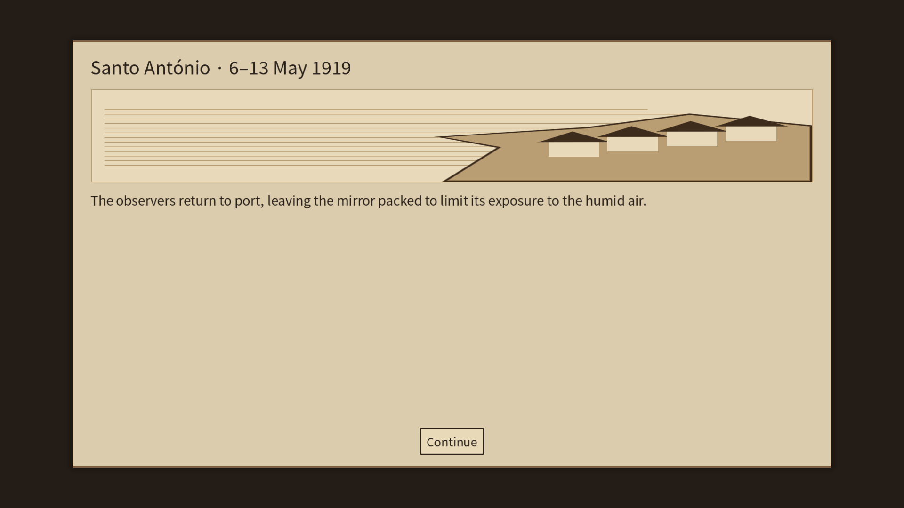

### 2026-11-28 04:42 JST · #600 (journey, Sobral chapter) at b5abc00: accepted

Opened whole at 1280×720, the ten frames asked for: 01, 02, 03, 04, 05, 06, 09, 10 in English; 05 and 09 in Japanese. The other 48 frames in the directory were not opened; 11 to 18 stand on the look at 3bdb042.

The seven items are gone:
1. The eclipsed Sun is round on 03 and 05; the stars on 10 are round points.
2. 04 and 05 have drawn cloud on paper; the eclipsed Sun stands clear above the shelter roof.
3. 05's diagram has three labelled rows: metronome, Davidson's astrograph, Crommelin's 4-inch.
4. 09, plate 6: the disc stays inside the plate.
5. 03: each picture has its caption under it; the Mailhat instrument is a telescope on a stand.
6. 06: the waiting rows read, in dimmer ink.
7. 01 carries the racecourse drawing.

Japanese names are in katakana on 05.

Still carried to #551 (draft #611 works on the shared sheets): on 09 a line is cut at the fold above the button.

Minor, not a hold: 05's sky at totality is the same pale paper as the day pages; the eclipse is about 40 px wide. It could take the dark page that 10 has.

Verdicts: technical regression none claimed for the slice (flag off); this PR's change accepted; chapter shown behind the flag, not ready for flag-off until #551.

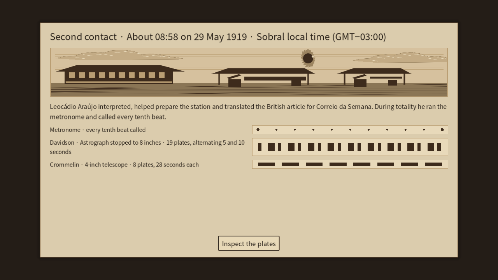
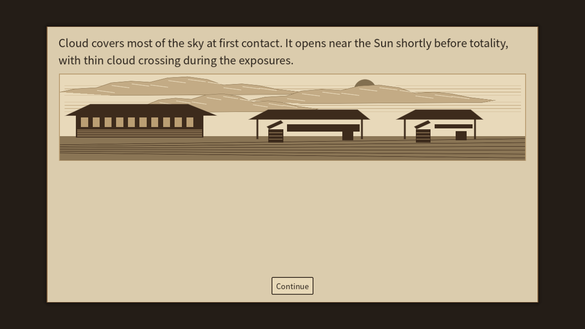
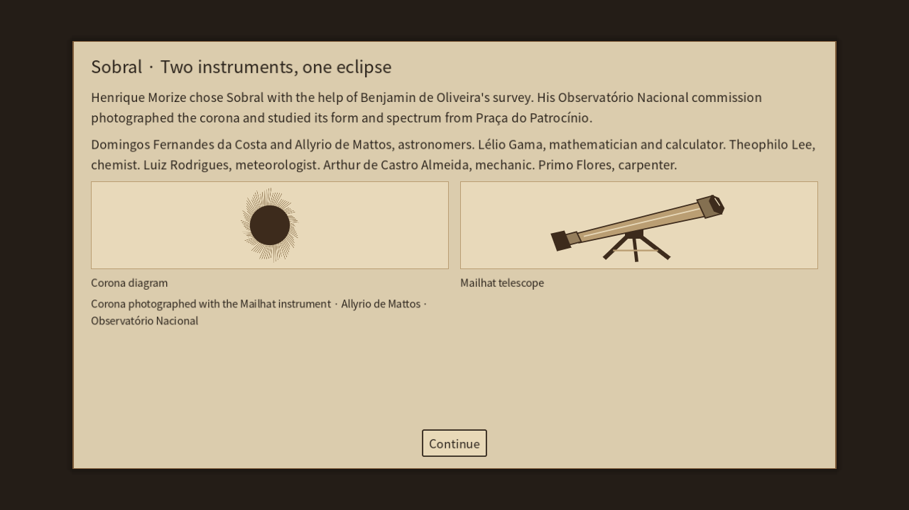
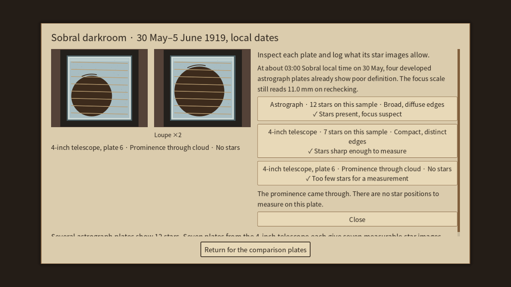
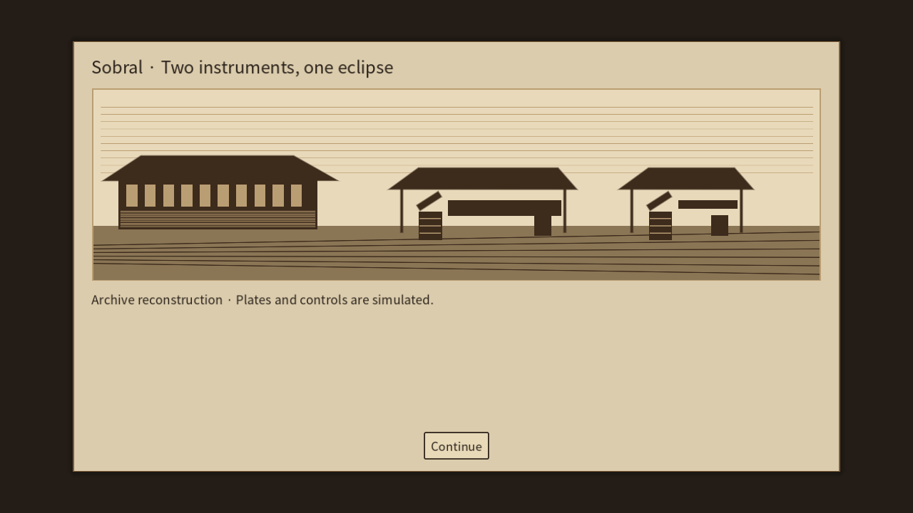

**Count stays 7/9.**

### 2026-11-28 04:46 JST · #589 (AA fun 01 middle cloud seam) at 3694d73: not accepted, one thing left

Opened whole at 1280×720: seam frames 0, 84, 120, 180, 240, 300; clear frames 0, 570, 660; thick frames 0, 660. A strip of twelve native crops of the Sun through the seam (frames 60 to 300). By numbers only: the largest frame-to-frame change in the Sun's crop over all 361 seam frames (0.33 of 255, at frame 155). Not opened: the thin clip, the mp4 files, the rest of the frames. Head 9870632 (metering only, no shader) not seen in a frame.

**What was wrong at 3a0a02e is gone.** Through the whole seam every cloud island keeps its hard contour and ruling; the sky no longer goes soft. The Sun is eaten from one side and returns from the other, corona with it, no see-through disc, no step. Second contact reads in clear and thick.

**Left: the seam is an empty pill.** What crosses the Sun is a thin outline in the shape of a capsule (two straight parallel sides, round ends) with nothing inside it: the sky inside is the same tone as outside, no ruling. Where it meets the Sun the disc and corona end in a soft feathered edge that does not sit on any drawn line. So the Sun is rubbed out by an outline, not covered by a cloud (strip: `seam-sun-strip-12.png`). The same capsule shape is the pale stripe pointing at the crescent in clear frame 0 and the straight-sided opening the corona sits in at clear frame 660.

**Accept if:** the seam is drawn as one more cloud island like those around it (their darker tone, their ruling, an irregular contour), and the disc and corona end at that contour with a hard edge; the thinning's opening has irregular edges, no straight parallel sides. Everything that holds now stays: hard contours in every frame, the side-to-side passage, no step larger than now.

For the next head: the seam clip again (I open 0, 120, 180, 240 and the same strip), clear frames 0 and 660.

Verdicts: technical regression none seen (rows 4 and 5 hold on these frames); this PR's change not accepted, one thing; totality as a whole unchanged in readiness.

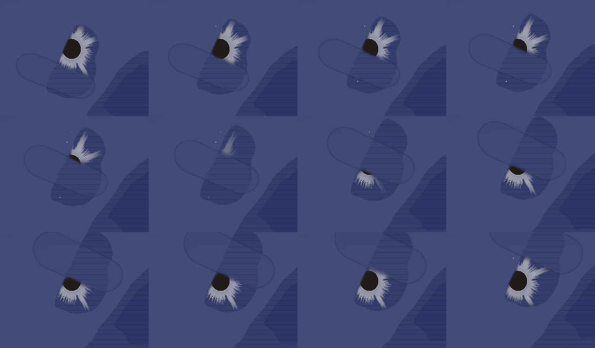
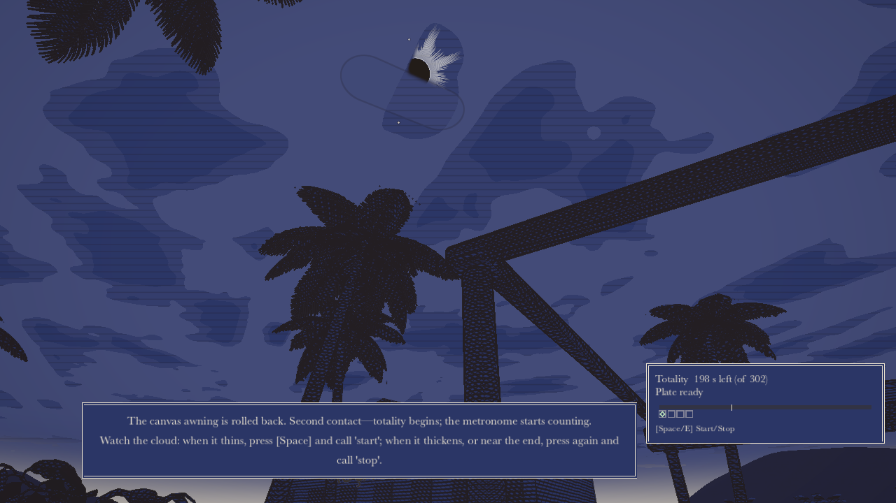
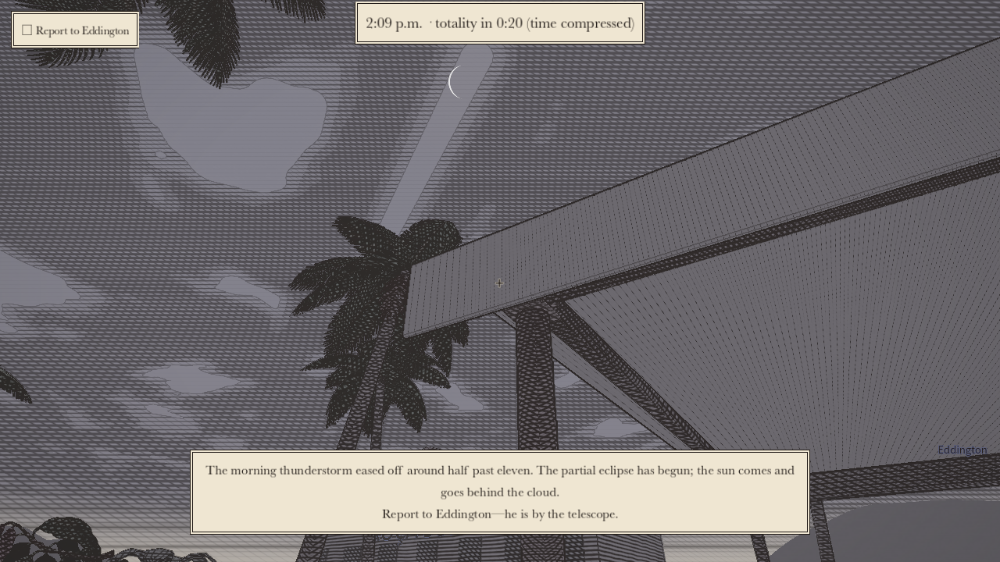
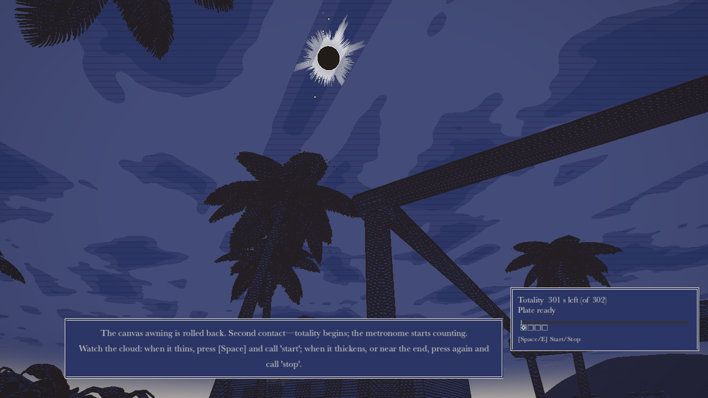

**Count stays 7/9.**

### 2026-11-28 04:59 JST · #609 (AA 19 Continue restores the recorded plate) at 47f2be1: accepted

Opened whole at 1280×720: the new `candidate-recorded-viewer.png`. `main-recorded-viewer.png` not opened; it has the same hash (4e90a1f5…). Candidate continued and main continued were opened at the last entry.

- Technical regression: none seen.
- This change: accepted. The viewer right after "Record reading" on plate 2 and the viewer after Continue are the same screen: Plate 2, "Reading: 0.76 div.", the scale on the print, "Micrometer readings 1/2". Main returns to Plate 1 with no readout.
- Whole scene: unchanged.
- Backlog, not a hold: the white frame sits on Plate 1's thumbnail while Plate 2 is in the viewer, on main and on the candidate alike (focus moves to the next plate after recording). The plate in the viewer has no mark of its own on the thumbnail row.

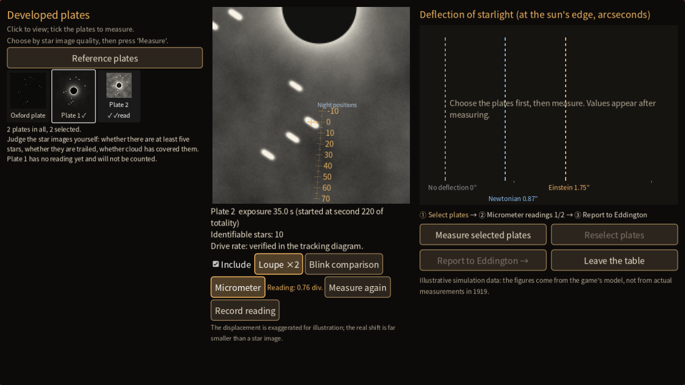

### 2026-11-28 05:05 JST · #614 (AA 08 last active device's hints win) at f49e3a9: accepted

Opened whole at 1280×720: candidate prep-pad, darkroom-pad, darkroom-keyboard; main prep-pad. The other four not opened.

- Technical regression: none seen; the frames differ from main only in the hint line.
- This change: accepted. After pad input the dialogue hint reads "[A button] Continue" and the choice hint "[Arrow keys/A button] Choose", in the slip's small capitals at the same place and size; after a key it reads "[1–3 or click] Choose" again. Main shows the keyboard hint in the pad state.
- Whole scene: unchanged.
- For edd-lead (copy): the pad hint says "Arrow keys"; on a pad that is the D-pad.
- Seen here, mine, not this PR's: this is the first play-camera frame with #605's daylight cloud. The contour lines cover the whole sky down to the horizon and read close to a contour map. To be judged in the row 2 motion capture (early partial under cloud) before I call it right.

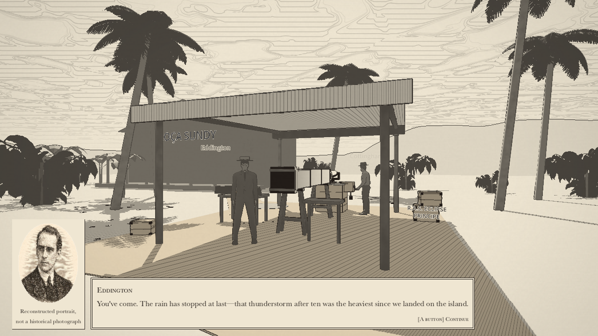
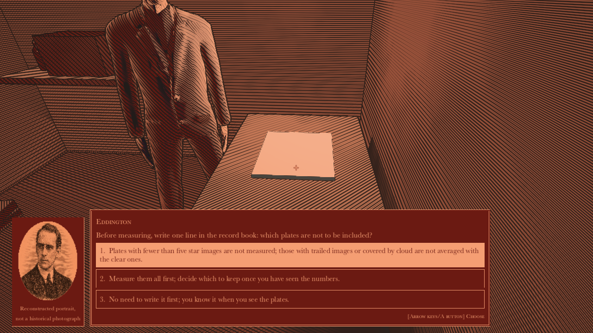

### 2026-11-28 05:18 JST · Cottingham's portrait (row 8, AA 27): candidate A picked

Three generated candidate pairs (toned print and its engraving), no photograph of the real man used or imitated; manifest in `/Volumes/KIOXIA/eddington-1919-cache/director/portraits/cottingham/2026-11-28/`. Opened whole at native size: the three prints (1254×1254), A's engraving, A's 720p dialogue mock, and Eddington's engraving beside it. Not opened: B's and C's engravings and mocks, the 6430 px comparison sheet.

- **A is the pick.** A square-jawed man of about fifty, greying at the temples, grey moustache, open work shirt, looking off to the side: practical and steady, and plainly not Eddington. Its engraving has the same build as Eddington's (hatching that follows the form, ruled ground fading into an oval vignette) and at the slip's 130×173 px the head, moustache and shirt still read.
- B is out: round and jovial, a comic turn the lines do not have. C is out: gaunt and severe, he would read as a threat beside Eddington.
- One correction for the committed file: A's engraving is printed in a lighter, warmer brown than Eddington's near-black line. Bring its ink to Eddington's tone and contrast so the two are plates from one book.

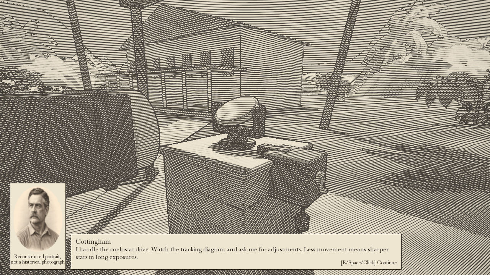

### 2026-11-28 05:41 JST · #617 (Cottingham's portrait print and engraving, my lane) at f04823a: accepted

Opened: the worker's side-by-side of `eddington_engraving.jpg` and the committed `cottingham_engraving.jpg` (2120×1104, shown to me at 2000 px wide). The committed files themselves not opened one by one; sizes checked (engraving 1024×1024, print 1254×1254, as Eddington's). The print is candidate A's, seen at the last entry before resizing.

- Technical regression: none possible on screen; no wiring in this PR. test_credits 477 checks, 0 failures by the worker's report; Codex review approve 0/0/0.
- This change: accepted. The ink is now Eddington's near-black on the same cream; same hatching, same ruled ground and oval vignette. Two plates from one book, two different men.
- Row 8: not moved until AA 27 wires the 16 Príncipe lines to `res://assets/portraits/cottingham_engraving.jpg`.

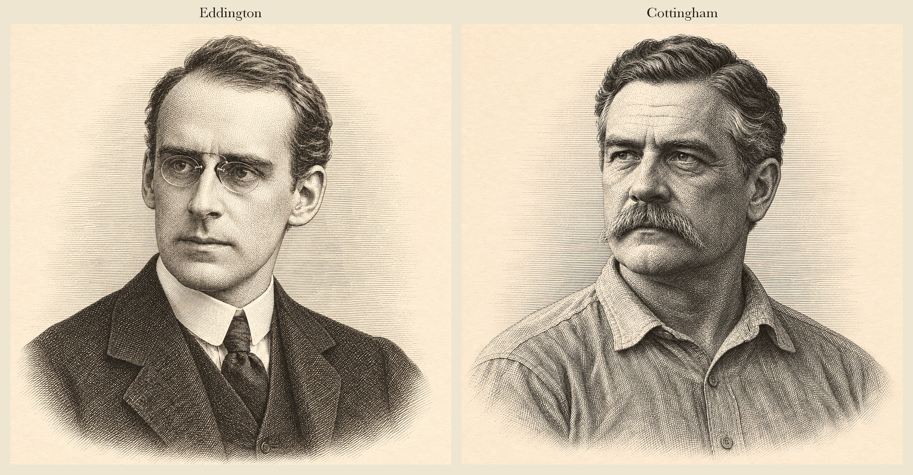

### 2026-11-28 07:12 JST · #611 (journey sheets, my lane, Refs #551) at 9df8510 / adac387: English at 1.0 holds, the rest not shown; not accepted yet

Capture of 9df8510 (adac387 after it changes the capture's settings handling only): 122 frames, English, 1280×720, text scale 1.0, stopped before I3 by an assertion in the capture's own story walk. Opened whole: 053 (route strip), 077 (the letter), 090 (onward passage), 105 first and end, 110 first. The other 116 by the index only (108 marked no scroll, 14 scroll, all in the drive check). No main pair, no 1.2, no Japanese.

- Holds at 1.0: the letter and the onward passage fit with no scroll and nothing cut; titles whole; ports named on the strips (Liverpool, Lisbon, Funchal, São Vicente, Santiago, Santo António); the scrollbar is brown; where the drive check scrolls, the fold falls between lines.
- Not shown: text scale 1.2 (where chapter 2 hid its closing lines) and Japanese. These are the cases the issue is about.
- One thing on the drive check: its record buttons (Usable / Repeat / Too few stars), the screen's action, are under the fold at first view while the column scrolls 70 px. They belong in the first view. Its disabled buttons are grey on grey and cannot be read (the Sobral 06 defect).
- The capture is a story playthrough with assertions, so a story expectation stops the pictures. It should open the sheets and photograph them.

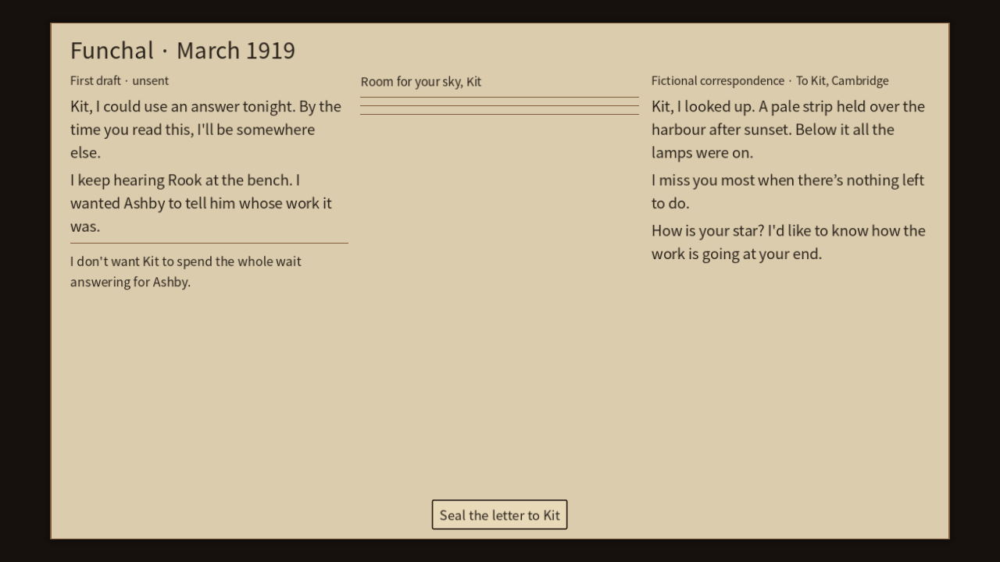
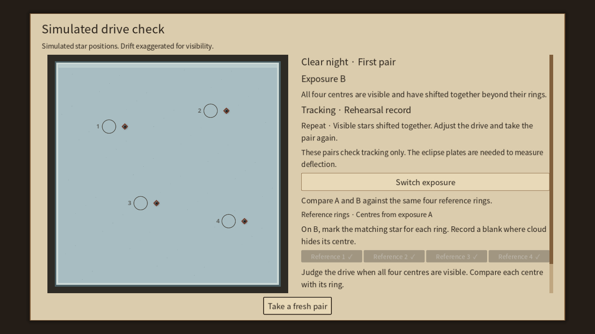

### 2026-11-28 08:31 JST · #620 (journey I4, Homeward and across Europe) at 382c0a7: accepted, fold slice carried to #611

Opened whole at 1280×720: return en (first view, end, first view at 1.2), plates en, Brussels telegram en, Berlin letter en, return ja, plates ja. Not opened: the other six (1.2 end, plates en end, the two ja ends, Brussels ja, Berlin ja).

- Technical regression: none seen. Same sheet, type, rules and brown scrollbar as the Sobral chapter.
- This change: accepted. Four sheets read in order; quotations, sources and rules are told apart; Japanese sets cleanly with the English quotation kept above its translation; at 1.2 the return sheet's fold falls between entries.
- Whole chapter: reads, but plain. Four sheets of text and no picture; the Brussels and Berlin sheets are two entries and one entry on an otherwise empty page.

Carried, not held here (same as #600): the fold cuts a line in half on the first view of return en, plates en and return ja, and the top of the scrolled view cuts one on return en end. That is the shared sheet's defect and belongs to #611 (Refs #551); I check these I4 sheets there.

Backlog: a homeward route strip (Príncipe to Liverpool) on the first sheet, as the outward chapters have; Brussels and Berlin could share one sheet.

Frames kept in `docs/design/slice_principe/accept/620/382c0a7/`.

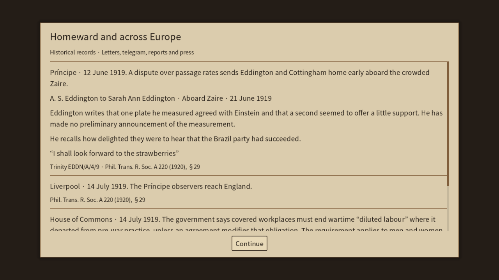
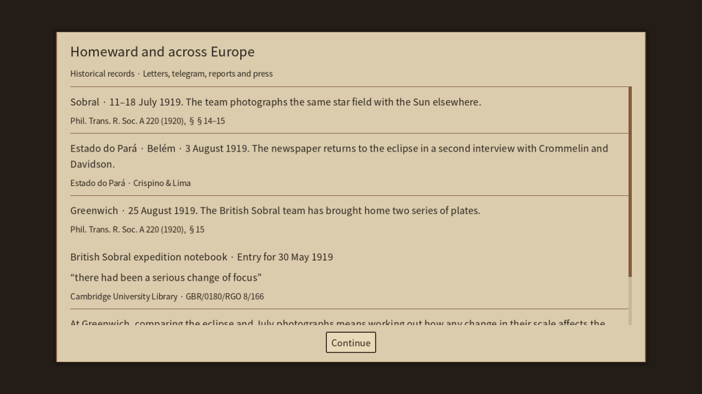

**Count stays 7/9.**

### 2026-11-28 08:44 JST · #618 (journey, London joint meeting) at 183a40c: accepted as a chapter; not yet a climax

Opened whole at 1280×720, English, text scale 1.0: threshold, proceedings, principal, precision attached, Silberstein, exchange, hold (first view and end). Not opened: the other 54 (all Japanese, the 1.2 exchange, prediction, simulation, scale, Newall, open test, reply, workbook, the other ends). Stills only: I have not seen how one state turns into the next.

- **Technical regression:** none seen. Same sheet, type, rules and scrollbar as the other journey chapters.
- **This change: accepted.** The argument reads in order, the speakers are told apart, and the chart keeps both Sobral astrograph figures in view as the text asks. It can merge.
- **Whole scene (the public climax): not accepted as a climax.** It does not feel epic; it feels like one more page of the folder.

Two defects in these frames, for a follow-up, not held here:
1. On the chart the row labels ("Sobral 4-inch", "Príncipe", "Sobral astrograph") are crossed by the dashed 0″ line, in every chart frame.
2. The fold cuts a line in half on hold (first view). Same shared-sheet defect as #600 and #620; it belongs to #611.

**What is missing for the climax** (my lane; brief written, I dispatch it when this is on main):
- **The result never arrives.** In "principal" the chart is already complete. The two points should land one after the other on an empty axis, Sobral's then Príncipe's, each with its error bar, while the 0.87″ line the player has carried since 1917 stands there to be passed.
- **The chart is 166 px of a 720 px screen.** It is the picture of the whole game's question and should be the largest thing on screen at that moment, drawn as a plate of the book (ink on paper, as the Sobral and Sundy drawings), not a dark strip.
- **The player's own figure is a line of text.** "Your 1917 prediction · 0.87" belongs on the chart as their mark, so they see their own number left behind.
- **No room and no people.** Burlington House, 6 November 1919, is two lines of type on the same 768 px slip as the doorstep talk. One drawn plate of the room would set the scale; Eddington's engraved portrait exists and is not used where he reports.
- **No held beat.** Every state ends in the same Continue button at the same weight; the announcement and Ashby's concession pass like any other paragraph.

Frames kept in `docs/design/slice_principe/accept/618/183a40c/`.

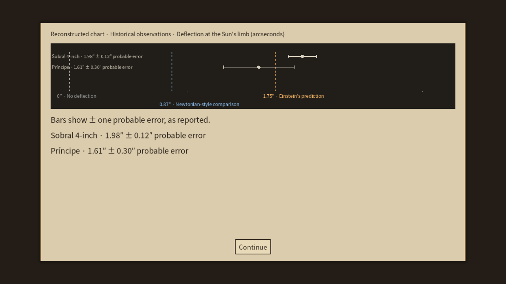
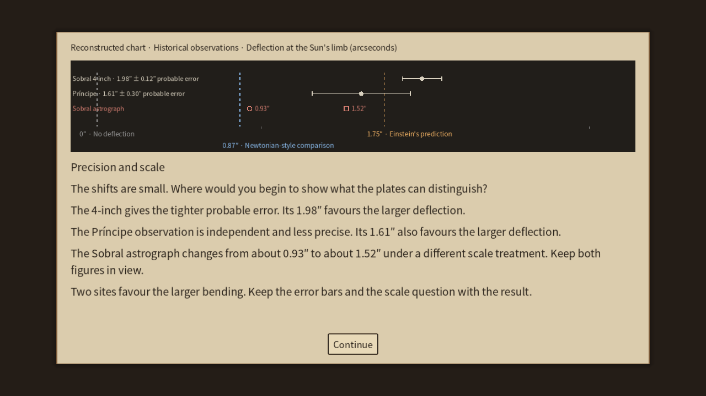
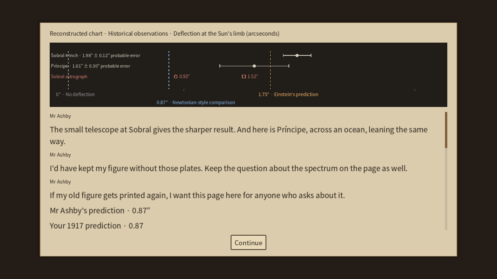

**Count stays 7/9.**

### 2026-11-28 09:02 JST · #589 (AA fun 01 middle cloud seam) at d535209: accepted, daylight stripe carried

Opened whole at 1280×720: seam frames 120 and 180; clear frames 0 and 660. A strip of twelve native crops of the Sun through the seam (frames 0 to 340). Not opened: the other seam frames, the mp4. The peak Sun-crop step (0.293 of 255) is the capture's own figure; I did not re-measure it. No thin or thick clip in this capture: thin is judged on the row 2 re-shoot after merge.

- **Technical regression:** none seen. Islands keep hard contours and ruling through the seam; corona and Moon intact before and after.
- **This change: accepted.** The seam is now a cloud: a filled, ruled island with an uneven contour, darker than its neighbours, and the disc and corona end hard at its edge. It comes in from one side, covers the disc with the rays still showing around it, and leaves on the other. The opening the corona sits in at clear frame 660 has irregular edges.
- **Whole scene (totality):** readiness unchanged; row 2 still to be judged in motion.

Carried, not held (this is the third round and the seam itself is right): at clear frame 0, 20 s before second contact in daylight, the thinning is still a pale stripe with straight parallel sides pointing at the crescent, like a beam. It goes into my daylight/rehearsal sky brief after this merges.

Frames kept in `docs/design/slice_principe/accept/589/d535209/`.

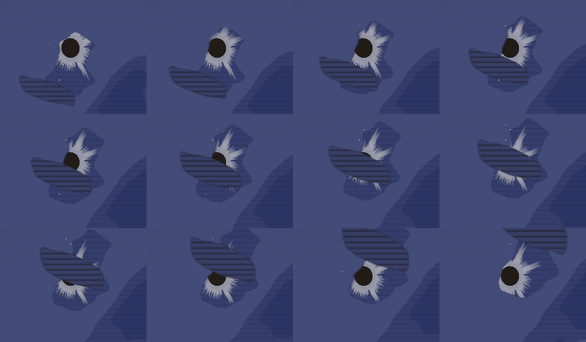

**Count stays 7/9.**

### 2026-11-28 09:24 JST · #621 (AA 27 Cottingham portrait wiring) at 947604a: accepted

Opened whole at 1280×720 (text scale 1.2): candidate journey en first-1, first-3, return-wound, third-contact; candidate standalone ja dispatch-wound; main journey en first-1. Not opened: the rest (zh-TW, ko, the other states and routes).

- Technical regression: none seen; main and candidate first-1 differ only by the portrait.
- This change: accepted. Cottingham's engraving sits in Eddington's slot with the same oval, caption and size; the line and the Continue hint clear it; in the darkroom it takes the safelight red like Eddington's.
- Row 8: this clause moves when merged; the row's other clauses wait for the survey.

For edd-lead, not this PR's: every camp frame here is shot under a dark veil (first-1 is almost black, on main too, with the line already up). If that is the capture catching a fade, fine; if the game really shows the first line that dark, it is a defect on main.

### 2026-11-28 09:24 JST · #615 (AA 25 ending review) at 3324030: accepted

Opened whole at 1280×720 (text scale 1.2): candidate en clean keys review and history, candidate en empty pad review, main en clean keys review. Not opened: the other 28 (ja, the rest of pad/keys and empty/clean).

- Technical regression: none seen; same type, column and button row as main.
- This change: accepted. The evidence (dispatch copy, verdict, telegram, basis) now comes before Eddington's reply and reads as one record; the empty-plates case reads the same way.
- Whole screen: unchanged, plain.

Inherited, visual backlog (on main too): the scrolled column cuts a line in half at its top edge; the button row's top border is cut and the row runs to the screen edges at 1.2; in history it wraps and leaves Quit alone on a second row.
Copy, for edd-lead: the history heading shows "Historically (HISTORICAL_RECORD; see docs/PROVENANCE.md)" to the player.

### 2026-11-28 09:24 JST · #610 (AA 11 I2 letter fold) at ac769c4: accepted

Opened whole at 1280×720 (text scale 1.2): candidate i2 letter end en keys and ja keys, candidate i2 landfall end en pad; main i2 letter end en keys. Not opened: the rest (zh-TW, ko, packet, hearing, armistice, the other pad/keys).

- Technical regression: none seen.
- This change: accepted. The letter's last line now stands clear of the button with room under it (on main it sits against the fold); Japanese keeps both the translation and the original line clear.
- One thing to check, not held: in the English candidate frame the rule above "Letter excerpt" is gone (main has it, the Japanese candidate has it). Likely a 1 px rule lost at this scroll offset.

Inherited: the route strip is cut by the top edge when scrolled. For edd-lead: #611 (my lane) rewrites the same sheets (port names, no scroll at 1.0); whichever merges second needs a rebase and I re-look at this state there.

**Count stays 7/9.**

## VISUAL_FIDELITY · ranked list (2026-11-28 14:15 JST)

Owner, 2026-11-28 14:15 JST via edd-lead: visuals are the first reason a player picks the game up; make it as beautiful as possible; visual rows rank above further AA polish. This list is mine and I dispatch from the top.

What I looked at, whole, at native size, for this list: the camp in daylight and after totality (`accept/614/f49e3a9/`, `accept/621/947604a/`), totality and its cloud (`accept/589/d535209/`), the darkroom (`accept/614/`, `accept/621/`), the journey sheets (`accept/611`, `620`, `610`), the Sundy and Sobral drawings (`accept/606/`, `accept/600/`), London (`accept/618/`), the Cambridge star-field table (`accept/583/`), the ending review (`accept/615/`), and the title screen (in the #609 capture). Not looked at for this list: the Cambridge room in 3D, the departure and epilogue scenes, anything moving (the row 2 and row 8 captures of main are still queued for the GPU).

Where the look stands: the engraving treatment holds and totality is the best frame in the game. The gap is what there is to look at. The one walkable place is a flat ground with one shelter, two stiff figures and a grey box for a house; and the journey, half the game's length, is text on paper with slips of flat shapes.

| # | Gap (what a player sees) | Target frame | Accept when | Means |
| --- | --- | --- | --- | --- |
| F1 | **The camp is an empty set.** Roça Sundy's house is a grey box with its name on it; the ground is one bare plane; nothing stands between the shelter and the horizon. | Camp in daylight from the arrival point and from under the shelter | The house is a building (roof, verandah, shutters, steps) that reads at 30 m; the ground around the shelter carries the expedition's things (plate boxes, tarpaulin, lantern, water barrel, tools, mirror cover) and paths; a middle distance exists (fence, drying floor, outbuildings); row 9 still holds | **Modelled 3D in Blender** (Codex, no sandbox; own procedural models as in af01, CC0 where it saves time). Shader alone cannot add things to look at. |
| F2 | **The people are mannequins.** Eddington and Cottingham stand straight with arms down; dark shapes with little line inside; nobody reacts to totality. | Camp at totality and at the drive | Each has a working pose at his station and both look up when the Sun goes; faces and hands read as drawn at conversation distance, also on blue paper (row 8's face clause) | **Blender poses and a short look-up** on the existing MPFB figures; line detail in the figure material. |
| F3 | **The journey has no places.** Five chapters of sheets; the pictures are 190 px slips of flat shapes (four boxes for Santo António). | First sheet of each chapter | Each chapter opens on a full-width engraved plate of its place (Liverpool quay, Funchal harbour, Santo António landing, Sobral, Burlington House), in the portraits' hand, labelled as reconstruction | **Engraved plates**: generated in the P1 recipe with provenance, small batch first; Príncipe's own plates rendered from the 3D camp once F1 lands. |
| F4 | **The first and last screens are bare text.** Title: type on cream. Ending: a column of text and a button row. | Title screen; ending review | Title carries the game's best image (totality, engraved) and its name set as a title page; the ending opens on the player's own plate as a plate, not a thumbnail | In-engine frame as key art plus layout; no new assets needed. |
| F5 | **The instruments are black boxes.** From the camp the telescope is a black rectangle and white blocks; the coelostat and clock drive have no brass, glass or gear to look at. | Under the shelter, looking along the tube; the drive close-up | Tube, coelostat, mirror, drive and plate holder each read as an instrument at 3 m, with parts the player has handled in the lessons | **Blender detail pass** on `coelostat.glb` and `horizontal_tube.glb`. |
| F6 | **Totality is a small event in a large sky.** The corona is about 100 px; the horizon glow is a thin band; the camp does nothing. | Totality from under the shelter and from the open | The darkening arrives across the ground, the horizon glows all round, the figures are silhouettes looking up (F2), the corona holds the eye; rows 4, 5 and 9 hold | Lighting and sky staging in engine; uses F1 and F2. |
| F7 | **The darkroom is hatched walls and one white slab.** | Darkroom entry and the bench | The bench carries trays, bottles, rack and the safelight as a lamp; the plate is the brightest thing | Place the `dr_*` props that exist; lighting. |
| F8 | **The evidence tools sit in a different product.** Dark panels and sans type against the paper world (darkroom table, Cambridge star field). | Darkroom measuring table; Cambridge star field | Frames, type and buttons belong to the book; the photographic plate stays photographic (row 7) | UI restyle; no new assets. |
| F9 | Cambridge, departure and epilogue in 3D | (to survey) | (after a capture of main) | Survey first. |

Dispatched now: F1 (house), F3 (three plates as candidates), F4 (title). Next as slots free: F1 ground dressing, F2, F5.

### 2026-11-28 15:23 JST · #622 (London climax staging, my lane) at 3a4b2f0: the answer arrives; two things left

Opened whole at 1280×720: proceedings en; arrival motion frames 000, 040, 100, 238; Príncipe step en at 1.2 and ja at 1.0; precision attached en. By numbers only: frame-to-frame change over all 120 motion frames, to read the timing. Not opened: the other 140 frames.

- **Technical regression:** none seen.
- **What works:** the chart is the largest thing on screen and is ink on paper; the axis draws, Sobral's point lands, then Príncipe's, each with its report line; Ashby's 0.87″ and the player's 1917 figure are marked on the 0.87″ line; no label is crossed; later states keep the same chart smaller. The proceedings is a title plate.
- **Timing as built:** axis drawn by 0.47 s, Sobral at 1.13 s, Príncipe at 2.23 s, Continue live at 2.70 s.

**Left:**
1. **Príncipe's own line is cut.** When Príncipe lands, "Arthur Eddington reports 1.61″ from the Príncipe plates" sits at the fold with his portrait in a black box sliced in half; at text scale 1.2 the line is under the fold entirely, behind a black bar. This is the player's expedition being announced. It must be whole in the first view at 1.0, 1.2 and in ja, with no scroll in this state; the portrait as the dialogue shows it (oval on paper, no black box) or not at all.
2. **It is over in 2.2 s.** For the public answer to a question asked in 1917 the beats need air. Target: axis complete by 0.5 s; Sobral lands at 2.0 s; Príncipe lands at 4.5 s; Continue becomes live at 6.0 s. A press during the arrival completes it at once. Reduced motion as now.

Whole scene: closer, not yet a climax. Still to come from other briefs: a drawn plate of the room (F3 candidates), sound at the two landings (edd-lead).

### 2026-11-28 15:38 JST · #611 (journey sheets, my lane, Refs #551) at 2533d41: accepted

Opened whole at 1280×720: en at text scale 1.2: 077 (letter), 090 (onward passage), 106 (drive check, first view), 063 (Funchal worktable); ja at 1.0: 237 (letter), 272 (drive check, clouded). The other 296 by the index only: 21 sheet states scroll (Funchal worktable at en 1.2, drive check at en 1.2 and its clouded attempt in ja), the rest fit. English at 1.0 was seen at 9df8510. No main pair.

- Technical regression: none seen.
- This change: accepted. At 1.2 the letter and the onward passage fit with nothing cut and no scroll; ports are named on the strips; the drive check's record buttons are in the first view beside the action and can be read when disabled; Japanese sets cleanly. Where a sheet still scrolls it has more than a line to show and the fold falls between entries.
- Small, not held: on the drive check at 1.2 the fold shaves the top edge of the reference-button row.

Not covered by this capture (it stops at I3): the I4 sheets (#620), the I2 letter state changed by #610, and the London hold sheet, where the fold cuts a line. I look at those after this is rebased on main.

### 2026-11-28 16:03 JST · #613 (AA 24 tribunal back-out) at fd593c2: accepted

Opened whole at 1280×720 (en, text scale 1.2): candidate keys back and correction, candidate pad filed, main keys back. Not opened: the other 24. Head 4c93318 (headless test setup only) not seen in a frame.

- Technical regression: none seen; main and candidate differ only by the source line.
- This change: accepted. After backing out, and after Kit's correction, the same card keeps the focus and its source ("Cambridge Observatory Syndicate minutes · ObsA1/iii/123–125") stays on the sheet above the button; once filed the card sits under its heading with the focus and can be read again.
- Whole scene: unchanged.

Inherited, already on my list from #542: "Filed with source." floats in the middle of the sheet. Noted for VISUAL_FIDELITY F9: the Cambridge room behind the sheet is smooth-shaded 3D with no engraving treatment.

**Count stays 7/9.**

### 2026-11-28 16:20 JST · #624 (journey I5 In print, I6 Replies) at 19427c7: accepted as chapters

Opened whole at 1280×720: I5-03 en, I5-22 en at 1.0 and 1.2, I5-13 en, I6-17 en, I6-13 ja. Not opened: the other 26. Head cbc8c2c (test fixture only) not seen in a frame.

- Technical regression: none seen. Same sheet, type and scrollbar as the other chapters.
- This change: accepted. The press, the fictional column and the replies read in order; fiction is labelled apart from record; Japanese sets cleanly; at 1.2 the illustration sheet's fold falls between paragraphs.
- Whole chapters: plain, like the rest of the journey (VISUAL_FIDELITY F3).

Not held, for follow-ups:
1. **I5-22 mixes two looks on one sheet.** The ray drawing is ink on paper; beside it sits the old dark chart strip with pale labels, and its right end is cut by the sheet's edge. Once #622's ink chart is on main this strip should be that chart. Mine, after #622.
2. **The Times headline is three lines of interface type.** "REVOLUTION IN SCIENCE" is the most quoted line of the whole story; it should be set as a newspaper column (the book's serif, rules, column width). Mine, with the journey plates.
3. The fold cuts a line on I5-22 and I6-17 at 1.0 (same shared-sheet defect as #600, #620; this capture predates the rebase). I look again on main.

Copy, for edd-lead: I6-17 reads "天文月報 · January 1920 JST": a zone on a 1920 month in player-facing text looks like our own log rule leaking into the game.

Frames kept in `docs/design/slice_principe/accept/624/19427c7/`.

**Count stays 7/9.**

## Journey plates · first generated batch: the hand holds (2026-11-28 17:50 JST)

Owner, 2026-11-28 16:4x JST via edd-lead: many more generated images for the game. This is the style batch for VISUAL_FIDELITY F3: six plates (Funchal, Santo António, Burlington House, two variants each) from Codex's built-in image generation, in the recipe of `eddington_engraving.jpg`. Raw files, prompts and hashes: `/Volumes/KIOXIA/eddington-1919-cache/director/plates/journey/2026-11-28/manifest.json`.

What I looked at: the contact sheet, all six raws whole at native size (1672x941), and the Santo António mock.

**Verdict: accepted as a style. Generated plates carry the places.** Line, not wash: hills and water are built from hatching that follows form, the sky is ruled, the edges fade as a vignette, the paper is the portraits' cream. Beside the Eddington portrait they read as the same book. Against the 190 px slips they replace there is no comparison: the player now arrives somewhere.

Picks for wiring:
- **Funchal: variant 1.** The steamer at anchor is the subject and the town climbs behind it. Variant 2 is a fishing-boat picture with the ship as a detail; kept in reserve.
- **Santo António: variant 1.** Quay with steps, the ship's boat coming in, low houses, the peaks. Variant 2 repeats Funchal 2's bollard foreground.
- **Burlington House: variant 2.** A man reading a paper to a full room, seen from behind, light from the tall windows; no face anywhere. Variant 1 has six faces at the table and a readable portrait: closer to depicting real people than I want.

Stated limits (they are reconstructions and are captioned so): ship silhouettes, quay construction, the room's ornament and the audience are not from sources. Variant 2 of Burlington House shows a woman's hat in the pews; unverified for this meeting, to fact-check before it ships.

For the wiring brief: the mock puts the plate over the whole sheet and leaves a caption only, so the plate is the chapter's opening sheet and the text starts on the next; the plate's cream is lighter than the sheet's paper and must be laid onto the paper (multiply), not pasted as a pale box. In-engine frames decide the rest.

Next: wire these three; a second batch for the chapters still without a place (Liverpool, Sobral, the voyage, Roça Sundy as seen on arrival).

**Count stays 7/9.**

## Object vignettes, ending plate, ornaments · generated batch two (2026-11-28 17:53 JST)

Second image batch of the Owner's 2026-11-28 request: nine candidates for F4, F7 and F8. Raws, prompts and hashes: `/Volumes/KIOXIA/eddington-1919-cache/director/plates/vignettes/2026-11-28/manifest.json`. (The previous entry's header time should read 17:48 JST.)

What I looked at: all nine raws whole at native size, the ending mock and the Cambridge mock. Not looked at: the journey-sheet mock.

**Technical regression:** none possible, nothing is wired. **The change:** candidates. **Whole-scene readiness:** not judged; no in-engine frame yet.

Accepted as candidates:
- **Coelostat and tube under the shelter (01), measuring micrometer (04), darkroom bench (02), steamer (05).** These are instrument-catalogue figures: finer and paler than the journey plates, object alone on bare paper. That is the right register for a figure set into a page of text, and they sit with the portraits. 04 is the best of the batch. 02 is the softest: the bottles lean toward airbrush; usable small.
- **Totality over the clearing (06).** A real picture: black Sun, hatched dark sky, palms, the shelter, two men from behind. The cut is coarser than the portraits, a wood-engraving hand; for a night scene I take it. One reservation: helmet, breeches and puttees read as soldier or explorer, not as two astronomers. Kept as a candidate for the page that tells what happened in history; not the title (in-engine plate, F4) and not the ending's lead image (the player's own plate).
- **Headpiece (07) and tailpiece (08).** Plain and in taste: an eclipsed Sun on a double rule, dividers among stars. Marks for chapter heads and ends.

Not accepted:
- **Plate box, holder and loupe (03).** Soft pencil shading, three dull objects on a table; says nothing the 3D props do not.
- **Rule border (09).** Four lines and four blocks: drawn in code if ever needed.

Two things the mocks settled:
1. **The ending mock shows the plate at 304 px: a stamp over a column of text.** A plate on the ending needs its own page or the full width. It does not rescue that screen; the ending stays on the F4 list as a layout job.
2. **A cream frame round the Cambridge panel does not move F8.** The panel is still a dark product with sans type; the frame reads as pasted on. F8 stays a restyle of the panel itself, and generated ornament is not its means.

Next: after the plate wiring PR (same sheets), one brief sets the four figures where their objects are first named and the head and tail marks on the chapters.

**Count stays 7/9.**

## Surface sheets and decals · generated batch three: three of nine, and not yet a way in (2026-11-28 17:54 JST)

Third image batch of the Owner's 2026-11-28 request, for F1 and F7: six tiling sheets and three decals. Raws, prompts and hashes: `/Volumes/KIOXIA/eddington-1919-cache/director/plates/surfaces/2026-11-28/manifest.json`.

What I looked at: the contact sheet, and the 1024 px tiles of earth, timber and roof tiles whole at native size. Not looked at: the 3x3 previews, the keyed decals at native size, anything in engine.

**Verdict: a weaker batch, and the lane is not scaled.**
- **Line, kept as candidates: trodden earth, timber planks, clay roof tiles.** At native size all three are cut, not washed: the earth has stones and tufts, the tiles are ruled along their curve. The timber and the roof tiles show a pale horizontal band at mid-height where the seam was blended; that must be redone before either is used.
- **Wash, not accepted: limewashed plaster, zinc bench top, damp stain.** Grey cloud with no line; exactly what the recipe forbids. A wall in this book is bare paper with a few cracks drawn on it, and that needs no texture.
- **Not accepted: the footpath** (reads as a bristled caterpillar on white) **and the canvas** (a weave, flat). **Fallen fronds:** drawn well, but a single cluster; of use as one decal at most.

The fact that matters more than the pictures (worker's reading of `scripts/world_builder.gd`): ground, house walls and darkroom bench carry a palette colour only; the ground's daytime shader reads no albedo texture, and all hatching comes from the screen-space engraving pass. A sheet with its own hatching under that pass is hatching on hatching. Whether that reads as richer or as moire is not something a contact sheet can say.

Next: one in-engine test before any more surface images: earth on the camp ground, roof tiles and timber on the new Sundy house, after the F1 house run lands (same file) and with the GPU switch on. Things to look at (people, places, instruments) come from plates and models, which is where the image lane goes on.

**Count stays 7/9.**

## Journey plates · batch two: the whole road now has places (2026-11-28 18:12 JST)

Ten more plates in the batch-one recipe, one per place the journey passes (subjects chosen by the worker from `docs/research`, each with its supporting line in the run report). Raws, prompts, hashes: `/Volumes/KIOXIA/eddington-1919-cache/director/plates/journey/2026-11-28-b2/manifest.json`.

What I looked at: all ten plates whole at native size (London news in its second pass). Not looked at: the contact sheet, London's first pass.

**Verdict: the best batch of the day. Nine of ten go to wiring.** The hand holds across ten subjects, and no two share a foreground: the gangway girder at Liverpool, the swell in the Atlantic, the lamp at Lisbon, the buttress roots, the grandstand steps at Sobral, the deck chairs. A player turning these pages travels.

- **Wire:** Liverpool landing stage, the Atlantic, Lisbon, the forest leg, Sobral square, Sobral racecourse, homeward deck, London news.
- **Wire after one redraw: Cambridge Observatory.** A handsome house, but not that house: the real building is known (a long low front, a four-column portico in the middle with the dome above it), and this one has its dome on a wing. One more generation from a written description of the real front.
- **Held: Roça Sundy on arrival.** A good plate of a one-storey verandah house. It must agree with the house being modelled for the camp (F1); I decide when the model stills are in. If they disagree, the plate is redrawn to the model, not the other way.

For edd-lead's fact-check before these ship (they are captioned as reconstructions, but a wrong landmark is still wrong): the church on Sobral's square is drawn as a small chapel; Lisbon and Liverpool show a woman among the travellers; the forest plate shows porters carrying the cases, which the research supports and which the text beside it should speak of with care.

Next: these go onto the sheets through the same mechanism as the first three, as a follow-up to the plate wiring run once it reports.

**Count stays 7/9.**

## #627 · AA 26 Madeira filing keeps its work in view: accepted at 6a2a003 (2026-11-28 18:46 JST)

What I looked at: all eight frames of the capture at 6a2a0039, whole, 1280x720, text scale 1.2 (en on keys, ja on pad): active copy, wrong folder, cancel, packets filed, sky page. Not looked at: main at the same states (the capture has no baseline), text scale 1.0, zh-TW and ko, anything moving.

- **Technical regression:** none seen in these frames. Without a main baseline I cannot say which of the notes below are new.
- **The change: accepted.** With the fourth loose row selected, the row and both team folders are on screen together in English and in Japanese; before, the row sat below the fold. After a wrong folder the row stays loose and marked and the reply reads in full under the list. After cancel the focus is back on the row. Filed, both packets show their rows and the way on.
- **Whole-scene readiness: not accepted,** as before: the hotel desk is a flat diagram (F3 gives this chapter its Funchal plate), and the scene is plain.

Not held, for the backlog:
1. In the cancel state the two folder buttons turn into grey slabs with pale lettering: the column headings become the least readable thing on the sheet. Disabled should read as quiet ink, not as fog.
2. Packets filed: the scrolled column cuts a line of text at its lower edge in both locales (the shared sheet defect).
3. Sky page: the note at the right is a 100 px tilted card with a squeezed black date; it wants to be a slip of handwriting.

Copy, for edd-lead: the Japanese sky page writes "Kit、" in the letter and "キットの筆跡" in the caption.

**Count stays 7/9.**

## Row 8 on main 176b5f0: not met (2026-11-28 19:09 JST)

Survey capture by edd-lead: `/Volumes/KIOXIA/eddington-1919-cache/director/accept/main-row8/176b5f0258adc27f9498e71745bcf2b6e49aa28a/index.md` (258 frames; 1080 and 720, text 1.0 and 1.2; English, journey flag off).

What I looked at, whole at native size: the Roça Sundy sign, the Sun-crescent and firefly frames (1080); Eddington's closest day view and Cottingham's closest night view (1080); plate box and chronometer at 3 m (1080); the after-totality line, the coda choice, the drive trim diagram, a briefing line, the totality strip and the plate viewer (720 and 1080). As contact sheets: faces, interactables 1 and 3. Read: the contrast table, the portrait tables. Not looked at: the other 240-odd frames singly, interactables sheets 2, 4, 5, the text and dialogue sheets, text scale 1.2, any locale but English. A fail needs only its failing clauses; a pass would have needed all of it.

**Row 8: not met.** Clause by clause:

1. **Signs, crescents, fireflies drawn: no, none of the three.**
   - "ROÇA SUNDY" is interface sans with a white outline, hanging in the air in front of the house, with leaves passing behind and before it. Not painted on anything.
   - Before second contact the palm shadow has pale dashes in it; none is a crescent.
   - The fireflies are soft white balls up to 35 px across. Lamps in fog, not insects, and not ink.
2. **No face features at reach: no.** At 0.35 m Eddington shows the spectacles (fine, they are his) and a mouth: three specks and a tick. In the darkroom his lit face shows nose and eye lines. Cottingham is shadow shapes and a moustache, which I accept. Separately: at this distance the hat is a tilted drum with a post through its brim. (The poses were collision-checked, not walked; if the player cannot in fact stand there, the fix is the distance.)
3. **Interactables identifiable at 3 m: mostly, with three misses.** The drive, tube, plan, chronometer, Oxford case and both men read. The plate box is a blank white block. "Roça Sundy" is a prompt on a bare wall between posts. By day the darkroom is smooth grey fog with no engraving on it at all (F7's subject).
4. **Text contrast 4.5:1: not certifiable from this table, and two real failures by eye.** The table calls black on cream 1.05:1 (drive trim) and 1.97:1 (a briefing line); it is measuring something other than the text, so I do not take its 194 cases as failures. What I see fail without a number: the after-totality line is dark grey on a slate-blue slip; the plate viewer's captions are small grey on black. The measure needs repair before this clause can be closed either way.
5. **Every line shows the portrait: the clause as written is not the right test.** The 31 lines without one are narration, the player's own thoughts, and documents (the exposure plan, the Oxford plate). No named speaker lacks a portrait in the rendered sample. A face on "You blow out the lamp" would be wrong. I propose the clause read: every line spoken by a named person shows the engraved portrait; narration, the player's thoughts and documents show none. With that wording this clause is met; the change of wording is edd-lead's to record.

Also seen, for edd-lead: "[E] The magnifying glass Ashby gave you." sits in the middle of the screen in frames where the player is looking at the sign, at the ground, at Eddington's forehead. Either the survey's staging or a live bug; worth one look.

Fix rows, in the order I would brief them:
- **8a Sign.** The house name painted on the house, in the book's serif, taking light and occlusion like the wall. Goes with the F1 house (same building); also the slanted "R.A.S. ECLIPSE" board.
- **8b Fireflies.** Small drawn sparks, a few pixels of paper with a short ink tail, no glow disc.
- **8c Crescents.** In the last minutes before second contact the gaps in leaf shadow are crescents, horns the right way.
- **8d Faces.** No mouth or eye marks on the 3D heads at any reachable distance, by day and under the safelight; hat scaled and seated.
- **8e Blue-paper slip.** Dialogue on blue paper reads as light ink on blue or dark ink on cream, not grey on slate.
- **8f Contrast measure.** Repair the measure (it fails plain black on cream), then re-run; tooling, edd-lead's.
- Plate box, day darkroom and plate viewer belong to F7 and F8, already listed.

**Count stays 7/9** (rows 2 and 8 open).

## Row 2 on main 176b5f0: not met, on the daylight cloud sky only (2026-11-28 19:34 JST)

Capture by edd-lead: `/Volumes/KIOXIA/eddington-1919-cache/director/accept/main-row2/176b5f0258adc27f9498e71745bcf2b6e49aa28a/index.md` (four states, 960 frames each at 60 fps: 10 s walk, then a full turn on the spot).

How I looked, and its limit: I cannot play the MP4. I stepped frames: four consecutive native-size frames, sky and ground crops, in the walk (frame 300) and in the turn (frame 780), for clear day (ground), early partial under cloud (sky, walk and turn) and clear totality (sky). Not looked at: thin-cloud totality, the ridge, palms and beams singly, the contact sheets, any pitch change (the capture has none). Stepping shows whether a line belongs to its surface; it shows shimmer only as far as four frames can. The row's other judge, the Owner's reaction in play, is still owed.

- **Ground: holds.** In the turn the hatching of the palm shadow swings round with the ground, frame for frame; in the walk it stays put under the feet. The lines are on the surface.
- **Totality sky: holds as far as stepping shows.** The ruling is faint and lives inside the cloud bands; the bands travel with the ridge.
- **Daylight cloud sky (early partial): does not hold.** The cloud outlines travel with the world, about 12 px a frame in the turn; the ruling stays on fixed screen rows. So every ruled line is cut at a new place by a moving outline on every frame, across the whole sky, and the sky has hundreds of such ends: the contour-map density I noted on #605 and #614. A line that stays while its end runs along it is the definition of not staying on its surface. (edd-lead's numbers point the same way: 0.9 px a frame median slip, 6 px at the 95th percentile, against 0.07 in totality.)

The capture's "candidate pops" are not pops: the cluster at frames 137 to 144 is the camera's own turn in the walk. I saw no pop in the frames I stepped; I did not step all 106 flagged pairs.

**Row 2: not met.** One fix row:
- **2a Daylight cloud sky.** The ruling belongs to the cloud, not to the screen: it turns and drifts with the cloud it shades. And there is far less of it: ruling inside cloud bodies only, one outline per cloud, bare paper between, so that what remains has few ends to run. Clear day stays bare paper. This is item (c) of the sky brief I have been holding, now with a reason to go first.

**Count stays 7/9** (rows 2 and 8 open).

## Row 8 contrast, re-measured (#639): the table now agrees with the eye (2026-11-28 19:38 JST)

New packet on the same main 176b5f0 frames: `/Volumes/KIOXIA/eddington-1919-cache/director/accept/row8f-contrast/7a9d31429cd56e0c5a9987934889a41562e2f551/index.md`, 171 text rows under 4.5:1.

Spot-check, five rows against frames I have looked at whole at native size: drive trim (now 9.0 to 13.6; black on cream, agrees), a briefing line (7.4 to 12.8; agrees), the after-totality lines (2.8 to 3.9; agrees, they are weak), the night choices (3.0 to 4.2; salmon on dark red, soft but legible, agrees), the plate viewer caption (4.3; agrees). The measure is usable. Not checked: the other rows one by one.

The failures are four things, not 171:
1. **The slip after totality.** The sky is already grey daylight; the slip is still slate blue with pale grey text, and the portrait's caption is two colours in one line ("Recons" dark, "tructed portrait" pale): a palette caught half-way. 2.0 to 3.9.
2. **The safelight slip at night.** Salmon text on dark red: 2.9 to 4.2 for body and choices.
3. **The small print everywhere.** "[E/Space/Click] Continue", "[1–3 or click] Choose", "Reconstructed portrait, not a historical photograph": the lowest numbers in every palette (2.0 to 3.6).
4. **Dimmed text in pause, help, history, credits and prompts at night** (3.5 to 4.4).

This is fix row 8e; brief `vis-row8e-slip.md`.

**Count stays 7/9.**

## #622 · London, the answer arrives: accepted at 158b232 (2026-11-28 19:40 JST)

Follow-up to the 3a4b2f0 review, which left two things: Príncipe's report line cut at the fold, and the beats too fast.

What I looked at: the three arrival steps at English text scale 1.2 and the Príncipe step in Japanese, whole, 1280x720; eight frames of the 60 fps arrival, in pairs either side of each beat (0.40/0.60, 1.87/2.13, 4.37/4.63, 5.87/6.13 s), at half size in two montages. Not looked at: English 1.0, the Japanese axis and Sobral steps, zh-TW, ko, reduced motion, the 200 other motion frames, main.

- **Technical regression:** none seen. The windowed flag-on run on this head passed (`test_journey on: 826 checks, 0 failures`); the headless suite was red twice before the last commit and has not been run on 158b232, so the gate's CI is the proof, not this capture.
- **The change: accepted.** Both things hold. Príncipe's line and Eddington's portrait are whole on the sheet with no scroll at 1.2 and in Japanese. The beats land where I set them: the two predictions at 0.5 s, Sobral's bar growing from its point at 2.0, Príncipe's at 4.5, and Continue wakes at 6.0. The eye is led: prediction, then the first answer far to the right of it, then our own.
- **Whole-scene readiness: not accepted.** It is a chart on a sheet. The answer arrives; nobody is in the room when it does. Still owed, as listed: the Burlington House plate behind or before it (now accepted as a plate), Thomson's line as its own beat.

Not held:
1. The Sobral row label runs through the dashed 0.87 line ("probable er|ror").
2. Eddington's portrait is about 50 px; at that size it is a stamp.
3. While it waits, Continue is a grey slab with pale lettering (same disabled style as #627).

**Count stays 7/9.**
